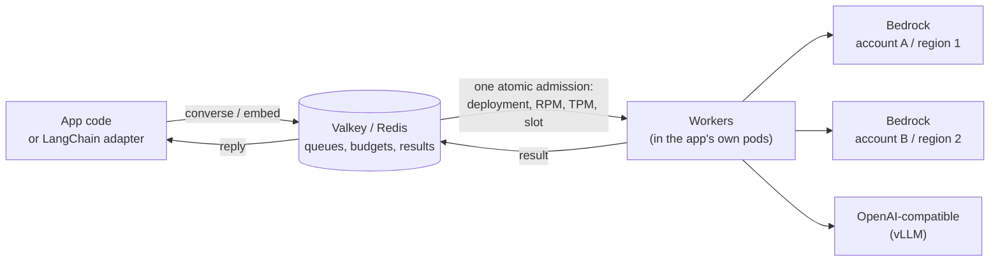

# llm-queue

[](https://pypi.org/project/llm-queue/)
[](https://pypi.org/project/llm-queue/)
[](https://github.com/techiewonk/llm-queue/actions/workflows/ci.yml)
[](https://github.com/techiewonk/llm-queue/blob/main/LICENSE)
[](https://techiewonk.github.io/llm-queue/)

**llm-queue runs your LLM calls through a shared queue on Valkey or Redis, inside your own
pods.** Every call is admitted against RPM, TPM and concurrency budgets per *deployment* (one
model in one account and one region), in one atomic step in the store, so 50 pods share a
budget as exactly as one. Calls wait in order, priority calls go first, and when a region runs
out of budget or breaks, calls spill to fallback regions and fallback models by rule. It works
with Amazon Bedrock and OpenAI-compatible servers (such as vLLM), and with LangChain.

## Why llm-queue

- **Budgets that hold across pods, accounts and regions.** RPM, TPM (output tokens weighted,
  cache reads optional) and concurrency per deployment, budgets shared by an account, smooth or
  calendar-minute windows. Measured on fakellm: 1,800 of 1,800 calls a minute, held exactly.
- **Priority without starvation.** Priority calls are read first, with a reserved share; normal
  calls keep a minimum share.
- **Fallback by rule.** Confirmed regions first, then fallback regions or inference profiles,
  then fallback models (also across providers: Bedrock and OpenAI-compatible requests are
  converted), each after a cause lasts a set time.
- **At-least-once delivery.** A worker that dies mid-call gives the call to another one; a call
  whose record the store lost is sent again; a request id replays a success and re-runs a
  failure; a cancel stops the call for every caller of its id.
- **Health per deployment.** Circuit breakers, slow-deployment detection, probes, and a
  provider throttle that takes a deployment out for every pod at once.
- **Streaming**, with the same budgets and fallback rules, chunk batching and idle cut-off.
- **Embeddings with codecs** for Titan, Cohere and OpenAI, `register_embedding_family` for a new
  family, batching, and a refused batch split so only the bad text fails.
- **Background jobs** on the same store: deduplicated sends, exponential retries for about an
  hour, dead letters kept 7 days, per-name concurrency.
- **Per-tenant fairness** (off by default): weighted shares with lending, hard per-tenant
  quotas, or round robin between tenants.
- **LangChain adapters** for Bedrock Converse and OpenAI-compatible chat and embeddings, with
  optional token streaming (`queue_streaming=True`).
- **Observability.** CloudWatch EMF or Prometheus metrics (`GET /metrics`), alerts, a status
  API, health and readiness routes, a CLI, and a documented list of every log event.
- **Runs on a shared cache store.** With `LLMQ_KEY_EXPIRY=auto` (the default) llm-queue keeps
  no TTL on the keys it needs when the store's policy is `volatile-*` (ElastiCache's default
  `volatile-lru`), so it can share one Valkey with your app's cache and none of its keys is
  evicted. See [Run on a shared cache store](https://techiewonk.github.io/llm-queue/how-to/shared-cache-store/).
- **Purge as a service.** Delete the store state of removed models, deployments and tenants,
  with dry runs and an audit, from Python, the CLI or HTTP, and automatically after a registry
  change. See [Purge store state](https://techiewonk.github.io/llm-queue/how-to/purge/).
- **One admin API.** Every admin operation (registry, models, deployments, blocks, calls, dead
  letters, jobs, purges, drain) is one method under `llmq.admin`, with the same command in
  `llm-queue` and the same route in the FastAPI router: audited, guarded by read and write
  tokens, and a dry run by default.
- **A live registry.** Accounts, models and every setting live in one JSON document, validated
  with every problem listed at once, published to the store, edited live with an audit trail
  and rolled back; a JSON Schema is printed by `llm-queue registry schema`.

## How it works



Each process is a caller, a worker or both. A caller registers the call and sends it to the
model's queue; a worker takes it, asks the store for a deployment with budget (one Lua script:
deployment, RPM, TPM and a concurrency slot together), calls the provider and stores the
result; the caller wakes up and reads it. There is no separate service to run: only the store.

## Quickstart

```bash
pip install "llm-queue[langchain-aws]"            # Bedrock (+ LangChain)
pip install "llm-queue[openai,langchain-openai]"  # OpenAI-compatible servers (+ LangChain)
pip install "llm-queue[http,metrics]"             # FastAPI routes, Prometheus metrics
pip install "llm-queue[langchain-aws]==0.1.1"     # pinned (no --pre since 0.1.1)
```

Python 3.12 or newer, and Valkey 8 or Redis 7.2+ (one primary, replicas allowed; cluster mode is
not supported). A registry with one model:

```json
{
  "registry_version": 1,
  "accounts": {"aws-main": {"kind": "aws"}},
  "models": {
    "gpt120b": {
      "type": "chat", "provider": "bedrock", "model_id": "openai.gpt-oss-120b-1:0",
      "rpm": 60, "tpm": 100000,
      "deployments": {"aws-main": {"confirmed": ["us-east-1"]}}
    }
  }
}
```

```bash
export LLMQ_ENVIRONMENT=dev                    # unset is strict: TLS store, id salt, key prefix
export LLMQ_STORE_URL=redis://localhost:6379
export LLMQ_REGISTRY_FILE=registry.json
```

```python
import asyncio

from llm_queue import CallFailed, LLMQueue, request_context


async def main() -> None:
    llmq = LLMQueue.from_env()     # reads LLMQ_*
    await llmq.start()             # loads the registry and runs workers in this process
    try:
        request = {"messages": [{"role": "user", "content": [{"text": "Say hello."}]}]}
        with request_context(priority=True, user_id="u-1"):
            reply = await llmq.converse("gpt120b", request)
        print(reply.response["output"]["message"]["content"], reply.meta.deployment)
    except CallFailed as exc:      # exc.kind: rate_limited, model_unavailable, ...
        print(exc.kind, exc.retry_after_secs)
    finally:
        await llmq.stop()


asyncio.run(main())
```

Start one `LLMQueue` per process, after any fork. The
[Getting started](https://techiewonk.github.io/llm-queue/tutorials/getting-started/) tutorial
runs this against a local Valkey and a fake Bedrock, and
[the samples](https://github.com/techiewonk/llm-queue/tree/main/samples) cover streaming,
embeddings, sync code, errors and fallback, jobs, status, LangChain and the HTTP router.

## When to use it

Use llm-queue when several processes or services call the same models and must share their
provider quotas: a per-process rate limiter cannot see the other pods, and a gateway service
adds a network hop and a service to run. llm-queue keeps the calls in your own processes and
needs only the store; measured on fakellm, the queue adds 0-15 ms at p95 over a direct call
([Performance](https://techiewonk.github.io/llm-queue/explanation/performance/)).

It is not the right tool when one process makes a few calls (the provider SDK's retries are
enough), when your store runs in cluster mode, or when you need providers other than Bedrock and
OpenAI-compatible servers without writing a provider (`register_account_kind` and the
[extension points](https://techiewonk.github.io/llm-queue/reference/extension-points/) allow
one). It is a beta: see [STABILITY](https://github.com/techiewonk/llm-queue/blob/main/STABILITY.md).

## Documentation

Full documentation: **https://techiewonk.github.io/llm-queue/**

- [What's new](https://techiewonk.github.io/llm-queue/whats-new/) and
  [Upgrade](https://techiewonk.github.io/llm-queue/how-to/upgrade/)
- [Getting started](https://techiewonk.github.io/llm-queue/tutorials/getting-started/): install, local stack, a registry, the first call
- [How-to guides](https://techiewonk.github.io/llm-queue/how-to/configure/): configure, Bedrock IAM, tune, call, jobs, large results, operate, purge, run on a shared cache store, monitor, share models across services, secure, test, upgrade
- [Explanation](https://techiewonk.github.io/llm-queue/explanation/architecture/): architecture, the life of a call, admission, tenant fairness, failures and recovery
  - [Architecture overview](https://techiewonk.github.io/llm-queue/explanation/architecture/): the parts, caller and worker roles, background loops, state and queue stores
  - [The life of a call](https://techiewonk.github.io/llm-queue/explanation/call-lifecycle/): every flow (queued, stream, embed, direct, fallback, cancel, duplicates, outages, purge, key expiry) with the store keys each step touches
  - [Tested scenarios](https://techiewonk.github.io/llm-queue/explanation/tested-scenarios/): every scenario, gate and drill, what it proves, and the latest measured numbers
- [Reference](https://techiewonk.github.io/llm-queue/reference/configuration/): every setting with its default and range, the registry document and its JSON Schema, environment variables, error kinds, log events, CLI and HTTP, the Python API

Project: [CHANGELOG](https://github.com/techiewonk/llm-queue/blob/main/CHANGELOG.md),
[CONTRIBUTING](https://github.com/techiewonk/llm-queue/blob/main/CONTRIBUTING.md),
[STABILITY](https://github.com/techiewonk/llm-queue/blob/main/STABILITY.md),
[SECURITY](https://github.com/techiewonk/llm-queue/blob/main/SECURITY.md).
