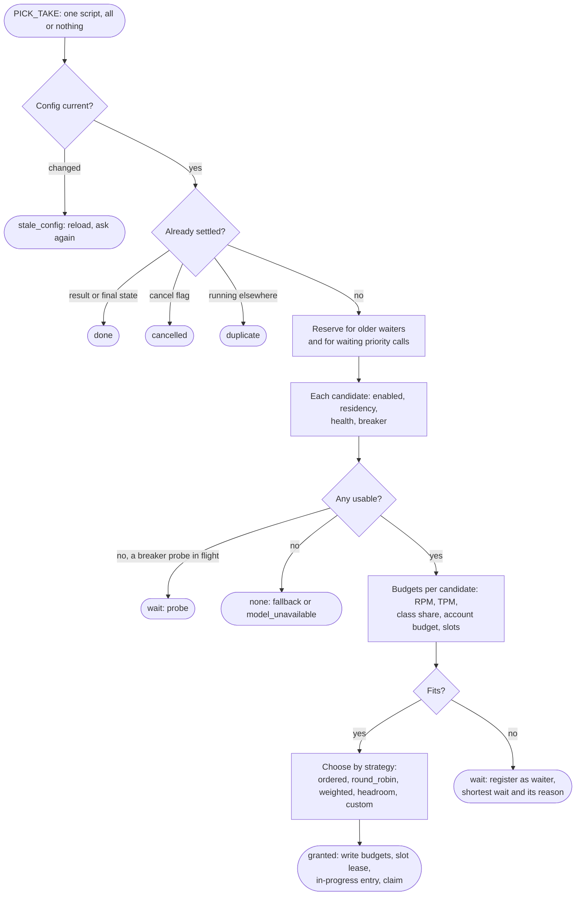

# Admission

How a worker decides, in one atomic store script, whether a call may run now, where, and what it costs.

One loop per model. It reads the priority queue first, up to `min(free worker_slots, 10)`
messages (`RECEIVE`: due returned messages and new ones, oldest first; each taken message is hidden
for `queue.visibility_secs`, its generation goes up; a hold that lapsed counts one failure and the
tenth goes to the dead-letter stream). Idle, the loop blocks on both doorbells (`BLPOP`) for 50 ms,
then for 1 s after 20 empty polls; a send wakes exactly one blocked worker.

For each message: parse (a newer envelope version is returned in 5 s, never dropped); check that a
caller is alive (`CALLERS_ALIVE`; dead callers mean `cancelled` / `caller_gone`); then admission.

**`PICK_TAKE`** (one script, all or nothing) does, in order:

| Step | What happens |
|---|---|
| Config | Reads the model's resolved numbers from `P:{m:A}:cfg` (written with every publish / edit). A change counter different from the worker's means `stale_config` (the worker reloads and asks again); missing numbers mean `no_config` (republish, then `queue_unavailable` or return in 5 s) |
| Settled? | A stored result or a final job state: `done`; a cancel flag: `cancelled`; running under another worker with a fresh heartbeat: `duplicate` (message returned after half a lease). A dead owner's entry and slot are dropped |
| Waiters | Expired waiter entries are cleaned. A foreign (model-fallback) ask is refused `busy` while the model has waiters of its own |
| Reservation | Older waiters of the same class set aside their cost (1 request, their tokens, 1 slot) on every deployment they may use. A normal call also sets aside what waiting priority calls need, on a deployment whose normal use this minute reached `normal_min_share` x rpm |
| Candidates | Each passed candidate is usable unless disabled, its account disabled, blocked, outside residency, auto-disabled (`health`), or its breaker open (after the cooldown one trial call at a time) |
| Budgets | Per candidate: the deployment's `rpm` / `tpm`, the class share (normal at most `1 - priority_reserve`, priority at most `1 - normal_min_share`), and the account's `shared_rpm` / `shared_tpm` (with the account's own `priority_reserve` for normal calls). `smooth` (default): a GCRA clock per budget, cost `60 / limit` s per unit, burst `max(1, floor(limit x rate_burst))`. `fixed`: counters per calendar minute. A call larger than the whole bucket is admitted when the clock is idle |
| Slots | Concurrency per class: `limit` from `P:{m:A}:ac:DEP` (starts at `max_concurrency`, 200 when unset; x0.7 on a throttle at most once a second, +1/limit per success up to the cap); normal slots at most `(1 - priority_reserve)` of it, priority at most `(1 - normal_min_share)` |
| Slow | With 3+ candidates that have `slow_min_samples` (20) latency samples, one above `slow_ratio` (3) x the median and above `slow_min_secs` (5) becomes a last choice |
| Choose | `ordered` (default) stops at the first fitting confirmed candidate; `round_robin`, `weighted` (smooth weighted round robin), `headroom` (`pick`: `percent` = largest free share of the bucket / minute and slots, before the call; `max`; `spread`), `custom:<name>` (the hook orders, then `ordered`). Order of preference: confirmed, then fallback, then last choices (previously failed or slow). A sticky session keeps its deployment while it fits or would wait at most `sticky_move_after_secs` (1 s) |
| Headroom rule | A foreign ask with `require_headroom` needs the chosen deployment's free share at or above `require_headroom_pct` (20 %) |
| Take or wait | Granted: write the budget states and per-minute counters, the slot lease, `P:{m:A}:inprog` and `inprog:ID` (owner, deployment, class, minute, cost), the claim (`job state=running, owner, hb`), the sticky key, the rotation; remove the waiter. Refused: register or refresh the waiter (`wait:p` / `wait:n` scored by queue position, `waitinfo` with cost and usable deployments, expiry 2 s) and return `wait` with the shortest wait and its reason (`rpm`, `tpm`, `account`, `reserve`, `not_head`, `slot`). No usable candidate at all: `none` |

Python then handles the terminal outcomes: an input estimate above every candidate's `tpm` fails
`request_too_large`; `none` turns on fallback regions for the cause `broken` (after
`fallback.after_secs`) or tries fallback models, else `model_unavailable` with `retry_after_secs`
until the next probe; no candidate after the call's filters is `no_deployment`, or
`credentials_unavailable` when only accounts with failed credentials were left.

**Hold.** A refused first attempt is held: the class stops being read (the calls behind it stay
in the queue, untouched), and a task retries `PICK_TAKE` every `min(wait, 1 s)`, extending the
message's visibility each time. Fallback regions join the candidates once the call has waited
`fallback.after_secs` (2) and the cause (`exhausted`, `broken`, `error`) is listed; fallback models
are tried after `model_fallback.after_secs` (5), with the other model's own budgets and estimate,
only while it has no waiters. The `fallback_policy` hook can override both. Past `max_wait_secs`
(counted from the queue position) or the deadline the call ends `expired`, and the caller gets
`rate_limited` with `retry_after_secs`. A call that already waited out `max_wait_secs` unreceived is
refused on arrival rather than started with no time left. When the hold ends the loop is woken.
