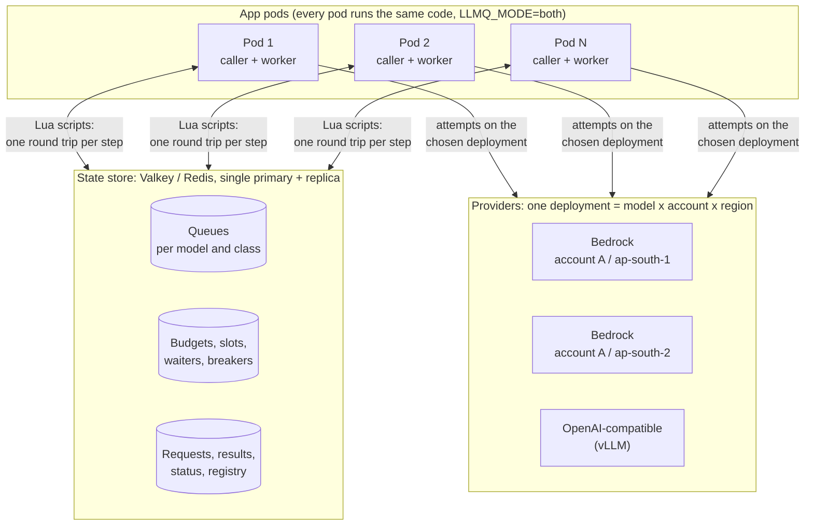
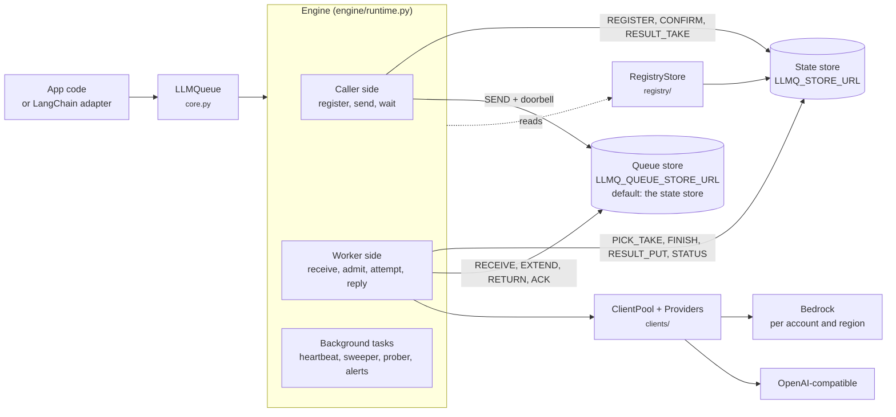

# Architecture overview

How llm-queue works, from the code under `src/llm_queue`. The design and
its decisions are in the [design plan](https://github.com/techiewonk/llm-queue/blob/main/docs/ACCOUNT_ROUTING_PLAN.md); a worked example with
sample data is in the [walkthrough](https://github.com/techiewonk/llm-queue/blob/main/docs/ACCOUNT_ROUTING_WALKTHROUGH.md). Anything marked
**unverified** was not confirmed in the code or by a measurement.

## Purpose and boundaries

The library puts LLM calls (Amazon Bedrock, or OpenAI-compatible servers such as vLLM) through a
queue on a Redis-protocol store (Valkey or Redis), and runs them under RPM / TPM budgets per
**deployment**: one model in one account and one region. It chooses the deployment, keeps waiting
calls in order, spills to fallback regions and fallback models by rule, retries by outcome, tracks
deployment health, and reports status.

| In scope | Out of scope |
|---|---|
| Admission (budgets, concurrency slots, order), balancing, fallback, retries, health | Prompt building, tool execution, agent logic (the app and LangChain do that) |
| Queues, results, request status, streaming to the caller, jobs (`register_job`) | A general task queue (jobs are a small add-on: at least once, no LLM budget) |
| Registry of accounts, models and settings, live edits with audit | Provisioning quotas at AWS; IAM; the store itself |
| Metrics (EMF or Prometheus), alerts as gauges and log lines, an HTTP router, a CLI | Dashboards, alert routing |

Every process runs the same code. The worker side runs inside the app's own pods (`LLMQ_MODE=both`,
the default), so there is no separate worker fleet. No process keeps a count of its own: budgets,
slots, waiter order and health live in the store, so 1 pod and 50 pods behave the same.

## Deployment topology

## Components

| Module | Role |
|---|---|
| `core.py` | Front door `LLMQueue`: `from_env`, `start`, `pause_receiving`, `stop`, `converse` / `chat` / `call`, `converse_stream` (= `chat_stream`), `embed`, `*_sync` (direct path on a private loop and engine), `register_job` / `send_job`, `cancel`, `status`, `request_status`, `health`, `registry`, `http_router` |
| `engine/runtime.py` | `Engine`: caller (register, send, wait), worker loops, held calls, attempts, retries, fallback, direct path, `store_down`, cancel, every background task |
| `engine/_admission_lua.py`, `engine/admission.py` | Lua `PICK_TAKE`, `FINISH`, `UNDO`, `RENEW`, `SWEEP`, `REREGISTER` and their Python wrapper |
| `engine/queue.py` | `StreamQueues`: a queue on a stream with visibility, generation, failures and dead letters (`SEND`, `RECEIVE`, `RETURN`, `EXTEND`, `FAIL`, `ACK`, `DEPTH`, `REDRIVE`), doorbells |
| `engine/requests.py` | `RequestStore`: claim record, callers set, result, status (`REGISTER`, `CONFIRM`, `ABANDON`, `RESULT_PUT`, `RESULT_TAKE`, `STATUS_SET`, `CALLERS_ALIVE`) |
| `engine/streaming.py` | `ChunkWriter` (worker) and `ChunkReader` (one per caller process) over `P:{r:ID}:chunks` |
| `engine/status.py` | `StatusReader` (one `_MODEL_STATUS` script per model) and `AlertEvaluator` |
| `engine/health.py` | Target-error counting, auto-disable, probe outcomes (`RECORD`, `PROBED`) |
| `engine/tokens.py`, `engine/inference.py` | Token estimate and refund rule; inference defaults / limits in the provider's request shape |
| `engine/envelope.py` | Message format v2 (`Envelope`), `Reply`, `Meta` |
| `engine/settings.py` | `InfraSettings.from_env`: the `LLMQ_*` process settings |
| `engine/store_client.py` | One store client factory with the failover options |
| `engine/http.py`, `engine/cli.py` | FastAPI router (extra `http`); the `llm-queue` command |
| `engine/jobs.py`, `engine/embed.py`, `engine/offload.py`, `engine/metrics.py`, `engine/hooks.py` | Jobs; embedding batching; large results in S3; EMF / Prometheus sinks; named hooks |
| `registry/` | `settings.py` (one table of every setting: levels, check, default), `schema.py` (build with every problem listed), `validate.py` (cross-field checks), `resolve.py` (`ResolvedRegistry`: deployments, effective values with their level), `store.py` + `_lua.py` (publish, live edit, audit, rollback, reload) |
| `clients/` | `ClientPool` (one aiobotocore client per account and region, SDK retries and parameter validation off; assume-role sessions `llmq-<env>-<pod>`, 1 h, refreshed by aiobotocore), `Providers` (Bedrock `converse` over ConverseStream, `invoke_model`; OpenAI chat over SSE, embeddings), attempt timers |
| `langchain/`, `http_transport.py` | `QueuedChatBedrockConverse`, `QueuedBedrockEmbeddings`, `QueuedChatOpenAI`, `QueuedOpenAIEmbeddings` (the OpenAI ones through an httpx transport that answers the SDK in process) |
| `ids.py`, `context.py` | UUIDv7 ids (32 hex); `request_context(priority, session_id, user_id, tenant_id)` |
