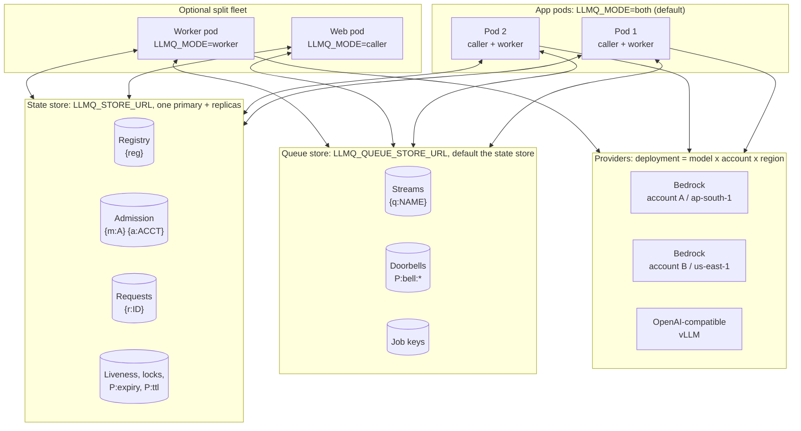
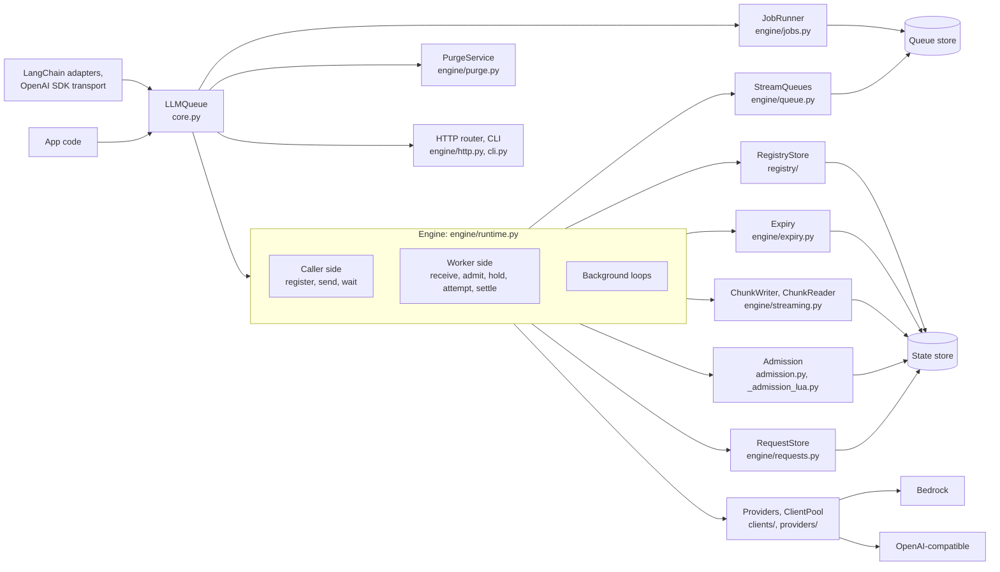

# Architecture overview

How llm-queue is built, from the code under `src/llm_queue`: the parts, which process runs
which part, what each one keeps in the store, and the rules they all follow. Read this page
first; the pages it links go one level deeper. Anything marked **unverified** was not
confirmed in the code or by a measurement.

| To learn | Read |
|---|---|
| Every flow step by step (queued call, stream, embed, direct path, fallback, cancel, outages...) | [The life of a call](call-lifecycle.md) |
| How one admission decision is made | [Admission](admission.md) |
| Attempts, retries, throttles, token estimates | [Attempts and retries](attempts.md) |
| Breaker, store outages and every failure row | [Failures and recovery](resilience.md) |
| Every key in the store | [Storage](storage.md) and [Store keys](../reference/store-keys.md) |
| What is tested and measured, and how | [Tested scenarios](tested-scenarios.md) |

## Purpose and boundaries

The library puts LLM calls (Amazon Bedrock, or OpenAI-compatible servers such as vLLM) through a
queue on a Redis-protocol store (Valkey or Redis), and runs them under RPM / TPM budgets per
**deployment**: one model in one account and one region. It chooses the deployment, keeps waiting
calls in order, spills to fallback regions and fallback models by rule, retries by outcome, tracks
deployment health, and reports status.

| In scope | Out of scope |
|---|---|
| Admission (budgets, concurrency slots, order), balancing, fallback, retries, health | Prompt building, tool execution, agent logic (the app and LangChain do that) |
| Queues, results, request status, streaming to the caller, jobs (`register_job`) | A general task queue (jobs are a small add-on: at least once, no LLM budget) |
| Registry of accounts, models and settings, live edits with audit, purge of removed state | Provisioning quotas at AWS; IAM; the store itself |
| Metrics (EMF or Prometheus), alerts as gauges and log lines, an HTTP router, a CLI | Dashboards, alert routing |

## Five rules everything follows

1. **No process keeps a count of its own.** Budgets, slots, waiter order, breakers, health and
   results live in the store and change only inside Lua scripts, one round trip per step. One
   pod and fifty pods behave the same.
2. **Store time is the only clock.** Every script reads `TIME`; a process keeps an offset
   (`StoreClock`, resynced by every heartbeat). A call's queue position is the stream id the
   store gave it, and its deadline counts from there.
3. **One deadline per call.** `timeout_secs` (plus `caller_margin_secs`, 5 s, on the caller
   side) bounds the whole call, whatever path it takes: queue, hold, retries, fallback, a store
   outage.
4. **At least once, answered once.** A message can be delivered again (visibility lapses, a
   worker dies), but the claim record `P:{r:ID}:job` makes a second copy a `duplicate` while
   the first runs, and a stored result is replayed rather than recomputed. Only a success is
   replayed; an id whose last run failed, expired or was cancelled runs again.
5. **Cancel wins.** A cancel of an id stops it for every caller in every process, and refuses
   later attaches to the same id while it is pending.

## Topology

Every process runs the same code. By default (`LLMQ_MODE=both`) the worker side runs inside the
app's own pods, so there is no separate worker fleet. A fleet may also split: web pods as
callers only, worker pods that only serve.

A caller-only pod still calls providers in three cases: sync calls, calls routed direct (see
[Direct path](call-lifecycle.md#4-direct-path)), and `static_cap` during a store outage.

## Roles: `LLMQ_MODE`

`LLMQueue.start()` starts the engine with `worker = mode in (both, worker)` and
`caller = mode in (both, caller)` (`core.py`). The role decides which background loops run.

| | `both` (default) | `caller` | `worker` |
|---|---|---|---|
| Makes calls (`converse`, `embed`, `send_job`, `cancel`, `status`) | yes | yes | yes (a job that embeds, a tool) |
| Result wake-ups (`_result_reader`, `_result_sweep`) | yes | yes | yes (since 0.1.1: before, a worker-only process saw its own results only at the 5 s `poll_secs` safety net) |
| Receive loops, held calls, attempts | yes | no | yes |
| Sweeper (+ auto purge), prober, alerts, cancel reader, client warm-up | yes | no | yes |
| Job runners (`register_job`) | yes | refused (`ConfigError`) | yes |
| Heartbeat, expiry-index sweep, store prober, registry reload, offload check | yes | yes | yes |

A queue that is not started still serves `*_sync` calls: they run on one private event loop per
process with a caller-only engine and a small store pool (20 connections), and always take the
direct path. See [Clients and connections](clients.md#sync-calls).

## Components

### LLMQueue: the front door (`core.py`)

`LLMQueue.from_env()` reads the `LLMQ_*` settings (`InfraSettings.from_env`), the `Tuning`
object (timeouts, pool sizes, loop pacing) and the job settings, builds one metrics sink, and
wires an `Engine` with its store clients, a `RegistryStore` and `Providers(ClientPool(...))`. It
keeps a builder for the caller-only engine of sync calls too.

Its methods are thin: `converse` / `chat` / `call`, `converse_stream` / `chat_stream`, `embed`,
the `*_sync` twins, `register_job` / `send_job`, `status`, `request_status`, `health`,
`describe`, `admin` (every admin operation: registry, models, deployments, blocks, requests,
dead letters, jobs, purges, drain), `http_router`, `pause_receiving` / `resume_receiving` /
`drain` and `stop`. It guards the misuses that would otherwise hang: a call from another event loop, from a
forked child, or after `stop()` raises `LLMQueueError`
([One LLMQueue per process](clients.md#one-llmqueue-per-process)). The first started queue is
the LangChain default.

### Engine (`engine/runtime.py`)

One `Engine` per started queue holds both halves of the process:

- **Caller side.** `call()` resolves the model alias (a model disabled at model level goes to
  its first usable `model_fallback` model), checks `max_message_bytes`, builds the `Envelope`,
  applies the `admission` hook, picks the route (queued or direct), registers the request, sends
  the message, then waits for a pub/sub wake-up and reads the result. `stream()` runs the same
  call with `stream=True` and reads the chunk stream. One deadline covers it all; the
  `store_down` rule handles an unreachable state store.
- **Worker side.** One receive loop per model (`_model_loop`) reads the priority queue first,
  then the normal one, and admits each message with `PICK_TAKE`. A refused call is **held**: its
  class (priority or normal) of that model stops being read on this worker while a `_hold` task
  retries admission. A granted call runs in a `_run` task: attempts, retries, fallback, then the
  settle (result, status, ack, refund).
- **Background loops.** See [Background loops by role](#background-loops-by-role).

Per process it keeps only work in hand: held calls (`_held`), worker slots per model, futures of
waiting callers, the outage memos. Nothing it keeps is a budget.

### Registry: store and resolution (`registry/`)

The registry document (accounts, models, deployments, settings, routing switches) is JSON,
validated with every problem listed (`schema.py`, `validate.py`; one table of every setting in
`settings.py`). `resolve.py` turns it into a `ResolvedRegistry`: the deployments of each model
(model x account x region, in the groups `confirmed` and `fallback`) and each setting's
effective value, taken from the most specific level that sets it (deployment, model, account,
`defaults`, library default; some object settings merge key by key).

`RegistryStore` keeps the document in the state store:

| Step | What happens |
|---|---|
| `boot()` at start | Publishes the process's own document by the version rule (see [Many services, one model](../how-to/share-models.md#the-registry-version-rule)), then loads what is live. Store unreachable, or the stored document refused (invalid, or `min_lib_version` above this library): the pod runs on its own document |
| `PUBLISH` / `EDIT` (Lua, `registry/_lua.py`) | One script stores the document, `P:{reg}:meta` (version, hash, change counter), an audit entry and each model's resolved admission numbers in `P:{m:A}:cfg`. Compare-and-set on the change counter. Routing blocks and the kill switch set live survive a publish |
| `run()`: the reload loop | Every `LLMQ_CFG_RELOAD_SECS` (30 s): reload; republish its own document when the stored one was lost (store reset) or is invalid and not newer. After failures the wait doubles up to 30 s |
| `stale_config` | `PICK_TAKE` compares the change counter in `cfg` with the worker's; a mismatch makes the worker reload once (one reload in flight per process) and ask again |

Admission scripts never parse the document: they read `P:{m:A}:cfg`.

### Admission (`engine/admission.py`, `engine/_admission_lua.py`)

Seven scripts hold every budget decision. Details in [Admission](admission.md).

| Script | Runs | Does |
|---|---|---|
| `PICK_TAKE` | Every admission try (receive, hold, direct, fallback ask) | Checks config, settled state, cancel, a duplicate run; caller liveness on the first ask; reserves for older waiters and waiting priority calls; filters candidates (enabled, residency, health, breaker); checks RPM / TPM / account budgets and concurrency slots; chooses by strategy; on grant writes budgets, slot lease, in-progress entry, the claim, sticky and rotation keys; on refusal registers a waiter |
| `FINISH` | After every attempt outcome | Settles a grant: refund to real usage (or all, on a throttle), release the slot, learn (limiter, breaker, latency, throttle window) |
| `UNDO`, `RELEASE` | Give-back (shutdown, worker error) | Refund and release the claim to `queued`, so another pod's receive is granted at once |
| `RENEW` | Heartbeat, every `LLMQ_LEASE_SECS` / 3 | Extends every slot lease and in-progress entry this process owns, the claims of held calls, the caller liveness key; reads the epoch; reports grants the store lost |
| `SWEEP` | Worker sweeper, one process, every 10 s | Drops slots and in-progress entries whose owner's lease lapsed (no refund: the budget was spent) |
| `REREGISTER` | After a store reset or a lost grant | Writes this process's running grants back |

`_SETTLE` is shared by `FINISH` and `SETTLE_DONE`, and `_TENANT` adds
[tenant fairness](fairness.md) when a model turns it on.

### Queues: streams and doorbells (`engine/queue.py`)

`StreamQueues` puts a queue on a Valkey stream with its side keys under one hash tag
`{q:NAME}`: `s` (stream), `vis` (hidden until), `gen` (receive generation), `fails`, `st`
(held / returned), `meta` (receive cursor), `dlq` (dead letters). Each model has two queues,
`<queue_prefix>llm-<alias>` and `...-priority` (or the model's `queue.name`).

| Script | Does |
|---|---|
| `SEND` | `XADD` (refused above `max_waiting`), trim to `retention_secs`, push one token on the doorbell `P:bell:NAME` |
| `RECEIVE_FIRST` | Reads the priority queue, then the normal one, up to `min(free slots, 10)`; due returned messages first; hides each for `visibility_secs` and bumps its generation; counts a failure for a hold that lapsed and dead-letters at `max_receives`; writes a receive claim `P:rcv:WORKER:ALIAS` so a lost reply can be reclaimed |
| `EXTEND`, `EXTEND_MANY` | Keep a held or running message hidden (holds, heartbeat) |
| `RETURN` | Back to the queue now (or after a delay), no failure counted |
| `FAIL` | Failure +1, back later; dead letter at `max_receives` (10) |
| `ACK` | Delete the message, only with the current generation: a stale worker cannot ack another's receive |
| `DEPTH`, `TRIM_DEAD(_MANY)`, `REDRIVE`, `RECLAIM`, `RING` | Status depth, dead-letter retention, redrive, reclaim a lost receive, push a doorbell token back |

**Doorbells.** An idle receive loop blocks on `BLPOP` over its two doorbell lists for 50 ms,
then for 1 s after 20 empty polls. A send pushes one token, so one idle worker wakes per call. A
worker that took a token it cannot serve (no free slot, or that class is held) pushes it back so
another pod wakes. A busy loop never waits.

### Request records and results (`engine/requests.py`)

`RequestStore` keeps everything about one request id under `{r:ID}`: `job` (the claim record:
state, user and params hashes, caller, `confirmed`, owner and heartbeat while running),
`callers` (processes waiting on it), `status`, `res` (the result), `cancel`, `chunks`.

| Script | Side | Does |
|---|---|---|
| `REGISTER` | caller | Creates the record, or reports `attached`, `done`, `expired`, `cancelled`, `conflict` or `takeover`; refreshes the caller liveness key `P:caller:WORKER` |
| `REGISTER_SEND` | caller | `REGISTER` + `SEND` + `CONFIRM` in one script, when the queues share the state store (and no replica wait is set) |
| `CONFIRM`, `ABANDON` | caller | The send happened: the record lives to the deadline + the status TTL. The send failed: drop the unconfirmed record |
| `RESULT_PUT` | worker | Write `res` once, mark the job final, `PUBLISH` the id on each caller's `P:done:<caller>` |
| `SETTLE_DONE` | worker | Result, status, `ACK` and `FINISH` (under `pcall`) in one script, when the queues share the state store |
| `RESULT_TAKE` | caller | Read the result; a library-made id's result is cut to 2 s at once (or `LLMQ_RESULT_DEDUPE_SECS`) |
| `STATUS_SET`, `CANCEL`, `CALLERS_ALIVE` | both | Status fields; cancel flag + `PUBLISH P:cancel`; is any caller alive |

Results above `offload_bytes` go to S3 through a `ResultOffload` (`engine/offload.py`); the
store keeps a marker. Every process needs the same offload: a pod without it refuses to start
while `P:offload` says the fleet offloads. See [Keep large results in S3](../how-to/large-results.md).

### Client pool and providers (`clients/`, `providers/`)

- **`ClientHub`** (`clients/hub.py`): one SDK client per (event loop, credential identity,
  region, options) per process, reference-counted and shared by every queue and by the sync
  engine. Never a client per model. See [Clients and connections](clients.md).
- **`ClientPool`** (`clients/pool.py`): hands out clients for a `Route` (account, region, model
  id or inference profile). Assume-role sessions `llmq-<env>-<pod>`, refreshed 5 minutes before
  expiry; pool size from the registry's slots; clients with failed credentials evicted.
- **Bedrock** (`clients/providers.py`, `clients/bedrock_http.py`): `BedrockHTTP` is the default
  transport (`BedrockOptions.transport = "aiohttp"`): botocore only resolves credentials, signs
  (SigV4) and frames event streams; the body is built and parsed with orjson and sent on the
  client's own aiohttp session. Measured on fakellm for 0.1.0b2: +78-104 % calls/s at 20 and 200
  concurrent Converse calls, client CPU per call -55-61 %, memory per client 669 KiB to 87 KiB
  (module docstring and CHANGELOG). `transport="botocore"` uses aiobotocore clients instead. Chat uses plain Converse
  unless the call streams or the model sets `converse_api: "stream"`; embeddings use InvokeModel.
  See [Bedrock APIs and IAM](../how-to/bedrock.md).
- **OpenAI-compatible**: chat always streams underneath (so the attempt timers apply) and is
  assembled into a `chat.completion`. Sent through the SDK's aiohttp client by default
  (`Tuning.openai.http`), httpx when that is not installed or asked for.
- **Error classification** (`providers/classify.py`): maps SDK errors to families (throttle,
  retryable, fatal; then auth, target, invalid request, context length, connection reset), so a
  real service and a fake that spell a failure differently are read alike. `register_provider`
  adds a provider kind.
- **Shape conversion** (`engine/shapes.py`): a fallback model of the other provider is called in
  its own shape. The worker converts a Converse request to OpenAI chat (or back) and the reply
  back to the caller's shape. Unconvertible requests (document or video blocks, image URLs,
  images inside tool results) skip that target; streams are never converted.

### Embeddings (`engine/embed.py`, `providers/embeddings.py`)

`embed()` checks the texts, splits them into batches of `embed_batch_size` (capped by the
family's codec), runs up to 16 batches at once, each as one ordinary queued call with
`vectors=True`, and returns the vectors in input order. An `EmbeddingCodec` holds what differs
between families: texts per call (Titan 1, Cohere 96, OpenAI 2048), the longest text, the
request body and how the reply becomes vectors. `codec_for` picks one by the registry `family`,
then the provider, then the model id; `register_embedding_family` adds one. The worker stores a
batch's vectors packed (base64 of float32, or float64 when float32 is not exact), 3x smaller
than the JSON body (gate B97). A batch refused for its content is split in halves until the bad
text alone fails.

### Streaming (`engine/streaming.py`)

The worker's `ChunkWriter` appends `{seq, att, t: chunk|end|error, d}` entries to
`P:{r:ID}:chunks` (the first event at once, later ones batched by `stream_flush_ms`). Each
caller process runs one shared `ChunkReader` that `XREAD`s every open stream (block 100 ms) and
is woken by `P:chunkwake:WORKER` when a stream opens. See [Streaming](streaming.md).

### Jobs (`engine/jobs.py`)

`register_job(name, fn)` and `send_job(name, payload)`: a small at-least-once job queue on the
same stream queues (`<queue_prefix>jobs-<name>`, in the queue store). One `JobRunner` loop per
job name sleeps on the queue's doorbell (up to 0.5 s), runs up to `concurrency` jobs, keeps them
visible, retries a failure after 5 s doubling to 300 s for about an hour, then dead-letters it
(kept 7 days). Jobs take no LLM budget; the LLM calls they make do. See
[Run background jobs](../how-to/jobs.md).

### Status, alerts, metrics and logs

- `StatusReader` (`engine/status.py`): one `_MODEL_STATUS` script per model returns waiting and
  running calls, and per deployment the RPM / TPM used and left, concurrency, breaker, health,
  latency and throttles. `request_status()` reads one call.
- `AlertEvaluator`: state alerts as gauges every 30 s, a log line once per flip, the last state
  in `P:alert:NAME:LABELS`; one process evaluates (lock `P:lock:alerts`).
- Metrics (`engine/metrics.py`): `EmfSink` (CloudWatch embedded metric format, the default) or
  `PrometheusSink`. One table, `METRICS`, lists every metric; labels come from the registry and
  bounded enums, never a request id, user or free text. See [Monitor](../how-to/monitor.md).
- Logs (`_logging.py`): structlog key-value events on top of stdlib `logging`, so the app keeps
  its levels and handlers. Ids are hashed with `LLMQ_ID_HASH_SALT`; prompt text is never logged.
  Outage lines are rate-limited per event and key (`LogLimiter`). Every event is listed in
  [Log events](../reference/log-events.md).

### HTTP router, CLI and adapters

- Admin API (`engine/admin/`): one operations table (`engine/admin/ops.py`) lists every admin
  operation; `llmq.admin` (`AdminServices`) holds one service method per operation, and the
  `llm-queue` command and the FastAPI routes of `llmq.http_router()` (extra `http`) are
  generated from the table and call the same methods. Every write takes an actor, is audited,
  and is a dry run by default. Health, readiness and `/metrics` are open; every other route
  needs a token or the app's `dependencies`. See [Admin API](../reference/admin-api.md).
- `langchain/`: `QueuedChatBedrockConverse`, `QueuedBedrockEmbeddings`, `QueuedChatOpenAI`,
  `QueuedOpenAIEmbeddings`. The OpenAI ones use `http_transport.py`, an httpx transport that
  answers the OpenAI SDK in process with `llmq.chat` and `llmq.embed`.
- `engine/hooks.py`: named hooks registered at import (`admission`, `fallback_policy`, a
  `custom:<name>` strategy, `probe`; token estimators). See
  [Extension points](../reference/extension-points.md).

### Purge service (`engine/purge.py`)

`PurgeService` deletes the store state of a removed model or deployment, or of one tenant, with
a dry run by default, an audit entry and a `PurgeReport`. `llmq.admin.purge`, the CLI and the
HTTP routes all call it. **Auto purge** (`LLMQ_AUTO_PURGE`, on by default) runs in the worker
sweeper's loop: when a reload drops a model or deployment, one worker (lock `P:lock:purge`)
schedules it in `P:purge` with a grace (`LLMQ_PURGE_GRACE_SECS`, 900 s) and purges it when due if
it is still absent. See [Purge store state](../how-to/purge.md) and the
[purge flow](call-lifecycle.md#15-purge).

### Key expiry (`engine/expiry.py`)

Every key with a lifetime goes through one `Expiry` helper (Python) or `X.expire` / `X.set`
(Lua), so the same write works in both modes:

- **`native`**: Valkey TTLs. Needs `maxmemory-policy noeviction`.
- **`swept`**: no TTL; the expire-at goes into the zset `P:ttl` and `TTL_SWEEP` deletes due
  keys, up to one sweep (10 s) late. A `volatile-*` store cannot evict them.

The mode belongs to the store: `P:expiry` holds it (missing means `native`) and every script
reads it. With `LLMQ_KEY_EXPIRY=auto` the engine reads each store's eviction policy at start and
every minute, and picks `native` for `noeviction`, `swept` otherwise. A state store and a separate
queue store each have their own `P:expiry` and `P:ttl`. See
[Key expiry modes](storage.md#key-expiry-modes) and the
[sweep flow](call-lifecycle.md#16-key-expiry-sweep).

## Background loops by role

What `Engine.start()` and `LLMQueue.start()` launch (`runtime.py`, `core.py`). A loop with a
lock takes a store lock first, so across the fleet only one process runs it at a time. Cadences
are defaults. [Background tasks](background.md) has more on each.

| Loop | Role | Cadence | Lock | Does |
|---|---|---|---|---|
| `_heartbeat` | all | `LLMQ_LEASE_SECS` / 3 (20 s), shorter for short `visibility_secs`, 1 s after a store error | - | `RENEW` grants, held claims and the caller key (one script); `EXTEND_MANY` held messages; clock sync; epoch and `master_replid` checks (store reset or promotion); safety-net cancel check; loops for models a reload added; free stuck holds |
| `_ttl_sweeper` | all | `sweep_secs` (10 s) | `P:lock:ttlsweep` | `TTL_SWEEP` on each store's `P:ttl`: up to 500 keys a run, up to 100 runs a sweep |
| `_store_prober` | all | 5 s; eviction policy read again every 12th round (1 min) | - | Write probe per store for readiness (`ok`, `read_only`, `down`); ends the outage memos; publishes the key expiry mode again |
| `registry_reload` (`RegistryStore.run`) | all | `LLMQ_CFG_RELOAD_SECS` (30 s), back-off on failure | - | Reload; republish its own document when the stored one is lost or invalid |
| `offload_lifecycle` | all | once at start | - | Warn when the S3 bucket has no expiry rule for the offload prefix |
| `_result_reader` | every role | pub/sub on `P:done:WORKER` | - | Wake waiting callers; a re-subscribe wakes all; a ping every 5 s, reset after two silent pings |
| `_result_sweep` | every role | 5 s | - | One `_RESULTS_EXIST` script per 500 waiting ids finds results pub/sub missed; three such sweeps in a row reset the reader |
| `ChunkReader` | caller | while streams are open, `XREAD` block 100 ms | - | Deliver the chunks of every open stream |
| `_model_loop` (one per model) | worker | busy: no wait; idle: doorbell `BLPOP` 50 ms, 1 s after 20 empty polls | - | Receive and admit |
| `_hold` (one per held call) | worker | `min(wait, 1 s)` | - | `EXTEND`, fallback checks, `PICK_TAKE` again |
| `_sweeper` | worker | 10 s | `P:lock:sweep`; the purge tick takes `P:lock:purge` | Auto purge tick; `SWEEP` dead owners per model; trim dead letters |
| `_prober` | worker | 5 s | `P:lock:probe`, one lock for all models (stretched to 35 s while a probe runs) | Probe auto-disabled deployments that are due |
| `_alert_loop` | worker | 30 s | `P:lock:alerts` (45 s, renewed by the holder) | Status report, alert gauges, a log line per flip |
| `_cancel_reader` | worker | pub/sub on `P:cancel` | - | Cancel running attempts; reads the cancel keys after a re-subscribe |
| `_warm_clients` | worker | once at start; `HEAD` every 10 s per client | - | Build every Bedrock client concurrently, keep connections warm |
| `JobRunner` (one per job name) | worker | doorbell, up to 0.5 s | - | Run jobs |
| `DrainWatcher` (`drain.py`) | all, when `LLMQ_DRAIN_FILE` is set | `LLMQ_DRAIN_POLL_SECS` (1 s) | - | `stat` the drain file; a new one (or a newer mtime) calls `pause_receiving()`; stopped first in `stop()` |
| `drain_hand_back` (one per pause) | worker | once, after `pause_receiving()` | - | Return held calls to the queue (`LLMQ_DRAIN_HANDBACK_ENABLED`); `stop()` waits for it |

A loop that dies is logged (`background_loop_died`), counted (`llmq_loop_died_total`) and makes
liveness false; a model loop is started again by the next heartbeat.

## Store usage: state store and queue store

Two URLs, one store by default. `LLMQ_QUEUE_STORE_URL` moves the queue traffic to a second store.

| Store | Holds | Scripts |
|---|---|---|
| State (`LLMQ_STORE_URL`) | Registry `{reg}`; admission `{m:A}` and `{a:ACCT}`; requests `{r:ID}` (job, callers, status, result, cancel, chunks); liveness `P:caller:*`; locks; alerts; `P:epoch`, `P:purge`, `P:offload`; its own `P:expiry` and `P:ttl` | `PUBLISH`, `EDIT`, `PICK_TAKE`, `FINISH`, `UNDO`, `RENEW`, `SWEEP`, `REREGISTER`, `REGISTER`, `CONFIRM`, `RESULT_PUT`, `RESULT_TAKE`, `STATUS_SET`, `CANCEL`, `_MODEL_STATUS`, `TTL_SWEEP` |
| Queue (`LLMQ_QUEUE_STORE_URL`, default the state store) | Streams `{q:NAME}`; doorbells `P:bell:*`; receive claims `P:rcv:*`; job keys `P:jobs:*` and `{q:jobs-*}:*`; its own health probe key, `P:expiry` and `P:ttl` | `SEND`, `RECEIVE_FIRST`, `EXTEND(_MANY)`, `RETURN`, `FAIL`, `ACK`, `DEPTH`, `TRIM_DEAD`, `REDRIVE`, `RECLAIM`, `TTL_SWEEP` |

With one store, a call's send is `REGISTER_SEND` (one script instead of three) and a success
settles with `SETTLE_DONE` (one script instead of `RESULT_PUT`, `ACK` and `FINISH`). A separate
queue store that fails sends for `LLMQ_QUEUE_FAILOVER_SECS` (5 s) makes calls run direct.

Store requirements: one primary with replicas (cluster mode is refused at `start()`: scripts
cross hash tags), Lua, pub/sub and `BLPOP`, and an eviction policy that cannot evict the
library's keys (`noeviction`, or `volatile-*` with key expiry `swept`). Measured: about 11 store
calls per queued call ([Performance](performance.md)). See
[Store usage](storage.md#store-usage) and [Store requirements](storage.md#store-requirements).

## Module map

| Module | Role |
|---|---|
| `core.py` | `LLMQueue`: `from_env`, `start`, `pause_receiving`, `stop`, calls, streams, `embed`, `*_sync` (private loop, caller-only engine), jobs, status, `health`, `describe`, `admin`, `http_router`, drain; the fork and loop guards |
| `engine/admin/` | The operations table (`ops.py`) and `AdminServices`: registry, audit, models, deployments, blocks, requests, tenants, queues, dead letters, jobs, purges, status, drain |
| `engine/audit.py` | `Audit`: one audit entry per admin write |
| `engine/runtime.py` | `Engine`: caller (register, send, wait, `store_down`), worker (receive, admit, hold, run, attempts, retries, fallback, settle), direct path, cancel, every background loop |
| `engine/_admission_lua.py`, `engine/admission.py` | `PICK_TAKE`, `FINISH`, `UNDO`, `RELEASE`, `RENEW`, `SWEEP`, `REREGISTER` and their Python wrapper (`Ask`, `Decision`) |
| `engine/queue.py` | `StreamQueues`, doorbells, receive claims, dead letters, `ReplicaWait` |
| `engine/requests.py` | `RequestStore`: claim, callers, result (with offload), status, cancel |
| `engine/streaming.py` | `ChunkWriter`, `ChunkReader`, stream replay |
| `engine/embed.py` | Batching, split on refusal, packed vectors |
| `engine/shapes.py` | Converse to OpenAI chat and back, for cross-provider fallback |
| `engine/status.py`, `engine/health.py` | Status reports and alerts; target-error counting, auto-disable, probes |
| `engine/tokens.py`, `engine/inference.py` | Token estimate and refund rule; inference defaults and limits per provider shape |
| `engine/envelope.py` | Message format v2 (`Envelope`), `Reply`, `Meta` |
| `engine/expiry.py` | `Expiry`, `P:expiry`, `P:ttl`, `TTL_SWEEP`, the eviction policy check |
| `engine/purge.py` | `PurgeService`, auto purge |
| `engine/jobs.py`, `engine/offload.py`, `engine/metrics.py`, `engine/hooks.py` | Jobs; S3 offload; EMF and Prometheus sinks; named hooks |
| `engine/settings.py`, `tuning.py`, `engine/store_client.py`, `engine/keys.py` | `LLMQ_*` settings; `Tuning`; the store client factory (retries, `READONLY` reconnect, TLS checks); key names |
| `engine/http.py`, `engine/cli.py` | The FastAPI routes and the `llm-queue` command, both generated from the operations table |
| `registry/` | `settings.py` (every setting), `schema.py`, `validate.py`, `resolve.py`, `store.py` + `_lua.py` (publish, edit, audit, rollback, reload), `json_schema.py` |
| `clients/` | `ClientHub`, `ClientPool`, `BedrockHTTP` (aiohttp transport), `Providers` (Bedrock, OpenAI-compatible), attempt timers |
| `providers/` | Error classification; embedding codecs |
| `langchain/`, `http_transport.py` | LangChain adapters; the in-process OpenAI SDK transport |
| `_logging.py`, `ids.py`, `context.py`, `errors.py` | Loggers; UUIDv7 ids (32 hex); `request_context(priority, session_id, user_id, tenant_id)`; `CallFailed` and the other errors |
