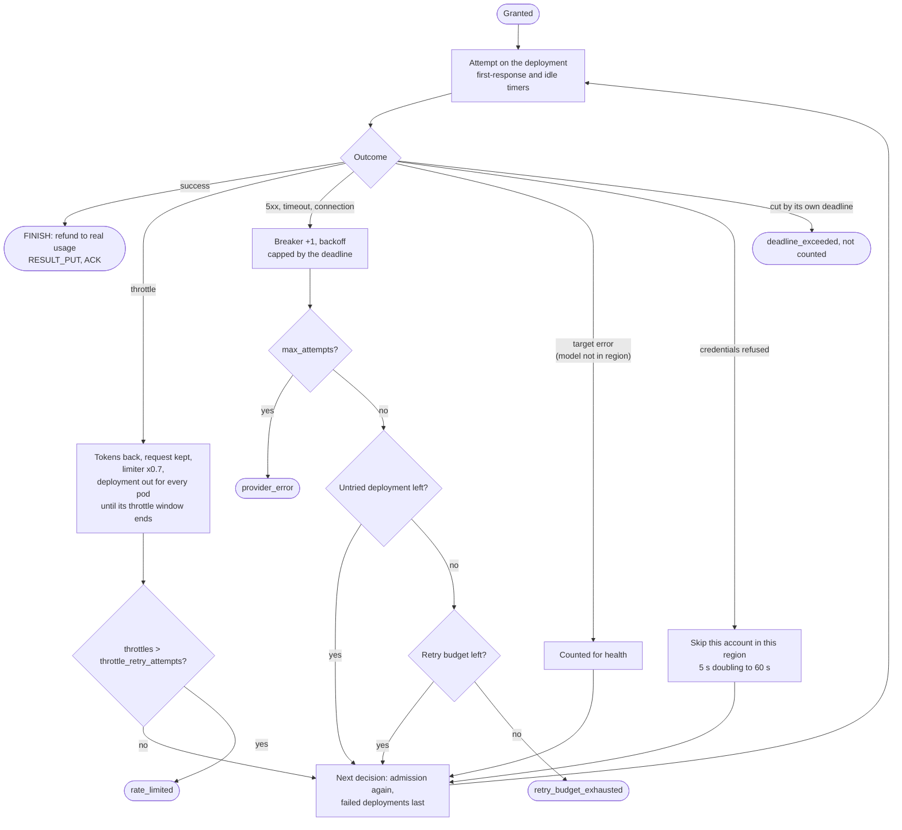
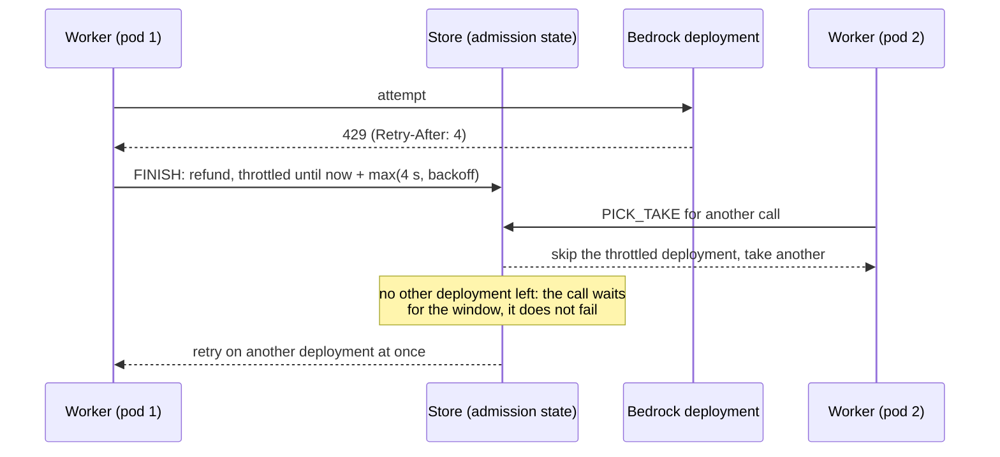

# Attempts and retries

What happens once a call is granted: timers, outcomes, refunds, retries and the retry budget.



A granted call takes a worker slot of its model and runs attempts. Each attempt: request = app
params + `inference` defaults and `inference_limits` at the deployment level + the deployment's
`params`; first-response timer `min(attempt_timeout_secs (60), the time left)`; idle timer
between chunks `stream_idle_secs` (30); an outer timer at the deadline. Any attempt that times
out on its own timer counts against the deployment's breaker, so a region that hangs trips it;
only a cut by the call's own deadline is not counted. For a call to fail over to another
deployment within its time, keep `attempt_timeout_secs` below `timeout_secs` (120).
A non-stream Bedrock chat call uses plain Converse by default, bounded by the attempt timer as a
whole; with the model's `converse_api: "stream"` it uses ConverseStream underneath, so the
first-response and idle timers apply and long answers are not cut (see
[Bedrock APIs and IAM](../how-to/bedrock.md)).

| Outcome | Budgets (`FINISH`) | Learning | Next |
|---|---|---|---|
| Success | TPM corrected to real usage (input + cache writes + output x `tpm_output_weight`; cache reads only with `tpm_count_cached`); no usage reported: estimate kept | limiter +1/limit, breaker closed, target errors cleared, latency EWMA (0.8 / 0.2) | `RESULT_PUT`, status `done`, `ACK` |
| Throttle | every token back; the request stays charged (the provider counted it) | limiter x0.7, throttle counter, the deployment's shared throttle window; never the breaker | another deployment at once, or wait for the window when none is left; more than `throttle_retry_attempts` (6) ends `rate_limited`; counts in the retry budget, not toward `max_attempts` (see [Throttling](#throttling)) |
| 5xx, timeout, connection | output part back, input kept | breaker failures +1 (opens at `breaker_threshold` 5 for `breaker_cooldown_secs` 15) | retry after backoff `retry_base_secs x retry_multiplier^(n-1) x U[1, retry_spread]` (1-2.5 s, 4-10 s, 16-30 s), capped at `retry_max_secs` (30) **and the deadline**; at `max_attempts` (4) `provider_error`; above the per-minute retry budget (`retry_budget_pct` 20 % of first attempts, at least `retry_budget_min` 10) `retry_budget_exhausted` |
| Idle mid-answer | nothing back | as a failure | as a failure |
| Cut by the call's own deadline | nothing back | none (not counted toward breaker or health) | `deadline_exceeded` |
| Target error (access denied, model not in region) | everything back | counted once the outcome is known; a request failing this way on two deployments is the cause and is not counted | next deployment; on the second one `provider_error` |
| Auth / credentials (also bad signature, clock skew, expired token) | everything back | account skipped in this region for 5 s, doubling to 60 s, reset by a success; client dropped | next deployment |
| Connection reset | nothing charged | none: one quick retry inside the attempt when nothing reached the caller | a second reset is a 5xx-type failure |
| Request invalid / context too long | everything back | none (not the provider's fault: no breaker, no health) | `invalid_request` / `context_length_exceeded` |
| Other (validation) | everything back | none | `provider_error` |

Retries, fallback and refunds settle against the estimate that admission charged (model-level
params, cached per registry view). The estimate is characters / 4 of every string in the request
(tool definitions included) plus `max_tokens` (or `default_output_tokens`, 1000) for chat.

## Throttling

A throttle (HTTP 429, `ThrottlingException`) is about the deployment, not the call, so every pod
learns from it at once:



- **Shared window.** The deployment is out for every pod until
  `max(Retry-After, backoff)`. The backoff is jittered and grows per throttle in a row:
  1-2 s, doubling up to 30 s; a success ends the streak (`Tuning.engine.throttle_base_ms`
  1000 and `throttle_max_ms` 30000).
- **Calls move or wait.** Admission skips a throttled deployment; with another usable one the
  call moves at once, with none left it waits for the window within its deadline.
- **Budget.** Every throttle gives its tokens back but keeps the request charged: the
  provider counted the 429 in its minute, and a request given back was sent again in that
  minute (gate BL1 saw 640 calls against rpm 600). It also cuts the learned
  concurrency (x0.7, at most once a second). Throttles count in the retry budget; more than
  `throttle_retry_attempts` (6) on one call ends it `rate_limited` with `retry_after_secs`.
- **Alert.** `quota_above_observed` turns on when throttles come while the deployment still had
  registry budget: the real quota is below the registry's number.

## Token estimates

The estimate is characters / 4 of every text in the request. Binary blocks (`image`,
`document`, `video`, `audio`, and OpenAI `image_url` / `input_audio` / `file`) are not read as
text: their base64 would count as tens of thousands of tokens; each costs a fixed 1,000 tokens
instead (a starting value: a ~1 MP image is about 1,300 tokens on Claude), and the real usage
corrects the budget after the call.

Characters / 4 fits English. Indic (Hindi, Tamil, ...) and CJK scripts take more tokens per
character, so the estimate is low and a deployment may be admitted past its TPM until the
correction. For such a model, register an estimator once at import and name it in the model's
`token_estimator` setting:

```python
from llm_queue import register_token_estimator
from transformers import AutoTokenizer      # or tiktoken, or the model vendor's tokenizer

tok = AutoTokenizer.from_pretrained("my-org/my-model")

def estimate(op: str, params: dict) -> int:
    texts = [b["text"] for m in params.get("messages", []) for b in m.get("content", [])
             if "text" in b]
    return sum(len(tok.encode(t)) for t in texts)

register_token_estimator("hindi", estimate)
```

```json
"models": {"sarvam": {"token_estimator": "hindi", "...": "..."}}
```

The setting is per model (or per deployment); other models keep characters / 4. A name that is
not registered in the process falls back to characters / 4, so register it in every process
that makes calls. Keep the estimator fast: it runs on every call before admission.
