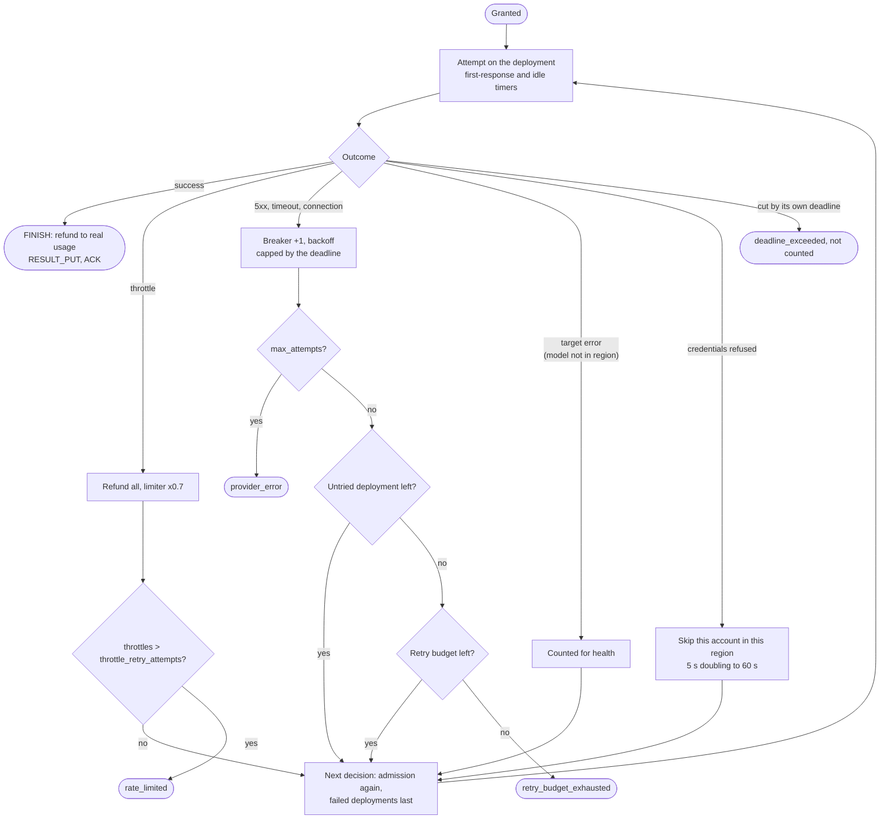

# Attempts and retries

What happens once a call is granted: timers, outcomes, refunds, retries and the retry budget.

A granted call takes a worker slot of its model and runs attempts. Each attempt: request = app
params + `inference` defaults and `inference_limits` at the deployment level + the deployment's
`params`; first-response timer `min(attempt_timeout_secs (60), half the time left on attempt 1,
else all of it)`; idle timer between chunks `stream_idle_secs` (30); an outer timer at the deadline.
Bedrock chat always uses ConverseStream underneath, so long answers are not cut by the first timer.

| Outcome | Budgets (`FINISH`) | Learning | Next |
|---|---|---|---|
| Success | TPM corrected to real usage (input + cache writes + output x `tpm_output_weight`; cache reads only with `tpm_count_cached`); no usage reported: estimate kept | limiter +1/limit, breaker closed, target errors cleared, latency EWMA (0.8 / 0.2) | `RESULT_PUT`, status `done`, `ACK` |
| Throttle | request and every token back | limiter x0.7, throttle counter; never the breaker | retry at once, that deployment a last choice; more than `throttle_retry_attempts` (6) ends `rate_limited`; does not count toward `max_attempts` |
| 5xx, timeout, connection | output part back, input kept | breaker failures +1 (opens at `breaker_threshold` 5 for `breaker_cooldown_secs` 15) | retry after backoff `retry_base_secs x retry_multiplier^(n-1) x U[1, retry_spread]` (1-2.5 s, 4-10 s, 16-30 s), capped at `retry_max_secs` (30) **and the deadline**; at `max_attempts` (4) `provider_error`; above the per-minute retry budget (`retry_budget_pct` 20 % of first attempts, at least `retry_budget_min` 10) `retry_budget_exhausted` |
| Idle mid-answer | nothing back | as a failure | as a failure |
| Cut by the call's own deadline | nothing back | none (not counted toward breaker or health) | `deadline_exceeded` |
| Target error (access denied, model not in region) | everything back | counted once the outcome is known; a request failing this way on two deployments is the cause and is not counted | next deployment; on the second one `provider_error` |
| Auth / credentials | everything back | account skipped in this process for 5 s, doubling to 60 s; client dropped | next deployment |
| Other (validation) | everything back | none | `provider_error` |

Retries, fallback and refunds settle against the estimate that admission charged (model-level
params, cached per registry view). The estimate is characters / 4 of every string in the request
(tool definitions included) plus `max_tokens` (or `default_output_tokens`, 1000) for chat.
