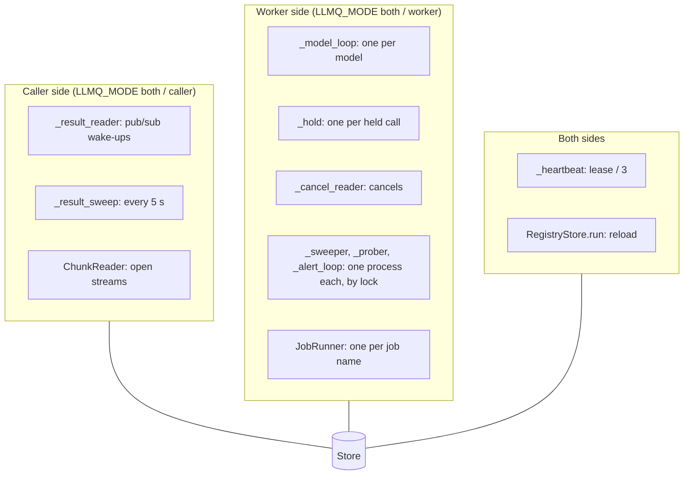

# Background tasks

The loops each process runs besides the calls themselves.

| Task | Side | Cadence | Does |
|---|---|---|---|
| `_model_loop` (one per model) | worker | busy: no wait; idle: doorbell `BLPOP` 50 ms, 1 s after 20 empty polls; held class: local wake event | receive and admit |
| `_hold` (one per held call) | worker | `min(wait, 1 s)` | `EXTEND` + `PICK_TAKE`, fallback checks |
| `_heartbeat` | both | `lease_secs / 3` (20 s), shorter for short `visibility_secs`; 1 s after a store error | caller key, `RENEW` all grants, `EXTEND` each held message, clock sync, epoch check |
| `_sweeper` | worker | 10 s, one process (lock) | `SWEEP`: drop in-progress entries and slots of owners whose lease lapsed (no refund) |
| `_prober` | worker | 5 s, one process per model (lock) | probe auto-disabled deployments that are due (one short real call; a throttle counts as success) |
| `_alert_loop` | worker | 30 s, one process (lock) | status report, alert gauges, a log line per flip |
| `_cancel_reader` | worker | pub/sub | cancel running attempts named on `P:cancel` |
| `_warm_clients` | worker | once at start | build every Bedrock client (first call 1,032 ms before, ~140 ms after) |
| `_result_reader` | caller | pub/sub | wake waiters; on re-subscribe wake all |
| `_result_sweep` | caller | 5 s | one script finds results of all waiting callers |
| `RegistryStore.run` | both | `LLMQ_CFG_RELOAD_SECS` (30) | reload; republish when the stored registry was lost or older |
| `ChunkReader` | caller | while streams are open, `XREAD` block 100 ms | deliver chunks |
| `JobRunner._loop` (one per job name) | worker | receive polls 20 ms to 500 ms | run jobs, keep them visible, fail with 5 s delay |
