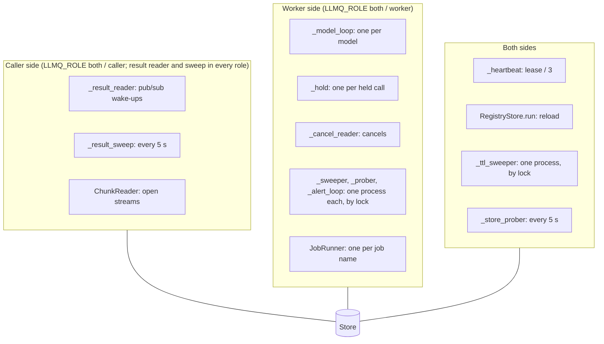

# Background tasks

The loops each process runs besides the calls themselves. Which role starts which loop, and
what each loop touches in the store, is in
[Architecture: background loops by role](architecture.md#background-loops-by-role).

| Task | Side | Cadence | Does |
|---|---|---|---|
| `_model_loop` (one per model) | worker | busy: no wait; idle: doorbell `BLPOP` 50 ms, 1 s after 20 empty polls; held class: local wake event | receive and admit |
| `_hold` (one per held call) | worker | `min(wait, 1 s)` | `EXTEND` + `PICK_TAKE`, fallback checks |
| `_heartbeat` | both | `lease_secs / 3` (20 s), shorter for short `visibility_secs`; 1 s after a store error | caller key, `RENEW` all grants, `EXTEND` each held message, clock sync, epoch check |
| `_sweeper` | worker | 10 s, one process (lock `P:lock:sweep`) | auto purge tick first (its own lock `P:lock:purge`, see [Purge](../how-to/purge.md#automatic-purge)); then `SWEEP`: drop in-progress entries and slots of owners whose lease lapsed (no refund); trim dead letters |
| `_prober` | worker | 5 s, one process for every model (lock `P:lock:probe`, held up to 35 s while a probe runs) | probe auto-disabled deployments that are due (one short real call; a throttle counts as success) |
| `_alert_loop` | worker | 30 s, one process (lock) | status report, alert gauges, a log line per flip |
| `_cancel_reader` | worker | pub/sub | cancel running attempts named on `P:cancel` |
| `_warm_clients` | worker | once at start | build every Bedrock client (first call 1,032 ms before, ~140 ms after) |
| `_result_reader` | every role | pub/sub | wake waiters; on re-subscribe wake all |
| `_result_sweep` | every role | 5 s | one script finds results of all waiting callers |
| `RegistryStore.run` | both | `LLMQ_REGISTRY_RELOAD_SECS` (30) | reload; republish when the stored registry was lost or older |
| `_ttl_sweeper` | both | `sweep_secs` (10 s), one process (lock `P:lock:ttlsweep`) | `TTL_SWEEP`: delete keys due in the expiry index `P:ttl` of each store, in both key expiry modes (see [Key expiry modes](storage.md#key-expiry-modes)) |
| `_store_prober` | both | 5 s; the eviction policy again every minute | a short write per store for readiness; ends the outage memos; publishes the key expiry mode again |
| `offload_lifecycle` | both | once at start | warn when the offload bucket has no expiry rule |
| `ChunkReader` | caller | while streams are open, `XREAD` block 100 ms | deliver chunks |
| `JobRunner._loop` (one per job name) | worker | sleeps on the queue's doorbell, up to 0.5 s | run jobs, keep them visible; a failed job is retried after 5 s doubling to 300 s, for about an hour, then dead-lettered |
