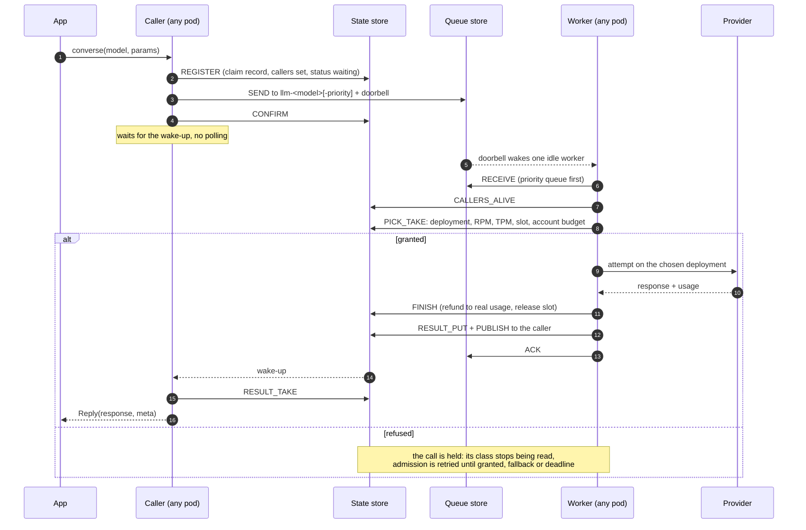
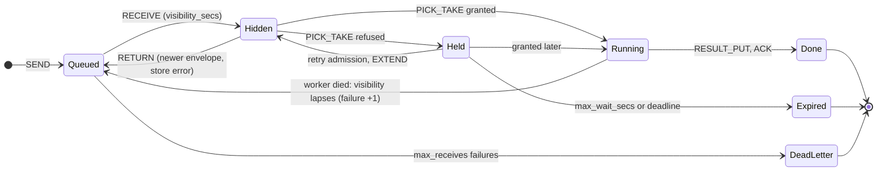

# The life of a call

From `llmq.converse(...)` to the reply: who does what, on which store, in which order.

## 1. **Resolve** (memory only): alias or provider model id to alias. A model disabled at model level
   sends the call to its first `model_fallback` model (if `allow_fallback="all"`) or fails
   `model_disabled`. `timeout_secs` (default 120) is capped by `timeout_max_secs` (900). The id is the
   app's `request_id` or a new UUIDv7. The `admission` hook may `Reject`.
2. **Route**: direct (in this process) when `force_direct` (sync calls), `routing.kill_switch`, or the
   id's hash falls outside `queue_pct`; users in `routing.allow_users` (HMAC hashes) always queue.
3. **Register** (`REGISTER`, one script): creates `P:{r:ID}:job` (`state=queued`, user and params
   hashes, `confirmed=0`), adds this process to `P:{r:ID}:callers`, writes the status `waiting`. A
   repeated id returns `attached` (wait for the first run), `done`, `expired` (`result_expired`),
   `conflict` (other params or user: `request_id_conflict`) or `takeover` (an unconfirmed record older
   than 5 s: its sender died).
4. **Send** (`SEND`, queue store): `XADD` to `<queue_prefix>llm-<alias>` or `...-priority` (the
   stream id is the store's clock: it is the call's queue position and the start of its deadline),
   refused with `queue_full` above `max_waiting` (50,000), and one token pushed on the queue's
   doorbell list `P:bell:<queue>`. With `LLMQ_QUEUE_WAIT_REPLICAS` the send and a `WAIT` go down one
   pipeline; too few acknowledgements make the call run direct under the same record.
5. **Confirm** (`CONFIRM`): the record lives until the deadline plus the status TTL.
6. **Wait**: no read right after sending. The caller waits for the pub/sub wake-up on
   `P:done:<worker id>`, then reads with `RESULT_TAKE`. A per-process sweep (`_RESULTS_EXIST`, every
   5 s, 500 ids per script) and a re-subscribe that wakes every waiter cover missed messages.

## Message states

## Finish and reply

`FINISH` (refund, slot and entry removed, learning) runs first; then `RESULT_PUT` writes
`P:{r:ID}:res` once (TTL `LLMQ_RESULT_TTL_SECS`, 300), marks the job final and `PUBLISH`es the id to
every caller's `P:done:<caller>`; then `STATUS_SET` (`done` with deployment, served model, attempts,
tokens) and `ACK` (deletes the message, only with the current generation). A failure writes an error
`Reply` the same way. `RESULT_TAKE` returns the result and, for a library-made id, deletes it at once
(`LLMQ_RESULT_DEDUPE_SECS`, default 0, keeps it that long instead); an app-supplied id keeps its TTL
so a duplicate id gets the same answer. Results above `offload_bytes` go to S3 (`ResultOffload`) and
the store keeps a marker. One `llmq_call_finished` log record per call (ids hashed, no text).

## Direct path

Used for sync calls (`converse_sync`, `embed_sync`, on a private event loop and caller-only engine),
the kill switch, `queue_pct`, a separate queue store that failed for `LLMQ_QUEUE_FAILOVER_SECS` (5),
and an unreplicated send. It registers and confirms the same record, then admits with the same
`PICK_TAKE` and waiter order (position = the store's time at registration; one registered waiter per
process, model and class, the rest wait on a local lock) and runs the same attempts. Only the queue
send and receive are skipped. Measured: 2,000 direct calls waiting cost 16 store scripts per process
per second (B96).
