# The life of a call

Every path a call can take, from `llmq.converse(...)` to the reply: who does what, on which
store, in which order, and which keys each step touches. [Architecture](architecture.md) names
the parts; this page follows them in motion. Key names are short forms: `P` is
`LLMQ_KEY_PREFIX`, `{r}` is `P:{r:ID}`, `{m}` is `P:{m:ALIAS}`, `{a}` is `P:{a:ACCT}`, `{q}` is
`P:{q:NAME}`. Each key table links the matching section of [Store keys](../reference/store-keys.md),
which lists fields, lifetimes and code references.

| # | Flow | When |
|---|---|---|
| 1 | [Queued converse](#1-queued-converse) | The normal path |
| 2 | [converse_stream](#2-converse_stream) | `converse_stream`, `chat_stream` |
| 3 | [embed](#3-embed) | `embed`, `embed_sync`, embeddings adapters |
| 4 | [Direct path](#4-direct-path) | Sync calls, kill switch, `queue_pct`, queue store down |
| 5 | [Fallback](#5-fallback-across-deployments-and-models) | Budget exhausted, deployments broken or failing |
| 6 | [Cancel](#6-cancel) | `llmq.admin.requests.cancel`, a cancelled awaiting task, a purge |
| 7 | [Duplicate request_id](#7-duplicate-request_id) | The app reuses its own `request_id` |
| 8 | [Timeouts and deadlines](#8-timeouts-and-deadlines) | Every call |
| 9 | [Caller gone](#9-caller-gone) | The calling process died |
| 10 | [Worker death mid-call](#10-worker-death-mid-call) | A worker is killed |
| 11 | [Store outage](#11-store-outage) | The state store is unreachable or refuses writes |
| 12 | [Store reset](#12-store-reset) | The store lost its data |
| 13 | [Throttling, breaker, health](#13-throttling-breaker-and-health) | Provider trouble |
| 14 | [Tenant fairness](#14-tenant-fairness) | `fairness.mode` is on |
| 15 | [Purge](#15-purge) | Manual or automatic cleanup of removed state |
| 16 | [Key expiry sweep](#16-key-expiry-sweep) | Every 10 s |

## Message states

The queue message's life, whatever the flow.

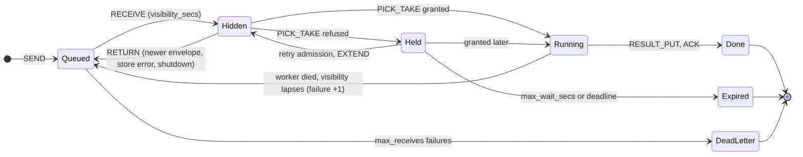

The request record `{r}:job` moves in parallel: `queued` (confirmed or not), `running` (owner and
heartbeat), then a final state `done`, `failed`, `expired` or `cancelled`. `request_status()`
reports `waiting`, `in_progress` and the final states.

## 1. Queued converse

The common case: the queues share the state store, no fairness, a success on the first attempt.

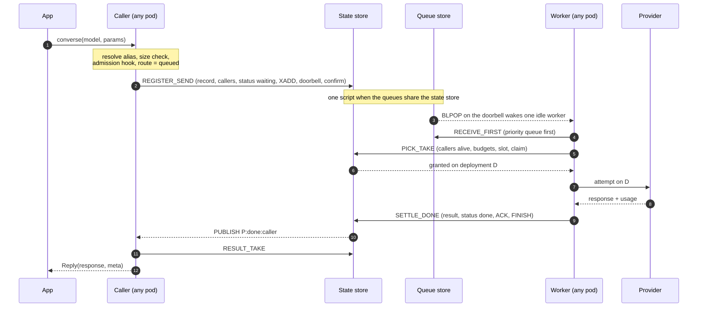

| Step | Who | Script | Keys touched |
|---|---|---|---|
| Resolve | caller | none (memory) | none. Alias or provider model id to alias; a model disabled at model level goes to its first usable `model_fallback` model (if `allow_fallback="all"`) or fails `model_disabled`; `max_message_bytes` checked (`request_too_large`); `timeout_secs` (120) capped by `timeout_max_secs` (900); the id is the app's `request_id` or a new UUIDv7 |
| Route | caller | none | none. Queued unless [direct](#4-direct-path) |
| Register + send | caller | `REGISTER_SEND` | [`{r}:job`, `{r}:callers`, `{r}:status`][req] (`waiting`); [`P:caller:WORKER`][live]; [`{q}:s`][q] (`XADD`, refused `queue_full` above `max_waiting`); [`P:bell:NAME`][bell] (`RPUSH`) |
| Wake | worker | `BLPOP` | [`P:bell:NAME`][bell] (one token) |
| Receive | worker | `RECEIVE_FIRST` | [`{q}:vis`, `:gen`, `:st`, `:meta`][q]; [`P:rcv:WORKER:ALIAS`][bell] |
| Admit | worker | `PICK_TAKE` | reads [`{m}:cfg`][madm], [`{r}:callers`][req] + [`P:caller:*`][live]; writes [`{m}:rate:DEP`][bud], [`{a}:rate`][bud], [`{m}:lease:DEP:{p\|n}`, `{m}:inprog`, `{m}:inprog:ID`][lease], [`{r}:job`][req] (`running`, owner, `hb`), [`{m}:retries:MINUTE`, `{m}:sticky:HASH`, `{m}:rot`][madm], [`{m}:ac:DEP`][health] on first use |
| Run | worker | heartbeat `RENEW`, `EXTEND_MANY` | lease and `inprog` scores, `inprog:ID` TTL, `{r}:job` `hb`, `P:caller:WORKER`, `{q}:vis` |
| Settle | worker | `SETTLE_DONE` | [`{r}:res`][res] (300 s), `{r}:job` (`done`), `{r}:status` (`done`, deployment, served model, attempts, tokens), `PUBLISH P:done:CALLER`; deletes the `{q}:s` entry and its side fields; `FINISH`: refund to real usage on `rate:DEP` / `{a}:rate`, learn on `ac:DEP`, `cb:DEP`, `health`; deletes `inprog:ID`, its `inprog` and lease members, `terr:DEP` |
| Read | caller | `RESULT_TAKE` | [`{r}:res`][res] cut to 2 s (library id) |

**Notes.**

- **Waiting.** The caller does not read right after sending. It waits on a future that the
  process's `_result_reader` (pub/sub on `P:done:<worker id>`) completes, then reads. The
  per-process `_result_sweep` (every 5 s, one script per 500 waiting ids) and a 60 s recheck
  cover lost wake-ups.
- **Separate queue store.** The send is three steps: `REGISTER` (state), `SEND` (queue), `CONFIRM`
  (state); the settle is `RESULT_PUT` + `STATUS_SET` (state), `ACK` (queue), `FINISH` (state).
- **Replica wait.** With `LLMQ_QUEUE_WAIT_REPLICAS`, the send and a `WAIT` go down one pipeline;
  too few acknowledgements never fail the send (it is on the primary): warned at most once a
  minute and counted in `llmq_send_not_replicated_total`.
- **A refused admission** holds the call; see [Fallback](#5-fallback-across-deployments-and-models)
  and [Admission](admission.md). Attempts, retries and refunds are in [Attempts and retries](attempts.md).
- The same table, with code references, is [Life of one call](../reference/store-keys.md#life-of-one-call).

## 2. converse_stream

`stream()` runs the same call with `stream=True` and `stream_id` = the request id, then reads
the chunk stream `{r}:chunks` instead of waiting for the result.

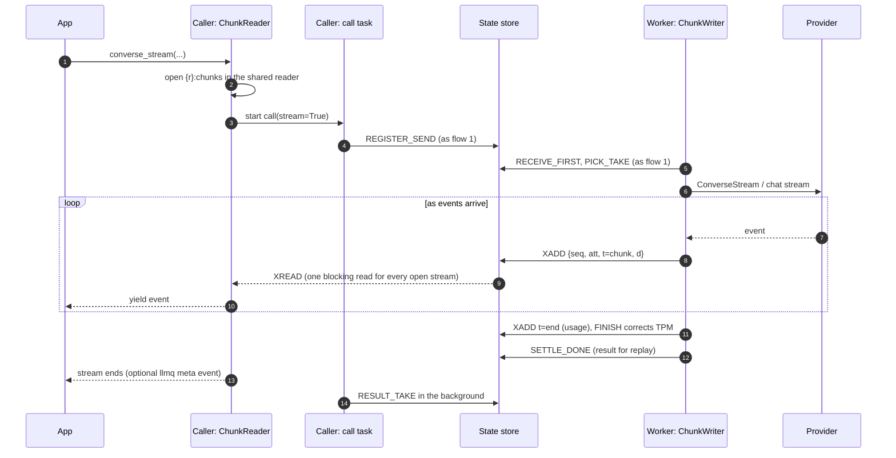

| Step | Who | Keys touched |
|---|---|---|
| Open | caller | [`P:chunkwake:WORKER`][bell] (`XADD MAXLEN 1`) wakes the shared reader |
| Register, send, admit | both | as flow 1; `PICK_TAKE` also reports the chunk stream's length |
| Write | worker | [`{r}:chunks`][res]: the first event at once, then batches every `stream_flush_ms` (30); lifetime result TTL + the call's timeout, set again on each write; capped at `stream_max_bytes` (8 MiB, then an `error` entry, never trimmed) |
| End | worker | `{r}:chunks` (`end` with usage), lifetime cut to 30 s; settle as flow 1 |
| Read | caller | `XREAD` block 100 ms over every open stream |

**Rules.**

- The caller checks the sequence: a gap, or a stream that ends without its `end` entry, is
  `worker_lost`. No event for `stream_idle_secs` (30) is `deadline_exceeded`.
- Before the first chunk, a failed attempt moves to another deployment as usual. After chunks
  were sent, a failure ends the stream with an `error` entry carrying the partial text
  (`CallFailed.partial_text`); there is no switch, and a stream already begun by another worker
  ends `worker_lost`.
- A stream never takes the `store_down` path (chunks travel through the store: an unreachable
  store is `queue_unavailable`), never falls back to a model of another provider, and is never
  given back at shutdown once it sent chunks (`worker_shutdown`).
- A finished stream whose chunks expired is replayed from the stored result when the id is
  attached again; with the result gone too it ends `result_expired`.

See [Streaming](streaming.md).

## 3. embed

`embed()` turns one list of texts into several ordinary calls.

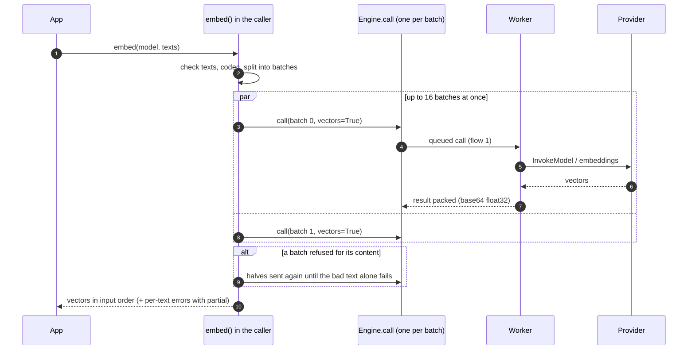

| Step | Who | Keys touched |
|---|---|---|
| Check | caller | none. Empty, non-string or too long texts, an `input_type` the family does not take, a model with no family: `invalid_request` naming the index |
| Batch | caller | none. `embed_batch_size` capped by the codec (Titan 1, Cohere 96, OpenAI 2048); with an app `request_id`, batch n is `<id>:<n>` and its halves `<n>.0` / `<n>.1` |
| Each batch | both | as flow 1: one request against RPM per batch; tokens only when token limiting is on for the model |
| Store the reply | worker | [`{r}:res`][res] holds the vectors packed (3x smaller than the JSON body, gate B97); above `offload_bytes` an S3 marker |

A refusal of kind `invalid_request`, `context_length_exceeded` or `request_too_large` splits the
batch; other failures fail its texts. `partial=False` raises the first failure; vectors of
different lengths fail the call (`provider_error`). See [Make calls](../how-to/call.md#embeddings-embed).

## 4. Direct path

The call runs in the calling process, under the same admission and the same waiter order; only
the queue send and receive are skipped.

| Trigger | Rule |
|---|---|
| Sync calls (`*_sync`) | Always direct (`force_direct`): on the started queue's loop, else on the private loop with a caller-only engine |
| Kill switch | `routing.kill_switch` in the registry (live): every call direct |
| `queue_pct` | Below 100: a call whose id hashes outside the percentage runs direct (a canary). Users in `routing.allow_users` (keyed hashes) always queue |
| Queue store failover | A separate queue store whose sends fail for `LLMQ_QUEUE_FAILOVER_SECS` (5 s): the call runs direct; the next calls skip the queue store while the outage is remembered (`outage_memo_secs`, 3 s, ended early by a store probe that succeeds) |

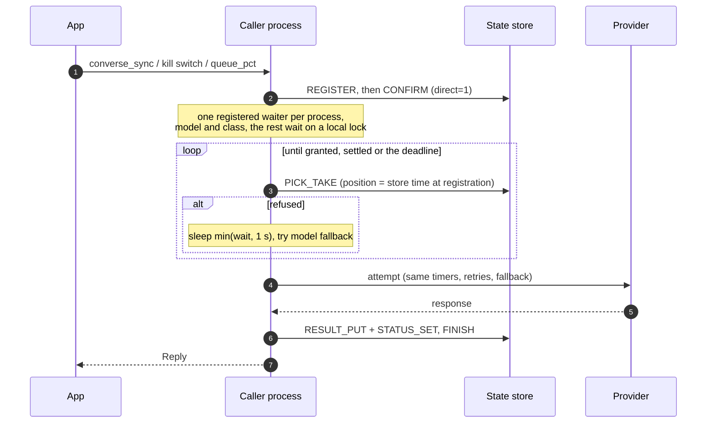

| Step | Keys touched |
|---|---|
| Register, confirm | [`{r}:job`][req] (`direct=1`), `{r}:callers`, `{r}:status`, [`P:caller:WORKER`][live] |
| Admit | as flow 1 (`PICK_TAKE`), with the waiter in [`{m}:wait:{p\|n}`, `waitinfo`, `waitexp`][wait] while refused |
| Run, settle | as flow 1, without the queue keys |

Other processes that attach to the same id get the stored result. A direct run whose process
dies is taken over by the next caller of the id: `REGISTER` answers `takeover` when the runner's
liveness key is gone and its claim has no heartbeat for a lease. Measured: 2,000 direct calls
waiting cost 16 store scripts per process per second (gate B96).

## 5. Fallback across deployments and models

Fallback has three levels: other deployments of the same model, the model's `fallback`
deployments (other regions), and fallback models (`model_fallback`, possibly of the other
provider).

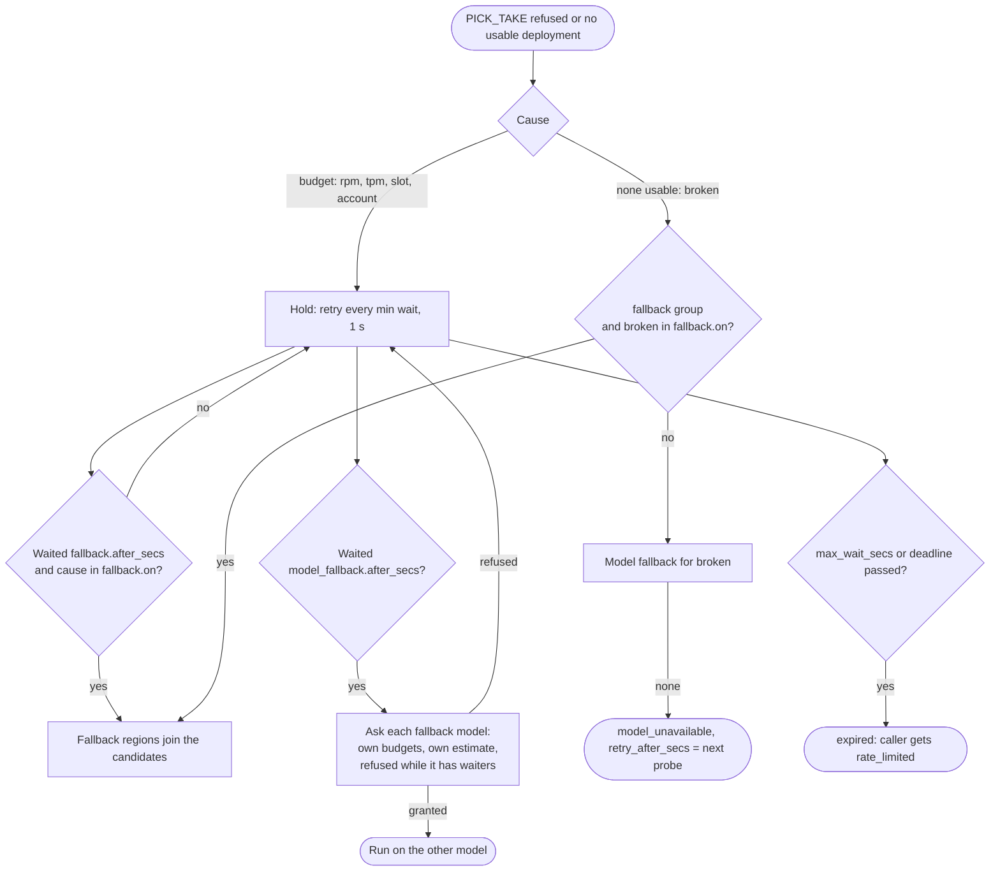

| Level | When | Rule |
|---|---|---|
| Other deployments | Every admission and every retry | `PICK_TAKE` picks among usable candidates by strategy; a failed deployment goes last; a throttled one is out for every pod until its window ends. A move to an untried deployment is free of the retry budget |
| `fallback` regions | The call waited `fallback.after_secs` (2) and the cause (`exhausted`, `broken`, `error`) is in `fallback.on` | The `fallback` group joins the candidates. `allow_fallback` must be `all` or `regions` |
| `model_fallback` models | The call waited `model_fallback.after_secs` (5), or no deployment is usable (`broken`) | Each target in order: enabled, takes this request's shape, no waiters of its own (else `busy`), `require_headroom_pct` (20 %) free when `require_headroom`. `allow_fallback` must be `all`. The status gets `served_model` |
| Policy hook | Any of the two above | `fallback_policy` named hook overrides the rule's answer |

**Cross-provider fallback.** A Bedrock model may fall back to an OpenAI-compatible model or the
reverse. The call keeps the caller's shape (`converse` or `chat`); the worker converts the
request to the target's shape before the attempt and the reply back after it (`engine/shapes.py`).
Messages, system prompt, tools and tool choice, `inferenceConfig` / `max_tokens`, temperature,
top-p and stop sequences carry over; fields with no counterpart are dropped. A request that
cannot be carried over (a document or video block, an image URL, an image in a tool result) skips
that target, and a stream never crosses providers. See
[Configuration](../reference/configuration.md#fallback-to-a-model-of-another-provider).

| Step | Keys touched |
|---|---|
| Hold | [`{q}:vis`][q] (`EXTEND`), [`{m}:wait:{p\|n}`, `waitinfo`, `waitexp`][wait] |
| Foreign ask | the other model's [`{m2}:cfg`][madm], `rate:DEP`, `lease:*`, `inprog`, `wait:*` (its waiters refuse the ask); the call's [`{r}:job`][req] claim |
| Status | [`{r}:status`][req] `in_progress`, `served_model` |
| No usable deployment | [`{m}:health`][health] and `cb:DEP` read for the `model_unavailable` log line |

## 6. Cancel

Anyone may cancel any id; cancel wins for every caller of it.

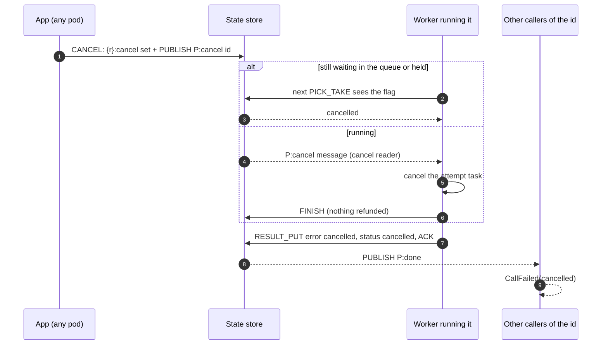

| Trigger | What happens |
|---|---|
| `llmq.admin.requests.cancel(request_ids=...)`, CLI `requests cancel`, `POST /requests/cancel` | `CANCEL` on calls not yet final (waiting ones only unless `state` says `running` / `all`); audited; logged `call_cancel` with `source=admin` |
| The awaiting task is cancelled (`asyncio` cancel, a client disconnect) | The process's one canceller batches it: the call is cancelled for every caller of the id. A direct run in this process is stopped at once |
| A tenant purge with `remove=queued` or `running` | Normal cancels with `source=purge` |
| `fail_fast` after a failed send that may have reached the store | A cancel written behind, so the app's retry does not make a second run |

| Step | Keys touched |
|---|---|
| Cancel | [`{r}:cancel`][req] (status TTL), `PUBLISH P:cancel` |
| Waiting call | `PICK_TAKE` reads `{r}:cancel`: `cancelled`; a new `REGISTER` of the id answers `cancelled` while it is pending |
| Running call | `_cancel_reader` (pub/sub) cancels the task; the heartbeat's `MGET` of `{r}:cancel` for running calls is the safety net |
| Settle | [`{r}:res`][res] (error), `{r}:job` and `{r}:status` (`cancelled`), the queue entry acked; `FINISH` releases the slot without refund |

A later call with the same id registers as new and runs again (only a success is replayed).

## 7. Duplicate request_id

`REGISTER` decides what a repeated id means. The params hash covers the model and params; the
user hash is the keyed hash of `user_id` or `session_id`.

| Record found | Outcome | The second caller |
|---|---|---|
| None | `new` | Sends and waits (the normal path); a stale `{r}:cancel` is deleted |
| Other params or user | `conflict` | `CallFailed("request_id_conflict")` |
| Running or queued, confirmed | `attached` | Joins `{r}:callers` and waits for the same result; it checks the record after the takeover grace and on each wake-up |
| `done` with the result present | `done` | Gets the stored answer (replay); read at once |
| `done`, result gone | `expired` | `CallFailed("result_expired")` |
| `failed`, `expired` or `cancelled` | `new` | Old record, result, status, cancel and chunks deleted in the same script; the call **runs again** |
| A cancel pending | `cancelled` | `CallFailed("cancelled")` |
| Unconfirmed and older than the grace (5 s) | `takeover` | Its sender died or its send failed: this caller sends it |
| A direct run whose runner is gone (no liveness key, no heartbeat for a lease) | `takeover` | This caller runs it |
| A record a worker's claim made (the caller's record was lost) | `attached` | Joins the running call |

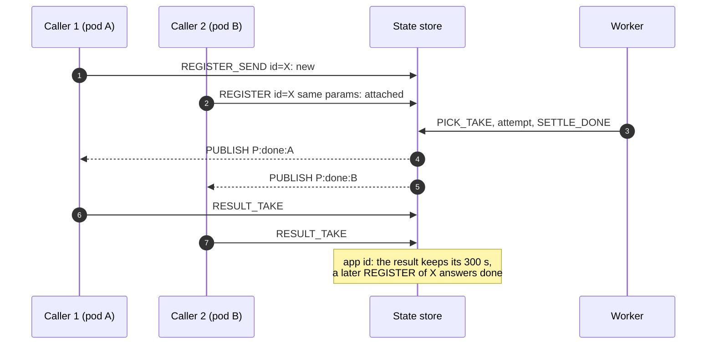

Keys: [`{r}:job`, `{r}:callers`, `{r}:status`, `{r}:cancel`, `{r}:res`, `{r}:chunks`][req]. A
library-made id's result is cut to 2 s after its first read, so replay is for app ids
(`LLMQ_RESULT_DEDUPE_SECS` keeps library ids longer). On the worker side, `PICK_TAKE` answers
`duplicate` for a second copy of a message whose call runs under another worker with a fresh
heartbeat (the copy is returned after half a lease), and `done` when a result is stored.

## 8. Timeouts and deadlines

One deadline per call, on two clocks that agree.

| Timer | Where | Default | Ends the call with |
|---|---|---|---|
| Caller deadline | caller, local loop time from `call()` | `timeout_secs` (120) + `caller_margin_secs` (5) | `deadline_exceeded` |
| Worker deadline | worker, store time: queue position + `timeout_secs` | 120 s | `expired` (held: the caller gets `rate_limited` with `retry_after_secs`), `deadline_exceeded` (running) |
| `max_wait_secs` | worker, from the queue position | none (until the deadline) | `expired`, caller gets `rate_limited`. A call that already waited it out unreceived is refused on arrival |
| Attempt | worker | `min(attempt_timeout_secs (60), time left)` | a failure (breaker +1), retried within the deadline |
| First response, idle between chunks | worker | `attempt_timeout_secs`, `stream_idle_secs` (30) | a failure; a stream mid-answer ends with its partial text |
| Stream idle (caller) | caller | `stream_idle_secs` + `stream_flush_ms` + margin | `deadline_exceeded` with `partial_text` |
| Message visibility | queue | `visibility_secs` (60), extended every heartbeat and hold | redelivery (flow 10) |
| Grant lease | admission | `LLMQ_LEASE_SECS` (60), renewed every 20 s | slot freed by `SWEEP` (flow 10) |

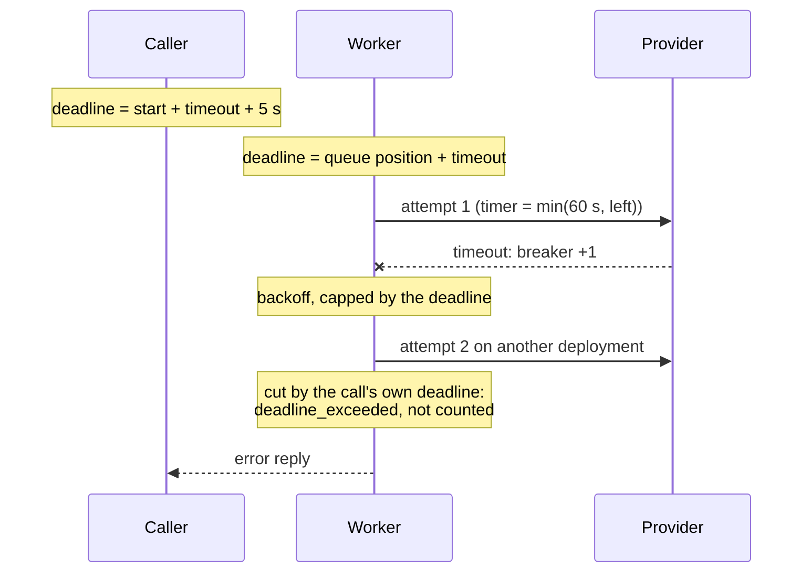

Keep `attempt_timeout_secs` below `timeout_secs` so a hanging deployment leaves time to fail
over. A store outage, a hold and the `store_down` path all spend the same deadline. Keys: the
expiry decisions read the stream id (`{q}:s`) and write the result and status as any settle.

## 9. Caller gone

Two cases, both cancel the call rather than run it for nobody.

| Case | Detected by | Result |
|---|---|---|
| The awaiting task was cancelled (the app gave up) | the caller itself | A cancel for every caller of the id ([flow 6](#6-cancel)) |
| The calling process died | `PICK_TAKE` on the call's first admission: every process in `{r}:callers` has no `P:caller:<id>` key | The worker finishes the call `cancelled` with the message `caller_gone` (logged `caller_gone`); nothing runs at the provider |

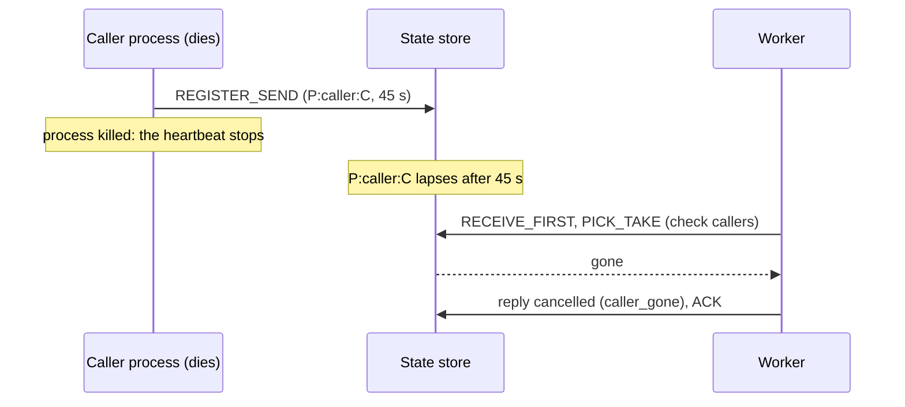

Keys: [`P:caller:WORKER`][live] (lifetime `max(LLMQ_CALLER_TTL_SECS, ceil(2 x lease / 3) + 5)` = 45 s,
renewed by every heartbeat and send), [`{r}:callers`][req]. In `swept` key expiry the liveness
key can live up to 10 s longer. **Outage guard:** for a caller TTL + a heartbeat + 5 s after a
worker saw the store fail (any store error, a late heartbeat, a heartbeat back from a gap),
callers count as alive, so calls waiting through an outage are not dropped (gate B95: 45 s block,
500 waiting, 0 dropped; scenarios S4, S5).

## 10. Worker death mid-call

At least once: a call whose worker died is run again by another worker.

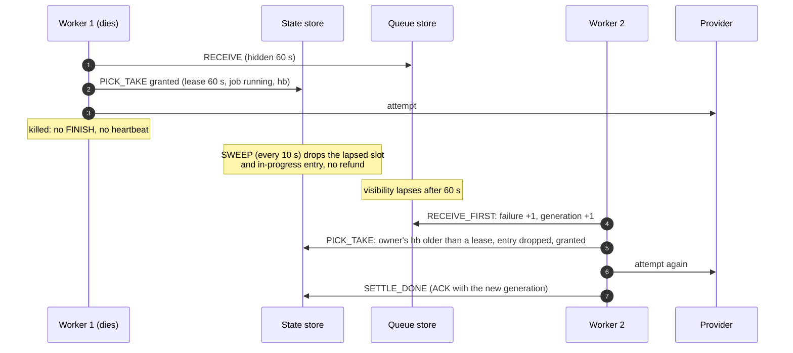

| Step | Keys touched |
|---|---|
| Lease lapses | [`{m}:lease:DEP:{p\|n}`, `{m}:inprog`, `{m}:inprog:ID`][lease] removed by `SWEEP` (lock [`P:lock:sweep`][live]); the budget charged stays charged |
| Redelivery | [`{q}:vis`, `:gen`, `:fails`][q]: failure +1; at `max_receives` (10) the message moves to [`{q}:dlq`][q] and the caller gets `dead_lettered` |
| Re-admission | [`{r}:job`][req]: a dead owner (no heartbeat for a lease) is replaced; a stored result means `done` (no second run) |

**Guarantees.** A call runs at least once and its answer is stored once. The provider may be
charged twice when a worker dies after the provider answered and before the result was
written. A `RECEIVE_FIRST` whose reply was lost (the store answered, the worker never saw it) is
reclaimed by its receive claim `P:rcv:WORKER:ALIAS` on the next round or at `stop()` (scenario
S11). A graceful stop never takes this path: `stop()` gives running calls back (refund, message
returned at once, no failure counted). Gates B13, B30, B71; scenario S1.

## 11. Store outage

Three cases: the state store is down before the send, after the send, or for a worker.

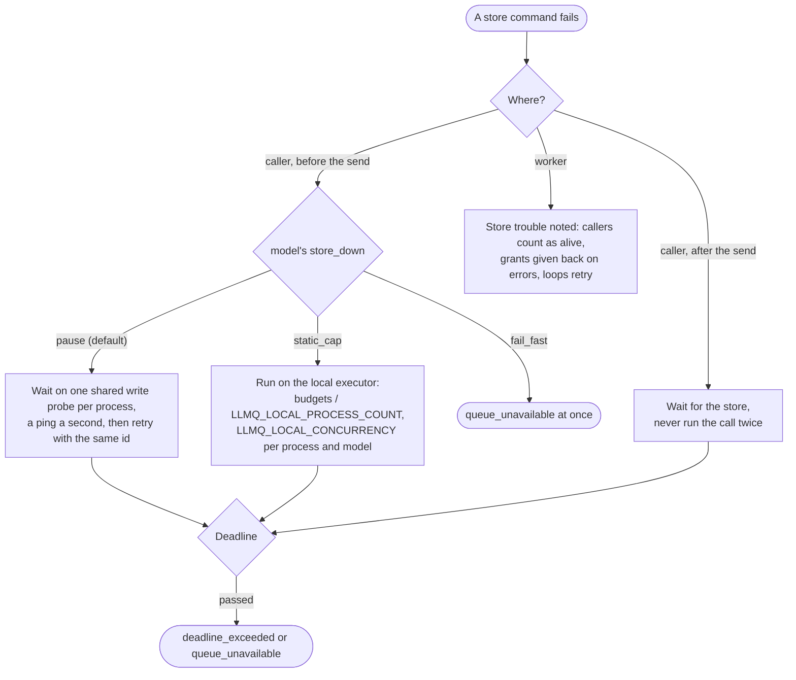

| Rule | What it does |
|---|---|
| `pause` | Every paused call in a process waits on one probe (a bounded write, not a `PING`: a read-only replica answers `PING`). When it succeeds, calls resume spread over up to 0.5 s, retried with the same request id (so a send that did reach the store is attached, not run twice) and only the time left |
| `static_cap` | Runs on the local executor of `LLMQ_EXECUTION_MODE=local` ([Modes](../how-to/modes.md)): each deployment's rpm / tpm divided by `LLMQ_LOCAL_PROCESS_COUNT` as this process's budget, at most `LLMQ_LOCAL_CONCURRENCY` (10) calls per process and model, with the usual retries, breakers and region / model fallback, all in memory. A budget or breaker is waited for at most `LLMQ_STATIC_CAP_WAIT_SECS` (5 s), then `rate_limited`. `stop()` drains these calls with the others and ends the rest with `worker_shutdown`. The result is written behind once the store is back, so a copy that did get queued meets `done` |
| `fail_fast` | `queue_unavailable` at once; a cancel is written behind for a send that may have landed |
| Outage memo | A call that saw the store down sets a memo for `outage_memo_secs` (3 s): `fail_fast` and `static_cap` calls answer at once without trying the store; `pause` calls join the waiting ones. A successful store probe ends the memo |
| Store refuses writes | `OOM`, `MISCONF`, `NOREPLICAS`, `BUSY`, `READONLY` count as down for writes: the same rules; the message says why |
| Pool busy | Every pooled connection in use is not an outage: `rate_limited` with `retry_after_secs=1` |
| Streams | `queue_unavailable` (chunks travel through the store) |

Keys: none can be written while the store is down; the probe writes [`P:health:WORKER`][live]
(5 s). Measured: gate B95 (45 s block, 500 waiting, 0 dropped), scenarios S4, S5, S9.
See [Failures and recovery](resilience.md#state-store-outage).

## 12. Store reset

The store came back without its data (restart without persistence, failover to an empty node),
or a promotion lost writes.

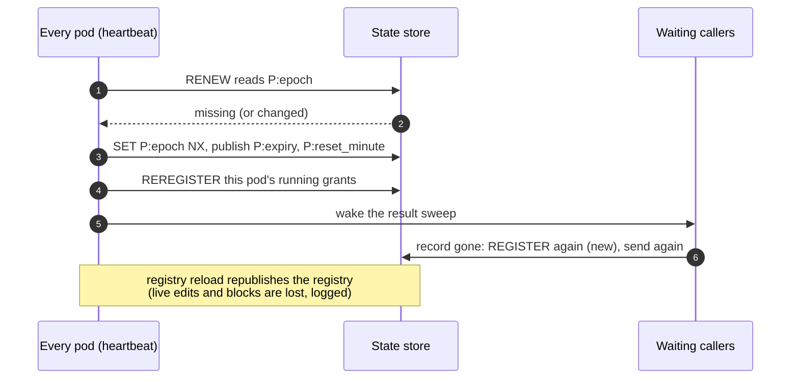

| Step | Keys touched |
|---|---|
| Detect | [`P:epoch`][live] missing or changed (each pod remembers the epoch it saw); or `master_replid` changed (`INFO replication`, a promotion that kept the old epoch) |
| Restore | [`P:epoch`][live], [`P:expiry`][exp] (before any expiry write), [`P:reset_minute`][bud] (fixed windows hold until the next minute), [`{m}:lease:*`, `{m}:inprog`, `{m}:inprog:ID`][lease] via `REREGISTER`; grants `RENEW` reports lost are registered again |
| Callers | [`{r}:job`][req] gone: the waiting caller registers and sends again (at least once) |
| Registry | [`P:{reg}:doc`, `:meta`][reg] republished by the reload loop; [`{m}:cfg`][madm] with it |

Calls queued only in the lost store are sent again by their callers; a call whose caller also
died is lost with the store. See [Store usage](storage.md#store-usage).

## 13. Throttling, breaker and health

Three mechanisms, all shared by every pod through the store.

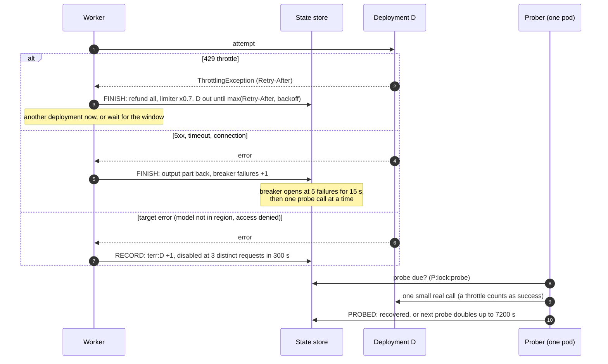

| Mechanism | Trigger | Effect | Keys |
|---|---|---|---|
| Throttle window | A 429 | D out for every pod until `max(Retry-After, jittered backoff 1-2 s doubling to 30 s)`; limiter x0.7 (at most once a second); refund all; more than `throttle_retry_attempts` (6) on one call: `rate_limited` | [`{m}:cb:DEP`][health] (`thr_n`, `thr_until`), [`{m}:ac:DEP`][health], [`{m}:thr:DEP:MINUTE`][health] |
| Retry backoff | 5xx, timeout, connection | `retry_base_secs x multiplier^(n-1) x U[1, spread]` capped at 30 s and the deadline; `max_attempts` (4); per-model retry budget (20 % of first attempts, at least 10 a minute) | [`{m}:retries:MINUTE`][madm] |
| Breaker | `breaker_threshold` (5) failures in the window | Open for `breaker_cooldown_secs` (15); then half-open: one trial call, the others wait for its answer | [`{m}:cb:DEP`][health] |
| Health disable | `disable_errors` (3) distinct requests with target errors in `disable_window_secs` (300), no success between | D disabled (unless it is the model's last healthy one); probed after `probe_after_secs` (900), doubling to `probe_max_secs` (7200) | [`{m}:terr:DEP`, `{m}:health`][health], [`P:lock:probe`][live] |
| Credentials | Auth, signature or clock-skew errors | The account skipped in that region only, 5 s doubling to 60 s, reset by a success | none (process memory) |

Health lives apart from the registry, so a deploy never re-enables a disabled deployment. No
usable deployment left: `model_unavailable` with `retry_after_secs` until the next probe. See
[Attempts and retries](attempts.md) and [Failures and recovery](resilience.md).

## 14. Tenant fairness

With `fairness.mode` on, `PICK_TAKE` runs one more step (`_TENANT`) before the deployment
budgets. The tenant is `tenant_id`, else `user_id`, else one shared tenant; only its keyed hash
reaches the store.

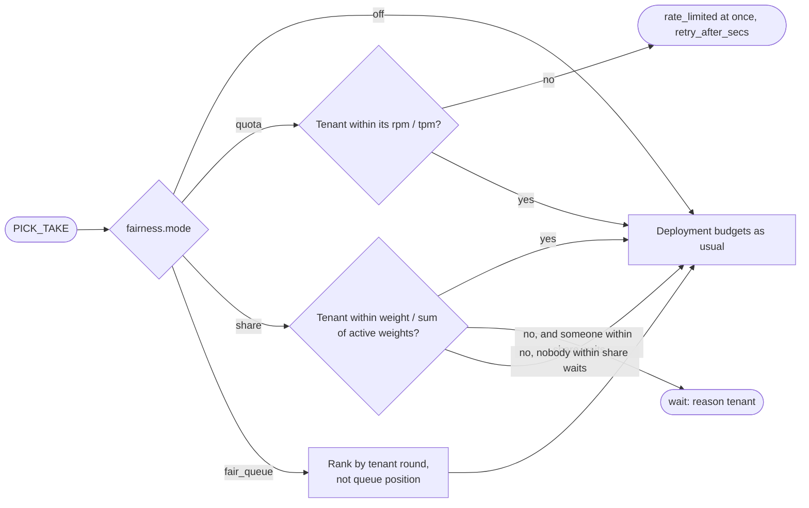

| Mode | Rule | Keys under `{m}` |
|---|---|---|
| `quota` | Hard caps per tenant, charged at grant, corrected at finish; refusal is final | [`tf:t:H`][tf] |
| `share` | A tenant over its weighted share waits only while a tenant within its share waits; unused share is lent | [`tf:t:H`, `tf:s:H`, `tf:act`, `tf:w`, `tf:need`][tf] |
| `fair_queue` | Waiting calls reserve budget in tenant-round order: a tenant with 100 calls gets one per round | [`tf:t:H`, `tf:fq`][tf] |

Cost: server time per admission script +9 % (`fair_queue`), +13 % (`quota`), +23 % (`share`)
over off (measured 2026-11-15, local Valkey 8.1). Each call is also in the request index of
its model and tenant (`P:{m:ALIAS}:tq:H`, written on confirm and removed by its final write,
`LLMQ_REQUEST_INDEX_ENABLED`), which admin operations and a tenant purge read. See
[Tenant fairness](fairness.md).

## 15. Purge

Removed models, deployments and tenants leave state behind; a purge deletes it.

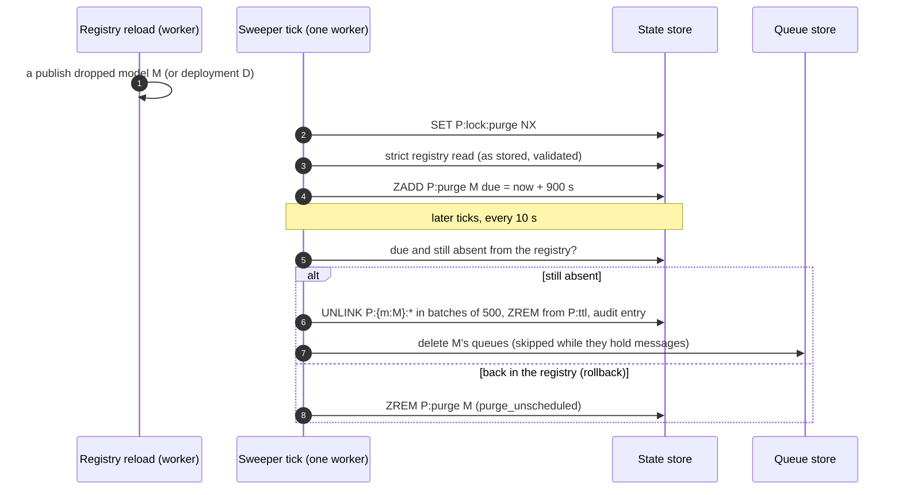

| Purge | Started by | Deletes (keys) |
|---|---|---|
| `model(alias)` | app, CLI, HTTP, auto | every [`{m:alias}:*`][madm] key, its queues [`{q}:*`][q] and doorbells; refused while the registry has the model, unless `force` |
| `deployment(alias, "account/name")` | app, CLI, HTTP, auto | [`rate:D`][bud], [`ac:D`, `cb:D`, `terr:D`, `thr:D:*`][health], [`lease:D:*`][lease], fields of `health` and `rot`, `sticky:*` pointing at it; waits for running calls (`LLMQ_PURGE_WAIT_SECS`, 300) unless auto |
| `tenant(id, remove=...)` | app, CLI, HTTP | [`tf:t:H`, `tf:s:H`][tf], the tenant in `tf:act` and `tf:w` (weight sum corrected); `queued` / `running` cancel its calls found in the request index `P:{m:ALIAS}:tq:H` |
| `removed()` | app, CLI (`purge removed`), HTTP | `model` and `deployment` for everything the registry no longer has |

Auto purge runs only in workers; the first tick after start is a baseline. Every real purge is
audited ([`P:{reg}:audit`][reg]), logged `llmq_purge` and counted. Bookkeeping keys:
[`P:purge`, `P:lock:purge`][exp]. See [Purge store state](../how-to/purge.md).

## 16. Key expiry sweep

How keys with a lifetime go away, in either key expiry mode.

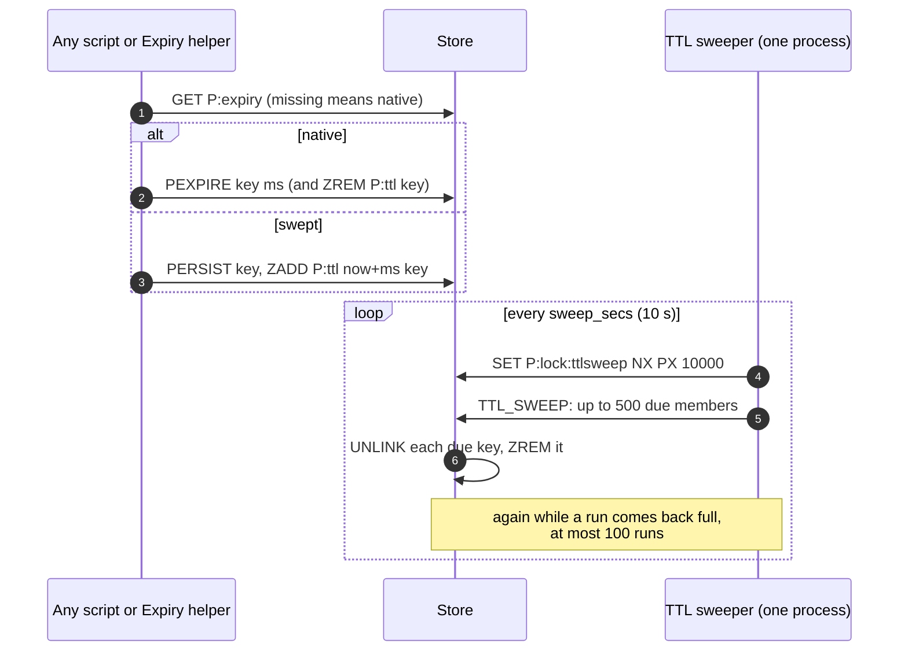

| Step | Keys touched |
|---|---|
| Mode | [`P:expiry`][exp] written at `start()`, every minute (policy re-read) and after a reset; `auto` picks `native` for `noeviction`, `swept` for `volatile-*`, `allkeys-*` or unknown |
| Each expiry write | the key itself (`PEXPIRE` or `PERSIST`), [`P:ttl`][exp] (`ZADD` or `ZREM`) |
| Sweep | [`P:lock:ttlsweep`][live] (native TTL, 10 s); due keys and their `P:ttl` members; `llmq_ttl_swept_total` |

The sweep runs in every role and in both modes, so keys indexed while `swept` still go after a
switch to `native`. Seven keys keep a real TTL in both modes (the sweep and probe locks, the
readiness probe key, debug capture). Up to 50,000 keys per 10 s by default. Measured with the
eviction drill on 0.1.0b3: `volatile-lru` in `swept` mode, 2,000 of 2,000 calls succeeded while
the store evicted 103,181 app keys and 0 queue keys ([Tested scenarios](tested-scenarios.md)).
See [Key expiry modes](storage.md#key-expiry-modes).

[req]: ../reference/store-keys.md#request-records
[res]: ../reference/store-keys.md#results-streaming
[q]: ../reference/store-keys.md#queues-streams
[bell]: ../reference/store-keys.md#doorbells-wakeups
[live]: ../reference/store-keys.md#process-liveness-locks
[madm]: ../reference/store-keys.md#model-admission
[bud]: ../reference/store-keys.md#budgets
[wait]: ../reference/store-keys.md#waiters
[lease]: ../reference/store-keys.md#leases-in-progress
[health]: ../reference/store-keys.md#health-breaker
[tf]: ../reference/store-keys.md#tenant-fairness
[exp]: ../reference/store-keys.md#key-expiry-purge
[reg]: ../reference/store-keys.md#registry
