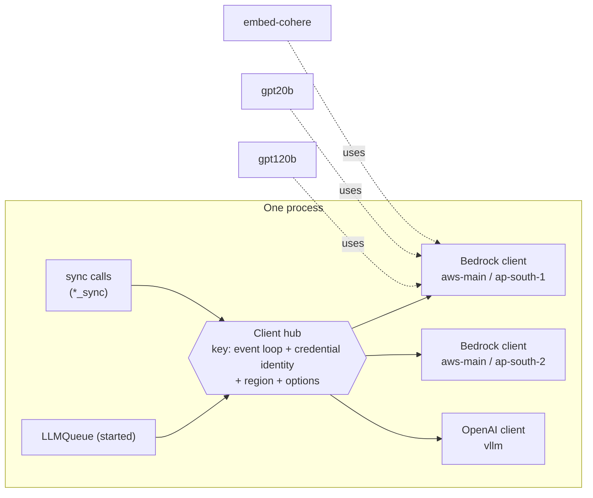
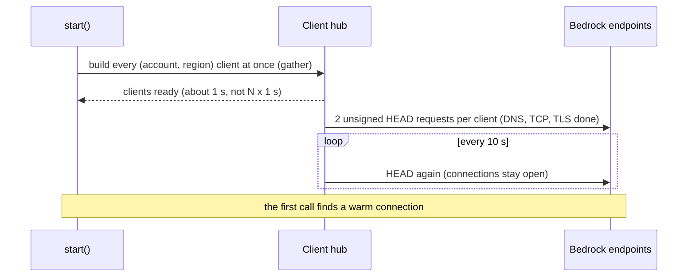

# Clients and connections

How a process holds its provider clients and store connections, why there is one client per
account and region (not per model), and how to run one `LLMQueue` per process under gunicorn,
Celery and threads.

## The client hub

Every process has one **client hub**. Each `LLMQueue` in the process, and the engine that serves
sync calls, borrows its SDK clients from it instead of building its own.



- **Key.** A client is keyed by the event loop it runs on, the credential identity (a hash of the
  account's fields and key ids, never the secret), the region and the client options (endpoint,
  timeouts, pool size). Every model on the same account and region shares the one client.
- **Event loop in the key.** An aiohttp / httpx connection pool belongs to the loop it was
  opened on; a client is never shared across loops. An entry whose loop has closed is dropped.
- **Reference counted.** Each holder adds a reference; the last release closes the client. A
  client whose credentials failed is evicted: the next call builds a fresh one while current
  holders finish with theirs.
- **Account changes.** An edit to an account's fields (role, endpoint) changes its identity
  hash, so the next call gets a new client; the old one closes when its holders let go.

### Why not one client per model

Models on one account and region call the same endpoint with the same credentials. A client per
model would only split the connection pool (more sockets, more idle connections dropped) and add
TLS handshakes, with nothing gained: isolation between models comes from their admission slots
and budgets, not from separate sockets.

## Start-up and warm connections



- **Parallel warm-up.** At `start()` the clients of every deployment are built concurrently, each
  under a lock of its own key, so a registry with 20 (account, region) pairs starts in about the
  time of one build. The process is ready once the clients exist.
- **Warm connections.** After a Bedrock client is built, two unsigned `HEAD` requests open
  connections to its endpoint (no model is invoked, nothing is billed). They repeat every 10 s,
  below the provider's ~20 s idle close and the 15 s keep-alive, so the first call after start
  or after an idle spell does not pay for a TLS handshake. Set it with
  `Tuning(warm=WarmOptions(...))` (defaults `connections=2`, `refresh_secs=10.0`,
  `keepalive_secs=15.0`); `connections=0` turns it off, `refresh_secs=0` keeps the first
  warm-up but stops the repeats.
- **Pool size from the registry.** Each client's connection pool is the sum of the concurrency
  slots routed to its account and region, at least 10 and at most 200, instead of a fixed 100.
- **Credentials.** Assumed-role sessions and `credentials=` values that carry an expiry are
  refreshed about 5 minutes before they expire, so no call waits on STS.

On Linux and macOS, the optional `uvloop` extra gives a faster event loop:
`pip install 'llm-queue[uvloop]'` and run the app with `llm_queue.run(main())` (it uses uvloop when
installed, else `asyncio.run`). It speeds up sockets and timers, not the SDKs.

## Sync calls

`converse_sync`, `embed_sync` and the other `*_sync` methods are for threads, scripts and Celery
tasks:

| The process has ... | Sync calls run on ... |
|---|---|
| A started `LLMQueue` | That queue's event loop (from another thread), with its clients and store connections. No second engine |
| No started queue | One private event loop per process, in a daemon thread, shared by every queue. A caller-only engine with a small store pool (20 connections); clients are built lazily, so a Celery worker builds only what it calls |

A sync call on the thread that runs the queue's own loop would deadlock and is refused with an
`LLMQueueError`; await the async method there. A sync call from any other running event loop
blocks that loop and logs `sync_call_on_event_loop` once.

### Celery

A Celery worker usually forks its pool processes from a parent. Build the queue in the child,
never in the parent:

```python
from celery.signals import worker_process_init

llmq = None

@worker_process_init.connect
def build_queue(**_):
    global llmq
    llmq = LLMQueue.from_env()      # not started: sync calls use the private loop

@app.task
def summarize(text):
    return llmq.converse_sync("gpt120b", {"messages": [...]}).response
```

## One LLMQueue per process

Build and start **one** `LLMQueue` per process, in the process that makes the calls, on the
event loop that makes them. The library guards the three ways this goes wrong:

### Two queues in one process

```python
a = LLMQueue.from_env()
b = LLMQueue.from_env()
await a.start()
await b.start()     # logs second_llm_queue_started; b gets its own engine and store pools
```

The second started queue logs `second_llm_queue_started`. The first stays the LangChain default
(`QueuedChatBedrockConverse` and the other adapters find it on their own); stopping a queue
that is not the default never clears the default. Both share the client hub, but each has its
own store pools, receive loops and worker slots, so one queue is what you want.

### Fork after start

```python
await llmq.start()
os.fork()           # child: every call raises LLMQueueError
```

A started queue's connections and event loop stay in the parent. In a forked child every call
raises `LLMQueueError` ("this process is a fork of it ... build and start a new LLMQueue in the
child"), instead of sharing sockets with the parent or hanging. The client hub and the private
sync loop are reset in the child.

The correct gunicorn pattern starts the queue in each worker, in the app's lifespan, and never
in the master before the fork (do not combine `--preload` with a queue started at import):

```python
@asynccontextmanager
async def lifespan(app):
    await llmq.start()        # runs in each gunicorn / uvicorn worker, after the fork
    yield
    llmq.pause_receiving()
    await llmq.stop()
```

```bash
gunicorn app:app -k uvicorn.workers.UvicornWorker -w 4     # no --preload with a started queue
```

### Several event loops

```python
await llmq.start()                          # on the app's loop

def in_a_thread():
    asyncio.run(llmq.converse(...))         # LLMQueueError: another event loop
    llmq.converse_sync(...)                 # fine: runs on the queue's loop
```

An async call from an event loop other than the one that ran `start()` (a thread with its own
`asyncio.run`, a fresh test loop) raises `LLMQueueError`: the queue's connections belong to its
loop. From other threads, use the `*_sync` methods; if a thread really needs its own loop, build
a queue for that loop.
