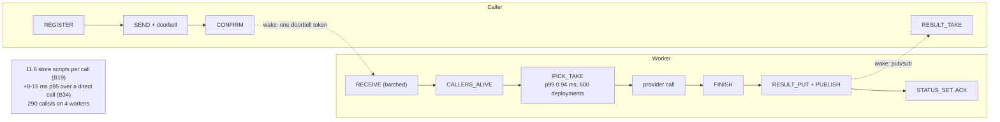

# Performance (measured)

Measured numbers, with where each comes from. Nothing here is an estimate unless it says so.

Every step above is one store round trip; the measured numbers below say what each costs.

Numbers from the CHANGELOG "Performance" section and plan §13 (maintainers' notes in docs/internal, not published) (2026-11-13, Python 3.12, fakellm, worker
processes as pods on one machine).

| What | Measured |
|---|---|
| Store scripts per queued call | 11.6 (B19, 2,000 calls in 10 s). By the code: caller `REGISTER`, `SEND`, `CONFIRM`, `RESULT_TAKE`; worker `RECEIVE` (batched), `CALLERS_ALIVE`, `PICK_TAKE`, first-attempt counter, `FINISH`, `RESULT_PUT`, `STATUS_SET`, `ACK`; plus doorbell and heartbeat. About 4 ms of store time per call on an in-VPC store (plan estimate) |
| Store work vs process count | 248 commands per call on 2 processes, 252 on 8 (B22) |
| Admission | `PICK_TAKE` p99 0.94 ms with 20 models x 30 deployments (B91, measured on a quiet Linux host; plan asks 2 ms). Machine-dependent: a Windows / Docker Desktop host measured 3.8-4.3 ms for 0.1.0b2 and 3.0-3.5 ms for 0.1.0b3 (2026-11-16) |
| Status | 20 x 30 report (210 KB) in 47 ms, 375 ms cold; 6.5 s before one script per model (B91) |
| Queue overhead | +0-15 ms p95 over a direct call (B34). B34 judges against `scripts/baselines/perf.json`, re-recorded 2026-11-15 on the dev machine as the median of 3 ramps: queued p95 218 ms, ceiling 349.6 calls/s (an earlier run: 141 ms, 290 calls/s on 4 workers) |
| Waiting callers | 2,000 waiting: 1,976 store calls/s before, 499/s after (pub/sub + sweep, B56) |
| Budgets | 1,800 of 1,800 a minute on 9 deployments, none above its RPM, priority wait p95 0.27 s (B17); normal class at 100 % of its 80 % (B56 / B93) |
| Recovery | Waiter pod killed: next waiter within 1.3 s smooth, 0.02 s after the minute fixed (B94); first call after idle 125 ms (B92) |
| Memory | Bulk Cohere embedding (300 x 96 texts): store +23 MB at peak, +582 MB before deleting results on first read (B97; CHANGELOG states 31 MB vs 587 MB). Process memory: **unverified** |
| CPU per call | botocore parameter validation off: 8.5 to 3.5 ms per attempt at 218 KB; no deep copy (1.86 ms saved); envelope encode 342 to 57 us; UUIDv7 0.49 us; `hiredis` parsing 39-75x faster |
| Message size check | One orjson pass for `max_message_bytes`: 0.22 ms at 240 KB (2026-11-14, Python 3.12) |
| Request admin at scale | Gate G-T2, 10,000 waiting calls of 20 tenants (2026-11-18, Windows / Docker Desktop, 1.6 ms store round trip; before, then after): `list` 100 rows 47 to 13 ms, `count` one tenant 94 to 39 ms, reprioritize 1,000 1,875 to 848 ms, cancel 10,000 9,641 to 1,342 ms. `--short` (1,000): 47 / 16 / 172 / 891 ms to 11 / 16 / 72 / 372 ms. A page is one script merging the tenants' indexes; records and stages one script per `LLMQ_ADMIN_BATCH` ids, all batches in one round trip; a cancel marks and answers its waiting calls in one script per batch, writes its audit entry, then wakes the callers in one transaction it does not wait for. The gate's callers wait in its own process, so their wake-ups share the admin's event loop: awaited, the wake's reply was read after about 2,000 of their result reads (0.5 to 2 s; cancel 10,000 measured 1.2 to 3.9 s on 2026-11-18, then 0.9 s with the wake not awaited and the scripts' keys built from the ids) (the before numbers were read with `time.monotonic`, 15.6 ms ticks on Windows) |

## Client start-up and per-call overhead: 0.1.0b1 baseline

`scripts/bench.py` measures pod start, the cold first call, the first call after an idle spell,
steady overhead and stream overhead on the local stack (fakellm with a fixed 5 ms latency), using
only the public API, so every release is measured the same way. The 0.1.0b1 run is the "before"
for the 0.1.0b2 client hub, warm connections and round-trip folding
(`scripts/baselines/bench-0.1.0b1.json`, 2026-11-14, Python 3.12, Windows, 6 deployments).

| What (p50 / p95, ms) | 0.1.0b1 |
|---|---|
| Pod start (`from_env` to `start()`) | 145 / 336 |
| Cold first call | 3,010 / 3,435 |
| First call after 60 s idle | 360 / 640 |
| Queue overhead, sequential priority calls | 125 / 425 |
| Queue overhead, 20 concurrent | 774 / 1,593 |
| Stream overhead to the first event | 123 / 366 |
| Store round trips per call, `converse` / `converse_stream` (median) | 18.6 / 30.9 |

!!! note "Indicative"
    Other test processes may have been running on the host; compare only runs made back to
    back on the same machine.

0.1.0b2 was released without a back-to-back benchmark against 0.1.0b1; the measured
before / after numbers of each change are in the CHANGELOG's Performance section.
