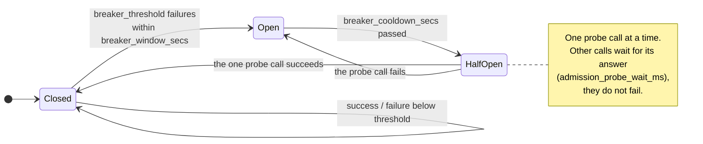
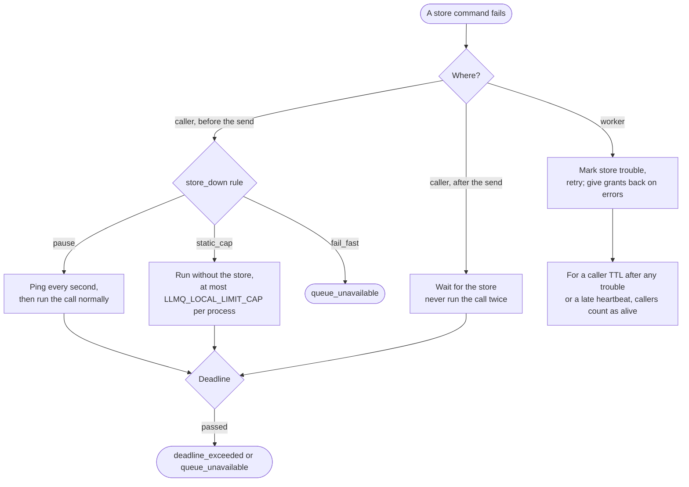

# Failures and recovery

How the library behaves when a worker, the store, a provider or a caller fails. Every row is
exercised by a fault scenario (`scripts/scenarios.py`) or a gate.

## Circuit breaker

## State store outage

Applies when the state store fails before the call was sent (registering). `pause` (default): ping
every second until the call's timeout, then run it normally, else `queue_unavailable`. `static_cap`:
run without the store, at most `LLMQ_LOCAL_LIMIT_CAP` (10) calls per process and model, confirmed
deployments in order, no budgets (quotas may be exceeded). `fail_fast`: `queue_unavailable` at once.
A call already sent never takes this path: its caller waits for the store until its deadline (before,
it could run twice). A streaming call fails `queue_unavailable` (chunks travel through the store).

## Failure model

| Event | What happens |
|---|---|
| Worker killed mid-call | Its message reappears after `visibility_secs` (60) with one failure counted; its grant's lease lapses and `SWEEP` frees the slot and entry (the charged budget stays); `PICK_TAKE` drops a dead owner's entry when the message is admitted again. A result already stored is reused. After `max_receives` (10) failures the message is dead-lettered and the caller gets `dead_lettered` (B13 / B30 / B71 tested) |
| Error inside the worker (store refusal, bug) | `_release`: every grant settled as a cut, message returned at once (or in 5 s for missing numbers); a direct call's caller gets the error. A store blip after the provider answered skips `FINISH` (the lease expires) but keeps the answer |
| State store outage | Callers already waiting keep waiting for the store; new calls follow `store_down`, all within the call's one deadline (timeout + `caller_margin_secs`). A worker treats callers as alive for a caller TTL + a heartbeat + 5 s after it saw the store fail (any store error, a late heartbeat, or a heartbeat back from a gap), so waiting calls are not dropped as `caller_gone` (B95: 45 s block, 500 waiting, 0 dropped; scenarios S4, S5). The registry stays on its last good copy. Admin operations raise `StoreUnavailable` |
| Half-open store (replies never come) | Every store command fails after `Tuning.store.read_timeout_secs` (15 s); a timeout is not retried (redis-py retries it by default: 4 x 15 s, and a Lua write could run twice). Scenario S5 |
| Store out of memory | Calls fail as `queue_unavailable` ("out of memory"), admin operations as `StoreUnavailable` (scenario S9) |
| A call still held past its deadline | Should not happen; the heartbeat logs `held_call_stuck`, cancels its task, gives its grants back and returns its message (one-hour soak: two calls were renewed for 50 minutes) |
| Store failover | Reconnect on `READONLY`; `scripts/failover.py`: `failover` and `restart` lose no call; `slowdns` (DNS lags 6 s) may fail calls in flight, at most 5 % |
| Queue store outage (separate store) | Per call: send retries for 5 s, then the call runs direct under the same budgets |
| Provider throttle | Refund all, limiter cut, retry elsewhere ([Attempts and retries](attempts.md)); alert `quota_above_observed` when throttles come with budget left |
| Provider errors | Breaker per deployment; retries capped by attempts, a per-model retry budget and the deadline. A move to a deployment the call has not tried is free of the retry budget (failover, bounded by the deployments); retries after every deployment failed spend it (scenarios P3, P4, P7) |
| Credentials refused | The account is skipped in that region only, with backoff (5 s doubling to 60 s): an opt-in region such as ap-south-2 can refuse a token the others accept (scenario P5) |
| Deployment broken (target errors) | `disable_errors` (3) distinct requests in `disable_window_secs` (300) with no success between disable it, unless it is the model's last healthy one (then only a log); probes after `probe_after_secs` (900), then doubling (at least 60 s) up to `probe_max_secs` (7200); health is apart from the registry, so a deploy never re-enables one |
| No usable deployment | `model_unavailable` with `retry_after_secs` until the next probe |
| Caller gone | The awaiting task cancelled: the call is cancelled unless another caller waits on the id. The calling process dead (no `P:caller:` key): the worker cancels it on receive (`caller_gone`) |
| Cancel | Waiting: never starts (`cancelled`); running: the attempt task is cancelled, the grant settled with nothing refunded |
| Deploy / restart | `pause_receiving()` (preStop) fails readiness and stops receiving; `stop(drain_secs)` returns held messages, lets running calls and this pod's waiting callers finish within `LLMQ_DRAIN_SECS` (45), then cancels (B33: 4 rolling restarts, 0 lost) |
| Registry invalid in the store | Read leniently (unknown names are warnings); an invalid stored document is ignored and the last good one kept |
