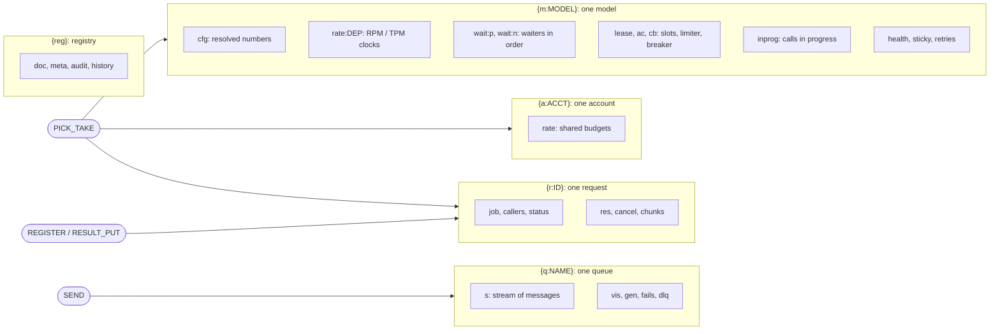

# Storage: keys and store usage

Every key the library writes, and the rules it follows on the store.

`P` is `LLMQ_KEY_PREFIX`; each box is one hash tag. One admission script touches several
tags at once, which is why cluster mode is not supported (see [Store usage](#store-usage)).

## Key layout

`P` is `LLMQ_KEY_PREFIX` (default `llmq`). Queue names are `LLMQ_QUEUE_PREFIX` + `llm-<alias>` (or the
model's `queue.name`) and `...-priority`; jobs use `jobs-<name>`. Hash tags group a model
(`{m:A}`), a request (`{r:ID}`), a queue (`{q:NAME}`), an account (`{a:ACCT}`) and the registry
(`{reg}`), but scripts cross tags (see [Storage](storage.md#store-usage)).

| Keys | Type | Holds | Lifetime |
|---|---|---|---|
| `P:{reg}:doc`, `:meta`, `:audit`, `:history` | string, hash, stream, hash | Registry JSON; `version`, `config_hash`, `changes`, `published`; one audit entry per publish / edit (`actor, op, version, diff, ts`); the last 20 published versions | audit trimmed to `LLMQ_AUDIT_RETENTION_DAYS` (90) |
| `P:{m:A}:cfg` | hash | `numbers` (resolved admission settings per deployment), `changes` | until `registry gc` |
| `P:{m:A}:rate:DEP` | hash | `rpm_tat`, `tpm_tat`, class clocks `p_/n_rpm_tat`, `p_/n_tpm_tat` (or `*_win` / `*_n` when fixed); `seen_win`, `seen_calls`, `seen_tokens`, `seen_n` | 180 s, refreshed on write |
| `P:{a:ACCT}:rate` | hash | Account budget clocks / counters | 180 s |
| `P:{m:A}:wait:p`, `:wait:n`, `:waitinfo` | zset, zset, hash | Waiters by queue position; their cost, usable deployments, expiry | entries expire after 2 s unless refreshed |
| `P:{m:A}:ac:DEP`, `:lease:DEP:p`, `:lease:DEP:n`, `:cb:DEP` | hash, zsets, hash | Learned concurrency (`limit`, `cut_at`); slots in use (owner to lease expiry); breaker (`state`, `failures`, `until`, `probe`, `probe_at`) | no TTL (leases expire by score) |
| `P:{m:A}:inprog`, `:inprog:ID` | zset, hash | Calls in progress (owner to lease expiry); the grant (owner, worker, dep, cls, minute, cost, account, started) | entry 2 x lease, renewed |
| `P:{m:A}:health`, `:terr:DEP`, `:thr:DEP:MIN` | hash, zset, counter | fields `DEP\|until`, `DEP\|wait`, `DEP\|since`, `DEP\|lat` (latency EWMA, ms), `DEP\|n`; target errors by request id; throttles this minute | window; 180 s |
| `P:{m:A}:rot`, `:sticky:HASH`, `:retries:MIN` | hash, string, hash | Rotation; a session's deployment; retries and first attempts this minute | none; `sticky.idle_ttl_secs` (1800); 120 s |
| `P:{r:ID}:job`, `:callers`, `:status`, `:res`, `:cancel`, `:chunks`, `:debug` | hash, set, hash, string, string, stream, string | Claim; calling processes; status (`state`, `model`, `priority`, `<state>_at`, ...); result; cancel flag; stream; `debug_capture` text | job and callers: deadline + status TTL; status: `LLMQ_STATUS_TTL_SECS` (1800); res: `LLMQ_RESULT_TTL_SECS` (300), deleted on first read for a library id; cancel: status TTL; chunks: result TTL + timeout; debug: 1 h |
| `P:{q:NAME}:s`, `:vis`, `:gen`, `:fails`, `:st`, `:dlq`, `:meta` | stream, zset, hashes, stream, hash | Messages; hidden until; generation; failures; held / returned; dead letters (`body, src, fails`); the receive cursor | stream `MINID` 4 days (`retention_secs`); DLQ 1 day |
| `P:bell:NAME` | list | Doorbell tokens (at most 64) | 60 s |
| `P:caller:WORKER`, `P:done:WORKER`, `P:cancel` | string, channel, channel | Process liveness; result wake-ups; cancels | `LLMQ_CALLER_TTL_SECS` (30) |
| `P:epoch`, `P:reset_minute`, `P:lock:{sweep,alerts,probe:A}`, `P:alert:*`, `P:health:WORKER` | strings | Store-reset detector; locks for one-process tasks; alert state; readiness probe | locks 5-25 s; alerts 1 day; probe 5 s |

## Store usage

- **Single primary only** (with replicas). Cluster mode is not supported: the scripts build key
  names inside Lua from the prefix rather than taking them in `KEYS`, and one script touches several
  tags (`PICK_TAKE` writes `{m:}`, `{r:}` and `{a:}` keys; `SEND` pushes the doorbell, which is not in
  `KEYS` and has no tag). Two stores are possible: the queue store holds only queues and doorbells.
- **Time** is the store's (`TIME` inside every script); a process keeps an offset (`StoreClock`,
  resynced every heartbeat), so pod clock skew does not matter.
- **Client** (`store_client.py`): bytes replies, `BlockingConnectionPool` with
  `LLMQ_STORE_MAX_CONNECTIONS` (200) and a 10 s wait for a free connection, connect timeout 5 s,
  keepalive, idle health check 30 s, and 3 retries with jitter (about 1.5 s) on dropped connections,
  timeouts and `READONLY`. `READONLY` closes the connection, so the retry resolves the DNS name again
  and reaches the new primary after a failover (before, every write failed until a restart).
  `valkey://` / `valkeys://` are accepted. Store passwords can come from `from_env(secrets=)`, read on
  every new connection.
- **Readiness** (`health_check`): ready means registry loaded and not draining; each store is probed
  with a bounded (1 s) write and reported `ok`, `read_only` or `down`, but never makes the process
  unready.
- **`NOSCRIPT`**: a pipelined `SEND` + `WAIT` that meets a node without the script cached is run once
  more (pipelines load scripts only when they start); plain script calls rely on redis-py's reload.
- **Queue store failover**: `LLMQ_QUEUE_FAILOVER_SECS` (5) of send errors before a call runs direct;
  `LLMQ_QUEUE_WAIT_REPLICAS` / `LLMQ_QUEUE_WAIT_MS` (0 / 100) make a send wait for replicas.
- **Store reset**: a missing `P:epoch` (restart without data, failover to an empty node) is detected
  by the heartbeat: running grants are put back (`REREGISTER`), a fixed window holds until the next
  minute, and the reload loop republishes the registry (live edits are lost and logged).
- **TLS**: outside `LLMQ_ENVIRONMENT` `dev` / `local` / `test` / `ci`, store URLs must be `rediss://`
  with certificate and host-name checks on (a localhost URL is allowed), and `LLMQ_ID_HASH_SALT` is
  required.
