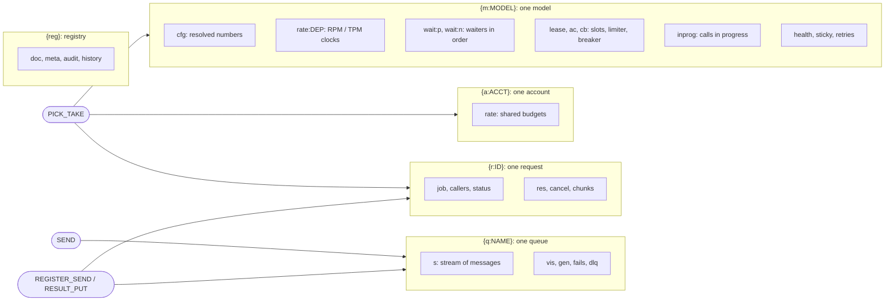

# Storage: keys and store usage

Every key the library writes, and the rules it follows on the store.

`P` is `LLMQ_KEY_PREFIX`; each box is one hash tag. One admission script touches several
tags at once, which is why cluster mode is not supported (see [Store usage](#store-usage)).

## Key layout

`P` is `LLMQ_KEY_PREFIX` (default `llmq`). Queue names are `LLMQ_QUEUE_PREFIX` + `llm-<alias>` (or the
model's `queue.name`) and `...-priority`; jobs use `jobs-<name>`. Hash tags group a model
(`{m:A}`), a request (`{r:ID}`), a queue (`{q:NAME}`), an account (`{a:ACCT}`) and the registry
(`{reg}`), but scripts cross tags (see [Store usage](#store-usage)).

This table is the short form. [Store keys](../reference/store-keys.md) lists every key with its
fields, writers, readers, code references and what happens if the store drops it.

"Sliding" means each write sets the lifetime again, so the key lives that long after its last
use. "Held" is `max(budget_key_ms, 2 x LLMQ_LEASE_SECS)` = 180 s by default. Lifetimes are the
same in both [key expiry modes](#key-expiry-modes); only how they are kept differs.

| Keys | Type | Holds | Lifetime |
|---|---|---|---|
| `P:{reg}:doc`, `:meta`, `:audit`, `:history` | string, hash, stream, hash | Registry JSON; `version`, `config_hash`, `changes`, `published`; one audit entry per publish, live edit, purge and CLI cancel (`actor, op, version, diff, ts`); the last 20 published versions | no expiry. The audit is trimmed on each write to about 10000 entries (`MAXLEN ~`) and to `LLMQ_AUDIT_RETENTION_DAYS` (90); a CLI cancel entry trims by `MAXLEN` only |
| `P:{m:A}:cfg` | hash | `numbers` (resolved admission settings per deployment), `changes` | no expiry; deleted by the `PUBLISH` that removes the model, or a model purge (see [Purge](../how-to/purge.md)) |
| `P:{m:A}:rate:DEP` | hash | `rpm_tat`, `tpm_tat`, class clocks `p_/n_rpm_tat`, `p_/n_tpm_tat` (or `*_win` / `*_n` when fixed); `seen_win`, `seen_calls`, `seen_tokens`, `seen_n` | 180 s (`budget_key_ms`), sliding |
| `P:{a:ACCT}:rate` | hash | Account budget clocks / counters | 180 s, sliding |
| `P:reset_minute` | string | After a store reset: the minute fixed windows hold until | 120 s |
| `P:{m:A}:wait:p`, `:wait:n`, `:waitinfo` | zset, zset, hash | Waiters by queue position; each waiter's cost, usable deployments and `exp` (with [backfill](admission.md#backfill) on, also `at`: its predicted grant per deployment) | keys: held (180 s), sliding. A waiter counts only while its `exp` (now + 2 s, refreshed on each ask) is ahead |
| `P:{m:A}:waitexp` | zset | Waiters by `exp`, so `PICK_TAKE` touches only expired ones | 180 s from the last refusal |
| `P:{m:A}:lease:DEP:p`, `:lease:DEP:n` | zsets | Slots in use (owner to lease end) | key: held (180 s), sliding; members end at their score (lease 60 s, renewed every lease / 3) |
| `P:{m:A}:inprog` | zset | Calls in progress (owner to lease end) | held (180 s), sliding |
| `P:{m:A}:inprog:ID` | hash | The grant (owner, worker, dep, cls, minute, cost, account, started, ...) | 2 x lease (120 s), set again by every heartbeat |
| `P:{m:A}:ac:DEP` | hash | Learned concurrency (`limit`, `cut_at`) | 1 day, sliding (on create and after each learned outcome) |
| `P:{m:A}:cb:DEP` | hash | Breaker (`state`, `failures`, `fail_at`, `until`, `probe`, `probe_at`) and throttle backoff (`thr_n`, `thr_until`) | 1 day, sliding (after each outcome and probe grant) |
| `P:{m:A}:health` | hash | Per deployment: `DEP\|until`, `DEP\|wait`, `DEP\|since`, `DEP\|lat` (latency EWMA, ms), `DEP\|lat_at`, `DEP\|n` | 1 day, sliding, but only when a finished call writes a latency sample. A hash written only by error records, probes or `disable` has no expiry |
| `P:{m:A}:terr:DEP` | zset | Target errors by request id | model setting `health.disable_window_secs` (300 s) from the last error |
| `P:{m:A}:thr:DEP:MIN` | counter | Throttles this minute | 180 s |
| `P:{m:A}:rot` | hash | Rotation (round robin and strategy state) | 1 day, sliding |
| `P:{m:A}:sticky:HASH` | string | A session's deployment | model setting `sticky.idle_ttl_secs` (1800 s), set again on every grant |
| `P:{m:A}:retries:MIN` | hash | Retries and first attempts this minute | 180 s |
| `P:{m:A}:tf:t:H`, `:tf:s:H` | hash, zset | Tenant fairness, per tenant hash `H`: the tenant's budget clocks and `fq` round; its share slots | `tf:t`: 180 s per budget write, `max(180 s, 2 x fairness.active_secs)` per round write; `tf:s`: held (180 s), sliding |
| `P:{m:A}:tf:act`, `:tf:w`, `:tf:need`, `:tf:fq` | zset, hash, zset, hash | Active tenants; their weights and `~sum`; waiting requests that need a share slot; the fair-queue round served | `act` / `w`: `max(180 s, 2 x active_secs)`, sliding; `need`: held (180 s), sliding; `fq`: 1 day, sliding |
| `P:{r:ID}:job`, `:callers` | hash, set | Claim; calling processes | 30 s until the send is confirmed; then the call's deadline + `LLMQ_STATUS_TTL_SECS` (1800 s); after the result 1800 s. A record a worker's claim created: `job_ttl_ms` (1 h), pushed back by heartbeats |
| `P:{r:ID}:status` | hash | `state`, `model`, `priority`, `<state>_at`, ... | `LLMQ_STATUS_TTL_SECS` (1800 s); a write never shortens it |
| `P:{r:ID}:cancel` | string | Cancel flag | `LLMQ_STATUS_TTL_SECS` (1800 s) |
| `P:{r:ID}:res` | string | The result (or an offload marker) | `LLMQ_RESULT_TTL_SECS` (300 s). After the first read of a library-made id it is cut to 2 s (or `LLMQ_RESULT_DEDUPE_SECS` when above 0); an app-supplied id keeps 300 s. Only an offloaded marker is deleted outright, after the offload read (when no dedupe window is set) |
| `P:{r:ID}:chunks` | stream | A streamed call's chunks | `LLMQ_RESULT_TTL_SECS` + the call's timeout, set again on each write; 30 s after the end |
| `P:{r:ID}:debug` | string | `debug_capture` text (dev only) | 1 hour |
| `P:offload` | string | A process with offload started (pods without it refuse to start) | 7 days, set again on each start and offloaded write |
| `P:{q:NAME}:s` | stream | Messages | no expiry; on each add, trimmed with `MINID ~` to `queue.retention_secs` (1 day, at most 14); a message leaves on ack |
| `P:{q:NAME}:vis`, `:gen`, `:fails`, `:st`, `:meta` | zset, hashes | Hidden until; generation; failures; held / returned; the receive cursor | no expiry; members and fields leave with their message |
| `P:{q:NAME}:dlq` | stream | Dead letters (`body, src, fails`) | no expiry; trimmed to `queue.dlq_retention_secs` (1 day) on each dead letter, by the sweeper every 10 s and by each job loop's upkeep. Job queues: `LLMQ_JOB_DEAD_RETENTION_SECS` (7 days) |
| `P:rcv:WORKER:ALIAS` | string | A receive claim (the batch a worker holds, its deadline) | the queue's `visibility_secs` (60 s) |
| `P:bell:NAME` | list | Doorbell tokens (at most 64) | 60 s from the last push |
| `P:jobs:QP` | set | Job names, for `status()` and the CLI | `LLMQ_JOB_DEAD_RETENTION_SECS` (7 days), set again every upkeep (10 s) |
| `P:{q:QP jobs-NAME}:consumer` | string | Some process consumes this job queue | 30 s, set every 10 s |
| `P:{q:QP jobs-NAME}:id:JOBID` | string | Job send dedupe | 60 s until the send is confirmed, then `LLMQ_JOB_DEDUPE_SECS` (1 day) |
| `P:{q:QP jobs-NAME}:returns` | hash | Give-backs per message | the jobs queue's `retention_secs` (1 day), set on each return |
| `P:caller:WORKER` | string | Process liveness | `max(LLMQ_CALLER_TTL_SECS, ceil(2 x lease / 3) + 5)` = 45 s by default, set again on every heartbeat and send |
| `P:done:WORKER`, `P:cancel` | channels | Result wake-ups; cancels | not stored |
| `P:chunkwake:WORKER` | stream | Wakes the process's shared chunk reader when a new stream opens | `MAXLEN 1`; 60 s from the last wake-up |
| `P:epoch` | string | Store-reset detector | no expiry |
| `P:lock:sweep`, `P:lock:ttlsweep`, `P:lock:probe`, `P:lock:alerts`, `P:lock:purge` | strings | One process at a time runs the worker sweep, sweeps the expiry index, probes, evaluates alerts, runs auto purges | sweep and ttlsweep 10 s (`sweep_secs`); probe 5 s (35 s while a probe runs); alerts 45 s, renewed by the holder; purge 120 s or until released |
| `P:alert:NAME:LABELS` | string | An alert's last state | 1 day, set again every evaluation |
| `P:health:WORKER` | string | Readiness write probe (each store) | 5 s |
| `P:purge` | zset | Auto purges waiting for their grace (target `alias` or `alias/account/name` to due time, store ms) | no expiry; entries until purged or cancelled |
| `P:expiry` | string | The store's key expiry mode: `native` or `swept` | no expiry |
| `P:ttl` | zset | The expiry index (key to expire-at, store ms), used in `swept` mode | no expiry; members leave when swept |

`PUBLISH` of a registry without a model deletes that model's `cfg`, `health`, `rot`, `inprog`,
`wait:p`, `wait:n`, `waitinfo` and `waitexp` at once; its other keys go by their lifetime, or
sooner with a purge.

## Store usage

- **Single primary only** (with replicas). Cluster mode is not supported (`start()` refuses it,
  see [Store requirements](#store-requirements)): the scripts build key
  names inside Lua from the prefix rather than taking them in `KEYS`, and one script touches several
  tags (`PICK_TAKE` writes `{m:}`, `{r:}` and `{a:}` keys; `SEND` pushes the doorbell, which is not in
  `KEYS` and has no tag). Two stores are possible: the queue store holds the queues, doorbells,
  receive claims (`P:rcv:*`), the job keys (`P:jobs:*`, `{q:jobs-*}:consumer`, `:id:*`,
  `:returns`), its own health probe key and its own `P:expiry` and `P:ttl`. Everything else is
  in the state store.
- **Time** is the store's (`TIME` inside every script); a process keeps an offset (`StoreClock`,
  resynced every heartbeat), so pod clock skew does not matter.
- **Client** (`store_client.py`): bytes replies, `BlockingConnectionPool` with
  `LLMQ_STORE_MAX_CONNECTIONS` (200) and a 10 s wait for a free connection, connect timeout 5 s,
  keepalive, idle health check 30 s, and 3 retries with jitter (about 1.5 s) on dropped connections,
  timeouts and `READONLY`. `READONLY` closes the connection, so the retry resolves the DNS name again
  and reaches the new primary after a failover (before, every write failed until a restart).
  `valkey://` / `valkeys://` are accepted. Store passwords can come from `from_env(secrets=)`, read on
  every new connection.
- **Readiness** (`health_check`): ready means registry loaded and not draining. A background task
  probes each store every 5 s with a short write bounded by `EngineTimings.health_probe_secs`
  (3 s) and caches the answer, so a readiness probe answers at once. Each store is reported `ok`,
  `read_only` or `down` (a refused write, such as out of memory, is `down`); the stores' state is
  reported but never makes the process unready, and a store error never turns into a 500.
  In strict mode (`LLMQ_ENVIRONMENT` not `dev` / `local` / `test` / `ci`) an eviction policy
  that may evict the library's keys does make it unready, with `not_ready_reason`: `allkeys-*`
  always, `volatile-*` only with native TTLs (see [Key expiry modes](#key-expiry-modes)).
  Liveness is false when a background loop died or the heartbeat stopped for a lease.
- **`NOSCRIPT`**: a pipelined `SEND` + `WAIT` that meets a node without the script cached is run once
  more (pipelines load scripts only when they start); plain script calls rely on redis-py's reload.
- **Queue store failover**: `LLMQ_QUEUE_FAILOVER_SECS` (5) of send errors (each try bounded by
  it) before a call runs direct; the next calls skip the queue store while the outage is remembered;
  `LLMQ_QUEUE_WAIT_REPLICAS` / `LLMQ_QUEUE_WAIT_MS` (0 / 100) make a send wait for replicas.
- **Store reset**: a missing or changed `P:epoch` (restart without data, failover to an empty node)
  is detected by every pod's heartbeat (each remembers the epoch it saw): the pod writes the
  key expiry mode (`P:expiry`) again, and each pod puts its own
  running grants back (`REREGISTER`), and grants `RENEW` reports as lost are registered again. A
  fixed window holds until the next minute, and the reload loop republishes the registry (live
  edits and live blocks are lost with the store's data, and logged).
- **TLS**: unless `LLMQ_ENVIRONMENT` is `dev` / `local` / `test` / `ci` (unset counts as strict),
  store URLs must be `rediss://` with certificate and host-name checks on (a localhost URL is
  allowed), and `LLMQ_ID_HASH_SALT` is required. The URL is read with redis-py's own parser, a
  repeated query parameter is refused, and `ssl_cert_reqs=required` / `ssl_check_hostname=true`
  are written into the URL explicitly. See [Environment variables](../reference/environment.md).

## Key expiry modes

Every key above with a lifetime needs something to delete it on time. There are two ways, and
`LLMQ_KEY_EXPIRY` picks one per store.

| | `native` | `swept` |
|---|---|---|
| How a key expires | A Valkey TTL (`PEXPIRE`, `SET ... PX`) | No TTL. Its expire-at goes into the zset `P:ttl` (member = key name, score = store ms); the sweeper deletes it |
| When | On time | Up to one sweep late (`sweep_secs`, 10 s) |
| Can `volatile-*` evict the library's keys? | Yes: almost all of them have a TTL | No: none it needs has a TTL |
| Store policy it needs | `noeviction` | `noeviction` or any `volatile-*` |
| Extra store work | None | One `ZADD` per expiry write (in the same script or pipeline); one sweep script every 10 s |

Example: a call's `P:{r:ID}:status` is written with a lifetime of 1800 s. In `native` it gets
`PEXPIRE 1800000`. In `swept` it gets no TTL and `ZADD P:ttl <now + 1800000> llmq:{r:ID}:status`.
About 1800 s later the next sweep finds it due, deletes it with `UNLINK` and removes the member.

**The index and the sweep.** Every process, worker or caller, tries every `sweep_secs` (10 s)
to take the expiry sweep's own lock, `P:lock:ttlsweep`; the one that gets it runs `TTL_SWEEP`.
It is a separate lock from the worker sweep's `P:lock:sweep` (lapsed leases, dead letters), so
the index is swept even in a fleet of callers only, and a slow worker sweep never holds it
back. One run deletes up to `LLMQ_TTL_SWEEP_BATCH` (500) due keys; the sweep runs again while a
run comes back full, at most `LLMQ_TTL_SWEEP_ROUNDS` (100) times. That is up to 50000 keys per
10 s by default; a bigger backlog waits for the next sweep.
Each deleted key counts in `llmq_ttl_swept_total`. The sweep runs in both modes, so keys indexed
while `swept` still go after a switch to `native`. A script that asks for a key's time left
(`PTTL`) reads the index in `swept` mode, so the "only lengthen" and "set when none" rules
behave the same in both modes.

**What stays native, and why.** Seven keys keep a real TTL in both modes. Losing any of them is
harmless, and the sweep locks must not wait for the sweep:

| Key | Why native |
|---|---|
| `P:lock:ttlsweep`, `P:lock:sweep` | The sweeps' own locks: they must lapse even when no sweep runs. Lost: two processes sweep at once (idempotent) |
| `P:lock:probe`, `P:lock:alerts`, `P:lock:purge` | Short locks. Lost: duplicate probing, alert evaluation or purge tick; all idempotent |
| `P:health:WORKER` | The 5 s readiness write probe. Lost: nothing |
| `P:{r:ID}:debug` | Debug capture, dev only. Lost: nothing |

Keys whose existence means something (`P:caller:*` liveness, the job send claim, receive
claims) are indexed, so in `swept` mode they can live up to 10 s past their lifetime. For
example, a caller that died is seen as gone after 45 to 55 s instead of 45 s.

**Where the mode lives.** The mode belongs to the store, not to a process: `P:expiry` holds
`native` or `swept` (no TTL), and every script reads it. **A missing `P:expiry` means
`native`.** So a part used without a started engine (the CLI, a purge service) follows whatever
the store says, and a store that never saw an engine uses native TTLs. A started engine writes
the mode at `start()`, every minute (when it reads the eviction policy again) and after a store
reset. A change logs `key_expiry_changed` (warning, with `store`, `policy`, `before` and
`mode`); a failed write logs `key_expiry_publish_failed` (warning) and is retried a minute later.
Until a process has published its mode, it reports the mode its setting asks for (`native` for
`auto`). With a separate queue store, each store has its own `P:expiry` and `P:ttl`.

**`auto` (the default).** The engine reads the store's `maxmemory-policy` (`CONFIG GET`, else
`INFO memory`, as on ElastiCache) and picks:

| Policy | `auto` picks | Ready in strict mode? |
|---|---|---|
| `noeviction` | `native` | Yes |
| `volatile-lru`, `-lfu`, `-ttl`, `-random` | `swept` | Yes |
| `allkeys-*` | `swept` (the safer one) | No: `allkeys-*` can evict keys with no TTL (queues, registry), so no mode makes it safe |
| unknown (unreadable) | `swept` | Yes |

`LLMQ_KEY_EXPIRY=native` or `swept` forces the mode. `native` on a `volatile-*` store makes a
strict-mode process unready. Give every process of one prefix the same setting: the last one to
write `P:expiry` wins, and each logs `key_expiry_changed` when it flips the mode.

**Switching modes.** In `swept` mode, setting an expiry also clears the key's native TTL
(`PERSIST`); in `native` mode it also removes the key's `P:ttl` member; reading a key's time
left counts either. So a switch (an upgrade from 0.1.0b2 on a `volatile-lru` store, or a policy
change under `auto`) loses nothing: each key moves to the new mode on its next write, and a key
never written again keeps its old expiry and still goes then. From `native` to `swept`, such a
key keeps its TTL (and stays evictable) until it is written again or expires: within a day for
the slowest (`ac`, `cb`, `rot`). From `swept` to `native`, it keeps its index member and the
sweep, which runs in both modes, deletes it on time. During a rolling upgrade from 0.1.0b2 the
old pods still set native TTLs and do not read `P:expiry`; finish the rollout (see
[Upgrade](../how-to/upgrade.md)).

**Seeing it.** `health()["key_expiry"]` is the state store's mode; the gauge
`llmq_key_expiry_swept{store}` is 1 in `swept`; `ZCARD P:ttl` is the number of keys waiting to
expire. See [Shared cache store](../how-to/shared-cache-store.md) for running on a `volatile-lru`
cache.

## Store requirements

| Requirement | Why | What the library does |
|---|---|---|
| `maxmemory-policy noeviction`, **or** a `volatile-*` policy with key expiry `swept` | Any other set-up lets a full store evict queue messages, budgets and results: lost calls and overspent budgets. `allkeys-*` is never safe | Reads the policy at `start()` and every minute after (`CONFIG GET`, else `INFO memory` where `CONFIG` is disabled, as on ElastiCache) and picks the [key expiry mode](#key-expiry-modes). Logs `store_eviction_policy` (warning) when the policy can evict its keys in that mode (`allkeys-*`, or `volatile-*` with `native`) and, in strict mode, fails readiness with `not_ready_reason`. Reports `eviction_policy` (`unknown` when unreadable) and `key_expiry` in `health()`, and `queue_eviction_policy` when the queue store is a separate one |
| One primary (with replicas), **not cluster mode** | One admission script touches keys of several hash tags | `start()` refuses a cluster-mode store with a `ConfigError` (`INFO cluster`) instead of failing at the first call |
| Lua scripts, pub/sub, blocking list reads (`BLPOP`) | Admission, result wake-ups and the queue doorbell | ElastiCache for Valkey / Redis OSS allows all three |
| A store that is out of memory | `noeviction` refuses writes when full; so does `volatile-*` once only keys without a TTL are left | Calls fail `queue_unavailable` ("out of memory"), admin operations `StoreUnavailable`; nothing is lost silently |
| `min-replicas-to-write 1` (recommended with replicas) | Without it a primary that lost its replicas keeps accepting writes, and a failover then drops what only it held | A write the store refuses for it (`NOREPLICAS`), like `OOM`, `MISCONF` (a failed save), `BUSY` (a long script) and `READONLY`, is treated as the store being down: `store_down` decides (pause, static cap, fail fast); a result already written stays readable |

Set `min-replicas-to-write` with `min-replicas-max-lag` (for example 1 and 10 s) on a replicated
self-managed Valkey or Redis; on a managed service, check whether its parameter group exposes
them (unverified for ElastiCache). `LLMQ_QUEUE_WAIT_REPLICAS` adds a `WAIT` after each
send for the same guarantee per message.

Tested versions: Valkey 8.1 and Redis 7.4 (the `docker/compose.yaml` stack every integration
test, scenario and gate runs on); Valkey 8 and Redis 7.2+ are supported. The client is redis-py
6 or later (`redis>=6,<9`): from 6 on, TLS connections check the host name by default, and the
URL parser the settings check uses is the one the client uses.
