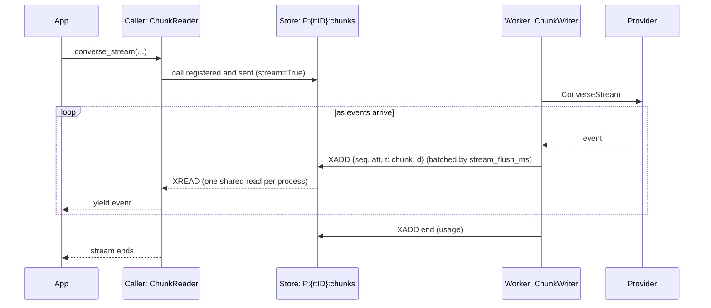

# Streaming

How provider events travel from the worker to the caller through the store.

`converse_stream` / `chat_stream` start a normal call with `stream=True`. The worker's `ChunkWriter`
appends entries `{seq, att, t: chunk|end|error, d}` to `P:{r:ID}:chunks`: the first event at once,
later ones batched by `stream_flush_ms` (30), capped at `stream_max_bytes` (8 MiB, then an error,
never trimmed); `end` carries the usage and TPM is corrected after it. Each caller process runs one
`ChunkReader` (`XREAD` over every open stream, block 100 ms). The caller checks sequence gaps
(`worker_lost`) and idleness (`stream_idle_secs`). After chunks were sent, a failure ends the stream
with an error entry carrying the partial text (`CallFailed.partial_text`) and no switch to another
deployment; a stream already begun by another worker ends `worker_lost`.
