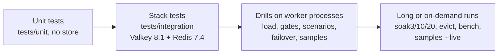

# Tested scenarios

llm-queue sits between an application and its LLM providers (Amazon Bedrock and
OpenAI-compatible APIs). Calls are admitted against shared budgets (requests and tokens per
minute, concurrency slots, priority classes, tenant shares) by Lua scripts in a Valkey or Redis
store, queued on store streams, and run by worker processes with retries, fallback and circuit
breakers. Everything that can fail in that path (providers, workers, callers, the store, the
network, operators) has a defined behaviour.

This page is the catalogue of those behaviours and the evidence for each. Every row gives the
situation, what the library does, how (naming the component), the test or drill that proves
it, which stores and key-expiry modes the proof ran on, and whether it is covered, partly
covered or not covered yet. The second half says how each kind of check runs, where it runs
and the numbers it last produced. It answers "what happens when ...?" and "how do you know?".
How to set up the stack and run the checks is in [Test](../how-to/test.md); what each failure
means in production is in [Failures and recovery](resilience.md).

No check calls a real LLM. Unit tests use in-process fakes; integration tests and drills use
fakellm, a fake Bedrock and OpenAI-compatible server shipped in `tools/fakellm` that can
throttle, fail, hang, cut streams and count every request it saw. Only `scripts/samples.py
--live` and `scripts/soak.py --live` call Amazon Bedrock, and only when someone runs them by
hand.

## How to read the tables

**Proved by** names tests as `path::test_name`, with these path prefixes:

| Prefix | Folder or script |
|---|---|
| `IE/` | `tests/integration/engine/` |
| `IR/` | `tests/integration/registry/` |
| `U/` | `tests/unit/` |
| `scenario Xn` | a named fault scenario in `scripts/scenarios.py` ([Fault scenarios](#fault-scenarios-scriptsscenariospy)) |
| `gate Bnn` | a load or chaos gate in `scripts/gates.py` ([Load and chaos gates](#load-and-chaos-gates-scriptsgatespy)) |
| `drill ...` | `scripts/failover.py`, `scripts/evict_drill.py`, `scripts/load.py`, `scripts/soak.py` |

A number in brackets after a file, such as `(14)`, is the number of tests in it that prove the
row. `TODO(test)` marks a behaviour that 0.2.0 delivers whose proving test is named here once
it is merged.

**Stores/modes:**

| Code | Meaning |
|---|---|
| `VR/as` | Runs on Valkey 8.1 **and** Redis 7.4; key expiry `auto` in CI and `swept` (no native TTLs, as on a shared `volatile-*` store) in the nightly run |
| `VR` | Runs on Valkey 8.1 and Redis 7.4, default expiry (registry integration tests) |
| `none` | Unit test with fakes, no store |
| `V/drill` | Worker and caller processes against the local Valkey (scenarios, gates, load, soak) |
| `V/fo` | Throwaway Valkey primary and replica in Docker (failover drill, gate B23) |
| `V/noev`, `V/vlru` | Eviction drill: a small-memory Valkey with `noeviction` or `volatile-lru` |

**Status:**

| Status | Meaning |
|---|---|
| covered | A test asserts the expected behaviour on the paths that matter |
| covered (0.2.0) | The behaviour is new or corrected in 0.2.0 and a 0.2.0 test asserts it |
| partial | Tested, but a path, store, mode or scale is missing; the row says which |
| not covered | No test yet; the row says what happens today |

## Summary

| Area | Scenarios | Covered | Covered (0.2.0) | Partial | Not covered |
|---|---|---|---|---|---|
| [Admission and budgets](#admission-and-budgets) | 22 | 20 | 1 | 1 | 0 |
| [Fairness and tenants](#fairness-and-tenants) | 15 | 11 | 1 | 2 | 1 |
| [Retries, fallback and circuit breaker](#retries-fallback-and-circuit-breaker) | 15 | 13 | 2 | 0 | 0 |
| [Provider failures](#provider-failures) | 16 | 16 | 0 | 0 | 0 |
| [Worker and pod failures](#worker-and-pod-failures) | 15 | 13 | 2 | 0 | 0 |
| [Store failures and modes](#store-failures-and-modes) | 24 | 18 | 3 | 2 | 1 |
| [Drain and rolling deploy](#drain-and-rolling-deploy) | 15 | 11 | 1 | 2 | 1 |
| [Cancellation and expiry races](#cancellation-and-expiry-races) | 14 | 12 | 2 | 0 | 0 |
| [Admin operations](#admin-operations) | 30 | 21 | 4 | 4 | 1 |
| [Local execution mode](#local-execution-mode) | 15 | 9 | 6 | 0 | 0 |
| [Secrets and settings](#secrets-and-settings) | 20 | 16 | 3 | 0 | 1 |
| [Streaming](#streaming) | 14 | 12 | 1 | 1 | 0 |
| [Embeddings](#embeddings) | 11 | 11 | 0 | 0 | 0 |
| [FastAPI and LangChain integration](#fastapi-and-langchain-integration) | 12 | 11 | 1 | 0 | 0 |
| [Observability](#observability) | 15 | 12 | 2 | 1 | 0 |
| **Total** | **253** | **206** | **29** | **13** | **5** |

---

## Admission and budgets

Admission is one Lua script per decision (`PICK_TAKE`, `FINISH`, `UNDO`, `RENEW`, `SWEEP` in
`engine/_admission_lua.py`), run atomically in the store on the store's clock, so every pod
sees the same budgets with no cross-pod race. See [Admission](admission.md).

| ID | Situation | Expected behaviour | How | Proved by | Stores/modes | Status |
|---|---|---|---|---|---|---|
| AD-01 | Calls arrive faster than a deployment's RPM (fixed window) | Exactly `rpm` granted per minute, never more, at the store and at the provider | Fixed-window counter per deployment-minute in `PICK_TAKE` | `IE/test_admission.py::test_rpm_fixed_window_exact`; `IE/test_budget_clock.py::test_fixed_window_matches_the_model` (Hypothesis against a Python model); gate B17 (9 deployments, none over 200 a minute) | VR/as, V/drill | covered |
| AD-02 | Same, smooth window with burst | Calls spaced at the rate, a configured burst allowed; a bucket of one call (`rpm x rate_burst` below 2) grants at its rate, priority calls still first | GCRA clock with `rate_burst` | `IE/test_admission.py::test_smooth_window_burst`; `IE/test_budget_clock.py::test_smooth_window_matches_the_model`; `IE/test_020_small_bucket.py` (4); `U/engine/test_020_local_limits.py::test_an_idle_smooth_bucket_of_one_lets_a_call_in`; drill `load.py rate_limit` | VR/as, none, V/drill | covered |
| AD-03 | A call's token cost is unknown until it ends | Input plus weighted max output reserved at grant, corrected to real usage at finish; a refund never exceeds the charge | Estimator (`engine/tokens.py`), `FINISH` correction | `IE/test_admission.py::test_tpm_and_correction`; `U/engine/test_budget_properties.py::test_refund_never_exceeds_the_reservation`; `IE/test_b2_runtime_admission.py::test_refund_is_capped_at_the_charge`; `IE/test_review_fixes.py::test_refund_matches_the_charge` | VR/as, none | covered |
| AD-04 | One call's reservation is larger than the whole TPM | Refused at once (it could never fit), not queued forever | Size check before waiting; the registry refuses a `tpm` below one reservation | `IE/test_b2_integrator_engine.py::test_reservation_above_tpm_is_too_large_at_once`; `U/test_b2_registry_validate.py::test_tpm_below_one_reservation_is_refused` | VR/as, none | covered |
| AD-05 | Several deployments share one account quota | One budget window per shared account, charged by every deployment | Account-level keys in `PICK_TAKE` | `IE/test_admission.py::test_account_budget`; `U/registry/test_registry.py::test_one_window_per_shared_account_budget` | VR/as, none | covered |
| AD-06 | Concurrency limit per class | At most `slots` calls running per class and deployment | Slot zset scored by lease end | `IE/test_admission.py::test_slots_per_class` | VR/as | covered |
| AD-07 | Interactive (priority) and background calls compete | Priority calls start within 2 s even behind a large normal backlog; a class share of 0 never fits | Class shares in `PICK_TAKE`; a separate priority stream | `IE/test_admission.py::test_class_shares`, `::test_fl18_a_class_share_of_zero_never_fits`; gate B56/B93 (2,400 waiting, priority start <= 2 s); gate B17 (priority wait p95 <= 2 s) | VR/as, V/drill | covered |
| AD-08 | A new call arrives while older calls wait for budget | Older waiters served first (no overtaking); each waiter holds only its own deployments | Waiter reservation rule, waiters scored by arrival | `IE/test_admission.py::test_reservation_for_older_waiters`, `::test_waiter_only_holds_its_own_deployments`; gate B56 (no older call starts more than 1 s after a newer one) | VR/as, V/drill | covered |
| AD-09 | Many callers hit one deployment at once | No over-grant, no deadlock | Atomic scripts | `IE/test_contention.py::test_200_callers_one_deployment` | VR/as | covered |
| AD-10 | A call cannot get budget before `max_wait_secs` | Fails `rate_limited` with `retry_after_secs`; a call already past its wait on arrival is refused at once | Waiter expiry index; arrival check | `IE/test_runtime.py::test_rpm_budget_and_expiry`; `IE/test_review_fixes.py::test_call_past_max_wait_is_refused_on_arrival` | VR/as | covered |
| AD-11 | A call's deadline passes | No answer is ever delivered after the deadline; a call held past it is let go | One deadline (timeout plus caller margin) on the store clock | `IE/test_review_fixes.py::test_a_call_never_answers_after_its_deadline`, `::test_a_call_held_past_its_deadline_is_let_go`; the common pass mark of every scenario | VR/as, V/drill | covered |
| AD-12 | Retry backoff would run past the deadline | Backoff cut to the deadline | Attempt loop | `IE/test_review_fixes.py::test_retry_backoff_never_outlives_the_deadline` | VR/as | covered |
| AD-13 | The model's queue is at its waiting limit | `queue_full` at once | `max_waiting` check in the send script | `IE/test_runtime.py::test_queue_full`; `IE/test_queue.py::test_failures_and_waiting_limit` | VR/as | covered |
| AD-14 | Routing between deployments | Weighted, tiered, last-choice and custom balancers order candidates; a refused weighted pick leaves the rotation alone | Strategies in `PICK_TAKE`, `balance` hook | `IE/test_admission.py::test_strategies`, `::test_tiers_and_last_choice`, `::test_fl17_a_refused_weighted_pick_leaves_the_rotation_alone`; `IE/test_runtime.py::test_custom_balancer_orders_candidates`; gate B22 (shares equal within 5 %) | VR/as, V/drill | covered |
| AD-15 | A conversation should stay on one deployment (prompt cache) | Sticky key hit, miss and expiry | Sticky key per session | `IE/test_admission.py::test_sticky_session`, `::test_cg7_sticky_key_hit_miss_and_expiry` | VR/as | covered |
| AD-16 | App-defined admission policy | A hook can reject; a failing hook fails closed and is counted | `admission` hook | `IE/test_runtime.py::test_admission_hook_rejects`; `U/engine/test_tokens_inference.py::test_admission_hook_fails_closed_and_counts` | VR/as, none | covered |
| AD-17 | Budgets edited live (RPM cut to a quarter, then back) | Over-budget calls `rate_limited`; provider calls stay within the cut budget | Registry reload; stale config detected in the scripts | `IE/test_admission.py::test_undo_and_stale_config`; scenario R1, X2, X7 | VR/as, V/drill | covered |
| AD-18 | An admission script is replayed after its reply was lost | Granted once; a replayed `FINISH` or `UNDO` counts once | Owner-checked, idempotent scripts | `IE/test_audit_engine_store.py::test_en5_replayed_fail_counts_one_failure` | VR/as | covered |
| AD-19 | Fractional token cost or refund | Rounded, never half applied | Integer budgets | `IE/test_admission.py::test_fl9_a_fractional_cost_or_refund_is_rounded_not_half_applied` | VR/as | covered |
| AD-20 | Admission cost at scale (20 models x 30 deployments) | Script p99 <= 2 ms; `status()` <= 500 KB and <= 200 ms | Indexed waiters, no scans | gate B91; gate B19 (11.6 scripts per call); gate B22 | V/drill | partial: B91 misses its 2 ms mark on the Windows / Docker dev machine; no Linux or in-VPC run is recorded |
| AD-21 | Large calls wait for TPM while small calls could pass without delaying them | Off by default; with the model's backfill flag on, a small call that fits starts ahead of a large waiter without delaying it | Size-aware backfill in `PICK_TAKE`, behind a per-model flag | `U/engine/test_020_backfill.py`; `IE/test_020_backfill_store.py` | none, VR/as | covered (0.2.0) |
| AD-22 | Throttle pacing and admission timings are tunable | Bad combinations refused at start | `Tuning` validation | `U/test_tuning.py::test_admission_script_timings_are_checked`; `U/test_b2_integrator.py::test_throttle_pacing_is_tunable_and_reaches_the_scripts` | none | covered |

## Fairness and tenants

Off by default. Modes `share`, `quota` and `fair_queue` per model (`engine/fairness.py` and the
admission scripts); see [Fairness](fairness.md). 0.2.0 adds a request index per model and
tenant, so one tenant's calls on one model can be listed, counted, cancelled and moved.

| ID | Situation | Expected behaviour | How | Proved by | Stores/modes | Status |
|---|---|---|---|---|---|---|
| FT-01 | Fairness is off | Admission exactly as without tenants; nothing new written | `mode` unset means off | `IE/test_tenant_fairness.py::test_off_writes_nothing_new`; `U/engine/test_fairness.py::test_off_by_default`, `::test_ask_without_fairness_sends_no_tf` | VR/as, none | covered |
| FT-02 | `share`: tenants with weights compete for slots | Slots split by weight; idle share lent and taken back | Per-tenant slot zset and weight sum | `IE/test_tenant_fairness.py::test_share_slots_by_weight_and_lending` | VR/as | covered |
| FT-03 | `share`: a tenant over its share while another is idle, then the other returns | Borrows, then yields as soon as a tenant within its share waits | Per-tenant GCRA clocks, borrower capped one minute ahead | `IE/test_tenant_fairness.py::test_share_rpm_borrow_then_yield` | VR/as | covered |
| FT-04 | `quota`: a tenant exceeds its hard RPM | `rate_limited` at once with `retry_after_secs`; per-tenant overrides | Tenant clocks | `IE/test_tenant_fairness.py::test_quota_rpm_per_tenant`, `::test_engine_quota_fails_rate_limited`; `U/engine/test_fairness.py::test_quota_per_tenant_override` | VR/as, none | covered |
| FT-05 | `quota`: tenant TPM charged by estimate | Corrected and refunded at finish | `FINISH` tenant correction | `IE/test_tenant_fairness.py::test_quota_tpm_refund` | VR/as | covered |
| FT-06 | `fair_queue`: one tenant floods the queue | Waiting calls served round robin between tenants | Round numbers per tenant | `IE/test_tenant_fairness.py::test_fair_queue_round_robin` | VR/as | covered |
| FT-07 | Which tenant a call belongs to | `tenant_id`, else `user_id`, else one shared tenant; the default tenant setting fills gaps | Context resolution; `LLMQ_DEFAULT_TENANT` | `U/engine/test_fairness.py::test_tenant_then_user_then_shared`; `U/test_020_core.py::test_from_env_worker_id_tenant_admin_and_describe` | none | covered |
| FT-08 | A worker dies holding a tenant slot | Slot renewed by the heartbeat while alive, freed after | Tenant slot zset with lease scores | `IE/test_tenant_fairness.py::test_tenant_slot_renewed_and_freed` | VR/as | covered |
| FT-09 | Tenant state must not leak | Every fairness key expires | Expiry on every write | `IE/test_tenant_fairness.py::test_every_key_expires` | VR/as | covered |
| FT-10 | Raw tenant and user ids must not reach the store | Only keyed hashes in call messages, stream bodies and dead letters | HMAC with `LLMQ_ID_HASH_SALT` | `U/engine/test_fairness.py::test_body_has_only_the_hash`; `IE/test_hashed_ids.py::test_stream_body_and_dead_letter_hold_hashes_only`, `::test_worker_hooks_and_fairness_see_the_hash` | VR/as, none | partial: background job messages still carry the raw ids |
| FT-11 | Tenant names in the registry (weights, quotas) | Hashed so they match the hashed calls: at load, on a live edit, and exactly once when an exported (already hashed) file is published again | Hash at registry load and on registry writes | `U/engine/test_fairness.py::test_registry_tenant_names_are_hashed_at_load`; `U/engine/test_020_requests_settings.py::test_registry_tenant_names_are_hashed_when_read`; `U/test_020_one_hash.py::test_an_exported_document_is_not_hashed_twice`, `::test_live_edit_paths_hash_the_tenant_and_mark_the_block`; `IE/test_020_hashed_tenants.py::test_g16_a_live_weight_edit_stores_the_hash_and_applies` | none | covered (0.2.0) |
| FT-12 | Find one tenant's calls on one model | Index per model and tenant written in the send script, removed in every final script (success, failure, expiry, cancel, dead letter), pruned when lapsed | `{m:ALIAS}:tq:<hash>` zset in `REGISTER_SEND`, `RESULT_PUT`, `SETTLE_DONE` | `IE/test_request_index.py` (14), e.g. `::test_register_send_indexes_and_the_result_removes`, `::test_failure_expiry_and_cancel_remove_the_entry`, `::test_worker_death_and_redelivery_settle_once`, `::test_index_off_writes_nothing` | VR/as | covered |
| FT-13 | Operations on tenant A while tenant B shares the model, and a worker dies | B served, none of its calls moved or cancelled; A's cancelled calls end `cancelled` within 2 s; index empty at the end | Request index and requests admin | scenario T1; `IE/test_request_index.py::test_another_tenant_is_untouched` | V/drill, VR/as | partial: T1 runs 30 calls per tenant; a larger run (300 per tenant, B's latency compared with a run without A's operations, under `burst`) is not built |
| FT-14 | Per-tenant status and metrics | `status(model, tenant=)` block; `tenant` metric label only for allow-listed tenants, others `other` | `engine/status.py`; `LLMQ_METRICS_TENANTS` | `IE/test_tenant_status_metrics.py` (2); `U/engine/test_020_requests_settings.py::test_metrics_tenants_cap`, `::test_tenant_metric_labels` | VR/as, none | covered |
| FT-15 | A call falls back to another model under `share` or `quota` | Tenant charged once, on the model that served it | | none | | not covered |

## Retries, fallback and circuit breaker

What happens when an attempt fails: move to another region, fall back to another model, open a
breaker, or give up within the deadline. See [Attempts](attempts.md).

| ID | Situation | Expected behaviour | How | Proved by | Stores/modes | Status |
|---|---|---|---|---|---|---|
| RF-01 | A region throttles | The call moves to another region at once | Throttle refund and limiter cut | `IE/test_runtime.py::test_throttles_move_to_fallback_region`; scenario P1, X3, X7 | VR/as, V/drill | covered |
| RF-02 | A throttle with `Retry-After` | The deployment is out for **every pod** for `max(Retry-After, jittered backoff)`; a success ends the streak | Shared throttle mark in the store | `IE/test_b2_runtime_admission.py::test_throttle_keeps_a_deployment_out_for_every_pod`, `::test_success_ends_the_throttle_streak`; `U/clients/test_b2_bedrock_transport.py::test_retry_after_reaches_the_classifier` | VR/as, none | covered |
| RF-03 | Throttled on the only deployment | Waits for the window, else `rate_limited` | Throttle wait | `IE/test_b2_runtime_engine.py::test_throttle_waits_for_its_window` | VR/as | covered |
| RF-04 | Model out of budget or unavailable | Model fallback, with the fallback's own limits; a disabled fallback skipped | `model_fallback` rules | `IE/test_runtime.py::test_model_fallback`, `::test_model_fallback_with_headroom_on_smooth_window`; `IE/test_b2_runtime_engine.py::test_fallback_model_gets_its_own_limits`; `IE/test_b2_integrator_engine.py::test_disabled_model_skips_a_disabled_fallback` | VR/as | covered |
| RF-05 | Fallback only for some causes | Only listed causes fall back; a policy hook can veto | `fallback_on`, policy hook | `IE/test_runtime.py::test_fallback_only_for_listed_causes`, `::test_fallback_policy_hook` | VR/as | covered |
| RF-06 | Fallback to another provider (Bedrock Converse to OpenAI chat or back) | Request and reply converted; tool fields dropped for a model without tools | `engine/shapes.py` | `IE/test_front.py::test_q40_a_fallback_of_the_other_provider_is_converted`; `IE/test_b2_integrator_engine.py::test_fallback_model_without_tools_loses_tool_fields`; `U/engine/test_shapes.py` (11) | VR/as, none | covered |
| RF-07 | A deployment fails repeatedly | Breaker opens after `breaker_threshold` failures in its window; after the cooldown one probe; others wait for its verdict; a probe without a verdict or a dead probe frees the breaker | Breaker state in the admission scripts | `IE/test_admission.py::test_breaker_counts_recent_failures_only`, `::test_breaker_window_is_a_setting`, `::test_a_call_waits_for_a_breaker_probe_in_flight`, `::test_a_probe_without_a_verdict_frees_the_breaker`, `::test_a_dead_probe_is_freed_by_the_sweep`; `IE/test_b2_runtime_admission.py::test_only_the_probe_closes_an_open_breaker`, `::test_dead_owner_takeover_frees_the_probe`; scenario P2, X4 | VR/as, V/drill | covered |
| RF-08 | Failures caused by the caller or the deadline | Do not open the breaker | Failure classification | `IE/test_review_fixes.py::test_deadline_cuts_do_not_open_the_breaker`; `IE/test_runtime.py::test_request_caused_errors_are_forgiven` | VR/as | covered |
| RF-09 | Retry budget | A move to an untried region is free; retries after every region failed spend the per-model budget | Retry budget keys | `IE/test_review_fixes.py::test_failover_to_an_untried_region_spends_no_retry_budget`, `::test_retries_after_every_region_failed_still_spend_the_budget`; `IE/test_b2_runtime_engine.py::test_retry_keys_expire_under_the_served_model`; scenario P7 | VR/as, V/drill | covered |
| RF-10 | A deployment keeps returning target errors (model missing, access denied) | Disabled after `disable_errors` distinct requests, but never when it is the model's last usable deployment (registry-disabled, blocked and out-of-residency deployments do not count as usable); probed later with backoff | `engine/health.py` | `IE/test_runtime.py::test_target_errors_disable_a_deployment`, `::test_last_usable_deployment_is_never_disabled`, `::test_probe_recovers_or_backs_off`; `IE/test_audit_engine_store.py::test_en23_failed_probe_doubles_from_probe_after`; scenario P4; `IE/test_020_core_fixes_store.py::test_a3_the_last_deployment_that_takes_calls_is_never_disabled` | VR/as, V/drill | covered (0.2.0) |
| RF-11 | A deployment is slow | Becomes last choice; old latency forgotten | Latency marks | `IE/test_runtime.py::test_slow_deployment_becomes_last_choice`; `IE/test_b2_runtime_admission.py::test_stale_latency_no_longer_marks_slow` | VR/as | covered |
| RF-12 | Confirmed deployments broken | The fallback tier is used | Tiers | `IE/test_runtime.py::test_broken_confirmed_uses_fallback_tier` | VR/as | covered |
| RF-13 | No usable deployment at all | `model_unavailable` with `retry_after_secs` until the next probe | Status read in one round trip | `IE/test_runtime.py::test_model_unavailable`; `IE/test_admission.py::test_unusable_deployments`; `IE/test_audit_runtime.py::test_rt31_model_unavailable_reads_breakers_in_one_round_trip` | VR/as | covered |
| RF-14 | Connection reset by the provider | One quick retry on the same deployment, no breaker or budget charge; a cut body is not quick-retried | Client transport | `U/clients/test_b2_clients_providers.py::test_one_quick_retry_on_a_connection_reset`; `U/clients/test_b2_audit_clients.py::test_a_body_cut_is_not_quick_retried` | none | covered |
| RF-15 | An attempt on the fallback model fails while the original model has capacity again | The next try goes back to the original model | Attempt loop picks the model again for each try | `IE/test_020_core_fixes_store.py::test_a11_a_retry_after_a_failed_fallback_attempt_goes_home_first` | VR/as | covered (0.2.0) |

## Provider failures

How each provider fault is classified and what it costs: a retry, a move, a breaker charge or
an immediate failure.

| ID | Situation | Expected behaviour | How | Proved by | Stores/modes | Status |
|---|---|---|---|---|---|---|
| PF-01 | Real provider error shapes | Each mapped to a kind and a retry-after, the same on every transport | `providers` classify table | `U/providers/test_classify_table.py::test_bedrock_errors`, `::test_openai_errors`, `::test_transport_errors_classify_alike_on_both_bedrock_transports` | none | covered |
| PF-02 | A throttle about tokens | A throttle, not a request error | Classifier | `U/clients/test_b2_clients_providers.py::test_a_bedrock_throttle_about_tokens_is_not_a_request_error` | none | covered |
| PF-03 | 5xx in one region | Other region serves; breaker opens and recovers | Breaker and fallback | scenario P2 | V/drill | covered |
| PF-04 | 5xx in every region | Refused on time; served after | Retry budget, deadline | scenario P7 | V/drill | covered |
| PF-05 | Provider hangs (no first byte) | Attempt timeout, next region; counts against the breaker | First-response timer | `IE/test_runtime.py::test_hung_region_is_left`; `U/clients/test_clients.py::test_hung_region_gives_up_at_first_response`; `IE/test_b2_runtime_engine.py::test_hung_first_response_counts_against_the_breaker`; scenario P3, X8 | VR/as, none, V/drill | covered |
| PF-06 | A long but healthy answer | Not cut by the attempt timer | First-response timer, not a total one | `U/clients/test_clients.py::test_long_healthy_answer_is_not_cut`; `U/clients/test_b2_verify_clients.py::test_a_slow_provider_is_still_an_attempt_timeout` | none | covered |
| PF-07 | Bad request (validation, context too long) | `invalid_request` at once: no retry, no breaker | Request-error kinds | `IE/test_b2_integrator_engine.py::test_bad_request_finishes_as_invalid_request`; `IE/test_b2_runtime_engine.py::test_inference_rejected_is_an_invalid_request`, `::test_target_error_on_the_only_deployment_ends_at_once`; `U/clients/test_b2_clients_providers.py::test_request_error_kinds` | VR/as, none | covered |
| PF-08 | Model not available in one region | Target error; moves without a breaker charge | Target-error class | `IE/test_b2_runtime_engine.py::test_model_error_moves_without_breaker_charge`; scenario P4 | VR/as, V/drill | covered |
| PF-09 | Bad credentials in one region | That account skipped in that region with backoff (5 s to 60 s), reset on success | Per-process credential backoff | `IE/test_review_fixes.py::test_credentials_refused_in_one_region_leave_the_others`; `IE/test_b2_runtime_engine.py::test_credential_backoff_resets_after_success`; `U/clients/test_b2_clients_providers.py::test_signature_and_token_errors_are_auth_errors`; scenario P5 | VR/as, none, V/drill | covered |
| PF-10 | Reply is not JSON, or a stream frame is corrupt | Retryable failure | Parser | `U/clients/test_b2_audit_clients.py::test_a_reply_that_is_not_json_is_retryable`, `::test_a_corrupt_stream_frame_is_retryable`; `U/clients/test_r23_stream_parsing.py::test_a_stream_frame_that_is_not_an_object_is_retryable` | none | covered |
| PF-11 | Connection dropped or body truncated | Transport error, the same text kept on both transports | Transport | `U/clients/test_b2_audit_clients.py::test_a_dropped_stream_is_a_transport_error`; `U/clients/test_b2_clients_providers.py::test_connection_resets_and_truncation`; `U/clients/test_b2_bedrock_transport.py::test_a_cut_stream_fails_the_same_after_the_same_text` | none | covered |
| PF-12 | Provider answers with a redirect | Never followed | HTTP transport | `U/clients/test_b2_audit_clients.py::test_a_redirect_is_never_followed` | none | covered |
| PF-13 | Two Bedrock transports (botocore, aiohttp) and two OpenAI clients (aiohttp, httpx) | Same bodies, replies, streams and errors | Transport parity | `U/clients/test_b2_bedrock_transport.py` (10); `U/clients/test_openai_http.py::test_errors_classify_the_same_on_both_clients` | none | covered |
| PF-14 | Caller passes parameters that would change routing or credentials | Refused before sending | Protected params | `U/clients/test_r23_protected_params.py` (3) | none | covered |
| PF-15 | Provider omits usage | Usage taken from the closing stream event, or counted | Usage fallback | `U/test_b2_langchain_stream.py::test_bedrock_usage_from_the_closing_event_when_the_provider_sent_none`; `U/fakellm/test_fakellm_accounts_stream.py::test_usage_missing` | none | covered |
| PF-16 | Support needs the provider's request id | `Result.request_id` and `Meta.provider_request_id` on plain, stream and embed replies; LangChain `ResponseMetadata.RequestId` | Header passed through | `U/clients/test_020_request_ids.py` (3); `IE/test_front.py::test_c2_provider_request_id_reaches_the_caller`; `U/test_b2_langchain_stream.py::test_c2_queue_metadata_is_llmq_plus_boto_response_metadata` | none, VR/as | covered |

## Worker and pod failures

Workers and callers die, restart and receive the same message twice. A call runs once and ends
once.

| ID | Situation | Expected behaviour | How | Proved by | Stores/modes | Status |
|---|---|---|---|---|---|---|
| WP-01 | A worker is killed (`kill -9`) mid-call | The message reappears after `visibility_secs`; another worker finishes the call; nothing held | Stream redelivery, lease sweep | `IE/test_review_fixes.py::test_worker_killed_mid_call_resumes_elsewhere`; scenario S1, X1, X3, X5, X6 | VR/as, V/drill | covered |
| WP-02 | Every worker is gone for a while | Calls wait, then are served or refused on time | Deadlines | scenario S3 | V/drill | covered |
| WP-03 | The same message is delivered twice (same pod or another) | Runs once; the duplicate goes back when the claim lapses | Claim per delivery in `PICK_TAKE` | `IE/test_b2_runtime_engine.py::test_redelivery_to_the_same_pod_runs_once`; `IE/test_admission.py::test_r3rc8_duplicate_reply_says_when_the_claim_lapses`; `IE/test_b2_runtime_admission.py::test_claim_owner_is_the_delivery`; `IE/test_r23_engine.py::test_r3rc8_a_duplicate_goes_back_when_the_claim_lapses` | VR/as | covered |
| WP-04 | A message keeps failing | Dead-lettered after `max_receives`; the caller gets `dead_lettered` | Queue failure count | `IE/test_queue.py::test_lapsed_hold_counts_until_dead`; `U/engine/test_r3_runtime_metrics.py::test_a_dead_lettered_call_is_counted`; `IE/test_audit_runtime.py::test_rt8_a_failed_dead_letter_reply_skips_only_itself` | VR/as, none | covered |
| WP-05 | A receive's reply is lost, or a receive is cancelled in flight | The same messages are handed back on replay; lost receives are reclaimed | Receive replay and reclaim | `IE/test_queue.py::test_s11_a_lost_receive_is_reclaimed`, `::test_s11_a_retried_receive_hands_back_the_same_messages`, `::test_fl4_a_replayed_receive_hands_back_its_dead_letters`, `::test_rv_t1_a_reclaim_leaves_a_re_received_message_alone`; `IE/test_r23_engine.py::test_fl3_a_receive_cancelled_in_flight_is_reclaimed` | VR/as | covered |
| WP-06 | A stale receipt is acknowledged | Refused and logged | Receipt check | `IE/test_queue.py::test_stale_receipt_refused`, `::test_a_returned_receipt_cannot_hide_the_message_again`; `IE/test_r23_engine.py::test_fe14_a_stale_ack_is_logged` | VR/as | covered |
| WP-07 | The caller process dies with calls waiting | After its caller TTL its calls are dropped (`caller_gone`), not run | Caller key renewed by the heartbeat | `IE/test_runtime.py::test_caller_gone_is_dropped`; `IE/test_r23_engine.py::test_cg5_a_caller_whose_key_expired_is_gone`; `IE/test_b2_speed_folds.py::test_pick_take_drops_a_call_whose_callers_are_gone`; scenario C2 | VR/as, V/drill | covered |
| WP-08 | The pod holding waiters is killed | The next grant comes within one rate interval plus 2 s (smooth) or at the next minute (fixed) | Waiter sweep | gate B94 | V/drill | covered |
| WP-09 | A background loop dies | Logged, counted, named in liveness | Loop supervision | `U/engine/test_r3_runtime_metrics.py::test_a_dead_loop_is_logged_counted_and_named_in_health`; `U/test_b2_integrator.py::test_liveness_route_reports_dead_loops`; `IE/test_r23_engine.py::test_fe15_one_failing_model_does_not_stop_the_sweep`, `::test_fe18_a_failing_free_stuck_does_not_end_the_heartbeat` | none, VR/as | covered |
| WP-10 | Two callers send the same request id | One provider call; every caller gets the same reply | Request record attach | `IE/test_requests.py::test_duplicate_ids`, `::test_result_once_and_wakes_every_caller`; `IE/test_runtime.py::test_duplicate_request_ids`; `IE/test_audit_runtime.py::test_rt32_two_waiters_on_one_id_both_wake`; scenario C3 | VR/as, V/drill | covered |
| WP-11 | An app reuses a request id | A success is replayed, even when a late failure or cancel for the same call arrives after it was stored; an id that ended badly runs again | `REGISTER` reads the final state; the final state is written only with the result | `IE/test_requests.py::test_q2_a_success_is_still_replayed`, `::test_q2_an_id_that_ended_badly_runs_again`; `IE/test_r23_engine.py::test_q2_a_failed_id_runs_again`; `IE/test_020_core_fixes_store.py::test_a1_a_late_reply_never_replaces_a_stored_success`, `::test_a1_a_late_settle_after_a_cancel_reply_keeps_the_success_final` | VR/as | covered (0.2.0) |
| WP-12 | Several services share one model queue; caller-only and worker-only pods | Each pod gets its own replies; all within budget; every call run by a worker pod | Roles `caller`, `worker`, `both` | scenario M1, M3; `IE/test_b3_expiry.py::test_a_caller_only_process_sweeps_with_its_own_lock`, `::test_a_worker_only_process_reads_its_results_at_once` | V/drill, VR/as | covered |
| WP-13 | Two services publish registries with different versions | The newer is live for both; the older logs `registry_older_ignored` | Version rule | scenario M2; `IR/test_registry_store.py::test_version_rule` | V/drill, VR | covered |
| WP-14 | Background jobs | At least once; `Retry-After` honoured; dead after too many returns; payload and process caps; a redelivered running job runs once | `engine/jobs.py` | `U/engine/test_audit_jobs.py` (20), e.g. `::test_q17_a_job_returned_too_often_is_dead`, `::test_r3je9_a_redelivered_running_job_runs_once`; `IE/test_b2_runtime_stream.py::test_job_timeout`, `::test_job_stopped_mid_run_is_returned` | none, VR/as | covered |
| WP-15 | `stop()` is called (SIGTERM) with jobs running and no prior pause | The pod stops receiving calls at once, then drains its jobs | `stop()` pauses receiving before the jobs drain | `IE/test_020_drain_store.py::test_a2_stop_stops_receiving_before_the_jobs_drain` | VR/as | covered (0.2.0) |

## Store failures and modes

The store can go down, freeze, be flushed, fail over, fill up or evict. Each has a defined
outcome, and no call runs twice because of it. See [Storage](storage.md) and
[Shared cache store](../how-to/shared-cache-store.md).

| ID | Situation | Expected behaviour | How | Proved by | Stores/modes | Status |
|---|---|---|---|---|---|---|
| ST-01 | Store down before a call is sent | Per model `store_down`: `pause` (wait for the store until the deadline), `static_cap` (run locally, capped), `fail_fast` (`queue_unavailable`) | Store guard, per-model rule | `IE/test_runtime.py::test_store_down_modes`; `IE/test_r23_engine.py::test_q11_fail_fast_remembers_an_outage`; `IE/test_b2_store_outage.py::test_paused_calls_share_one_store_probe`; `IE/test_review_fixes.py::test_store_down_pause_keeps_the_call_deadline`; scenario S4, X1, X2 | VR/as, V/drill | covered |
| ST-02 | Store down after a call was sent | The caller waits for the store; the call never runs twice | Sent calls never take the store-down path | `IE/test_review_fixes.py::test_store_error_after_send_waits_instead_of_running_twice`; `IE/test_b2_store_outage.py::test_send_whose_reply_was_lost_runs_once`, `::test_answer_waits_out_a_store_outage`, `::test_store_down_retry_answers_by_the_deadline`; gate B95 (500 waiting, 45 s block, 0 dropped) | VR/as, V/drill | covered |
| ST-03 | Store half-open (connections open, no replies) | Every command fails after the read timeout; timeouts are not retried (a Lua write could run twice) | Store client settings | scenario S5, X5; `U/test_tuning.py::test_a_read_timeout_is_not_retried`, `::test_read_timeout_must_be_above_every_blocking_command` | V/drill, none | covered |
| ST-04 | Store flushed or replaced (all keys gone) | Running calls re-registered (grants, claims, budgets); finished ones skipped; a lost record is sent again | Store epoch check in the heartbeat | `IE/test_runtime.py::test_store_reset_reregisters_running_calls`; `IE/test_b2_runtime_engine.py::test_changed_epoch_reregisters`, `::test_lost_grant_is_reregistered_by_the_heartbeat`; `IE/test_admission.py::test_fl13_reregister_restores_the_claim_and_the_grant_budgets`; `IE/test_r23_engine.py::test_r3fm4_a_call_whose_record_the_store_lost_is_sent_again`; scenario S8, X6 | VR/as, V/drill | covered |
| ST-05 | Primary fails over to a replica | Promotion detected, grants re-registered; no call lost | `master_replid` check; reconnect | `IE/test_r23_engine.py::test_r3fm8_a_promotion_reregisters_and_rechecks`; drill `failover.py failover` (S6); gate B23 | VR/as, V/fo | covered |
| ST-06 | DNS still points at the old primary (READONLY replies) | Reconnect and retry; readiness reports a read-only store; at most 5 % of in-flight calls fail | READONLY handling in the store client | `IE/test_store_and_http.py::test_readonly_reply_reconnects_and_retries`, `::test_readiness_reports_a_read_only_store`; `IE/test_r23_engine.py::test_fe7_a_read_only_store_is_not_back`; drill `failover.py slowdns` (S7) | VR/as, V/fo | covered |
| ST-07 | Store node restarts (connections dropped, refused for 6 s) | No call lost | Reconnect | drill `failover.py restart` (S11) | V/fo | covered |
| ST-08 | Store full under `noeviction` (writes refused with OOM) | `queue_unavailable` (counted as store down), no crash, every call ends by itself; an answer in hand is kept | Write refusals treated as store down | `IE/test_review_fixes.py::test_a_store_out_of_memory_is_a_call_failure`; `IE/test_r23_engine.py::test_q12_refusals_count_as_the_store_down`, `::test_q12_an_answer_in_hand_rides_out_a_refusal`; scenario S9; drill `evict_drill.py noeviction` | VR/as, V/drill, V/noev | covered |
| ST-09 | Store shared with an app cache under `volatile-lru` | Key expiry `auto` picks `swept`: no queue key has a native TTL, so none is evicted; app keys are evicted | `engine/expiry.py`, swept index `P:ttl` | drill `evict_drill.py volatile-lru` (2,000 calls ok, 0 queue keys evicted); `IE/test_b3_expiry.py::test_swept_mode_leaves_no_native_ttl`, `::test_decide_and_readiness_rule`; the nightly swept run of every engine test (teardown fails on a stray TTL) | V/vlru, VR/as | covered |
| ST-10 | Strict environment on an evicting store | Not ready (refuses to serve with keys that can vanish) | Readiness rule | `IE/test_r23_engine.py::test_q10_strict_mode_with_an_evicting_store_is_not_ready`; `IR/test_b2_store_checks.py::test_policy_read_from_the_stack` | VR/as, VR | covered |
| ST-11 | Expiry mode switches (native to swept or back), or pods are set to different modes | Keys move to the new expiry, including keys written from Python; pods with conflicting explicit modes do not flip the store's mode back and forth, and on an evicting store no queue key gets a native TTL | Mode published in `P:expiry` | `IE/test_b3_expiry.py::test_switching_modes_moves_a_key_to_the_new_expiry`, `::test_publish_mode_reports_a_change`, `::test_missing_mode_key_means_native`; `IE/test_020_core_fixes_store.py::test_a12_the_stores_expiry_mode_wins_over_a_differing_setting`, `::test_a10_a_mode_change_reaches_every_process_at_once` | VR/as | covered (0.2.0) |
| ST-12 | Swept expiry housekeeping | Only due keys deleted, in chunks | `SWEEP` | `IE/test_b3_expiry.py::test_sweep_deletes_only_due_keys`, `::test_sweep_unpacks_large_batches_in_chunks`, `::test_swept_expire_skips_a_missing_key` | VR/as | covered |
| ST-13 | Scripts flushed (`SCRIPT FLUSH`, restart, failover) | NOSCRIPT reloads the script | Registered scripts | `IE/test_queue.py::test_cg4_scripts_reload_after_a_script_flush` | VR/as | covered |
| ST-14 | Store is a cluster, or `CONFIG` is disabled (managed services) | Cluster refused at start; policy read from `INFO` | `engine/store_checks.py` | `IR/test_b2_store_checks.py::test_cluster_mode_is_refused`, `::test_config_get_disabled_falls_back_to_info` | VR | covered |
| ST-15 | A separate queue store fails | Send retries for the failover time, then the call runs direct under the same budgets; a blackholed store skipped after the first detection | Queue-store failover | `IE/test_r23_engine.py::test_cg3_a_failing_queue_store_sends_calls_direct`, `::test_r3fm3_a_blackholed_queue_store_is_skipped_after_the_first_detection`; scenario L3 | VR/as, V/drill | covered |
| ST-16 | Writes must reach a replica before a call counts as sent | `WAIT` for replicas; an unreplicated send runs the call direct | Replica wait | `IE/test_review_fixes.py::test_unreplicated_send_runs_the_call_direct`; `U/engine/test_r23_engine_unit.py::test_q8_replica_wait_scopes_and_no_replica`; gate B23 | VR/as, none, V/fo | partial: an unreplicated send records no message id, so the requests admin cannot list or move that call |
| ST-17 | Connection pool busy | Waits for a connection; not mistaken for a store outage; a pool busy too long names the cause | Pool guard | `IE/test_r23_engine.py::test_r3pf6_a_busy_store_pool_is_not_a_store_outage`; `U/engine/test_r23_store_client.py::test_a_busy_pool_waits_for_a_connection`, `::test_a_pool_busy_for_too_long_names_the_cause` | VR/as, none | covered |
| ST-18 | Store 50 ms slower per packet | All served | Timers sized for latency | scenario S10, X4 | V/drill | covered |
| ST-19 | Pods' clocks differ, or the store clock jumps | Timers all on the store clock; a jump is reported | `StoreClock` | `U/engine/test_r23_engine_unit.py::test_r3fm10_a_store_clock_jump_is_reported`, `::test_r3rc7_a_slow_time_read_keeps_the_old_offset` | none | covered |
| ST-20 | Pub/sub subscriber silently dead | Detected by pings and reset; missed results found by the sweep | Subscriber health | `IE/test_r23_engine.py::test_r3rc6_a_silent_subscriber_is_reset`, `::test_r3rc5_a_stored_result_is_read_at_once` | VR/as | covered |
| ST-21 | Memory, keys and connections over a long mixed run with chaos | Flat (the last sixth within 10 % of the second) | Expiry everywhere | drill `soak.py` (soak3, soak10, soak20); gate B97 (embedding memory) | V/drill | partial: no soak result is stored in the repository |
| ST-22 | A `REGISTER` or `SETTLE_DONE` script replayed after a connection reset | Same outcome as the first run: the call is sent at once (no stall), and no false double-run alarm | Replay-safe scripts | `IE/test_020_core_fixes_store.py::test_a5_a_replayed_register_answers_the_first_outcome`, `::test_a5_a_replayed_register_send_sends_once`, `::test_a7_a_replayed_settle_is_recognised` | VR/as | covered (0.2.0) |
| ST-23 | Failover on Redis (not Valkey) | As ST-05 | | none (the failover drill runs on Valkey only) | | not covered |
| ST-24 | The store guarantees users rely on most (shared cache store, managed failover) | Re-proved every night, not only before a release | Eviction drill (both policies) and failover drill in the nightly workflow | drill `evict_drill.py --calls 500`, `failover.py`, `failover.py --image redis:7.4-alpine` (`nightly.yml`) | V/noev, V/vlru, V/fo | covered (0.2.0) |

## Drain and rolling deploy

A pod about to stop hands its waiting calls to the other pods, finishes or gives back what it
runs, and reports itself not ready. See [Operate](../how-to/operate.md) and
[Queue and local modes](../how-to/modes.md).

| ID | Situation | Expected behaviour | How | Proved by | Stores/modes | Status |
|---|---|---|---|---|---|---|
| DR-01 | `pause_receiving()` (preStop) while calls wait for budget | Held calls handed back at once; another pod serves them | `_hand_back_held`, `LLMQ_DRAIN_HAND_BACK_HELD` | `IE/test_020_drain_store.py::test_pause_hands_held_calls_back_and_another_engine_serves_them` | VR/as | covered |
| DR-02 | A receive is in flight at the pause | Its messages go back unadmitted | Pause guard on receive | `IE/test_020_drain_store.py::test_a_receive_in_flight_at_pause_is_released`, `::test_a_batch_received_at_pause_goes_back_unadmitted` | VR/as | covered |
| DR-03 | Hand-back not wanted | Can be turned off | Setting | `IE/test_020_drain_store.py::test_hand_back_can_be_turned_off`; `U/test_020_drain.py::test_the_engine_gets_the_hand_back_setting` | VR/as, none | covered |
| DR-04 | Pause from another thread (signal handler) | Hands back like a pause on the loop | `call_soon_threadsafe` | `IE/test_020_drain_store.py::test_pause_from_another_thread_hands_back` | VR/as | covered |
| DR-05 | Resume after a pause | Ready and receiving again; refused after `stop()` | `resume_receiving()` | `IE/test_020_drain_store.py::test_resume_makes_the_engine_ready_and_receiving_again`, `::test_resume_is_refused_after_stop`, `::test_queue_drain_waits_for_running_calls_and_resume_after_stop_is_refused` | VR/as | partial: a resume called from a thread other than the event loop's is not thread-safe |
| DR-06 | Multi-process pod drained by a file | A file at `LLMQ_DRAIN_FILE` newer than the process pauses every queue; an older file is ignored; re-arms only on a newer mtime | `llm_queue/drain.py` `DrainWatcher` | `IE/test_020_drain_store.py::test_the_drain_file_pauses_every_queue_and_ignores_an_old_file`; `U/test_020_drain.py::test_a_file_older_than_the_watcher_is_ignored`, `::test_a_new_file_triggers_once`, `::test_it_re_arms_only_on_a_newer_mtime`, `::test_a_failing_callback_is_logged_and_the_watcher_goes_on` | VR/as, none | covered |
| DR-07 | Readiness while draining | `/health/ready` 503 with reason `draining`; no calls taken | `health()` | `IE/test_020_drain_store.py::test_draining_is_in_health_with_its_reason`; `IE/test_store_and_http.py::test_pause_receiving_fails_readiness_and_takes_no_calls` | VR/as | covered |
| DR-08 | Drain over HTTP | `POST /drain`, `POST /resume` guarded and audited; `GET /drain` status only; off by default; mounted by `install()` only when a write can be audited | `engine/http.py` | `U/test_020_drain.py::test_drain_routes_are_off_by_default`, `::test_drain_routes_are_post_guarded_and_get_is_status_only`, `::test_drain_routes_need_a_guard`; `U/test_admin_http.py::test_drain_routes_are_writes_and_audited_with_the_actor`; `U/test_020_fastapi.py::test_drain_routes_are_mounted_when_they_can_be_guarded` | none | covered |
| DR-09 | Drain time runs out with calls still running | Running calls given back (refunded, message returned at once, no failure counted); `stop()` awaits the hand-back | `stop(drain_secs)` | `IE/test_b2_runtime_engine.py::test_drain_timeout_gives_running_calls_back`; `IE/test_audit_runtime.py::test_rt6_shutdown_give_back_is_awaited_by_stop`; `IE/test_020_drain_store.py::test_stop_right_after_pause_awaits_the_hand_back`; `IE/test_r23_engine.py::test_fe2_a_call_received_during_stop_is_returned`, `::test_fe6_stop_with_no_drain_still_returns_waiting_calls` | VR/as | covered |
| DR-10 | The app keeps calling during the drain | Served (sync calls on the started loop) | Lifecycle | `U/test_core_lifecycle.py::test_calls_during_the_drain_are_served`; `U/test_r23_core.py::test_a_sync_call_during_the_drain_uses_the_started_loop` | none | covered |
| DR-11 | A stream that already sent chunks when the drain ends | Cannot move; ends `worker_shutdown` | Stream guard | none direct (described in [Failures and recovery](resilience.md)) | | partial: no test drives a stream through a drain timeout |
| DR-12 | Rolling restart under load with live edits | 0 calls lost (priority included); the registry counter never goes back | All of the above | gate B33 (4 workers restarted one by one); scenario S2 | V/drill | covered |
| DR-13 | Jobs during a drain | Jobs pause and resume with the queue | `JobRunner` pause | `IE/test_020_drain_store.py::test_jobs_pause_and_resume` | VR/as | covered |
| DR-14 | A rolling deploy of multi-process pods driven by the drain file, under load | Held calls move to other pods within seconds of the pause; no call lost; each pod exits within its grace period | Drain file, hand-back and `stop()` together | scenario D1; `IE/test_020_drain_store.py::test_pause_hands_held_calls_back_and_another_engine_serves_them`, `::test_the_drain_file_pauses_every_queue_and_ignores_an_old_file` | V/drill, VR/as | covered (0.2.0) |
| DR-15 | A pause while a call waits for budget between retries | Handed back like other held calls | | none | | not covered: only calls whose run has not started are handed back, so such a call keeps the drain open until its deadline |

## Cancellation and expiry races

A cancel, a deadline and a result can arrive in any order, from any pod. The first final
outcome wins and nothing is held after it.

| ID | Situation | Expected behaviour | How | Proved by | Stores/modes | Status |
|---|---|---|---|---|---|---|
| CX-01 | Cancel a waiting or running call | A waiting call never starts; a running attempt is cancelled, its grant settled | Cancel key and pub/sub | `IE/test_runtime.py::test_cancel_waiting_and_running`, `::test_cancelling_the_awaiting_task_cancels_the_call`; scenario C1 | VR/as, V/drill | covered |
| CX-02 | Several callers share an id and one cancels | The cancel wins for every caller, including one attaching after | Cancel mark on the record | `IE/test_requests.py::test_q3_cancel_wins_for_every_caller_of_a_shared_id`; `IE/test_r23_engine.py::test_q3_an_attach_after_a_cancel_is_cancelled`, `::test_r3rc1_two_pods_cancelling_a_shared_id_cancel_it`; `IE/test_review_fixes.py::test_cancelling_one_local_waiter_cancels_the_shared_call` | VR/as | covered |
| CX-03 | Cancel arrives before the run task starts, or while pub/sub is down | Still stops the run; the heartbeat checks the cancel key | Cancel key read | `IE/test_b2_cancel.py::test_cancel_read_before_the_run_started_stops_it`; `IE/test_b2_runtime_engine.py::test_cancel_key_is_checked_by_the_heartbeat` | VR/as | covered |
| CX-04 | A cancelled call's budget | Estimate given back; not counted as answered | Settle on cancel | `IE/test_b2_runtime_engine.py::test_cancel_gives_the_estimate_back`; `IE/test_b2_cancel.py::test_cancelled_attempt_is_not_counted_answered` | VR/as | covered |
| CX-05 | Cancel cleanup in a store outage | Time-bound, never past the deadline, logged | Bounded cleanup | `IE/test_audit_runtime.py::test_rt3_cancel_cleanup_is_time_bound_and_logged`, `::test_rt3_cancelled_calls_share_one_canceller`; `IE/test_b2_store_outage.py::test_cancel_cleanup_never_runs_past_the_deadline` | VR/as | covered |
| CX-06 | Cancel after `stop()`; a hold cancelled before its first step | No canceller started; class freed | Lifecycle guards | `IE/test_r23_engine.py::test_rvn3_a_cancel_after_stop_starts_no_canceller`, `::test_rvn2_a_hold_cancelled_before_its_first_step_frees_its_class` | VR/as | covered |
| CX-07 | Caller-only direct run, caller cancels | The run stops | Direct-run cancel | `IE/test_r23_engine.py::test_fe17_a_caller_only_direct_run_stops_on_cancel` | VR/as | covered |
| CX-08 | A sync caller's wait is interrupted | The call is cancelled | Sync runner | `U/test_r23_core.py::test_an_interrupted_wait_cancels_the_call` | none | covered |
| CX-09 | Final status written twice | The first final status is never replaced | `set_status` | `IE/test_requests.py::test_final_status_is_never_replaced` | VR/as | covered |
| CX-10 | An id whose record expired is re-registered | Fails at once | Expired-id check | `IE/test_audit_runtime.py::test_rt17_an_expired_id_found_on_re_registration_fails_at_once` | VR/as | covered |
| CX-11 | An answer is in hand but the store refuses the finish | The answer is kept until the call's deadline | Answer cache | `IE/test_r23_engine.py::test_q7_an_answer_in_hand_is_kept_to_the_calls_deadline`; `IE/test_audit_runtime.py::test_rt11_a_refused_finish_keeps_a_successful_call_done` | VR/as | covered |
| CX-12 | Waiters expire or their callers vanish | Expired waiters swept; they never block fallback | Waiter expiry index | `IE/test_admission.py::test_dead_waiter_expires`; `IE/test_b2_runtime_admission.py::test_expired_waiters_do_not_block_fallback`; `IE/test_b2_speed_folds.py::test_sweep_drops_expired_waiters_without_an_expiry_entry` | VR/as | covered |
| CX-13 | A cancel lands while an admission script is in flight (retry path or direct path) | The grant is undone at once: slot and budget returned, not held until the lease ends | Cancel-safe admission step | `IE/test_020_core_fixes_store.py::test_a4_a_cancel_during_an_admission_in_flight_gives_the_grant_back` | VR/as | covered (0.2.0) |
| CX-14 | A cancel or failure arrives after a success was stored | The success stays final; a later caller with the same id gets it (see WP-11) | Final state written only with the result | `IE/test_020_core_fixes_store.py::test_a1_a_late_settle_after_a_cancel_reply_keeps_the_success_final`, `::test_a1_a_late_reply_never_replaces_a_stored_success`, `::test_a1_a_direct_run_whose_post_result_step_raises_returns_the_success` | VR/as | covered (0.2.0) |

## Admin operations

0.2.0 has one operation table (`engine/admin/ops.py`) from which the Python services
(`llmq.admin.*`), the CLI (`llm-queue ...`) and the HTTP routes are generated. Every write
takes an `actor`, is audited and is a dry run unless asked otherwise. See
[Admin API](../reference/admin-api.md) and [Purge](../how-to/purge.md).

| ID | Situation | Expected behaviour | How | Proved by | Stores/modes | Status |
|---|---|---|---|---|---|---|
| AO-01 | An operation added on one surface only | Impossible: Python, CLI, HTTP and docs are compared with the table | Parity test | `U/test_admin_parity.py` (6) | none | covered |
| AO-02 | Who may read and write | Probes and `/metrics` open; reads need the read or admin token; writes need `allow_writes`, the admin token and an actor; the token is read per request (rotation); an empty token refuses | Guards in `engine/http.py` | `U/test_admin_http.py::test_probes_and_metrics_are_open_everything_else_guarded`, `::test_read_token_reads_only_and_admin_token_does_both`, `::test_token_is_read_per_request_and_an_empty_one_refuses`, `::test_writes_are_not_mounted_without_allow_writes`, `::test_writes_need_a_write_guard_and_an_actor`; `U/test_020_core.py::test_admin_token_guards_routes_but_not_probes` | none | covered |
| AO-03 | A write sent without confirming | Dry run: reports the change and writes nothing (HTTP `dry_run` by default, the CLI needs `--yes`) | Op table default | `U/test_admin_http.py::test_every_write_defaults_to_a_dry_run`; `U/engine/test_ops_cli.py::test_d3_a_change_is_a_dry_run_until_yes`; `U/test_admin_parity.py::test_writes_are_guarded_and_dry_run_by_default` | none | partial: only the requests cancel proves "writes nothing" against a dump of the store; reprioritize, extend, purges and registry dry runs are not dump-checked |
| AO-04 | Every operation against a live engine | Each operation answers on a running queue | Admin services | `IE/test_ops.py::test_admin_services_on_a_live_engine`, `::test_admin_http_routes_on_a_live_engine`, `::test_command_line` | VR/as | covered |
| AO-05 | List and count one tenant's calls on one model | By state and stage (queued, delayed, held, direct, running, cancelling); paging stable while calls finish | `RequestsAdmin.list` and `count` on the index | `IE/test_requests_admin.py::test_list_and_count_by_tenant`, `::test_pagination_is_stable_while_calls_finish`, `::test_stages_held_delayed_running_direct_and_cancelling`, `::test_direct_stage` | VR/as | partial: paging across several tenants, equal scores across a page boundary, and a score changed by an extend mid-paging are not tested |
| AO-06 | Cancel by model, tenant, state or ids | `waiting` (the default) leaves running calls alone, enforced in the script; cancelled waiting calls answered `cancelled` at once; a second run reports already cancelling | `CANCEL` with a state filter | `IE/test_requests_admin.py::test_cancel_waiting_running_all_and_by_ids`, `::test_cancel_waiting_skips_a_call_granted_meanwhile`, `::test_cancelled_waiting_calls_fail_cancelled_at_once`; `IE/test_ops.py::test_admin_cancel_and_request_by_id` | VR/as | covered |
| AO-07 | Move one tenant's waiting calls to the priority class | Only that tenant's queued calls move; held, delayed and direct ones skipped; place by arrival and deadline kept; served in the new class; stops when the target is full; split by bytes | `MOVE` in `engine/queue.py` | `IE/test_requests_admin.py::test_reprioritize_moves_only_that_tenants_queued_calls`, `::test_moved_call_keeps_deadline_and_is_served_in_its_new_class`, `::test_reprioritize_stops_when_the_target_is_full`, `::test_byte_cap_splits_runs_and_separate_store_variant` | VR/as | covered |
| AO-08 | A receive replay or reclaim after a call was moved | Does nothing; the moved message is not run twice | | none | | not covered |
| AO-09 | Give one call more time | The new deadline is seen by the caller, the current worker (a running attempt's timeout moves with it), a worker that takes the call later (its wait limit too) and a stream; an extend never shortens a deadline; refused past the model's cap | `RequestsAdmin.extend` | `IE/test_requests_extend.py` (4); `IE/test_requests_extend.py::test_g7a_a_waiting_call_outlives_its_max_wait`, `::test_g7b_a_running_attempt_is_not_cut_at_the_old_deadline`, `::test_g7c_a_stream_reads_the_extended_deadline`, `::test_g7d_an_extend_never_shortens`, `::test_g7e_an_extend_past_the_queue_retention_is_refused` | VR/as | covered (0.2.0) |
| AO-10 | Request index switched off, or too many calls to scan | Lookups by model and tenant refused clearly; counts truncated and writes refused above the scan cap | `_need_index`, scan cap | `IE/test_requests_admin.py::test_index_off_refuses`, `::test_scan_cap_truncates_counts_and_refuses_writes`; `U/test_admin_requests.py::test_index_off_refuses_lookups_by_model_and_tenant` | VR/as, none | partial: with the index off, `count()` answers zeros instead of refusing |
| AO-11 | Purge a removed model | Dry run, real, and again (idempotent); refused while busy unless forced | `PurgeService.model` | `IE/test_purge.py::test_model_purge_dry_run_real_and_again`, `::test_model_purge_refusals_and_busy_queue` | VR/as | covered |
| AO-12 | Purge a deployment's state | Purged; a wait that times out skips | `PurgeService.deployment` | `IE/test_purge.py::test_deployment_purge`, `::test_deployment_purge_wait_timeout_skips` | VR/as | covered |
| AO-13 | A tenant leaves | Its state purged; the share weight sum fixed; its calls found through the request index | `PurgeService.tenant` | `IE/test_purge.py::test_tenant_purge_fixes_the_weight_sum`, `::test_tenant_calls_come_from_the_request_index`, `::test_engine_purges_a_tenants_calls_from_the_index` | VR/as | covered |
| AO-14 | Cancel a model's queued calls (of one tenant) | `purge.queue(model, tenant=)` cancels them (callers get `cancelled`), audited with counts | `purge.queue` on the index | `U/test_admin_requests.py::test_tenants_list_and_purge_queue_use_the_index` | none | partial: no integration test runs `purge.queue` against a live store |
| AO-15 | Models and deployments removed from the registry | Their keys and queues purged (`purge removed`, `registry gc`) | Purge and gc | `IE/test_purge.py::test_removed_purges_models_and_deployments`; `IR/test_b2_cli.py::test_gc_removes_queues_of_removed_models` | VR/as, VR | covered |
| AO-16 | Automatic purge of removed things | Scheduled after a grace period; cancelled by a rollback; off schedules nothing; waits when the registry is unreadable | Auto purge | `IE/test_purge.py::test_auto_purge_grace_rollback_and_due`, `::test_auto_purge_off_schedules_nothing`, `::test_auto_purge_waits_when_the_registry_cannot_be_read` | VR/as | covered |
| AO-17 | Live registry edits from several operators at once | All applied (compare-and-set with backoff); an invalid edit writes nothing; a typo refused, stored unknown fields kept | `registry/store.py` | `IR/test_registry_store.py::test_concurrent_edits_both_applied`, `::test_invalid_edit_writes_nothing`, `::test_live_edit_updates_numbers_and_audit`; `IR/test_b2_store.py::test_concurrent_live_edits_all_succeed`, `::test_edit_typo_is_refused_but_stored_unknowns_are_kept`; `U/registry/test_store_unit.py::test_edit_conflict_retries_with_backoff_then_raises`; scenario R4 | VR, none, V/drill | covered |
| AO-18 | Roll back the registry | Old content published as a new version; live blocks kept; a deploy publishing in between retried | Rollback | `IR/test_registry_store.py::test_rollback_publishes_old_content_as_new_version`; `IR/test_b2_cli.py::test_registry_rollback_plans_then_publishes`; `U/registry/test_r23_store.py::test_rollback_keeps_and_lists_the_live_blocks`; `U/registry/test_store_unit.py::test_rollback_retries_when_a_deploy_publishes_in_between` | VR, none | covered |
| AO-19 | Edits to protected fields (routing, providers) | Refused under `safe` live-edit mode; modes `all` and `off` | Live-edit mode | `IR/test_registry_store.py::test_protected_fields_refused_under_safe`, `::test_modes_all_and_off`; `IR/test_b2_store.py::test_routing_and_provider_fields_protected_in_safe_mode` | VR | covered |
| AO-20 | An invalid or too-new registry in the store | Running pods keep their last good copy; a starting pod runs on its own; a document needing a newer library is never overwritten | Lenient read, version rule | `IR/test_b2_store.py::test_boot_on_invalid_newer_registry_runs_on_own_config`, `::test_invalid_registry_not_newer_is_replaced`, `::test_registry_needing_newer_library_is_never_overwritten`; `IR/test_registry_store.py::test_lenient_read_and_last_good`, `::test_lost_registry_is_restored`, `::test_boot_without_store_runs_on_config` | VR | covered |
| AO-21 | Block a region or account; kill switch | Blocks and the kill switch survive a publish; the kill switch runs calls direct under the same budgets | Blocks in the registry | `IR/test_b2_store.py::test_blocks_and_kill_switch_survive_a_publish`; `IE/test_runtime.py::test_kill_switch_runs_direct_with_budgets`; scenario R2, R3; gate B96 | VR, VR/as, V/drill | covered |
| AO-22 | Model enable, disable, drain | Applied as audited registry edits; drain waits for the queue | Model operations | `IE/test_ops.py::test_model_drain`, `::test_admin_services_on_a_live_engine` | VR/as | covered |
| AO-23 | Audit | Every write audited with its actor; secrets redacted; control characters in actors refused; malformed entries skipped | `engine/audit.py`, registry audit | `IR/test_registry_store.py::test_audit_redacts_secrets`; `IR/test_b2_store.py::test_audit_actor_refuses_control_characters`; `U/registry/test_store_unit.py::test_log_skips_malformed_audit_entries`, `::test_check_actor_refuses_bad_actors`; `U/engine/test_ops_cli.py::test_cancel_by_ids_is_dry_by_default_filters_and_is_audited` | VR, none | covered |
| AO-24 | Dead letters | List, show (bodies only with a setting), redrive (stops at the waiting limit, skips a letter without a body), purge | `DlqAdmin` | `IE/test_ops.py::test_admin_services_on_a_live_engine`; `U/test_admin_http.py::test_dead_letter_bodies_need_their_setting`; `IE/test_queue.py::test_fl23_redrive_stops_at_max_waiting`, `::test_fl20_trim_dead_many_trims_every_queue_in_one_call`; `IE/test_audit_engine_store.py::test_en12_redrive_skips_a_dead_letter_without_body` | VR/as, none | covered |
| AO-25 | Admin when the store is down | `StoreUnavailable`; HTTP 503 | Error mapping | `IE/test_review_fixes.py::test_admin_operations_raise_store_unavailable`; `U/engine/test_audit_admin.py::test_en10_http_reports_a_store_outage_as_503`; `U/test_admin_http.py::test_errors_map_to_status_codes` | VR/as, none | covered |
| AO-26 | What can I do on this pod? | `GET /` lists exactly the mounted routes, cached | Admin index | `U/test_admin_http.py::test_index_lists_exactly_the_mounted_routes_and_is_cached` | none | covered |
| AO-27 | Request bodies and bounds | Bodies checked against the table; id and edit counts bounded; HTTP waits capped; a bug is a 500, not a client error | HTTP adapter | `U/test_admin_http.py::test_bodies_are_checked_against_the_table`, `::test_fo15_bounds_on_ids_and_edits`, `::test_http_waits_are_always_capped`, `::test_a_bug_is_not_reported_as_a_client_error` | none | covered |
| AO-28 | Admin cost at scale: 10,000 waiting calls of 20 tenants, and the request index's cost per call | Store scripts per call unchanged and the index adds at most 50 us per call; listing 100 calls <= 20 ms, counting <= 100 ms, cancelling 10,000 <= 3 s, moving 1,000 <= 2 s | Request index, batched admin scripts | gate G-T2; `IE/test_020_admin_scale.py` (2); gate G-T1 | V/drill, VR/as | covered (0.2.0) |
| AO-29 | Health summary per model (`healthy`, `warning`, `critical`) | Computed from budget use, waiting calls, the oldest wait and breakers | Health summary in the status view | `U/engine/test_020_health_summary.py` (6); `IE/test_020_health_summary_store.py::test_health_summary_follows_live_edits` | none, VR/as | covered (0.2.0) |
| AO-30 | Tenant weights edited live | Names hashed exactly as at boot, so the new weight applies to that tenant's calls | Hash on registry writes | `IE/test_020_hashed_tenants.py::test_g16_a_live_weight_edit_stores_the_hash_and_applies`; `U/test_020_one_hash.py::test_live_edit_paths_hash_the_tenant_and_mark_the_block` | VR/as, none | covered (0.2.0) |

## Local execution mode

`LLMQ_EXECUTION_MODE=local`: every call runs in its own process against the provider with
in-memory budgets (the registry's RPM and TPM divided by `LLMQ_LOCAL_PROCESS_COUNT`), a
concurrency cap, retries, fallback and breakers; the store is never contacted. See
[Queue and local modes](../how-to/modes.md#local-mode). Tests named `::test_...` below are in
`IE/test_020_local_mode.py`; they build store clients that fail the test if used.

| ID | Situation | Expected behaviour | How | Proved by | Stores/modes | Status |
|---|---|---|---|---|---|---|
| LM-01 | The store is lost, being migrated or not wanted | Converse and chat run in process with no store | `engine/local.py` | `::test_converse_and_chat_run_in_process_without_a_store` | none | covered |
| LM-02 | Streams and embeddings locally | Streams yield events and the meta event; a stream of an embedding model is refused; embed batches async and sync | Local executor | `::test_streams_yield_events_and_the_meta_event`, `::test_a_stream_of_an_embedding_model_is_refused`, `::test_embed_batches_and_one_text_async_and_sync` | none | covered |
| LM-03 | Sync calls and LangChain adapters | Work locally; sync calls without `start()` get a private engine | Same API | `::test_sync_calls_without_start_use_a_private_local_engine`, `::test_langchain_adapters_run_locally` | none | covered |
| LM-04 | Several processes share a provider quota | Each gets `rpm / process_count`; a per-process limit below one call a window (for example `fixed` window, RPM 4, 10 processes) carries the debt (RPM 0.4 a process: at most one call every 3 minutes), never rounded up | `LocalLimits` | `::test_rpm_is_divided_by_the_process_count`; `U/engine/test_020_local_limits.py::test_fixed_window_below_one_a_minute_carries_the_debt` | none | covered (0.2.0) |
| LM-05 | More calls than the concurrency cap | Held; priority goes first; status counts in-flight calls; an async engine and a sync-runner engine in one process share one cap | Local slots | `::test_the_concurrency_cap_holds_calls_and_priority_goes_first`, `::test_concurrency_status_counts_calls_in_flight`; `IE/test_020_local_mode.py::test_async_and_sync_engines_share_one_concurrency_cap`; `U/engine/test_020_local_limits.py::test_slots_are_shared_by_engines_on_other_loops` | none | covered (0.2.0) |
| LM-06 | Throttles | Move to another deployment with backoff; on the only deployment, end `rate_limited` | Local health | `::test_a_throttle_moves_to_another_deployment_and_backs_off`, `::test_throttles_on_the_only_deployment_end_rate_limited` | none | covered |
| LM-07 | 5xx, hangs, bad requests, timeouts | Same rules as queue mode: backoff on the same deployment, an attempt timeout moves on, the call timeout ends the call, a request error fails at once | Shared attempt rules | `::test_a_5xx_is_retried_with_backoff_on_the_same_deployment`, `::test_an_attempt_timeout_moves_on`, `::test_the_call_timeout_ends_the_call`, `::test_a_request_error_fails_at_once` | none | covered |
| LM-08 | Region and model fallback, breaker | Same as queue mode | Shared rules | `::test_region_fallback_serves_when_confirmed_regions_fail`, `::test_model_fallback_serves_when_the_model_is_out_of_budget`, `::test_the_breaker_opens_after_failures` | none | covered |
| LM-09 | Operator tools in local mode | `describe()` and health say local; store-only operations refused with `LocalModeRefused`; `install()` mounts every route with local answers | Local refusals | `::test_describe_and_health_say_local`, `::test_store_only_operations_are_refused`, `::test_install_mounts_every_route_with_local_answers` | none | covered |
| LM-10 | Settings | Local variables validated | Settings | `::test_settings_validate_the_local_variables` | none | covered |
| LM-11 | Shutdown with calls in flight | Drain waits for the calls (not for the caller's whole handler), then fails calls still running; `stop()` returns soon after the last call ends | Local stop | `::test_stop_drains_then_fails_calls_still_running`; `IE/test_020_local_mode.py::test_stop_and_drain_wait_for_the_call_not_the_handler` | none | covered (0.2.0) |
| LM-12 | Short store outage, model with `store_down: static_cap` | Runs on the local executor, capped; a budget wait is capped; `stop()` drains it; a warning at start when it runs with one process | Same executor | `IE/test_runtime.py::test_store_down_modes`; `IE/test_020_static_cap.py::test_stop_drains_then_ends_static_cap_calls`, `::test_a_static_cap_budget_wait_is_capped`, `::test_start_warns_when_static_cap_runs_with_one_process` | VR/as | covered |
| LM-13 | Local mode with secrets from a source, `defaults=` and `secret_names=` | Settings read exactly as in queue mode | Shared settings path | `IE/test_020_local_mode.py::test_local_mode_reads_a_secrets_source_like_queue_mode` | none | covered (0.2.0) |
| LM-14 | A breaker probe fails before the provider call | Breaker and budget released | Local probe guard | `IE/test_020_local_mode.py::test_a_probe_that_fails_before_the_provider_frees_the_breaker` | none | covered (0.2.0) |
| LM-15 | Many processes in local mode against a provider quota | The provider never sees more than its quota in any minute; every call answered or `rate_limited` on time | Per-process share of the budget | gate BL1 | V/drill | covered (0.2.0) |

## Secrets and settings

Where settings and secrets come from, in which order, and what is refused. See
[Configure](../how-to/configure.md) and [Secure](../how-to/secure.md).

| ID | Situation | Expected behaviour | How | Proved by | Stores/modes | Status |
|---|---|---|---|---|---|---|
| SS-01 | Settings from several places | Code `secrets=` over the environment over `defaults=`; a higher layer's registry file drops a lower inline registry; store URL and store parts are one conflict group | `Layers` in `engine/settings.py` | `U/test_020_settings.py::test_layers_order_is_secret_then_environ_then_defaults`, `::test_a_higher_registry_file_drops_a_lower_registry`, `::test_store_url_and_store_parts_are_one_conflict_group`, `::test_defaults_fill_settings_below_environ_and_secrets` | none | covered |
| SS-02 | A secret stored under another name | `secret_names` maps it to the `LLMQ_*` setting | Mapping | `U/test_020_settings.py::test_secret_names_read_settings_from_secrets_under_other_names`, `::test_secret_names_apply_to_the_queue_settings_password_and_admin_token` | none | covered |
| SS-03 | Store given as host, port, TLS, password | URL built with an escaped password; strict TLS applies; a password only in the environment works | Store parts | `U/test_020_settings.py::test_store_parts_build_the_url_with_an_escaped_password`, `::test_store_parts_follow_the_strict_tls_rule`; `IE/test_020_store_parts_embed_one.py::test_store_from_parts_and_a_factory_model`, `::test_password_only_in_the_environment_and_embed_one` | none, VR/as | covered |
| SS-04 | Store password rotates | New connections use the fresh password; ACL users work | Credential provider | `U/test_020_settings.py::test_store_password_from_env_logs_in_through_a_credential_provider`; `U/engine/test_r23_store_client.py::test_an_acl_user_works_with_the_rotating_password`; `U/engine/test_audit_admin.py::test_en31_fresh_password_does_not_block_the_loop` | none | covered |
| SS-05 | Secrets from configured sources | `env`, `file` (JSON, dotenv, Kubernetes secret volume), AWS Secrets Manager; tried in order; placeholders in the spec | `llm_queue/secrets.py` | `U/test_020_secrets.py::test_sources_are_tried_in_order`, `::test_file_json_and_dotenv`, `::test_file_directory_like_a_kubernetes_secret_volume`, `::test_aws_secret_json_values_and_a_missing_key`; `IE/test_020_secrets_source.py::test_store_password_from_a_file_source_logs_in` | none, VR/as | covered (AWS through a botocore `Stubber`, no live call) |
| SS-06 | Precedence with sources | Code secrets win without reading the source; the secrets settings are never read from a secret | Source order | `U/test_020_secrets.py::test_code_secrets_win_over_the_source_which_is_not_read`, `::test_the_secrets_settings_are_never_read_from_a_secret`, `::test_secret_names_argument_wins_per_setting` | none | covered |
| SS-07 | Every secret consumer uses the source | Queue password, jobs, admin token, account key refs, CLI, purge service | Wiring | `U/test_020_secrets.py::test_queue_password_jobs_admin_token_and_account_refs_through_the_source`, `::test_job_settings_read_the_source`, `::test_cli_honours_the_source`, `::test_purge_service_honours_the_source` | none | covered |
| SS-08 | A secret is rotated | Seen after `cache_secs`; a failed refresh keeps the old values and is tried again soon, not a full cache period later | Cache | `U/test_020_secrets.py::test_values_are_cached_then_read_again_after_cache_secs`, `::test_aws_rotation_is_seen_after_the_cache_and_a_failed_refresh_keeps_values`, `::test_cache_zero_reads_every_lookup`; `U/test_020_secrets.py::test_a_failed_refresh_is_retried_after_thirty_seconds_not_a_cache_period`; `U/test_020_secrets_refresh.py::test_a_failed_refresh_is_retried_after_a_jittered_wait` | none | covered (0.2.0) |
| SS-09 | A secrets source is slow (the admin token is read per request) | Requests and probes are not blocked; liveness answers at once | Source reads off the event loop | `U/test_020_secrets.py::test_an_expired_source_is_refreshed_off_the_loop_while_the_last_value_serves`, `::test_the_admin_token_guard_reads_a_secret_off_the_event_loop` | none | covered (0.2.0) |
| SS-10 | A source is unreadable or a secret is missing | `ConfigError` naming the source, never the values | Error messages | `U/test_020_secrets.py::test_file_errors_name_the_source_not_the_values`, `::test_aws_denied_or_missing_secret_is_a_config_error_naming_the_source`, `::test_unreadable_source_at_start_names_it` | none | covered |
| SS-11 | Unsafe settings in a strict environment | Refused: plain store URL, short salt, implicit key prefix, non-https endpoints, debug capture, unknown hosts | Strict rules | `U/test_r23_settings.py` (10); `U/test_b2_registry_settings.py::test_debug_capture_refused_outside_dev`, `::test_openai_account_needs_allowed_hosts_outside_dev`, `::test_unset_environment_is_strict`; `IE/test_review_fixes.py::test_settings_refuse_unsafe_values` | none, VR/as | covered |
| SS-12 | Registry as data | `${NAME:-default}` placeholders (typed when they are the whole string), YAML, repeated keys refused, `allowed_regions: "auto"`, `quota_*` x `budget_pct` | `registry` loader | `U/registry/test_020_registry_data.py` (29) | none | covered |
| SS-13 | Many bad values at once | All reported together, with values, levels and paths | Validation | `U/test_tuning.py::test_every_bad_value_is_listed_at_once`; `U/registry/test_registry.py::test_all_problems_reported_at_once`; `U/test_b2_registry_validate.py::test_r3cf17_messages_name_values_levels_and_paths` | none | covered |
| SS-14 | Docs drift from code | Every setting, registry field, log event and metric documented with the code's values | Doc-sync tests | `U/test_config_docs.py` (9); `U/test_log_events_doc.py::test_every_log_event_is_documented`; `U/engine/test_r3_metrics.py::test_every_metric_is_documented_in_monitor_md`; `U/test_registry_schema.py` (6) | none | covered |
| SS-15 | Secrets never leak | Not in `repr`, `describe()`, audit, or URLs in logs | Redaction | `U/test_b2_registry_settings.py::test_salt_is_not_in_repr`; `U/test_b2_integrator.py::test_id_hash_salt_is_not_in_repr`; `IE/test_review_fixes.py::test_settings_accept_valkey_urls_and_hide_the_password`; `U/test_admin_http.py::test_fo16_redaction_shares_the_store_set_and_walks_lists` | none, VR/as | covered |
| SS-16 | Account credentials | Assumed roles with external id, session reuse, STS unreachable is a credential failure; accounts cannot point at metadata or process secrets | `clients` | `U/clients/test_assume_role.py` (4); `U/registry/test_registry.py::test_accounts_cannot_point_at_metadata_or_process_secrets` | none | covered |
| SS-17 | Corporate network | Proxies and CA bundles honoured; `verify=False` warned | Transport | `U/clients/test_r23_transport.py` (4) | none | covered |
| SS-18 | An optional extra is missing | A clear error naming the extra | Lazy imports | `U/clients/test_r23_missing_extra.py` (5); `U/test_contracts.py::test_import_has_no_heavy_side_effects` | none | covered |
| SS-19 | `LLMQ_ENABLED=false` (the off switch) | Probes only; direct calls refused as `config_error`; factories return None; the drain file still works | Off switch in settings and the front door | `U/test_020_disabled.py::test_calls_are_refused_as_config_error`, `::test_factories_return_none`, `::test_drain_file_still_fails_readiness`, `::test_install_mounts_the_probes_only` | none | covered (0.2.0) |
| SS-20 | An environment variable set under a name that was renamed | Reported at start as renamed | | none | | not covered: an old name is ignored without a message |

## Streaming

A stream's chunks travel through the store, so a stream survives what a plain call survives,
except that it cannot move to another deployment once chunks were sent. See
[Streaming](streaming.md).

| ID | Situation | Expected behaviour | How | Proved by | Stores/modes | Status |
|---|---|---|---|---|---|---|
| SM-01 | Normal stream | Events in order and early; chunks batched in a flush window; the first events not held | Chunk stream per call (`engine/streaming.py`) | `IE/test_stream.py::test_events_arrive_in_order_and_early`, `::test_flush_window_batches_chunks`; `U/engine/test_r3_stream.py::test_r3st12_events_up_to_the_first_text_are_not_held` | VR/as, none | covered |
| SM-02 | Failure before any chunk | Raises the call's error (retry and fallback still possible) | Stream guard | `IE/test_stream.py::test_failure_before_any_chunk_raises_the_call_error` | VR/as | covered |
| SM-03 | Provider cuts the stream | Ends with the partial text; unused output refunded | Partial text kept | `IE/test_stream.py::test_cut_mid_stream_ends_with_partial_text`; `IE/test_r3_stream_engine.py::test_r3st13_a_cut_stream_refunds_the_unused_output` | VR/as | covered |
| SM-04 | Stream stalls | Fails with the partial text and the worker's error | Idle timer | `IE/test_stream.py::test_idle_stream_fails_with_partial_text`; `IE/test_r3_stream_engine.py::test_r3st1_a_stalled_stream_ends_with_the_workers_error`; `U/clients/test_clients.py::test_idle_stream_is_given_up` | VR/as, none | covered |
| SM-05 | The worker running a stream dies | Never re-run on another deployment after chunks were sent: `worker_lost` | Chunks found on re-run | `IE/test_stream.py::test_stream_begun_elsewhere_ends_with_worker_lost`; scenario L2 | VR/as, V/drill | covered |
| SM-06 | Deadline mid-stream | `deadline_exceeded` | Deadline | `IE/test_r3_stream_engine.py::test_r3st2_deadline_mid_stream_is_deadline_exceeded` | VR/as | covered |
| SM-07 | Caller cancels or stops reading | Ends at once with the partial text; the queue stream closed | Consumer close | `IE/test_r3_stream_engine.py::test_r3st3_cancel_mid_stream_ends_at_once_with_partial_text`; `U/test_b2_langchain_stream.py::test_cancelled_consumer_closes_the_queue_stream`, `::test_consumer_that_stops_closes_the_queue_stream`; `IE/test_audit_runtime.py::test_rt25_cancelled_stream_leaves_no_chunk_getter` | VR/as, none | covered |
| SM-08 | The same id streamed again | A second concurrent stream refused; after the chunks expired the stored reply is replayed | Stream open guard | `IE/test_r3_stream_engine.py::test_r3st8_a_second_stream_of_one_id_is_refused`, `::test_r3st6_restream_after_the_chunks_expired_replays_the_reply` | VR/as | covered |
| SM-09 | Store lost mid-stream | `queue_unavailable` (`CallFailed`), never a hang | Chunks travel through the store | `IE/test_b2_store_outage.py::test_store_lost_mid_stream_is_queue_unavailable`; `IE/test_review_fixes.py::test_a_stream_in_a_store_outage_raises_call_failed`; scenario L2 | VR/as, V/drill | covered |
| SM-10 | A chunk write is cut by a cancel or a store error | Resent under the same sequence number; the reader skips the copy | Sequence numbers | `U/engine/test_r3_stream.py::test_r3st7_a_write_cancelled_before_the_store_is_sent_again`, `::test_r3st7_cancelled_add_neither_loses_a_chunk_nor_reuses_its_seq` | none | covered |
| SM-11 | Direct path and metadata | Direct calls stream too; a meta event tells the served model and tokens | Same stream API | `IE/test_stream.py::test_direct_path_streams_too`; `IE/test_r3_stream_engine.py::test_r3st9_meta_event_tells_the_served_model_and_tokens` | VR/as | covered |
| SM-12 | Slow consumer, long answers | Reads what is buffered; no task per chunk; text joined in linear time; events not kept until the end | Reader design | `IE/test_b2_runtime_stream.py::test_slow_consumer_reads_what_is_buffered`; `IE/test_r3_stream_engine.py::test_r3pf11_no_task_per_chunk_entry`; `U/clients/test_r23_stream_parsing.py::test_streamed_text_is_joined_in_linear_time`, `::test_bedrock_stream_events_are_not_kept_until_the_end` | VR/as, none | covered |
| SM-13 | Tool use, reasoning and citations in streams | Kept for both providers; split tool input reassembled | Stream parsers | `U/clients/test_r23_stream_parsing.py` (8); `U/clients/test_b2_clients_providers.py::test_converse_stream_keeps_redacted_reasoning_and_citations` | none | partial: streams with tools are not driven end to end through a worker and the chunk store |
| SM-14 | A stream whose deadline was extended by an operator | Uses the new deadline | Extend notice read by the stream | `IE/test_requests_extend.py::test_g7c_a_stream_reads_the_extended_deadline` | VR/as | covered (0.2.0) |

## Embeddings

Embedding calls share the queue, budgets and failure handling of chat calls, with batching and
large-result offload on top. See [Large results](../how-to/large-results.md).

| ID | Situation | Expected behaviour | How | Proved by | Stores/modes | Status |
|---|---|---|---|---|---|---|
| EM-01 | Many texts | Batched per model family (Cohere 96, Titan 1 per call); vectors returned in order | `engine/embed.py` | `IE/test_embed.py::test_cohere_batches_keep_order`, `::test_titan_one_text_per_call`, `::test_smaller_batch_size`; `U/test_b2_clients_front.py::test_embed_runs_a_window_of_batches` | VR/as, none | covered |
| EM-02 | Large results | Stored in object storage, read back, deleted; an offload failure keeps the result inline; read errors retried | `engine/offload.py` | `IE/test_embed.py::test_large_results_go_to_object_storage`; `U/engine/test_r3_offload.py` (9); `U/engine/test_audit_engine.py::test_en3_offload_failure_keeps_the_result_inline`; `IE/test_b2_runtime_stream.py::test_offloaded_result_survives_a_failed_read` | VR/as, none | covered |
| EM-03 | One text in a batch is refused | The batch split down to the bad text; an over-long text refused first | Split on refusal | `U/engine/test_r3_embed.py::test_q19_a_refused_batch_is_split_to_the_bad_text`, `::test_q20_over_long_text_is_refused_first` | none | covered |
| EM-04 | Some batches fail | `partial` keeps the good ones; empty texts refused before sending | Partial results | `U/test_b2_clients_front.py::test_embed_partial_keeps_the_good_batches`, `::test_embed_rejects_empty_texts_before_sending` | none | covered |
| EM-05 | Store memory with large vector results | Vectors packed in binary; peak store memory bounded | Packed vectors | `U/engine/test_r3_embed.py::test_b97_packed_vectors_round_trip_exactly` and 5 more `test_b97_*`; gate B97 (28,800 texts, peak +38 MB of +64 MB) | none, V/drill | covered |
| EM-06 | A new embedding family | The registered codec used; an unknown Bedrock id is a config error, not silently Titan | Codec registry | `U/engine/test_embed_codecs.py` (15) | none | covered |
| EM-07 | Query and document embeddings | Input type per call | Input type | `U/test_011_embeddings_input_type.py` (2); `U/engine/test_r3_embed.py::test_r3je24_unknown_cohere_input_type_fails_first` | none | covered |
| EM-08 | One vector | `embed_one` | API | `U/test_020_settings.py::test_embed_one_returns_the_one_vector`; `IE/test_020_store_parts_embed_one.py::test_password_only_in_the_environment_and_embed_one` | none, VR/as | covered |
| EM-09 | Embeddings while a worker is killed and the store blocked | Every batch answered or refused on time, vectors in order | As chat | scenario L4 | V/drill | covered |
| EM-10 | Malformed provider replies | Mixed vector lengths, incomplete OpenAI indices and unreadable bodies fail the call | Parsers | `U/engine/test_r3_embed.py::test_r3je23_mixed_lengths_fail`, `::test_openai_indices_must_be_complete`; `U/engine/test_audit_engine.py::test_en6_unreadable_embedding_body_is_a_call_failure` | none | covered |
| EM-11 | Embedding usage and request ids | Usage reported; one derived request id per batch; the provider request id on results | Embed result | `U/engine/test_r3_embed.py::test_q21_usage_is_reported`; `U/test_b2_clients_front.py::test_embed_derives_one_request_id_per_batch`; `U/clients/test_020_request_ids.py::test_openai_embeddings_result_has_the_request_id` | none | covered |

## FastAPI and LangChain integration

How the queue starts and stops with an app, carries per-request ids, and plugs into LangChain.
See [FastAPI](../how-to/fastapi.md) and [LangChain](../how-to/langchain.md).

| ID | Situation | Expected behaviour | How | Proved by | Stores/modes | Status |
|---|---|---|---|---|---|---|
| FA-01 | Wiring a FastAPI app | `install()` starts the queue before the app's startup and stops it after its shutdown; keeps the lifespan state; a second install refused; builds from the environment when no queue is given | `llm_queue/fastapi.py` | `U/test_020_fastapi.py::test_install_starts_the_queue_before_the_app_and_stops_it_after`, `::test_install_keeps_the_lifespan_state_of_the_app`, `::test_install_without_a_queue_builds_one_from_the_environment`; `IE/test_020_fastapi_store.py::test_install_runs_the_queue_around_the_app` | none, VR/as | covered |
| FA-02 | The queue fails to start | `on_start_error="log"` keeps the app up (and still stops); `"raise"` fails the startup | Start policy | `U/test_020_fastapi.py::test_on_start_error_log_keeps_the_app_up_and_still_stops`, `::test_on_start_error_raise_fails_the_startup_before_the_app_starts`; `IE/test_020_fastapi_store.py::test_a_failed_start_with_on_start_error_log_keeps_the_app_up` | none, VR/as | covered |
| FA-03 | Per-request ids (tenant, user, priority) | Middleware sets the context for HTTP and websockets | `llm_queue/asgi.py` | `U/test_020_fastapi.py::test_middleware_sets_the_context_for_http_requests`, `::test_middleware_sets_the_context_for_websockets` | none | covered |
| FA-04 | Background work | Background priority, ids kept; helpers for tasks and threads copy the context; generator functions refused; a failing task logged | Background helpers | `U/test_020_fastapi.py::test_background_keeps_ids_and_drops_priority`, `::test_create_background_task_keeps_a_reference_and_runs_at_background_priority`, `::test_run_in_thread_copies_the_ids_at_background_priority`, `::test_background_priority_refuses_generator_functions`, `::test_a_failing_background_task_is_logged` | none | covered |
| FA-05 | Context across tasks and threads | Flows into tasks; reaches threads only with `copy_context`; a reset in another context tolerated | `llm_queue/context.py` | `U/test_contracts.py::test_context_flows_into_tasks_and_nests`, `::test_context_reaches_threads_only_with_copy_context`; `U/test_020_core.py::test_a_context_reset_in_another_context_is_tolerated` | none | covered |
| FA-06 | Readiness for Kubernetes | Ready only when started, registry loaded, not draining, store not evicting (strict); never depends on providers | `LLMQueue.ready`, `queue_ready` | `U/test_020_fastapi.py::test_ready_needs_start_registry_no_drain_and_no_evicting_store`, `::test_queue_ready`; `IE/test_ops.py::test_readiness_never_depends_on_providers` | none, VR/as | covered |
| FA-07 | Routes | Mounted under the prefix; `mount_admin=False` mounts nothing | Router | `U/test_020_fastapi.py::test_routes_mount_under_the_prefix_and_options_pass_through`, `::test_mount_admin_false_mounts_nothing`; `IE/test_store_and_http.py::test_http_router_routes_and_auth` | none, VR/as | covered |
| FA-08 | LangChain model factories | The queued class when the boot registry knows the model, else None; LangChain not imported for unknown models; OpenAI models get OpenAI adapters | `llm_queue.langchain` factories | `U/test_020_factories.py` (7) | none | covered |
| FA-09 | LangChain adapters through the queue | Chat, tools, streaming, embeddings; a fallback reports the model that answered; refusals surface unchanged | Queued adapters | `IE/test_front.py::test_langchain_bedrock_chat_and_tools`, `::test_langchain_queue_streaming`, `::test_langchain_openai_chat_and_embeddings`; `U/test_b2_langchain_stream.py` (18); CI job `langchain-03` (the LangChain 0.3 line) | VR/as, none | covered |
| FA-10 | Sync code (scripts, threads, Celery) | Sync calls run direct; many threads build one runner; refused on the event-loop thread; a forked child and other loops get a clear error; after stop, a clear error | Sync runner | `IE/test_front.py::test_sync_calls_run_direct`; `IE/test_review_fixes.py::test_first_sync_calls_from_many_threads_build_one_runner`; `U/test_b2_clients_front.py::test_forked_child_and_other_loops_get_a_clear_error`; `U/test_core_lifecycle.py::test_sync_call_after_stop_builds_no_new_engine`, `::test_sync_call_on_a_stopped_loop_fails_instead_of_hanging` | VR/as, none | covered |
| FA-11 | Start and stop edge cases | Concurrent starts start once; a failed start stops what it started; stop runs every step when one fails; stop can be cancelled | Lifecycle | `U/test_core_lifecycle.py` (17); `IE/test_audit_runtime.py::test_rt7_stop_can_be_cancelled`, `::test_rt13_start_is_bounded_on_a_dead_store` | none, VR/as | covered |
| FA-12 | `install()` with the queue switched off | Probes only, answering `{enabled: false}` | Off switch in `install()` | `U/test_020_disabled.py::test_install_mounts_the_probes_only` | none | covered (0.2.0) |

## Observability

Metrics, logs, status and health: what an operator sees, and that it stays bounded. See
[Monitor](../how-to/monitor.md).

| ID | Situation | Expected behaviour | How | Proved by | Stores/modes | Status |
|---|---|---|---|---|---|---|
| OB-01 | Metric hygiene | Every metric has help text and bounded labels and is documented; removed series go away | `engine/metrics.py` | `U/engine/test_r3_metrics.py::test_every_listed_metric_has_help_and_bounded_labels`, `::test_a_removed_deployment_series_goes_away`; `U/engine/test_r3_runtime_metrics.py::test_every_emitted_metric_is_in_the_table` | none | covered |
| OB-02 | Outcomes and timings | Calls, failures (with the last deployment), cancels by a bounded source, waits and durations as histograms | Runtime metrics | `U/engine/test_r3_runtime_metrics.py` (11); `IE/test_ops.py::test_metrics_and_call_record` | none, VR/as | covered |
| OB-03 | CloudWatch EMF output | One line per call; never blocks; a full queue drops and counts; a dead writer thread restarted; lines flushed at exit | EMF writer | `U/engine/test_emf_writer.py` (5); `U/engine/test_r3_metrics.py::test_one_call_is_one_emf_line` | none | covered |
| OB-04 | Prometheus | Sinks share collectors; `/metrics` served | Prometheus sink | `U/test_b2_clients_front.py::test_prometheus_sinks_share_collectors`; `U/engine/test_r3_runtime_metrics.py::test_http_live_names_the_reason_and_metrics_are_served` | none | covered |
| OB-05 | Alerts | Logged once per change; the quota alert stable across the minute rollover; a pod that lost the alert lock clears its gauges | Alert evaluation in `status.py` | `IE/test_ops.py::test_alerts_log_once_per_change`; `U/engine/test_r3_status.py` (5) | VR/as, none | covered |
| OB-06 | Status of models and calls | Waiting, running, budgets with the quota behind them, held calls, per-request state | `status()` | `IE/test_ops.py::test_status_of_model_and_request`; `U/engine/test_r3_status.py::test_held_calls_are_reported_as_waiting_for_a_grant`; `U/test_r23_api.py::test_r3ap3_deployment_status_declares_every_key` | VR/as, none | covered |
| OB-07 | Health probes | Liveness never touches the store and names dead loops; readiness cached and catches refusals | `health()` | `U/test_admin_http.py::test_fo9_liveness_does_not_touch_the_store`; `IE/test_b2_runtime_engine.py::test_health_is_cached_and_catches_refusals` | none, VR/as | covered |
| OB-08 | Logs | One line per event (newlines kept on one line); repeats rate-limited with a count; no message built when disabled; every event documented | `_logging.py` | `U/test_logging.py` (4); `U/test_log_events_doc.py::test_every_log_event_is_documented` | none | covered |
| OB-09 | How is this pod configured? | `describe()`: no password, salt or registry body; logged once at start | `describe()` | `U/test_020_core.py::test_from_env_worker_id_tenant_admin_and_describe` | none | covered |
| OB-10 | Debug capture of request bodies | Refused outside dev; a capture failure never re-runs the call | Debug capture | `U/test_b2_registry_settings.py::test_debug_capture_refused_outside_dev`; `IE/test_ops.py::test_debug_capture`; `IE/test_audit_runtime.py::test_rt12_debug_capture_failure_never_reruns_the_call` | none, VR/as | covered |
| OB-11 | Error handling in the app | Every error has a `category` and `retryable`; unknown means `internal`; pickling unchanged | `errors.py` | `U/test_020_error_categories.py` (8); `U/test_b2_clients_front.py::test_every_call_failed_kind_has_an_http_status` | none | covered |
| OB-12 | Registry state visible | Registry gauges; refused-registry gauges; a corrupt counter never fails a call | Gauges | `IE/test_b2_integrator_engine.py::test_registry_state_is_exported_as_gauges`; `IE/test_audit_runtime.py::test_co4_registry_reload_errors_are_counted`, `::test_co9_a_corrupt_registry_counter_never_fails_a_call` | VR/as | covered |
| OB-13 | Double-run signals | `ack_stale_receipt` and `grant_lost` raised only for real double runs, never for a replayed finish | Replay-safe settle | `IE/test_020_core_fixes_store.py::test_a7_a_replayed_settle_is_recognised` | VR/as | covered (0.2.0) |
| OB-14 | Per-model health summary | `healthy`, `warning` or `critical` in the status view (see AO-29) | Health summary | `U/engine/test_020_health_summary.py` (6); `IE/test_020_health_summary_store.py::test_health_summary_follows_live_edits` | none, VR/as | covered (0.2.0) |
| OB-15 | Status size and time at scale | A full `status()` <= 500 KB and <= 200 ms | Status reads | gate B91 (210 KB in 47 ms) | V/drill | partial: machine-dependent, see AD-20 |

---

## How each kind of check runs

### Unit and integration tests

pytest settings are in `pyproject.toml`: `--strict-config --strict-markers`, warnings are errors,
`xfail_strict`, a 120 s limit per test (pytest-timeout) and `asyncio_mode = "auto"`. The default
`testpaths` is `tests/unit` only; the stack tests run when `tests/integration` is named. Branch
coverage of the unit and integration run must be at least 89 % (`fail_under`).

| Suite | Files | Test functions | Needs |
|---|---|---|---|
| `tests/unit` (top level) | 33 | 336 | nothing |
| `tests/unit/clients` | 15 | 112 | in-process fakellm; moto's STS server for assume role |
| `tests/unit/engine` | 22 | 198 | fakes of the store client, engine and S3 |
| `tests/unit/fakellm` | 7 | 54 | nothing (tests of the fake itself) |
| `tests/unit/providers` | 1 | 3 | nothing |
| `tests/unit/registry` | 6 | 84 | a fake store client |
| `tests/unit/scripts` | 4 | 27 | nothing (self-tests of the drill harness) |
| `tests/integration/engine` | 39 | 468 | the Docker stack: Valkey 8.1 and Redis 7.4; fakellm in process |
| `tests/integration/registry` | 4 | 29 | the Docker stack: Valkey 8.1 and Redis 7.4 |
| **Total** | **131** | **1,311** | |

Counts are `def test_` and `async def test_` definitions found by a text search (2026-11-18).
More tests run than that: every engine and registry store test runs once on Valkey and once on
Redis, the Bedrock client tests run on both transports (`botocore` and `aiohttp`), and some
tests are parametrised.

- **Store.** `tests/integration/engine/conftest.py` and `tests/integration/registry/conftest.py`
  parametrise every test over `{"valkey": 6379, "redis": 6380}` (password from
  `LLMQ_TEST_REDIS_PASSWORD`, default `localdev`). A store that does not answer fails the test;
  nothing is skipped. Each test gets its own key prefix, and every key under it is deleted at
  teardown.
- **Key expiry.** `LLMQ_TEST_KEY_EXPIRY` (default `auto`) sets the engine tests' key expiry mode.
  With `swept`, teardown also fails a test that left a native TTL on any key other than locks,
  the health probe and debug capture.
- **Transport.** `LLMQ_TEST_BEDROCK_TRANSPORT` (default `botocore`) sets the Bedrock transport of
  the engine tests; `tests/unit/clients/conftest.py` runs the client tests on both transports.
- **Marker.** One marker is declared, `integration` ("needs the Docker stack"); every file under
  `tests/integration/engine` sets `pytestmark = pytest.mark.integration`.
- **No fakeredis.** Tests without a store use hand-written fake clients; tests with a store use
  the real Valkey and Redis of `docker/compose.yaml` (`python scripts/stack.py up`).
- **Property tests.** Hypothesis checks the budget math in
  `tests/unit/engine/test_budget_properties.py` and, against the store clock, in
  `tests/integration/engine/test_budget_clock.py`.

### Fault scenarios: `scripts/scenarios.py`

Each run is one scenario under one load, on worker processes, two callers and fakellm, with the
store behind a fault proxy. The chat model has two regions (`us-east-1`, `us-east-2`) at 600 RPM
each. A run has three phases counted in calls, not time: 30 calls `before` (healthy), 60
`during` (the fault is on, and calls keep coming until it ends), 30 `after` (settled).

Loads: `under` is 50 % of the budget, `at` 100 %, `burst` 300 %. Profiles: `fast` (the default:
lease 3 s, visibility 2 s, deadline 10 s, attempt 3 s, wait 8 s, a fault held 5 s) and `prod`
(production timers, a fault held 20 s).

**Common pass mark** (every scenario): `before` and `after` calls all succeed (under `burst` a
call may be refused on time, as `rate_limited` or `deadline_exceeded`, in any phase); `during`
fails only with the kinds the scenario allows; no answer arrives after its deadline; nothing is
left in progress at the end (no lease, waiter, held or queued message); the provider saw no
more calls than were sent plus the retry budget and the calls in flight when a fault hit. The
table adds each scenario's own rule. "On-time kinds" means `deadline_exceeded`,
`queue_unavailable` and `rate_limited`.

| Id | Group | Fault injected | Pass mark (beyond the common one) | Allowed during the fault | Catalogue rows |
|---|---|---|---|---|---|
| S1 | worker | One worker killed with `kill -9` mid-traffic; a replacement started | Its calls finish elsewhere; nothing held | none | WP-01 |
| S2 | worker | Graceful restart: a new worker starts, then the old one drains and stops | Nothing lost | none | DR-12 |
| S3 | worker | Every worker killed; new ones only after the fault time | Calls wait, then are served or refused on time | on-time kinds | WP-02 |
| S4 | store | The proxy drops every store connection and refuses new ones | Refused on time while down; served after | on-time kinds | ST-01 |
| S5 | store | The proxy freezes: connections stay open, nothing comes back (store read timeout lowered to 3 s in `fast`) | Fails within the read timeout; nothing stuck | on-time kinds | ST-03 |
| S8 | store | Every key of the run deleted (a flushed or replaced store) | Running calls re-registered; nothing stuck | on-time kinds | ST-04 |
| S9 | store | `maxmemory-policy noeviction` and `maxmemory` set 1 MB below current use, restored after | Refused as `queue_unavailable`; no crash. Runs alone | on-time kinds | ST-08 |
| S10 | store | Every store packet 50 ms late | All served | none | ST-18 |
| P1 | provider | fakellm returns `ThrottlingException` in one region | Other region serves; the faulted region serves again within 30 s | none | RF-01 |
| P2 | provider | `InternalServerException` (5xx) in one region | Other region serves; breaker opens and recovers (serves again within 30 s) | none | RF-07, PF-03 |
| P3 | provider | One region hangs | Attempt timeout, next region; serves again within 30 s | none | PF-05 |
| P4 | provider | `ResourceNotFoundException` in one region (model not there) | Target error; other region serves | none | PF-08, RF-10 |
| P5 | provider | `UnrecognizedClientException` in one region (bad credentials) | Other region serves; serves again within 30 s | none | PF-09 |
| P7 | provider | 5xx in every region | Refused on time; served after (settle 16 s) | `provider_error`, `model_unavailable`, `deadline_exceeded`, `rate_limited`, `retry_budget_exhausted` | PF-04, RF-09 |
| R1 | registry | Live edit: RPM cut to a quarter (150), then back | Over-budget calls `rate_limited`; provider calls stay within the cut budget (plus the bucket's old burst) | `rate_limited`, `deadline_exceeded` | AD-17 |
| R2 | registry | Live edit: one region `enabled: false`, then back | Other region serves; it serves again once enabled | none | AO-21 |
| R3 | registry | Live edit: `routing.kill_switch` on, then off | Calls sent while the switch was on ran in the caller (direct path), none by a worker; same budgets | none | AO-21 |
| R4 | registry | Live edit with `rpm: -5` | The edit raises `RegistryError`; the registry version is unchanged | none | AO-17 |
| C1 | caller | 40 calls to a 2 s model; 20 cancelled after 0.5 s | At most 40 provider calls; no cancelled call answered; the other calls served or refused on time | none | CX-01 |
| T1 | caller | Tenants A and B send 30 calls each to a model at 2 calls a second; at 2 s A's waiting calls are moved to the priority queue, at 4 s A's waiting calls are cancelled, at 5 s a worker is killed | Every B call served, none moved or cancelled; A's calls moved; every cancelled A call ends `cancelled` within 2 s (+1 s clock slack); the model's request index is empty at the end | none | FT-13 |
| C2 | caller | A caller process with 100 waiting calls (model at 60 RPM) is killed | Its calls stop reaching the provider once its caller TTL has passed; at most a computed bound of them ran | none | WP-07 |
| C3 | caller | Two callers send the same request id at once | Exactly one provider call; both callers get the same reply | none | WP-10 |
| D1 | deploy | Rolling deploy of multi-process pods driven by the drain file, under load with calls waiting for budget | 0 calls lost; held calls served by another pod soon after the pause; each pod exits within its grace period | none | DR-14 |
| X1 | pairs | S4 + S1 | As S4 | on-time kinds | as their parts |
| X2 | pairs | S4 + R1 | As S4 and R1 | on-time kinds | as their parts |
| X3 | pairs | S1 + P1 | As S1 and P1 | none | as their parts |
| X4 | pairs | S10 + P2 | As S10 and P2 | none | as their parts |
| X5 | pairs | S5 + S1 | As S5 and S1 | on-time kinds | as their parts |
| X6 | pairs | S8 + S1 | As S8 and S1 | on-time kinds | as their parts |
| X7 | pairs | R1 + P1 | As R1 and P1 | `rate_limited`, `deadline_exceeded` | as their parts |
| X8 | pairs | R2 + the other region hangs | Refused on time; served after | on-time kinds, `model_unavailable`, `provider_error` | as their parts |
| M1 | clients | Four client pods (four services) on one model queue, with the usual workers | All served (`burst`: refused on time); each pod gets its own replies; within budget | none | WP-12 |
| M2 | clients | Two services whose registry documents differ in `registry_version` and RPM | The newer document is live for both; the older logs `registry_older_ignored`; all served | none | WP-13 |
| M3 | clients | Caller-only pods and worker-only pods (no `both`) | All served, every call by a worker pod | none | WP-12 |
| L2 | store | Streams (2 a second, 16 per pod, 120 tokens at 60 tokens a second) while the store is blocked and a worker killed | Each stream completes intact or ends with an on-time error; nothing hangs | on-time kinds | SM-05, SM-09 |
| L3 | store | Only the separate queue store (`LLMQ_QUEUE_STORE_URL`) blocked; `LLMQ_QUEUE_FAILOVER_SECS=2` | Calls run direct after the failover time; all served on time | none | ST-15 |
| L4 | store | Embedding calls (3 batches of 96 texts each) while a worker is killed and the store blocked | Every batch answered or refused on time; vectors in order | on-time kinds, `model_unavailable` | EM-09 |
| S6 | failover | `scripts/failover.py failover` on Docker nodes | See [Store failover drill](#store-failover-drill-scriptsfailoverpy) | | ST-05 |
| S7 | failover | `scripts/failover.py slowdns` | As above | | ST-06 |
| S11 | failover | `scripts/failover.py restart` | As above | | ST-07 |

The script has no P6 and no S12. `python scripts/scenarios.py --list` prints the same list from
the code.

**Load matrix.** With no `--load`, `--matrix full` (the default) runs every scenario under every
load. `--matrix default` runs every scenario `at`, and `burst` only for S1, S3, S4, S5, S8, R1,
C2, X1, X2, X5, M1, L2 and L4, where load changes the code path. `burst` units always run one at
a time; S9 and the Docker drills run alone, after the others.

**In `check.py`.** Step `scenarios` runs `scripts/scenarios.py all --jobs 3 --exclude S6 S7 S11`
(the Docker drills run once, in step `store`), with `--load at` under `--quick`,
`--matrix default` by default and `--matrix full` under `--release`.

### Load and chaos gates: `scripts/gates.py`

Each gate starts worker processes (pods) against one store and fakellm, prints its numbers and
the checks it applies, and fails when any check fails. `--quick` leaves out B17, B91 and B92. A
whole run takes about 20 minutes (about 14 with `--quick`).

| Gate | Load | Measured | Pass mark | Catalogue rows |
|---|---|---|---|---|
| B17 | Mixed calls at 47.5 a second for 150 s (40 % Titan embeddings; chat with 500 to 20,000-token prompts, 20 % with tools, 30 % priority), 2 callers, 4 workers, 9 deployments (3 accounts x 3 regions) at 200 RPM, fixed window | The store's RPM count per deployment-minute; fakellm's calls per wall-clock minute; served in one full minute; priority wait p95 | No deployment over 200 in a minute (store); at the provider at most 200 + 2 per deployment-minute; served in the full minute >= 0.9 x 1,800; priority wait p95 <= 2 s | AD-01, AD-07 |
| B19 | 2,000 calls in 10 s (200 a second), 4 workers | Store scripts and commands per call; admission refusals; the workers' call counter | Every call served; refusals per call <= 0.05; calls counted by the metrics >= 90 % of calls sent | AD-20 |
| B22 | 100 calls a second for 15 s, round robin over the deployments, on 2 then on 8 worker processes | Deployment shares; store commands per call with idle polling subtracted | Shares equal within 5 %; commands per call equal within 5 % | AD-14, AD-20 |
| B23 | 100 calls a second for 15 s against a Docker primary and replica; at 5 s the primary is killed and the replica promoted; run with `LLMQ_QUEUE_WAIT_REPLICAS` 0 and 1 | Lost sends (`deadline_exceeded`), duplicates at the provider, all failures | The replica took over in both runs; with the wait on, losses and duplicates <= with it off + 2; with the wait on, failures <= 5 % of calls | ST-05, ST-16 |
| B33 | 50 calls a second for 40 s (25 % priority); 4 workers restarted one by one, each with a live registry edit mid-restart | Calls lost; the registry change counter each caller sees | 0 lost (priority included); the counter never goes back; every caller ends on the last edit | DR-12 |
| B34 | 30 s of alternating queued and direct calls at 5 a second (fakellm fixed at 100 ms); then three ramps of 50, 100 ... 400, 500, 600, 800 calls a second, 8 s each, until a call fails or wait p95 > 1 s | Queued and direct p95; ceiling (median of the three ramps) | Queue path adds <= 20 ms at p95; queued p95 <= baseline x 1.25 + 10 ms; ceiling >= 0.8 x baseline; fails when `scripts/baselines/perf.json` is missing | see [Performance](performance.md) |
| B56 / B93 | 2,400 normal calls sent 5 ms apart to one 1,200 RPM deployment, 8 workers; 20 priority calls after 20 s | Starts in a full minute; start order; priority wait; store scripts a second with > 1,500 waiting and with 100-600 waiting | Starts per minute >= 0.95 x the normal-class quota (80 % of 1,200); after warm-up no older call starts more than 1 s after a newer one; priority calls start within 2 s; store calls with the big backlog <= 1.25 x with the small one; every call served | AD-07, AD-08 |
| B91 | 100 calls a second for 15 s over 20 models x 30 deployments (10 regions x 3 accounts) | Store script p99 (server time); size and time of a full `status()` | Every call served; script p99 <= 2 ms; status <= 500 KB and <= 200 ms (median of 5 after a cold one) | AD-20, OB-15 |
| B92 | 3 minutes idle, then one priority call and 50 calls a second for 60 s across 3 regions | First-call overhead (minus fakellm's 250 ms p95); priority wait p95 | 0 errors; first-call overhead <= 500 ms; priority wait p95 <= 2 s | see [Performance](performance.md) |
| B94 | 60 calls waiting on one deployment (smooth 60 RPM, then fixed 30 RPM); after 8 s the pod holding waiters is killed | Gap to the next grant after the kill | Smooth: no gap between grants over 2 s plus one rate interval (1 s); fixed: the first grant within 2.5 s of the next minute; every call served | WP-08 |
| B95 | 500 calls waiting (timeout 300 s); after 5 s the state store is blocked for 45 s | Failure kinds | 0 calls dropped as `caller_gone`; all served | ST-02 |
| B96 | Kill switch on; 4 caller processes with 500 direct calls each, waiting on a 600 RPM model | Store scripts per caller process per second, over 20 s | Every caller started and is still waiting; scripts > 0; scripts <= 20 per process per second | AO-21 |
| B97 | One `embed()` of 28,800 texts on Cohere (300 calls of 96) at 600 RPM | Store memory above the start, sampled every 0.5 s | Every batch served; peak <= +64 MB | EM-05, ST-21 |
| BL1 | Local mode: 4 processes with `LLMQ_LOCAL_PROCESS_COUNT=4`, fakellm's RPM limit equal to the registry's, 150 % offered | fakellm's calls per minute | Never over its RPM in any minute (+2); every call answered or `rate_limited` on time | LM-15 |
| G-T1 | Request index on and off, at B19's load | Store scripts per call; time of the send and settle scripts | Scripts per call unchanged; the index adds at most 50 us per call | AO-28 |
| G-T2 | 10,000 waiting calls of 20 tenants on one model | Admin list, count, cancel and move times | List 100 <= 20 ms; count <= 100 ms; cancel 10,000 <= 3 s; move 1,000 <= 2 s | AO-28 |
| F2 | Health summary (0.2.0): an idle model, then 80 calls on a 30 RPM model with `health_summary` marks of 10 / 40 waiting and 3 / 8 s oldest wait, then the backlog cancelled | `status.health` state and reasons every 0.5 s; summary read time | Idle `healthy`; `critical` (`waiting`, `oldest_wait`) within 20 s; `healthy` within 15 s of the cancel; read p95 <= 200 ms | AO-29, OB-14 |

B93 has no id of its own: it is judged inside B56 (the `B56` entry of `GATES`, printed as
`B56/B93`). `check.py` step `gates` runs `scripts/gates.py`, with `--quick` under
`check.py --quick`.

### Store failover drill: `scripts/failover.py`

Starts a throwaway Valkey 8.1 primary and replica in Docker, a TCP proxy that plays the store's
DNS name, and its own fakellm (which counts request bodies it saw twice). It sends 10 calls a
second for 30 s; the fault comes at 8 s.

| Mode | Scenario id | Fault | Pass mark |
|---|---|---|---|
| `failover` | S6 | `FAILOVER`: the primary becomes a replica; the name moves to the new primary | No call lost |
| `slowdns` | S7 | `FAILOVER`, but the name keeps pointing at the old primary for 6 s (READONLY replies) | Only calls in flight when the store stopped taking writes may fail (`deadline_exceeded`), at most 5 % |
| `restart` | S11 | Every connection drops and the node refuses new ones for 6 s | No call lost |

In every mode only a call in flight while the fault began may run twice at the provider
(at-least-once delivery). `check.py` step `store` runs all three after
`tests/integration/engine/test_store_and_http.py`.

### Eviction drill: `scripts/evict_drill.py`

Starts a throwaway Valkey in Docker with a small `maxmemory` (`--maxmemory`, 64 MB), its own
fakellm, and an "app cache" filler that writes 8 KB keys with a TTL until the store is full and
beyond, while `--calls` calls (2,000) go through the queue, `--concurrency` (50) at a time, with
`LLMQ_KEY_EXPIRY=auto`. The results go to `reports/evict-<time>.json`.

| Policy | Mode `auto` picks | Pass mark |
|---|---|---|
| `volatile-lru` | `swept` | Every call ok; the store evicted app keys (`evicted_keys` > 0); no key under the queue's prefix evicted (keyspace `evicted` events); no queue key with a native TTL except locks, the health probe and debug capture |
| `noeviction` | `native` | 0 keys evicted; every call ends by itself (an answer, or `CallFailed` once the full store refuses writes) within `--call-timeout` (20 s) |

It checks the key expiry modes described in [Storage](storage.md) and
[Store keys](../reference/store-keys.md). It needs Docker but not the stack. `check.py` step
`evict` runs it (not in `all`; `--quick` sends 500 calls).

### Load drill: `scripts/load.py`

| Gate | Load | Pass mark |
|---|---|---|
| `throughput` | 2,000 calls (`--calls`), 200 at a time, three workers' engines sharing one store | Every call succeeds; each worker serves some; nothing stays held; at least `--min-rate` calls a second (default 40) |
| `rate_limit` | 300 calls at once to a 600 RPM model (smooth window, 10 % burst) | In the first 10 s at most 60 + 100 served; the rest `rate_limited` (at most 1 % `deadline_exceeded`); no call outlives its deadline; nothing held |

CI runs `scripts/load.py throughput --calls 500 --min-rate 20`.

### Soak: `scripts/soak.py`

8 worker processes and 2 callers against one store through a proxy, fakellm as the provider,
mixed traffic at 70 calls a second (chat with 20 % priority, and embeddings) at about 80 % of
the budget. Chaos events in turn: a worker killed and replaced, the store blocked, a live edit
(RPM halved, then back), a rolling restart of one worker.

| Step | `--minutes` | Calls | Chaos | Block / edit | Status TTL | Sample |
|---|---|---|---|---|---|---|
| `soak3` | 3 | ~12,600 | every 30 s | 10 s / 12 s | 30 s | 15 s |
| `soak10` | 10 (default) | ~42,000 | every 60 s | 20 s / 30 s | 60 s | 30 s |
| `soak20` | 20 | ~84,000 | every 120 s | 20 s / 30 s | 120 s | 60 s |

**Pass mark.** Every call answered by its deadline (ok, or `rate_limited`, `deadline_exceeded`
or `queue_unavailable` while a chaos event is on, which ends 20 s after the event); outside
chaos at least 0.9 x the offered calls served; nothing in progress for any model once the calls
drain; flat: the last sixth of the run within 10 % of the second sixth, plus a small absolute
slack, for store memory, keys, calls per second, connections (`CLIENT LIST`), and each
process's RSS and asyncio task count.

**Diagnostic options** (all on by default; `--no-<name>` turns one off):

| Option | Effect |
|---|---|
| `--driver-accounting` | Judge the driver's RSS without its own result list (callers only) |
| `--process-numbers` | Print each process's start -> end numbers behind the verdict |
| `--save-samples` | Write every process sample to `soak-processes.json` in the log folder |

`--seed` replays the random choices. `--live` runs on real Bedrock (gpt-oss-20b at 10 RPM and
5,000 TPM, Titan at 10 RPM, offered at about 50 %) with keys from `--env-file`; the store stays
the local Valkey.

### Samples: `scripts/samples.py`

Runs each program in `samples/` (01 to 10) as its own process with `LLMQueue.from_env()`, on
the local Valkey and fakellm, with a fresh key prefix deleted afterwards. A sample passes when
its process exits cleanly within `--timeout` (180 s). `--live` runs them on real Bedrock with
keys from `--env-file`; `--store env` uses the env file's store (TLS). The outputs shown in
[Samples](../samples/index.md) come from these runs; that page says which are live and which
come from fakellm.

### Benchmark: `scripts/bench.py`

Measures pod start, the cold first call, the first call after an idle spell, steady and stream
overhead and store round trips per call, with the public API only. It never fails a run
(`check.py` step `bench`, not in `all`). See [Performance](performance.md).

## Where each check runs

| Check | Pull request CI | Nightly | By hand or before a release |
|---|---|---|---|
| Unit tests (Python 3.12-3.14, Windows, lowest dependencies) | yes | | |
| Integration tests, Valkey and Redis, expiry `auto` | yes | | |
| Integration engine tests, expiry `swept` | | yes | |
| Samples on fakellm, `load.py throughput` | yes | | |
| Scenarios (`--load under`) | | yes | `check.py scenarios` (matrix by mode) |
| Gates (`--quick`) | | yes | full gates |
| Soak 10 min | | yes | soak20 before a release |
| Failover drill | | yes (0.2.0) | `check.py store` |
| Eviction drill (both policies) | | yes (0.2.0) | `check.py evict` |
| Samples on real Bedrock, soak `--live` | | | yes |

**`ci.yml`** (every push to `main` and every pull request; also called by `publish.yml`):

| Job | Python | Runs |
|---|---|---|
| `build` | 3.12 | `uv build`, `twine check --strict`, install the wheel in a clean venv, import, `llm-queue --help` |
| `checks` | 3.12, 3.13, 3.14 | `ruff check`, `ruff format --check`, `mypy`, `pytest tests/unit` |
| `windows` | 3.12 | `pytest tests/unit` on `windows-latest` |
| `lowest` | 3.12 | `pytest tests/unit` with `--resolution lowest-direct` |
| `langchain-03` | 3.12 | `tests/integration/engine/test_front.py` with the LangChain 0.3 line, on the Docker stack |
| `integration` | 3.12, 3.13, 3.14 | Docker stack; `pytest tests/unit tests/integration` (with coverage on 3.12); `scripts/samples.py`; `scripts/load.py throughput --calls 500 --min-rate 20` |
| `zizmor` | | Static security audit of the workflows |

**`nightly.yml`** (02:17 UTC, or by hand), on fakellm and the Docker stack:

| Job | Runs |
|---|---|
| `drills` (`scenarios`) | `scripts/scenarios.py all --load under --jobs 4` |
| `drills` (`gates`) | `scripts/gates.py --quick` |
| `drills` (`soak10`) | `scripts/soak.py --minutes 10` |
| `swept` | `pytest tests/integration/engine` with `LLMQ_TEST_KEY_EXPIRY=swept`: the engine tests with no native TTLs, as on a shared `volatile-*` store (CI runs them with `auto`) |
| eviction and failover drills (0.2.0) | `scripts/evict_drill.py --calls 500` (`evict`); `scripts/failover.py` on Valkey 8.1 (`failover`) and with `--image redis:7.4-alpine` (`failover-redis74`) |

The drills keep `reports/` as an artifact for 7 days.

**`publish.yml`** (on a `v*` tag; a manual run stops after the TestPyPI smoke test):

| Stage | What it checks or does |
|---|---|
| `verify` | `__version__` is canonical PEP 440; the tag is `v<__version__>`; `CHANGELOG.md` has a dated heading for it that does not say unreleased; the tagged commit is on `main` |
| `checks` | Every `ci.yml` job |
| `build` | sdist and wheel with pinned hatchling; `twine check --strict` |
| `testpypi` | Upload to TestPyPI (trusted publishing) |
| `smoke` | Install the wheel from TestPyPI in a clean env; version, imports, `llm-queue --help` |
| `pypi` | Upload to PyPI (tags only) |
| `release` | GitHub Release from the CHANGELOG section; a pre-release for a / b / rc / dev versions |

`docs.yml` builds these docs with `zensical build --strict` when `docs/` changes.

## Latest measured numbers

Timing and throughput numbers come from one Windows machine with the store behind Docker
Desktop's port forwarding, unless the row says otherwise; compare them only with runs on the
same machine. Counts and pass or fail of behaviour do not depend on the machine.

| What | Result | Machine-dependent | Source |
|---|---|---|---|
| B91 script p99, 0.1.0b2 | 3.8-4.3 ms: **fails** the 2 ms mark | Yes; not a regression | The maintainer's release checks (not stored in the repo) |
| B91 script p99, 0.1.0b3 | 3.0-3.5 ms: **fails** the 2 ms mark | Yes; not a regression | The maintainer's release checks (not stored in the repo) |
| B91 `PICK_TAKE` p99 | 0.94 ms (20 models x 30 deployments) | Yes | [Performance](performance.md) |
| B91 status | 210 KB in 47 ms, 375 ms cold | Yes | [Performance](performance.md) |
| Eviction drill, 0.1.0b3, `volatile-lru` | 2,000 of 2,000 calls ok; 103,181 app keys evicted; 0 queue keys evicted | Counts: no | The maintainer's release checks (not stored in the repo) |
| Eviction drill, 0.1.0b3, `noeviction` | Every call fails loudly with `queue_unavailable`; 0 keys evicted (a pass: every call ended by itself) | No | The maintainer's release checks (not stored in the repo) |
| B34 baseline | Queued p95 218 ms; ceiling 349.6 calls a second (median of ramps 250, 350, 350); a confirming run gave 300 calls a second and passed | Yes | `scripts/baselines/perf.json`, recorded 2026-11-15 |
| 0.1.0b2 final checks | Every scenario, failover drill and gate passed; B34 ceiling about 300-400 calls a second, queue path under 20 ms at p95 | Yes | [Changelog](../project/changelog.md), 0.1.0b2 |
| B19 | 11.6 store scripts per queued call | No | [Performance](performance.md) |
| B22 | 248 commands per call on 2 processes, 252 on 8 | No | [Performance](performance.md) |
| B17 | 1,800 of 1,800 a minute on 9 deployments, none above its RPM; priority wait p95 0.27 s | The wait: yes | [Performance](performance.md) |
| B56 | 2,000 waiting: 1,976 store calls a second before pub/sub and the sweep, 499 after | Yes | [Performance](performance.md) |
| B94, B92 | Next waiter within 1.3 s smooth, 0.02 s after the minute fixed; first call after idle 125 ms | Yes | [Performance](performance.md) |
| B97 | Store peak +38 / +41 MB (budget +64 MB), +102 / +107 MB before vectors were stored in binary | Partly | [Changelog](../project/changelog.md), 0.1.0b2 |
| B33 | 4 rolling restarts, 0 calls lost | No | [Operate](../how-to/operate.md) |
| `load.py throughput` | 68 calls a second for 2,000 calls on a busy dev machine (2026-11-14) | Yes | `scripts/load.py` docstring |
| Coverage | 89.85 % line and branch (2026-11-14) | No | `pyproject.toml` |
| Live samples | The nine samples of the time passed on real Bedrock (`us-east-1`, a managed Valkey 8.2 store over TLS, strict mode) on 2026-11-14; all ten pass on fakellm (2026-11-16) | No | [Samples](../samples/index.md) |
| `bench.py`, 0.1.0b1 | Pod start p50 145 ms; cold first call p50 3,010 ms; queue overhead p50 125 ms, sequential | Yes | `scripts/baselines/bench-0.1.0b1.json`, [Performance](performance.md) |

!!! note "B91 on the dev machine"
    Gate B91 holds store script time at p99 to 2 ms. On the Windows / Docker dev machine it
    fails for 0.1.0b2 and 0.1.0b3 alike, and 0.1.0b3 measures lower than 0.1.0b2, so the
    failure comes from the machine, not from a regression. No B91 run on a Linux host or an
    in-VPC store is recorded in the repo, so the gate there is unverified.

Also unverified: no soak result (`soak3`, `soak10` or `soak20`) and no nightly result is stored
in the repo, and process memory under B97 is not measured (see [Performance](performance.md)).

## Running them

[Test](../how-to/test.md) has the set-up and every command. In short:

| What | Command |
|---|---|
| Every check step | `python scripts/check.py all` (`--quick` for the dev run, `--release` before a release); `make check-all`, `make check-dev` |
| One step | `python scripts/check.py a6` (`make check S="a6"`); `python scripts/check.py --list` |
| Scenarios | `python scripts/scenarios.py --list`, `python scripts/scenarios.py S4 --load under`, `python scripts/scenarios.py --group store`, `python scripts/scenarios.py all --matrix default` |
| Gates | `python scripts/gates.py`, `python scripts/gates.py B17 B95`, `python scripts/gates.py --quick`, `python scripts/gates.py B34 --record-baseline` |
| Failover | `python scripts/failover.py`, `python scripts/failover.py slowdns` |
| Load | `python scripts/load.py`, `python scripts/load.py rate_limit`, `python scripts/load.py --calls 500` |
| Soak | `python scripts/check.py soak3` (or `soak10`, `soak20`), or `python scripts/soak.py --minutes 3` |
| Eviction | `python scripts/evict_drill.py`, `python scripts/evict_drill.py volatile-lru --calls 500`, or `python scripts/check.py evict` |
| Samples | `python scripts/samples.py`, `python scripts/samples.py 03_embed`, `python scripts/samples.py --live --store env` |
| Benchmark | `python scripts/bench.py`, `python scripts/bench.py --only start steady roundtrips` |

Before a release the docs ask for `python scripts/check.py all` (CONTRIBUTING says
`all --release`) and `python scripts/check.py soak20`.
