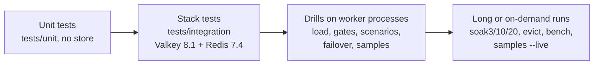

# Tested scenarios

Every scenario, gate and drill the project runs, what each one does to the system and what it
must show to pass. Use it to see what has been proven and under which load. How to set up the
stack and run the checks is in [Test](../how-to/test.md); this page does not repeat it. The
numbers each check last produced are at the end, with the file each one comes from.

No check calls a real LLM. Unit tests use in-process fakes; stack tests and drills use fakellm
(a fake Bedrock and OpenAI-compatible server, `tools/fakellm`). Only `scripts/samples.py --live`
and `scripts/soak.py --live` call Amazon Bedrock, and only when someone runs them by hand.

## Unit and integration tests

pytest settings are in `pyproject.toml`: `--strict-config --strict-markers`, warnings are errors,
`xfail_strict`, a 120 s limit per test (pytest-timeout) and `asyncio_mode = "auto"`. The default
`testpaths` is `tests/unit` only; the stack tests run when `tests/integration` is named. Branch
coverage of the unit and integration run must be at least 89 % (`fail_under`; 89.85 % measured
2026-11-14).

| Suite | Files | Test functions | Needs |
|---|---|---|---|
| `tests/unit` (top level) | 19 | 175 | nothing |
| `tests/unit/clients` | 14 | 109 | in-process fakellm; moto's STS server for assume role |
| `tests/unit/engine` | 21 | 193 | fakes of the store client, engine and S3 |
| `tests/unit/fakellm` | 7 | 54 | nothing (tests of the fake itself) |
| `tests/unit/providers` | 1 | 3 | nothing |
| `tests/unit/registry` | 4 | 51 | a fake store client |
| `tests/unit/scripts` | 3 | 21 | nothing (self-tests of the drill harness) |
| `tests/integration/engine` | 28 | 378 | the Docker stack: Valkey 8.1 and Redis 7.4; fakellm in process |
| `tests/integration/registry` | 4 | 28 | the Docker stack: Valkey 8.1 and Redis 7.4 |
| **Total** | **101** | **1,012** | |

Counts are `def test_` and `async def test_` definitions found by a text search (2026-11-17).
More tests run than that: every engine and registry store test runs once on Valkey and once on
Redis, the Bedrock client tests run on both transports (`botocore` and `aiohttp`), and some
tests are parametrised.

### Fixtures and markers

- **Store.** `tests/integration/engine/conftest.py` and `tests/integration/registry/conftest.py`
  parametrise every test over `{"valkey": 6379, "redis": 6380}` (password from
  `LLMQ_TEST_REDIS_PASSWORD`, default `localdev`). A store that does not answer fails the test;
  nothing is skipped. Each test gets its own key prefix, and every key under it is deleted at
  teardown.
- **Key expiry.** `LLMQ_TEST_KEY_EXPIRY` (default `auto`) sets the engine tests' key expiry mode.
  With `swept`, teardown also fails a test that left a native TTL on any key other than locks,
  the health probe and debug capture.
- **Transport.** `LLMQ_TEST_BEDROCK_TRANSPORT` (default `botocore`) sets the Bedrock transport of
  the engine tests; `tests/unit/clients/conftest.py` runs the client tests on both transports.
- **Marker.** One marker is declared, `integration` ("needs the Docker stack"); every file under
  `tests/integration/engine` sets `pytestmark = pytest.mark.integration`.
- **No fakeredis.** The repository does not use fakeredis. Tests without a store use
  hand-written fake clients; tests with a store use the real Valkey and Redis of
  `docker/compose.yaml` (`python scripts/stack.py up`).
- **Property tests.** Hypothesis checks the budget math in
  `tests/unit/engine/test_budget_properties.py` and, against the store clock, in
  `tests/integration/engine/test_budget_clock.py`.

### What the key files guard

| Area | Files | What they pin |
|---|---|---|
| Admission scripts | `test_admission.py` (37 tests), `test_b2_runtime_admission.py`, `test_b2_speed_folds.py`, `test_budget_clock.py`, `test_contention.py`, `test_tenant_fairness.py` | `PICK_TAKE`, `FINISH`, `UNDO`, `RENEW`, `SWEEP` on both stores: RPM and TPM budgets, class shares, slots, the waiter reservation rule, fixed and smooth windows against a Python model, 200 callers at once on one deployment, per-tenant fairness |
| Queue and records | `test_queue.py`, `test_requests.py` | Stream order, return in place, dead letters, the waiting limit; a duplicate request id attaches to the first run |
| Engine end to end | `test_runtime.py`, `test_r23_engine.py` (46 tests), `test_review_fixes.py`, `test_audit_runtime.py`, `test_b2_runtime_engine.py` | Caller, worker loop, held calls, retries, fallback, health auto-disable; each review or audit finding has a test that names it |
| Store faults | `test_b2_store_outage.py`, `test_store_and_http.py`, `test_audit_core_call_path.py` | No call runs twice after a short outage mid-call; READONLY reconnect after a failover; registry failures end in `CallFailed` |
| Key expiry (0.1.0b3) | `test_b3_expiry.py` | Native and swept helpers in Lua and Python; swept mode leaves no native TTL |
| Purge (0.1.0b3) | `test_purge.py`, `tests/unit/engine/test_purge_http.py` | Model, deployment and tenant purges, auto purge, the HTTP routes |
| Streaming | `test_stream.py`, `test_r3_stream_engine.py`, `test_b2_runtime_stream.py`; unit `test_r3_stream.py`, `test_audit_streaming.py` | Event order, flush window, cuts, a lost worker, idle streams |
| Embeddings | `test_embed.py`; unit `test_embed_codecs.py`, `test_r3_embed.py`, `test_r3_offload.py` | Batching, vectors in order, large results in S3 |
| Front door | `test_front.py`; unit `test_b2_clients_front.py`, `test_core_lifecycle.py`, `test_tuning.py` | `LLMQueue.from_env` as an app builds it, sync calls, jobs, the LangChain adapters, settings defaults |
| Clients | `tests/unit/clients/*` | Client hub and pool, both Bedrock transports, OpenAI over httpx and aiohttp, proxies and CA bundles, assume role, protected params |
| Error classes | `tests/unit/providers/test_classify_table.py` | Real provider errors mapped to a kind and a retry-after |
| Registry | `tests/unit/registry/*`, `tests/integration/registry/*` | Schema, validation, resolve; the version rule, compare-and-set edits, audit, rollback; store checks at start |
| Docs in step with code | `test_config_docs.py`, `test_log_events_doc.py`, `test_registry_schema.py`, `test_readme.py` | Every setting, log event and registry rule is documented with the code's values; the README quickstart matches the library |
| Harness | `tests/unit/scripts/*` | `check.py all` runs each test once; the scenario matrix; drill teardown after a fault |

## Fault scenarios: `scripts/scenarios.py`

Each run is one scenario under one load, on worker processes, two callers and fakellm, with the
store behind a fault proxy. The chat model has two regions (`us-east-1`, `us-east-2`) at 600 RPM
each. A run has three phases counted in calls, not time: 30 calls `before` (healthy), 60
`during` (the fault is on, and calls keep coming until it ends), 30 `after` (settled).

Loads: `under` is 50 % of the budget, `at` 100 %, `burst` 300 %. Profiles: `fast` (the default:
lease 3 s, visibility 2 s, deadline 10 s, attempt 3 s, wait 8 s, a fault held 5 s) and `prod`
(production timers, a fault held 20 s).

**Common pass mark** (every scenario, from the module docstring): `before` and `after` calls all
succeed (under `burst` a call may be refused on time, as `rate_limited` or `deadline_exceeded`,
in any phase); `during` fails only with the kinds the scenario allows; no answer arrives after
its deadline; nothing is left in progress at the end (no lease, waiter, held or queued
message); the provider saw no more calls than were sent plus the retry budget and the calls in
flight when a fault hit. The table adds each scenario's own rule.

"On-time kinds" below means `deadline_exceeded`, `queue_unavailable` and `rate_limited`.

| Id | Group | Fault injected | Pass mark (beyond the common one) | Allowed during the fault |
|---|---|---|---|---|
| S1 | worker | One worker killed with `kill -9` mid-traffic; a replacement started | Its calls finish elsewhere; nothing held | none |
| S2 | worker | Graceful restart: a new worker starts, then the old one drains and stops | Nothing lost | none |
| S3 | worker | Every worker killed; new ones only after the fault time | Calls wait, then are served or refused on time | on-time kinds |
| S4 | store | The proxy drops every store connection and refuses new ones | Refused on time while down; served after | on-time kinds |
| S5 | store | The proxy freezes: connections stay open, nothing comes back (store read timeout lowered to 3 s in `fast`) | Fails within the read timeout; nothing stuck | on-time kinds |
| S8 | store | Every key of the run deleted (a flushed or replaced store) | Running calls re-registered; nothing stuck | on-time kinds |
| S9 | store | `maxmemory-policy noeviction` and `maxmemory` set 1 MB below current use, restored after | Refused as `queue_unavailable`; no crash. Runs alone | on-time kinds |
| S10 | store | Every store packet 50 ms late | All served | none |
| P1 | provider | fakellm returns `ThrottlingException` in one region | Other region serves; the faulted region serves again within 30 s | none |
| P2 | provider | `InternalServerException` (5xx) in one region | Other region serves; breaker opens and recovers (serves again within 30 s) | none |
| P3 | provider | One region hangs | Attempt timeout, next region; serves again within 30 s | none |
| P4 | provider | `ResourceNotFoundException` in one region (model not there) | Target error; other region serves | none |
| P5 | provider | `UnrecognizedClientException` in one region (bad credentials) | Other region serves; serves again within 30 s | none |
| P7 | provider | 5xx in every region | Refused on time; served after (settle 16 s) | `provider_error`, `model_unavailable`, `deadline_exceeded`, `rate_limited`, `retry_budget_exhausted` |
| R1 | registry | Live edit: RPM cut to a quarter (150), then back | Over-budget calls `rate_limited`; provider calls stay within the cut budget (plus the bucket's old burst) | `rate_limited`, `deadline_exceeded` |
| R2 | registry | Live edit: one region `enabled: false`, then back | Other region serves; it serves again once enabled | none |
| R3 | registry | Live edit: `routing.kill_switch` on, then off | Calls sent while the switch was on ran in the caller (direct path), none by a worker; same budgets | none |
| R4 | registry | Live edit with `rpm: -5` | The edit raises `RegistryError`; the registry version is unchanged | none |
| C1 | caller | 40 calls to a 2 s model; 20 cancelled after 0.5 s | At most 40 provider calls; no cancelled call answered; the other calls served or refused on time | none |
| T1 | caller | S-T (0.2.0): tenants A and B send 30 calls each to a model at 2 calls/s; at 2 s A's waiting calls are moved to the priority queue, at 4 s A's waiting calls are cancelled, at 5 s a worker is killed | Every B call served, none moved or cancelled; A's calls moved; every cancelled A call ends `cancelled` within 2 s (+1 s clock slack); the model's request index is empty at the end | none |
| C2 | caller | A caller process with 100 waiting calls (model at 60 RPM) is killed | Its calls stop reaching the provider once its caller TTL has passed; at most a computed bound of them ran | none |
| C3 | caller | Two callers send the same request id at once | Exactly one provider call; both callers get the same reply | none |
| X1 | pairs | S4 + S1 | As S4 | on-time kinds |
| X2 | pairs | S4 + R1 | As S4 and R1 | on-time kinds |
| X3 | pairs | S1 + P1 | As S1 and P1 | none |
| X4 | pairs | S10 + P2 | As S10 and P2 | none |
| X5 | pairs | S5 + S1 | As S5 and S1 | on-time kinds |
| X6 | pairs | S8 + S1 | As S8 and S1 | on-time kinds |
| X7 | pairs | R1 + P1 | As R1 and P1 | `rate_limited`, `deadline_exceeded` |
| X8 | pairs | R2 + the other region hangs | Refused on time; served after | on-time kinds, `model_unavailable`, `provider_error` |
| M1 | clients | Four client pods (four services) on one model queue, with the usual workers | All served (`burst`: refused on time); each pod gets its own replies; within budget | none |
| M2 | clients | Two services whose registry documents differ in `registry_version` and RPM | The newer document is live for both; the older logs `registry_older_ignored`; all served | none |
| M3 | clients | Caller-only pods and worker-only pods (no `both`) | All served, every call by a worker pod | none |
| L2 | store | Streams (2 a second, 16 per pod, 120 tokens at 60 tokens/s) while the store is blocked and a worker killed | Each stream completes intact or ends with an on-time error; nothing hangs | on-time kinds |
| L3 | store | Only the separate queue store (`LLMQ_QUEUE_STORE_URL`) blocked; `LLMQ_QUEUE_FAILOVER_SECS=2` | Calls run direct after the failover time; all served on time | none |
| L4 | store | Embedding calls (3 batches of 96 texts each) while a worker is killed and the store blocked | Every batch answered or refused on time; vectors in order | on-time kinds, `model_unavailable` |
| S6 | failover | `scripts/failover.py failover` on Docker nodes | See [Store failover drill](#store-failover-drill-scriptsfailoverpy) | |
| S7 | failover | `scripts/failover.py slowdns` | As above | |
| S11 | failover | `scripts/failover.py restart` | As above | |

The script has no P6 and no S12. `python scripts/scenarios.py --list` prints the same list from
the code.

**Load matrix.** With no `--load`, `--matrix full` (the default) runs every scenario under every
load. `--matrix default` runs every scenario `at`, and `burst` only for S1, S3, S4, S5, S8, R1,
C2, X1, X2, X5, M1, L2 and L4, where load changes the code path. `burst` units always run one at
a time; S9 and the Docker drills run alone, after the others.

**In `check.py`.** Step `scenarios` runs `scripts/scenarios.py all --jobs 3 --exclude S6 S7 S11`
(the Docker drills run once, in step `store`), with `--load at` under `--quick`,
`--matrix default` by default and `--matrix full` under `--release`.

## Load and chaos gates: `scripts/gates.py`

The plan's gates, scaled to run on one machine. Each starts worker processes (pods) against one
store and fakellm, prints its numbers and the checks it applies, and fails when any check fails.
`--quick` leaves out B17, B91 and B92. A whole run takes about 20 minutes (about 14 with
`--quick`).

| Gate | Load | Measured | Pass mark |
|---|---|---|---|
| B17 | Mixed calls at 47.5 a second for 150 s (40 % Titan embeddings; chat with 500 to 20,000-token prompts, 20 % with tools, 30 % priority), 2 callers, 4 workers, 9 deployments (3 accounts x 3 regions) at 200 RPM, fixed window | The store's RPM count per deployment-minute; fakellm's calls per wall-clock minute; served in one full minute; priority wait p95 | No deployment over 200 in a minute (store); at the provider at most 200 + 2 per deployment-minute; served in the full minute >= 0.9 x 1,800; priority wait p95 <= 2 s |
| B19 | 2,000 calls in 10 s (200 a second), 4 workers | Store scripts and commands per call; admission refusals; the workers' call counter | Every call served; refusals per call <= 0.05; calls counted by the metrics >= 90 % of calls sent |
| B22 | 100 calls a second for 15 s, round robin over the deployments, on 2 then on 8 worker processes | Deployment shares; store commands per call with idle polling subtracted | Shares equal within 5 %; commands per call equal within 5 % |
| B23 | 100 calls a second for 15 s against a Docker primary and replica; at 5 s the primary is killed and the replica promoted; run with `LLMQ_QUEUE_WAIT_REPLICAS` 0 and 1 | Lost sends (`deadline_exceeded`), duplicates at the provider, all failures | The replica took over in both runs; with the wait on, losses and duplicates <= with it off + 2; with the wait on, failures <= 5 % of calls |
| B33 | 50 calls a second for 40 s (25 % priority); 4 workers restarted one by one, each with a live registry edit mid-restart | Calls lost; the registry change counter each caller sees | 0 lost (priority included); the counter never goes back; every caller ends on the last edit |
| B34 | 30 s of alternating queued and direct calls at 5 a second (fakellm fixed at 100 ms); then three ramps of 50, 100 ... 400, 500, 600, 800 calls a second, 8 s each, until a call fails or wait p95 > 1 s | Queued and direct p95; ceiling (median of the three ramps) | Queue path adds <= 20 ms at p95; queued p95 <= baseline x 1.25 + 10 ms; ceiling >= 0.8 x baseline; fails when `scripts/baselines/perf.json` is missing |
| B56 / B93 | 2,400 normal calls sent 5 ms apart to one 1,200 RPM deployment, 8 workers; 20 priority calls after 20 s | Starts in a full minute; start order; priority wait; store scripts a second with > 1,500 waiting and with 100-600 waiting | Starts per minute >= 0.95 x the normal-class quota (80 % of 1,200); after warm-up no older call starts more than 1 s after a newer one; priority calls start within 2 s; store calls with the big backlog <= 1.25 x with the small one; every call served |
| B91 | 100 calls a second for 15 s over 20 models x 30 deployments (10 regions x 3 accounts) | Store script p99 (server time); size and time of a full `status()` | Every call served; script p99 <= 2 ms; status <= 500 KB and <= 200 ms (median of 5 after a cold one) |
| B92 | 3 minutes idle (plan: 30), then one priority call and 50 calls a second for 60 s across 3 regions | First-call overhead (minus fakellm's 250 ms p95); priority wait p95 | 0 errors; first-call overhead <= 500 ms; priority wait p95 <= 2 s |
| B94 | 60 calls waiting on one deployment (smooth 60 RPM, then fixed 30 RPM); after 8 s the pod holding waiters is killed | Gap to the next grant after the kill | Smooth: no gap between grants over 2 s plus one rate interval (1 s); fixed: the first grant within 2.5 s of the next minute; every call served |
| B95 | 500 calls waiting (timeout 300 s); after 5 s the state store is blocked for 45 s | Failure kinds | 0 calls dropped as `caller_gone`; all served |
| B96 | Kill switch on; 4 caller processes with 500 direct calls each, waiting on a 600 RPM model | Store scripts per caller process per second, over 20 s | Every caller started and is still waiting; scripts > 0; scripts <= 20 per process per second |
| B97 | One `embed()` of 28,800 texts on Cohere (300 calls of 96) at 600 RPM | Store memory above the start, sampled every 0.5 s | Every batch served; peak <= +64 MB |

B93 has no id of its own: it is judged inside B56 (the `B56` entry of `GATES`, printed as
`B56/B93`). Gate ids are the design plan's; the plan is not in the published docs.

`check.py` step `gates` runs `scripts/gates.py`, with `--quick` under `check.py --quick`.

## Store failover drill: `scripts/failover.py`

Starts a throwaway Valkey 8.1 primary and replica in Docker, a TCP proxy that plays the store's
DNS name, and its own fakellm (which counts request bodies it saw twice). It sends 10 calls a
second for 30 s; the fault comes at 8 s.

| Mode | Scenario id | Fault | Pass mark |
|---|---|---|---|
| `failover` | S6 | `FAILOVER`: the primary becomes a replica; the name moves to the new primary | No call lost |
| `slowdns` | S7 | `FAILOVER`, but the name keeps pointing at the old primary for 6 s (READONLY replies) | Only calls in flight when the store stopped taking writes may fail (`deadline_exceeded`), at most 5 % |
| `restart` | S11 | Every connection drops and the node refuses new ones for 6 s | No call lost |

In every mode only a call in flight while the fault began may run twice at the provider
(at-least-once delivery). `check.py` step `store` runs all three after
`tests/integration/engine/test_store_and_http.py`.

## Load drill: `scripts/load.py`

| Gate | Load | Pass mark |
|---|---|---|
| `throughput` | 2,000 calls (`--calls`), 200 at a time, three workers' engines sharing one store | Every call succeeds; each worker serves some; nothing stays held; at least `--min-rate` calls a second (default 40) |
| `rate_limit` | 300 calls at once to a 600 RPM model (smooth window, 10 % burst) | In the first 10 s at most 60 + 100 served; the rest `rate_limited` (at most 1 % `deadline_exceeded`); no call outlives its deadline; nothing held |

CI runs `scripts/load.py throughput --calls 500 --min-rate 20`.

## Soak: `scripts/soak.py`

8 worker processes and 2 callers against one store through a proxy, fakellm as the provider,
mixed traffic at 70 calls a second (chat with 20 % priority, and embeddings) at about 80 % of
the budget. Chaos events in turn: a worker killed and replaced, the store blocked, a live edit
(RPM halved, then back), a rolling restart of one worker.

| Step | `--minutes` | Calls | Chaos | Block / edit | Status TTL | Sample |
|---|---|---|---|---|---|---|
| `soak3` | 3 | ~12,600 | every 30 s | 10 s / 12 s | 30 s | 15 s |
| `soak10` | 10 (default) | ~42,000 | every 60 s | 20 s / 30 s | 60 s | 30 s |
| `soak20` | 20 | ~84,000 | every 120 s | 20 s / 30 s | 120 s | 60 s |

**Pass mark.** Every call answered by its deadline (ok, or `rate_limited`, `deadline_exceeded`
or `queue_unavailable` while a chaos event is on, which ends 20 s after the event); outside
chaos at least 0.9 x the offered calls served; nothing in progress for any model once the calls
drain; flat: the last sixth of the run within 10 % of the second sixth, plus a small absolute
slack, for store memory, keys, calls per second, connections (`CLIENT LIST`), and each
process's RSS and asyncio task count.

**Diagnostic options** (all on by default; `--no-<name>` turns one off):

| Option | Effect |
|---|---|
| `--driver-accounting` | Judge the driver's RSS without its own result list (callers only) |
| `--process-numbers` | Print each process's start -> end numbers behind the verdict |
| `--save-samples` | Write every process sample to `soak-processes.json` in the log folder |

`--seed` replays the random choices. `--live` runs on real Bedrock (gpt-oss-20b at 10 RPM and
5,000 TPM, Titan at 10 RPM, offered at about 50 %) with keys from `--env-file`; the store stays
the local Valkey.

## Eviction drill: `scripts/evict_drill.py`

Starts a throwaway Valkey in Docker with a small `maxmemory` (`--maxmemory`, 64 MB), its own
fakellm, and an "app cache" filler that writes 8 KB keys with a TTL until the store is full and
beyond, while `--calls` calls (2,000) go through the queue, `--concurrency` (50) at a time, with
`LLMQ_KEY_EXPIRY=auto`. The results go to `reports/evict-<time>.json`.

| Policy | Mode `auto` picks | Pass mark |
|---|---|---|
| `volatile-lru` | `swept` | Every call ok; the store evicted app keys (`evicted_keys` > 0); no key under the queue's prefix evicted (keyspace `evicted` events); no queue key with a native TTL except locks, the health probe and debug capture |
| `noeviction` | `native` | 0 keys evicted; every call ends by itself (an answer, or `CallFailed` once the full store refuses writes) within `--call-timeout` (20 s) |

It checks the key expiry modes described in [Storage](storage.md) and
[Store keys](../reference/store-keys.md). It needs Docker but not the stack. `check.py` step
`evict` runs it (not in `all`; `--quick` sends 500 calls).

## Samples: `scripts/samples.py`

Runs each program in `samples/` (01 to 10) as its own process with `LLMQueue.from_env()`, on
the local Valkey and fakellm, with a fresh key prefix deleted afterwards. A sample passes when
its process exits cleanly within `--timeout` (180 s). `--live` runs them on real Bedrock with
keys from `--env-file`; `--store env` uses the env file's store (TLS). The outputs shown in
[Samples](../samples/index.md) come from these runs; that page says which are live and which
come from fakellm.

## Benchmark: `scripts/bench.py`

Measures pod start, the cold first call, the first call after an idle spell, steady and stream
overhead and store round trips per call, with the public API only. It never fails a run
(`check.py` step `bench`, not in `all`). See [Performance](performance.md).

## CI

**`ci.yml`** (every push to `main` and every pull request; also called by `publish.yml`):

| Job | Python | Runs |
|---|---|---|
| `build` | 3.12 | `uv build`, `twine check --strict`, install the wheel in a clean venv, import, `llm-queue --help` |
| `checks` | 3.12, 3.13, 3.14 | `ruff check`, `ruff format --check`, `mypy`, `pytest tests/unit` |
| `windows` | 3.12 | `pytest tests/unit` on `windows-latest` |
| `lowest` | 3.12 | `pytest tests/unit` with `--resolution lowest-direct` |
| `langchain-03` | 3.12 | `tests/integration/engine/test_front.py` with the LangChain 0.3 line, on the Docker stack |
| `integration` | 3.12, 3.13, 3.14 | Docker stack; `pytest tests/unit tests/integration` (with coverage on 3.12); `scripts/samples.py`; `scripts/load.py throughput --calls 500 --min-rate 20` |
| `zizmor` | | Static security audit of the workflows |

**`nightly.yml`** (02:17 UTC, or by hand), on fakellm and the Docker stack:

| Job | Runs |
|---|---|
| `drills` (`scenarios`) | `scripts/scenarios.py all --load under --jobs 4` |
| `drills` (`gates`) | `scripts/gates.py --quick` |
| `drills` (`soak10`) | `scripts/soak.py --minutes 10` |
| `swept` | `pytest tests/integration/engine` with `LLMQ_TEST_KEY_EXPIRY=swept`: the engine tests with no native TTLs, as on a shared `volatile-*` store (CI runs them with `auto`) |

The drills keep `reports/` as an artifact for 7 days.

**`publish.yml`** (on a `v*` tag; a manual run stops after the TestPyPI smoke test):

| Stage | What it checks or does |
|---|---|
| `verify` | `__version__` is canonical PEP 440; the tag is `v<__version__>`; `CHANGELOG.md` has a dated heading for it that does not say unreleased; the tagged commit is on `main` |
| `checks` | Every `ci.yml` job |
| `build` | sdist and wheel with pinned hatchling; `twine check --strict` |
| `testpypi` | Upload to TestPyPI (trusted publishing) |
| `smoke` | Install the wheel from TestPyPI in a clean env; version, imports, `llm-queue --help` |
| `pypi` | Upload to PyPI (tags only) |
| `release` | GitHub Release from the CHANGELOG section; a pre-release for a / b / rc / dev versions |

`docs.yml` builds these docs with `zensical build --strict` when `docs/` changes.

## Latest measured numbers

Timing and throughput numbers come from one Windows machine with the store behind Docker
Desktop's port forwarding, unless the row says otherwise; compare them only with runs on the
same machine. Counts and pass or fail of behaviour do not depend on the machine.

| What | Result | Machine-dependent | Source |
|---|---|---|---|
| B91 script p99, 0.1.0b2 | 3.8-4.3 ms: **fails** the 2 ms mark | Yes; not a regression | The maintainer's release checks (not stored in the repo) |
| B91 script p99, 0.1.0b3 | 3.0-3.5 ms: **fails** the 2 ms mark | Yes; not a regression | The maintainer's release checks (not stored in the repo) |
| B91 `PICK_TAKE` p99 | 0.94 ms (20 models x 30 deployments) | Yes | [Performance](performance.md), from the CHANGELOG and plan §13 |
| B91 status | 210 KB in 47 ms, 375 ms cold | Yes | [Performance](performance.md) |
| Eviction drill, 0.1.0b3, `volatile-lru` | 2,000 of 2,000 calls ok; 103,181 app keys evicted; 0 queue keys evicted | Counts: no | The maintainer's release checks (not stored in the repo) |
| Eviction drill, 0.1.0b3, `noeviction` | Every call fails loudly with `queue_unavailable`; 0 keys evicted (a pass: every call ended by itself) | No | The maintainer's release checks (not stored in the repo) |
| B34 baseline | Queued p95 218 ms; ceiling 349.6 calls/s (median of ramps 250, 350, 350); a confirming run gave 300 calls/s and passed | Yes | `scripts/baselines/perf.json`, recorded 2026-11-15 (its commit message gives the ramps) |
| 0.1.0b2 final checks | Every scenario, failover drill and gate passed; B34 ceiling about 300-400 calls/s, queue path under 20 ms at p95 | Yes | [Changelog](../project/changelog.md), 0.1.0b2 |
| B19 | 11.6 store scripts per queued call | No | [Performance](performance.md) |
| B22 | 248 commands per call on 2 processes, 252 on 8 | No | [Performance](performance.md) |
| B17 | 1,800 of 1,800 a minute on 9 deployments, none above its RPM; priority wait p95 0.27 s | The wait: yes | [Performance](performance.md) |
| B56 | 2,000 waiting: 1,976 store calls/s before pub/sub and the sweep, 499/s after | Yes | [Performance](performance.md) |
| B94, B92 | Next waiter within 1.3 s smooth, 0.02 s after the minute fixed; first call after idle 125 ms | Yes | [Performance](performance.md) |
| B97 | Store peak +38 / +41 MB (budget +64 MB), +102 / +107 MB before vectors were stored in binary | Partly | [Changelog](../project/changelog.md), 0.1.0b2 Performance (2026-11-15) |
| B33 | 4 rolling restarts, 0 calls lost | No | [Operate](../how-to/operate.md) |
| `load.py throughput` | 68 calls/s for 2,000 calls on a busy dev machine (2026-11-14) | Yes | `scripts/load.py` docstring |
| Coverage | 89.85 % line and branch (2026-11-14) | No | `pyproject.toml` |
| Live samples | The nine samples of the time passed on real Bedrock (`us-east-1`, ElastiCache Valkey 8.2 over TLS, strict mode) on 2026-11-14; all ten pass on fakellm (2026-11-16) | No | [Samples](../samples/index.md) |
| `bench.py`, 0.1.0b1 | Pod start p50 145 ms; cold first call p50 3,010 ms; queue overhead p50 125 ms, sequential | Yes | `scripts/baselines/bench-0.1.0b1.json`, [Performance](performance.md) |

!!! note "B91 on the dev machine"
    Gate B91 holds store script time at p99 to 2 ms. On the Windows / Docker dev machine it
    fails for 0.1.0b2 and 0.1.0b3 alike, and 0.1.0b3 measures lower than 0.1.0b2, so the
    failure comes from the machine, not from a regression. No B91 run on a Linux host or an
    in-VPC store is recorded in the repo, so the gate there is unverified.

Also unverified: no soak result (`soak3`, `soak10` or `soak20`) and no nightly result is stored
in the repo, and process memory under B97 is not measured (see [Performance](performance.md)).

## Running them

[Test](../how-to/test.md) has the set-up and every command. In short:

| What | Command |
|---|---|
| Every check step | `python scripts/check.py all` (`--quick` for the dev run, `--release` before a release); `make check-all`, `make check-dev` |
| One step | `python scripts/check.py a6` (`make check S="a6"`); `python scripts/check.py --list` |
| Scenarios | `python scripts/scenarios.py --list`, `python scripts/scenarios.py S4 --load under`, `python scripts/scenarios.py --group store`, `python scripts/scenarios.py all --matrix default` |
| Gates | `python scripts/gates.py`, `python scripts/gates.py B17 B95`, `python scripts/gates.py --quick`, `python scripts/gates.py B34 --record-baseline` |
| Failover | `python scripts/failover.py`, `python scripts/failover.py slowdns` |
| Load | `python scripts/load.py`, `python scripts/load.py rate_limit`, `python scripts/load.py --calls 500` |
| Soak | `python scripts/check.py soak3` (or `soak10`, `soak20`), or `python scripts/soak.py --minutes 3` |
| Eviction | `python scripts/evict_drill.py`, `python scripts/evict_drill.py volatile-lru --calls 500`, or `python scripts/check.py evict` |
| Samples | `python scripts/samples.py`, `python scripts/samples.py 03_embed`, `python scripts/samples.py --live --store env` |
| Benchmark | `python scripts/bench.py`, `python scripts/bench.py --only start steady roundtrips` |

Before a release the docs ask for `python scripts/check.py all` (CONTRIBUTING says
`all --release`) and `python scripts/check.py soak20`. What each failure means in production is
in [Failures and recovery](resilience.md).
