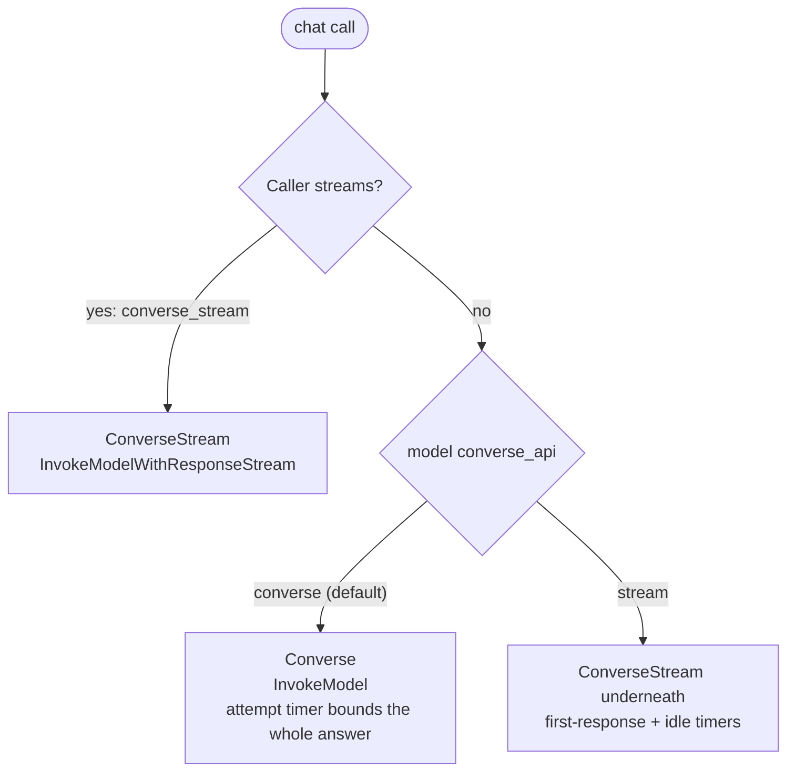

# Bedrock APIs and IAM

Which Amazon Bedrock API each call uses, how to choose it per model, and the IAM permissions the
pods' role needs.

## Which API a call uses

| Call | Bedrock API | IAM action |
|---|---|---|
| `converse` / `converse_sync`, model `converse_api: "converse"` (default) | `Converse` | `bedrock:InvokeModel` |
| `converse` / `converse_sync`, model `converse_api: "stream"` | `ConverseStream`, assembled into a Converse reply | `bedrock:InvokeModelWithResponseStream` |
| `converse_stream` (and LangChain streaming) | `ConverseStream` | `bedrock:InvokeModelWithResponseStream` |
| `embed` / `embed_sync` | `InvokeModel` | `bedrock:InvokeModel` |



Before 0.1.0b2 every chat call used ConverseStream underneath, so the role always needed
`bedrock:InvokeModelWithResponseStream`, and models without tool use over streaming could not
call tools. Non-stream calls now use plain Converse by default.

## Choosing `converse_api`

```json
"models": {
  "gpt120b": {"type": "chat", "provider": "bedrock", "model_id": "openai.gpt-oss-120b-1:0",
              "converse_api": "stream", "...": "..."}
}
```

- **`converse`** (default): one request, one answer. It needs only `bedrock:InvokeModel` and
  works for every model that supports tools in Converse. The attempt timer
  (`attempt_timeout_secs`) bounds the whole answer, so a long generation needs a timeout that
  fits it.
- **`stream`**: the answer streams underneath and is assembled for the caller. The
  first-response timer (`attempt_timeout_secs`, at most the time left) and the idle timer between chunks (`stream_idle_secs`) apply, so a region that accepts the
  connection and never answers is given up quickly, while a long healthy answer is never cut.
  Use it for long answers, or when you want hung regions found fast.

<!-- verify after merge: in dev/0.1.0b2 (84c979d) the setting value is "stream" (registry/settings.py) but clients/providers.py compares "converse_stream", and runtime.py never sets Timing.attempt_secs, so every non-stream call still takes ConverseStream; the plain-Converse default documented here needs that wiring. -->

## IAM policy

The pods' role (or each assumed account role) needs, for the models and regions in the
registry:

```json
{
  "Version": "2012-10-17",
  "Statement": [
    {
      "Sid": "LlmQueueInvoke",
      "Effect": "Allow",
      "Action": [
        "bedrock:InvokeModel",
        "bedrock:InvokeModelWithResponseStream"
      ],
      "Resource": [
        "arn:aws:bedrock:ap-south-1::foundation-model/*",
        "arn:aws:bedrock:ap-south-2::foundation-model/*",
        "arn:aws:bedrock:*:123456789012:inference-profile/*"
      ]
    }
  ]
}
```

- Drop `bedrock:InvokeModelWithResponseStream` only if no model uses `converse_api: "stream"`
  and no code calls `converse_stream` (LangChain `astream` included).
- Narrow `Resource` to the model ids and regions in your registry. Cross-region inference
  profiles need both the profile ARN and the foundation models it routes to.
- For accounts with `role_arn`, the pods' own role needs `sts:AssumeRole` on that role (with the
  `external_id_ref` value as external id when set), and the assumed role needs the policy above.
- Large results in S3 (`S3Offload`) need `s3:PutObject`, `s3:GetObject` and `s3:DeleteObject`
  on the bucket prefix, and `kms:GenerateDataKey` / `kms:Decrypt` when it uses a KMS key.

## Errors from IAM and credentials

| What Bedrock says | What the library does |
|---|---|
| `AccessDeniedException` for one model in one region (not enabled there) | A target error: that deployment is counted for health, the call moves on |
| Expired token, bad signature, clock skew | A credentials error: the account is skipped in that region with backoff, the client is rebuilt, an alert-worthy log |
| Every account's credentials refused | `CallFailed("credentials_unavailable")`, `retry_after_secs` 60 |

See [Attempts and retries](../explanation/attempts.md) for every outcome.
