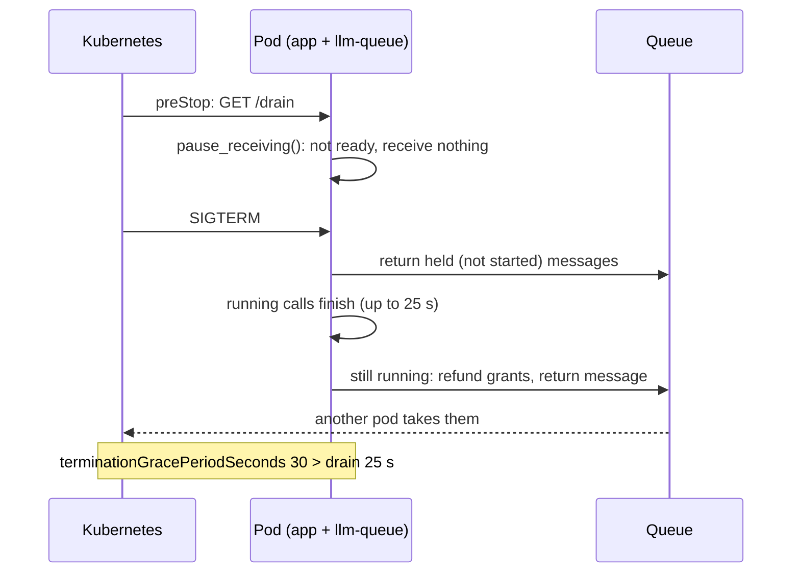

# Operate

How to deploy, watch and change a running system.

## Start and stop with the app

Start the queue once per process in the app's startup hook and stop it on shutdown:

```python
from contextlib import asynccontextmanager

@asynccontextmanager
async def lifespan(app):
    await llmq.start()              # a failure here should fail the pod: queued models need it
    yield
    llmq.pause_receiving()          # not ready; no new queued work
    await llmq.stop()               # drain: LLMQ_DRAIN_SECS (25 s) for jobs and calls together
```

Start one queue per process, after any fork (in each gunicorn / uvicorn worker, in Celery's
`worker_process_init`); see [Clients and connections](../explanation/clients.md#one-llmqueue-per-process).

## Deploys and restarts

1. A **preStop hook** calls `llmq.pause_receiving()` (for example through a `/drain` endpoint, as
   in `samples/09_http_router.py`). Readiness fails, and the process takes no new calls or jobs;
   running work goes on.
2. **Shutdown** is `await llmq.stop(drain_secs=...)`. Held messages go back to the queue at once;
   running calls and this pod's waiting callers get up to `drain_secs` (default
   `LLMQ_DRAIN_SECS`, **25 s**) to finish. Jobs drain first, then calls get what is left.
3. **When the drain runs out**, a call still running is **given back, not failed**: its grants are
   refunded and its message returned to the queue at once, so another pod runs it and no failure
   is counted toward `max_receives`. A stream that already sent chunks to its caller cannot move
   and ends `worker_shutdown` (with `partial_text`). A job still running is returned the same way.



Kubernetes settings that fit the defaults:

```yaml
spec:
  terminationGracePeriodSeconds: 30     # the default; keep it above LLMQ_DRAIN_SECS (25)
  containers:
    - name: app
      lifecycle:
        preStop:
          httpGet: {path: /drain, port: 8000}   # calls llmq.pause_receiving()
      readinessProbe:
        httpGet: {path: /llmq/health/ready, port: 8000}
      livenessProbe:
        httpGet: {path: /llmq/health/live, port: 8000}
```

The preStop hook's time counts against the grace period, so keep the `/drain` handler instant
(it only flips a flag). If you raise `LLMQ_DRAIN_SECS` for long answers, raise
`terminationGracePeriodSeconds` with it (drain + 5 s or more); a pod killed before its drain ends
loses nothing either, its calls reappear after `visibility_secs`, but they then count one
failure each.

Measured: 4 rolling restarts, 0 calls lost (gate B33).

## Health and readiness

| Route / call | Answers |
|---|---|
| `GET /health/live` | 200 while the process runs |
| `GET /health/ready` | 200 when the registry is loaded and the process is not draining, else 503 |
| `await llmq.health()` | `{"live", "ready", "stores": {"state", "queue"}}` |

Readiness never depends on the stores or the providers, and answers at once from cached state:
a background task probes each store every 5 s with a short write bounded by
`EngineTimings.health_probe_secs` (3 s) and reports it `ok`, `read_only` (a failover left it a
replica) or `down` (unreachable, or refusing writes, such as out of memory). A store error never
turns the readiness route into a 500. Liveness is false when one of the library's background
loops died or the heartbeat made no progress for a lease (`LLMQ_LEASE_SECS`).

At `start()` the store's own setup is checked: a cluster-mode store is refused (`ConfigError`),
and a `maxmemory-policy` other than `noeviction` logs `store_eviction_policy` with a warning (see
[Store requirements](../explanation/storage.md#store-requirements)).

## Status

```bash
llm-queue status                # every model
llm-queue status --model M      # one model: deployments, budgets used, health, queues, blocks
llm-queue request ID            # one call
```

The same from code: `await llmq.status(model)`, `await llmq.request_status(request_id)`; over
HTTP: `GET /status`, `GET /requests/{id}`.

## Alerts

Every 30 s one process evaluates alerts from the status report. Each alert is a gauge, and a
log line `llmq_alert` is written once when it turns on or off. Thresholds come from the model's
`alerts` setting.

| Alert | On when |
|---|---|
| `model_unavailable` | No usable deployment is left: disabled, unhealthy, outside residency, blocked, on a disabled account, or behind an open breaker |
| `deployment_disabled` | A deployment was auto-disabled by health checks |
| `quota_near_limit` | A deployment used `alerts.quota_used_pct` (90) % of its RPM or TPM |
| `quota_above_observed` | The provider throttled while the deployment had budget left: the real quota is below the registry's number |
| `dead_letters` | A model's dead-letter queue holds `alerts.dlq_messages` (1) or more messages |

## Change things at run time

```bash
llm-queue registry set --model M rpm=400    # live edit (audited)
llm-queue registry disable M aws-main/ap-south-1
llm-queue block --region R                  # stop using a region (or --account A)
llm-queue unblock --region R
llm-queue drain M --yes --wait              # disable a model for new calls; serve waiting ones
llm-queue dlq list --model M                # dead letters; also show, redrive, purge
```

Commands that delete or move data (`drain`, `dlq redrive`, `dlq purge`, `registry gc`) need
`--yes`; `--dry-run` shows what they would do.

`--actor NAME` records who made a change. Live edits and their limits are in
[Configure](configure.md#live-edits). Every command is in [CLI and HTTP](../reference/cli-http.md).

## HTTP router

With the `http` extra:

```python
from fastapi import Depends

app.include_router(
    llmq.http_router(dependencies=[Depends(require_admin)]),
    prefix="/llmq",
)
```

This gives `/status`, `/requests/{id}` and `/registry` behind your dependencies, and
`/health/live` and `/health/ready` without them. `allow_writes=True, actor=fn` adds
`POST /registry` and `POST /registry/block`, audited under `actor(request)`. Write routes need
`dependencies` (else `ConfigError`), a JSON body and the `X-LLMQ-Admin` header; see
[Secure a deployment](secure.md#4-protect-the-http-write-routes).

## Store failover

The store is one primary with replicas (cluster mode is not supported).

- Clients reconnect on `READONLY` after a failover. The failover drill (`scripts/failover.py`)
  loses no call on `failover` and `restart`; with DNS lagging 6 s, at most 5 % of calls in
  flight may fail.
- `LLMQ_QUEUE_WAIT_REPLICAS` / `LLMQ_QUEUE_WAIT_MS`: a send waits for this many replicas to
  acknowledge it. Too few acknowledgements make the call run direct under the same record.
- With a separate queue store (`LLMQ_QUEUE_STORE_URL`), errors for `LLMQ_QUEUE_FAILOVER_SECS`
  (5) make calls run direct under the same budgets.
- A state store outage: callers already waiting keep waiting until their deadline; new calls
  follow the model's `store_down` rule (`pause`, the default; `static_cap`; `fail_fast`).
  Measured: a 45 s outage with 500 calls waiting dropped none.

Details: [Failures and recovery](../explanation/resilience.md).

## StoreUnavailable

Admin operations (`cancel`, `status`, `request_status`, `send_job`, and the registry's reads and
edits) raise `StoreUnavailable` when the store is unreachable, read-only or full. It is also a
`ConnectionError`. Calls raise `CallFailed` (`queue_unavailable`) instead.

## Logs and metrics

The library logs with structlog and never configures logging; the app does. Log records are
named events, for example:

| Event | Meaning |
|---|---|
| `llmq_call_finished` | One per call: ids (hashed), model, deployment, outcome, tokens; no prompt text |
| `llmq_alert` | An alert turned on or off |
| `llmq_registry_audit` | A registry publish or edit, with actor and diff (secrets redacted) |
| `registry_older_ignored` | This process's registry is older than the stored one, which is used |
| `registry_invalid_replaced`, `registry_needs_newer_library` | The stored registry was invalid and replaced; or it needs a newer library and this pod keeps its own |
| `second_llm_queue_started` | A second `LLMQueue` was started in one process |
| `store_eviction_policy` | The store may evict keys (not `noeviction`) |
| `job_no_consumer` | A job was sent to a name no running process consumes |
| `store_down` | The state store failed before a call was sent; the `store_down` rule applies |
| `deployment_disabled`, `deployment_recovered` | Health checks turned a deployment off or back on |

Metrics go to `LLMQ_METRICS_SINK`: `emf` (CloudWatch embedded metrics, default), `prometheus`
(needs the `metrics` extra) or `none`; one sink per process. Names include `llmq_calls_total`,
`llmq_wait_seconds`, `llmq_tokens_input_total`, `llmq_tokens_output_total`,
`llmq_fallback_total`, `llmq_admission_refusals_total` (counted once per call),
`llmq_retries_total`, `llmq_grants_lost_total`, `llmq_store_errors_total` and
`llmq_jobs_no_consumer_total`. Every 30 s the alert loop also sets gauges per model and
deployment: `llmq_queue_waiting`, `llmq_in_progress`, `llmq_dead_letters`, `llmq_breaker_open`,
`llmq_rpm_used`, `llmq_tpm_used`, `llmq_concurrency_in_use`, `llmq_throttles_1m`,
`llmq_provider_latency_ms` and `llmq_alert_<name>`.
