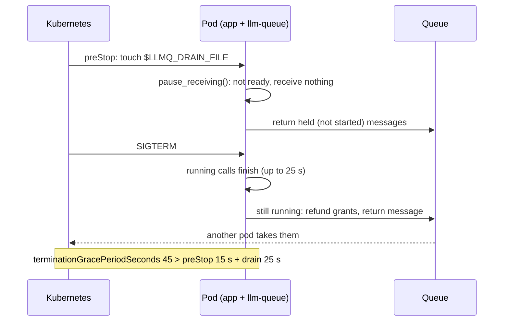

# Operate

How to deploy, watch and change a running system.

## Start and stop with the app

Start the queue once per process in the app's startup hook and stop it on shutdown:

```python
from contextlib import asynccontextmanager

@asynccontextmanager
async def lifespan(app):
    await llmq.start()              # a failure here should fail the pod: queued models need it
    yield
    llmq.pause_receiving()          # not ready; no new queued work
    await llmq.stop()               # drain: LLMQ_DRAIN_SECS (25 s) for jobs and calls together
```

With FastAPI, `llm_queue.fastapi.install(app, llmq)` does this, mounts the routes and adds the
request context middleware in one call (see [Use with FastAPI](fastapi.md)).

Start one queue per process, after any fork (in each gunicorn / uvicorn worker, in Celery's
`worker_process_init`); see [Clients and connections](../explanation/clients.md#one-llmqueue-per-process).

To run without the store (outage, migration, a service without one), see the switch ladder in
[Queue and local modes](modes.md).

## Deploys and restarts

1. A **preStop hook** pauses the pod: it touches `LLMQ_DRAIN_FILE` (every process of the pod
   sees it), or, in a single-process pod, posts `{"dry_run": false}` to the router's
   `POST /drain` (see [Drain a pod](#drain-a-pod)). Readiness fails, the process takes no new calls or jobs, and
   calls held waiting for budget go back to the queue at once; running work goes on.
2. **Shutdown** is `await llmq.stop(drain_secs=...)`. Held messages go back to the queue at once;
   running calls and this pod's waiting callers get up to `drain_secs` (default
   `LLMQ_DRAIN_SECS`, **25 s**) to finish. Jobs drain first, then calls get what is left.
3. **When the drain runs out**, a call still running is **given back, not failed**: its grants are
   refunded and its message returned to the queue at once, so another pod runs it and no failure
   is counted toward `max_receives`. A stream that already sent chunks to its caller cannot move
   and ends `worker_shutdown` (with `partial_text`). A job still running is returned the same way.



Kubernetes settings that fit the defaults:

```yaml
spec:
  terminationGracePeriodSeconds: 45     # above the preStop sleep (15) + LLMQ_DRAIN_SECS (25)
  containers:
    - name: app
      env:
        - {name: LLMQ_DRAIN_FILE, value: /llmq-drain/drain}
      lifecycle:
        preStop:   # every process pauses within LLMQ_DRAIN_POLL_SECS (1 s)
          exec: {command: ["sh", "-c", "touch $LLMQ_DRAIN_FILE; sleep 15"]}
      volumeMounts:
        - {name: llmq-drain, mountPath: /llmq-drain}
      readinessProbe:
        httpGet: {path: /llmq/health/ready, port: 8000}
      livenessProbe:
        httpGet: {path: /llmq/health/live, port: 8000}
  volumes:
    - {name: llmq-drain, emptyDir: {}}
```

The `sleep 15` lets the load balancer see the failed readiness and running calls finish before
SIGTERM. The preStop hook's time counts against the grace period, so the grace period must cover
the sleep plus `LLMQ_DRAIN_SECS` plus a margin (45 s here; with the default 30 s, drop the sleep
or lower `LLMQ_DRAIN_SECS`). If you raise `LLMQ_DRAIN_SECS` for long answers, raise
`terminationGracePeriodSeconds` with it; a pod killed before its drain ends
loses nothing either, its calls reappear after `queue.visibility_secs` (default 60 s), but
they then count one failure each.

Measured: 4 rolling restarts, 0 calls lost (gate B33).

## Drain a pod

A pause takes a process out of service without stopping it: readiness answers 503 with
`not_ready_reason: draining`, no new calls or jobs are received, running ones go on.

| Way | Reaches | Use |
|---|---|---|
| `LLMQ_DRAIN_FILE` | every process of the pod that shares the file | Multi-process pods (gunicorn / uvicorn workers): a preStop hook runs `touch $LLMQ_DRAIN_FILE; sleep 15`. Each process checks every `LLMQ_DRAIN_POLL_SECS` (1 s). A file older than the queue's construction (minus 1 s) is a leftover and ignored |
| `POST /drain` (`http_router(drain_routes=True)`) | the one process that answered | Single-process pods, or an operator pausing one process. Guarded like the write routes: an admin token (`LLMQ_ADMIN_TOKEN`), or `dependencies` plus the `X-LLMQ-Admin` header; `drain_routes=True` without either is a `ConfigError`. A write like every admin write: a dry run unless the body is `{"dry_run": false}`, and audited only when it acts. `GET /drain` is behind the read guard like every read route and only reads `draining`, `since`, `held` and `running` |
| `llmq.pause_receiving()` | this process | Sync, from any thread (a signal handler); `await llmq.drain(drain_secs)` also waits for running calls and jobs and returns True when none is left |

**Hand-back.** With `LLMQ_DRAIN_HANDBACK_ENABLED=true` (the default) a pause returns the calls
held here waiting for budget to the queue at once, so another pod runs them; a receive in flight
when the pause lands returns what it took instead of holding it. `stop()` waits for that
hand-back. Set it to false to keep held calls here until `stop()` (0.1.1 behaviour). A
`mode=caller` process holds no queued calls, so nothing is handed back there. With one replica,
handed-back calls wait for the new pod.

**Resume.** `llmq.resume_receiving()` (or `POST /resume` with `{"dry_run": false}`) undoes a
pause: the process receives again and is ready once started. After `stop()` it raises
`LLMQueueError` (the route answers 409).

**Admin drain is a dry run by default.** `llmq.admin.drain.start(actor=...)` and
`resume(actor=...)` (and their routes) are admin writes: without `dry_run=False` (HTTP
`"dry_run": false`) they change nothing, write no audit entry and return the current status
with `dry_run: true` and `would_change` (False when the process is already in that state). With
`dry_run=False` they act, are audited (`op` `drain` / `resume`) and return the status after,
with `dry_run: false`. The drain file and `LLMQueue.pause_receiving()` / `resume_receiving()` /
`drain()` are the process API, not admin writes: they act at once and have no dry run.
A drain file that paused a process does not pause it again after a resume; touching the file
anew (a newer mtime) does.

An app with its queue switched off can still fail its own readiness from the same file:

```python
from llm_queue.drain import DrainWatcher

watcher = DrainWatcher(os.environ["LLMQ_DRAIN_FILE"], on_drain=lambda: state.update(ready=False))
watcher.start()          # in the app's startup, on its event loop; `await watcher.stop()` at shutdown
```

## Health and readiness

| Route / call | Answers |
|---|---|
| `GET /health/live` | 200 while the library's background loops run and the heartbeat makes progress; **503** when a loop died or the heartbeat stalled for a lease. Once `stop()` begins it stays 200, so a draining pod is not restarted. It reads the process's own state only, never the store |
| `GET /health/ready` | 200 when the registry is loaded and the process is not draining, else 503. In strict mode a store whose eviction policy can evict the library's keys (`allkeys-*`, or `volatile-*` with native key expiry) also answers 503, with the reason |
| `await llmq.health()` | `live`, `ready`, `stores` (`state`, `queue`), `eviction_policy`, `key_expiry_mode` (`native` or `swept`), `worker`, `version`, `registry_version`, `held`, `heartbeat_age_secs`, `draining`, `draining_since`; plus `live_reason` when not live, `not_ready_reason` when not ready (`draining` after a pause, else in strict mode an evicting store's policy) and `queue_eviction_policy` with a separate queue store |

A liveness probe on `/health/live` restarts a pod whose loops died (0.1.0b1 always answered
200): keep its `failureThreshold` at 3 or more so one slow beat does not restart a healthy pod.

Readiness never depends on the stores' reachability or the providers, and answers at once from
cached state (one exception: in strict mode a store whose `maxmemory-policy` may evict keys makes
the process not ready, with `not_ready_reason` in the body; the policy is read again every
minute):
a background task probes each store every 5 s with a short write bounded by
`EngineTimings.health_probe_secs` (3 s) and reports it `ok`, `read_only` (a failover left it a
replica) or `down` (unreachable, or refusing writes, such as out of memory). A store error never
turns the readiness route into a 500. Liveness is false when one of the library's background
loops died or the heartbeat made no progress for a lease (`LLMQ_LEASE_SECS`).

At `start()` the store's own setup is checked: a cluster-mode store is refused (`ConfigError`),
and a `maxmemory-policy` that can evict the library's keys (`allkeys-*`, or `volatile-*` with
`LLMQ_KEY_EXPIRY_MODE=native`) logs `store_eviction_policy` with a warning and, when strict, fails
readiness (see
[Store requirements](../explanation/storage.md#store-requirements)).

## Status

```bash
llm-queue status                # every model
llm-queue status --model M      # one model: deployments, budgets used, health, queues, blocks
llm-queue requests get ID       # one call
llm-queue ops                   # every operation, and a summary of the store
```

The same from code: `await llmq.status(model)`, `await llmq.admin.requests.get(request_id)`;
over HTTP: `GET /status`, `GET /requests/{id}`, and `GET /` for the admin index with a live
summary (version, readiness, drain, stores, registry, models, jobs, scheduled purges).

## Alerts

Every 30 s one process (the holder of the alert lock, which it keeps while it runs) evaluates
alerts from the status report. Each alert is a gauge `llmq_alert_<name>`, and a log line
`llmq_alert` is written once when it turns on or off; an alert whose model or deployment left
the registry is logged off. Thresholds come from the model's `alerts` setting. Alarm and query
examples: [Monitor](monitor.md).

| Alert | On when |
|---|---|
| `model_unavailable` | No usable deployment is left: disabled, unhealthy, outside residency, blocked, on a disabled account, or behind an open breaker |
| `deployment_disabled` | A deployment was auto-disabled by health checks |
| `quota_near_limit` | A deployment used `alerts.quota_used_pct` (90) % of its RPM or TPM (off after two clear samples) |
| `quota_above_observed` | The provider throttled (this or the last minute) while the deployment had budget left: the real quota is below the registry's number (off after two clear samples) |
| `dead_letters` | A model's dead-letter queues (priority and normal together) hold `alerts.dlq_messages` (1) or more messages: `dlq list --model M` and `dlq list --model M --priority` |
| `breaker_open` | A deployment's breaker is open |
| `kill_switch_on` | The routing kill switch is on (one per model) |
| `queue_stalled` | A model's oldest queued call is older than `alerts.queue_age_secs` (600) |
| `job_dead_letters` | A job name has dead jobs |

## Change things at run time

```bash
llm-queue registry set --model M rpm=400 --yes      # live edit (audited)
llm-queue deployments disable M aws-main/ap-south-1 --yes
llm-queue blocks add --region R --yes               # stop using a region (or --account A)
llm-queue blocks remove --region R --yes
llm-queue models drain M --wait-secs 600 --yes      # disable a model for new calls; serve waiting ones
llm-queue requests cancel --id ID --yes             # cancel calls by id (waiting ones by default)
llm-queue dlq list --model M                        # dead letters; also show, redrive, purge
llm-queue purge model M                             # what a purge of a removed model would delete
llm-queue purge tenant T --yes                      # a tenant's fairness state (also: deployment)
```

Every command that changes something is a **dry run** until `--yes`: it prints what it would
do and changes nothing. `llm-queue dlq list --job J` lists dead jobs. Purges are described in
[Purge](purge.md). `requests cancel --state running|all` also cancels calls that already run;
`requests list|count|cancel|reprioritize MODEL [--tenant T]`, `requests extend ID` and
`tenants list MODEL` find calls by model and tenant in the request index
([Admin API](../reference/admin-api.md#requests-by-model-and-tenant)).

`--actor NAME` (default the OS user) records who made a change in the audit (`llm-queue audit
list`). Live edits and their limits are in [Configure](configure.md#live-edits). Every
operation, on every surface, is in [Admin API](../reference/admin-api.md).

## HTTP router

With the `http` extra:

```python
from fastapi import Depends

app.include_router(
    llmq.http_router(dependencies=[Depends(require_admin)]),
    prefix="/llmq",
)
```

This mounts every read operation of the [Admin API](../reference/admin-api.md) (`GET /` lists
them with a live summary) behind your dependencies, or behind `LLMQ_ADMIN_READ_TOKEN` /
`LLMQ_ADMIN_TOKEN` without any; `/health/live`, `/health/ready` (and `/metrics` with
`metrics_route=True`) stay open. With no token and no dependencies the router mounts only those
open routes and logs `admin_routes_unauthenticated`, unless `insecure_reads=True`. `allow_writes=True` (default
`LLMQ_ADMIN_WRITES_ENABLED`) adds the write routes: registry edits, blocks, model and deployment
switches, dead letters, cancels and purges. A write needs the admin token, or `dependencies`
plus the `X-LLMQ-Admin` header; it is audited under `actor(request)`, or `token:<X-LLMQ-Actor>`
with the token; its `dry_run` defaults to true. See
[Secure a deployment](secure.md#4-protect-the-http-write-routes).

## Store failover

The store is one primary with replicas (cluster mode is not supported).

- Clients reconnect on `READONLY` after a failover. The failover drill (`scripts/failover.py`)
  loses no call on `failover` and `restart`; with DNS lagging 6 s, at most 5 % of calls in
  flight may fail.
- `LLMQ_REPLICA_WAIT_COUNT` (default 0, off) / `LLMQ_REPLICA_WAIT_MS` (default 100): a write
  waits for this many replicas to acknowledge it, for call sends, job sends and registry live
  edits (each switchable with `LLMQ_REPLICA_WAIT_SCOPES`, default `all`). Too few
  acknowledgements never fail a write: it was sent, so it goes on, with a `replicas_short`
  warning at most once a minute and `llmq_send_not_replicated_total`. Also set
  `min-replicas-to-write` on the primary: its `NOREPLICAS` refusal counts as the store down.
- With a separate queue store (`LLMQ_QUEUE_STORE_URL`), errors for `LLMQ_QUEUE_STORE_FAILOVER_SECS`
  (5) make calls run direct under the same budgets. Each send try is bounded by that time (a
  store that never answers fails over then, not after the client's ~21 s budget), and the
  process remembers the outage for a few seconds (cleared by a good store probe): calls in
  that time skip the queue store and run direct at once.
- A state store outage: callers already waiting keep waiting until their deadline; new calls
  follow the model's `store_down` rule (`pause`, the default; `static_cap`; `fail_fast`).
  Measured: a 45 s outage with 500 calls waiting dropped none.

Details: [Failures and recovery](../explanation/resilience.md).

## StoreUnavailable

Admin operations (`cancel`, `status`, `request_status`, `send_job`, and the registry's reads and
edits) raise `StoreUnavailable` when the store is unreachable, read-only or full. It is also a
`ConnectionError`. Calls raise `CallFailed` (`queue_unavailable`) instead.

## Logs and metrics

The library logs with structlog and never configures logging; the app does. Log records are
named events, for example:

| Event | Meaning |
|---|---|
| `llmq_call_finished` | One per call (every path, failures too): request id, model, outcome, account, region, deployment, attempts, waits, duration, tokens, worker, hashed user and tenant; no prompt text |
| `llmq_alert` | An alert turned on or off |
| `llmq_registry_audit` | A registry publish or edit, with actor and diff (secrets redacted) |
| `registry_older_ignored` | This process's registry is older than the stored one, which is used |
| `registry_invalid_replaced`, `registry_needs_newer_library` | The stored registry was invalid and replaced; or it needs a newer library and this pod keeps its own |
| `second_llm_queue_started` | A second `LLMQueue` was started in one process |
| `store_eviction_policy` | The store may evict the library's keys (`allkeys-*`, or `volatile-*` with native key expiry) |
| `key_expiry_changed` | A store's key expiry mode changed from `native` to `swept` (or was set first): a policy change, or a process set to `swept` |
| `key_expiry_conflict` | This process's `LLMQ_KEY_EXPIRY_MODE` differs from the store's mode; it follows the store (give every process one setting) |
| `job_no_consumer` | A job was sent to a name no running process consumes |
| `store_down` | The state store failed before a call was sent; the `store_down` rule applies |
| `deployment_disabled`, `deployment_recovered` | Health checks turned a deployment off or back on |

Metrics go to `LLMQ_METRICS_SINK`: `emf` (CloudWatch embedded metrics, default, with the
`environment` dimension), `prometheus` (needs the `metrics` extra;
`llmq.http_router(metrics_route=True)` serves `GET /metrics`) or `none`; one sink per process. Per call: calls by
outcome and by caller-seen failure, attempts by result, tokens, and histograms of the queue
wait, the wait for a grant, the call and each provider attempt. Every 30 s the alert-lock
holder sets the cluster gauges (queues, held calls, oldest call, budgets and their limits,
concurrency, breakers, usable deployments, routing switches, dead jobs, alerts), and every pod
sets its own (ready, stores up, held calls, heartbeat age, outage memo, registry state, build
info). [Monitor](monitor.md) lists every metric with its labels, unit and emitter.
