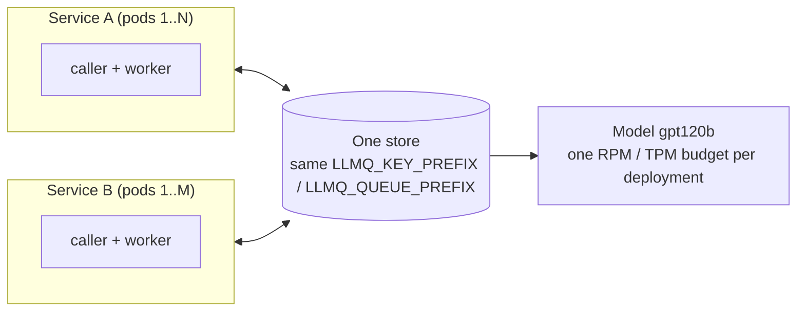

# Many services, one model

Several services, each with many pods, can call the same models through the same queues and
budgets. Budgets, slots, waiter order and health live in the store, so the limits hold across
every process that shares it.

## What the services must share

| Must be the same | Why |
|---|---|
| The store (`LLMQ_STORE_URL`, and `LLMQ_QUEUE_STORE_URL` if used) | Queues, budgets and results live there |
| `LLMQ_KEY_PREFIX` and `LLMQ_QUEUE_PREFIX` | They name the keys and queues; a different prefix is a separate system with its own budgets |
| The registry document | Every service ships the **same** document (`LLMQ_REGISTRY` or `LLMQ_REGISTRY_FILE`) |

A service in `caller` mode only makes calls; the workers of any service in `both` or `worker`
mode run them.

## The registry version rule

Each process publishes its registry at `start()` by `registry_version`:

| This process's version vs the store's | What happens |
|---|---|
| Higher | It is published and replaces the stored one |
| Equal, same content | The stored one is kept, with its live edits |
| Equal, other content | The stored one is kept; the process logs `registry_version_not_bumped` |
| Lower | The stored one is used; the process logs `registry_older_ignored` |

So during a rolling deploy of one service, its new pods publish the new version and the old pods
of every service pick it up on their next reload (`LLMQ_CFG_RELOAD_SECS`, 30 s). Raise
`registry_version` with every deployed change, and ship the new document to every service; a
service with an old document keeps working on the stored, newer one.

## Fairness between clients

Calls are served in arrival order within a class (priority, then normal). There is no fair share
per client or per service: one client that floods a model delays every other client of that
model.

To keep latency-sensitive callers moving:

- mark user-facing calls `priority=True` (or with `request_context(priority=True)`); priority
  calls are read first, and `priority_reserve` keeps part of each budget for them;
- give callers that should not wait long a `max_wait_secs`, so they fail `rate_limited` (with
  `retry_after_secs`) instead of waiting behind the flood.

## Library versions

Services may run different llm-queue versions for a while. Queue messages carry a format
version; a worker that gets a message newer than it understands returns it to the queue, never
drops it, so a newer worker can take it. See the [stability policy](../project/stability.md).
