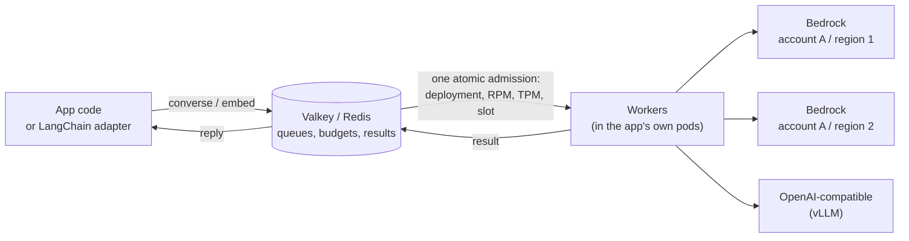

# llm-queue

llm-queue puts LLM calls through a queue on Valkey or Redis and runs them under RPM / TPM
budgets per **deployment** (one model in one account and one region). It picks the deployment,
keeps waiting calls in order, spills to fallback regions and fallback models by rule, retries by
outcome, tracks deployment health and reports status. It works with Amazon Bedrock and
OpenAI-compatible servers (such as vLLM), and with LangChain. The queue, the budgets and the
results live in one store, so admission (deployment, RPM, TPM, concurrency slot) is one atomic
step, and 1 pod behaves the same as 50.

-   **Get started**

    ---

    Install, start a local stack, write a registry and make your first call.

    [Getting started](tutorials/getting-started.md)

-   **How-to guides**

    ---

    Configure, tune, call, operate, share models across services, and test.

    [Make calls](how-to/call.md) · [Configure](how-to/configure.md) · [Operate](how-to/operate.md)

-   **Explanation**

    ---

    How a call flows, how admission decides, what happens when things fail.

    [Architecture](explanation/architecture.md) · [Life of a call](explanation/call-lifecycle.md)

-   **Reference**

    ---

    Settings, error kinds, the CLI and HTTP routes, and the Python API.

    [Configuration](reference/configuration.md) · [Errors](reference/errors.md) · [API](reference/api.md)

## Measured

Measured on fakellm with worker processes as pods on one machine (details and sources in
[Performance](explanation/performance.md)):

| What | Measured |
|---|---|
| Queue overhead | 0-15 ms at p95 over a direct call |
| Store work | about 11 store calls per queued call |
| Admission | p99 under 1 ms with 30 deployments per model |
| Budgets | held exactly: 1,800 of 1,800 a minute |
| Store outage | a 45 s store outage loses no waiting call |
