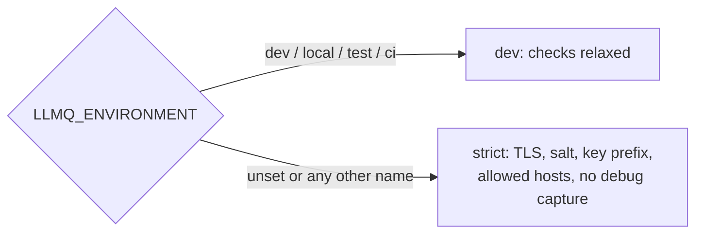

# Environment variables

Every process setting (`LLMQ_*`) that `LLMQueue.from_env()` reads, with its default, its range
and what it does. Model settings live in the registry document, and timeouts and pool sizes in
`Tuning` (see [Configuration](configuration.md)). The job limits (`LLMQ_JOB_*`) are listed in
[Configuration](configuration.md#job-settings-llmq_job_).

## Where values come from

```python
llmq = LLMQueue.from_env()                                    # os.environ
llmq = LLMQueue.from_env(secrets=lookup)                      # lookup(name) first, then os.environ
llmq = LLMQueue.from_env(environ={"LLMQ_STORE_URL": "..."},   # no environment variables at all
                         secrets=lookup)
llmq = LLMQueue.from_env(secrets=lookup,                      # the app's own values, lowest
                         defaults={"LLMQ_KEY_PREFIX": "myapp-dev"},
                         secret_names={"LLMQ_STORE_HOST": "valkey_host"})
```

Three layers, highest first: **the secrets**, then **`environ`**, then **`defaults=`**.

- The secrets are `secrets=` when given (code wins), else the sources `LLMQ_SECRETS_SOURCE`
  names (see [Secrets](#secrets)), else none. `secrets=` is a function from a name to a value
  or `None`; each `LLMQ_*` name is looked up there first, then in `environ`.
  `LLMQ_STORE_PASSWORD` and `LLMQ_QUEUE_STORE_PASSWORD` are read through the layers on every
  new store connection, so a rotated password needs no restart (a password in the environment
  works without a secrets source too). Account secrets (`api_key_ref`, `external_id_ref`) are
  looked up in the secrets, then in `environ`.
- `environ=` replaces `os.environ` with a mapping you build (from a config file, a test
  fixture). Nothing is read from the process environment then.
- `defaults=` (a mapping of `LLMQ_*` names to values; `True` / `False` read as `true` /
  `false`) is used for a name neither layer above sets: the app's own defaults, kept in code.
  A name without the `LLMQ_` prefix is refused.
- `secret_names=` maps an `LLMQ_*` setting to the key that holds it in the secrets
  (`{"LLMQ_STORE_PASSWORD": "valkey_password"}`): that key is asked instead of the `LLMQ_*`
  name. It is merged over `LLMQ_SECRET_NAMES` (the argument wins per setting). The order of the
  layers stays the same.

The CLI (`llm-queue`) and `AdminServices.from_env` read the same layers, so
`LLMQ_SECRETS_SOURCE` applies to them too. `AdminServices.from_env` takes `LLMQueue.from_env`'s
`secrets=`, `defaults=` and `secret_names=` and builds on the same wiring
(`AdminContext.from_layers`), so an admin worker reproduces an app that configures through
`defaults=`.

Two groups name one thing two ways: `LLMQ_STORE_URL` or the store parts (`LLMQ_STORE_HOST`,
`LLMQ_STORE_PORT`, `LLMQ_STORE_DB`, `LLMQ_STORE_TLS_ENABLED`), and `LLMQ_REGISTRY` or
`LLMQ_REGISTRY_FILE`. The highest layer that sets any name of a group picks the form, and the
other form is ignored in every layer: a `defaults` `LLMQ_REGISTRY` gives way to an
environment's `LLMQ_REGISTRY_FILE`, and an environment's `LLMQ_STORE_URL` to a secret
`LLMQ_STORE_HOST`. One layer that sets both forms is refused.

Every value is checked at `from_env`; all problems are raised together as one `ConfigError`.
An empty value (`LLMQ_LEASE_SECS=`, as compose's `${VAR:-}` writes) counts as unset.

How to read the **Range** column: `1 to 100` includes both ends; `above 0` excludes 0;
`(whole)` means a whole number (`200.0` and `1e3` are refused). TTLs stay within 2147483647
seconds, the longest `EXPIRE` takes.

## Secrets

Where the secret layer comes from when no `secrets=` is passed. These settings are read from
`environ` and `defaults=` only, never from a secret.

| Variable | Default | Range | Meaning |
|---|---|---|---|
| `LLMQ_SECRETS_SOURCE` | `none` | comma list of `aws-secretsmanager:<secret-id>`, `file:<path>`, `env`, `none` | Sources tried in order for each name; the first that has it wins. `aws-secretsmanager:<id>`: one Secrets Manager secret holding a JSON object (credentials from the default chain, the pod role on EKS). `file:<path>`: a directory with one file per key (a Kubernetes secret volume; one trailing newline stripped), a `.json` file holding an object, or any other file read as `.env` lines (`KEY=VALUE`, `#` comments, optional quotes). `env`: the environment. `none`: no source. `${NAME}` and `${NAME:-default}` are expanded from the environment (`aws-secretsmanager:${ENV}/app/secret`). A source that cannot be read at `from_env` (missing, denied, not JSON) raises `ConfigError` naming it; a key no source has is unset |
| `LLMQ_SECRET_NAMES` | empty | JSON object of `LLMQ_*` names to keys | The key each setting has in the secrets: `{"LLMQ_STORE_HOST":"valkey_host","LLMQ_STORE_PASSWORD":"valkey_key"}`. Merged with `secret_names=` (the argument wins per setting). Keys must be `LLMQ_*` settings (not these five) and values non-empty |
| `LLMQ_SECRETS_REGION` | the AWS default (`AWS_REGION`, then `AWS_DEFAULT_REGION`) | an AWS region | Region of the `aws-secretsmanager` sources |
| `LLMQ_SECRETS_CACHE_SECS` | 300 | 0 to 86400 | Each source's values are kept this long, then read again (so a rotated value is seen within it). 0: read on every lookup. A lookup on the event loop never waits for a refresh: it gets the last values while a background thread reads the source again. A refresh that fails keeps the last values (`secrets_refresh_failed`) and is tried again after min(this, 30 s) |
| `LLMQ_SECRETS_TIMEOUT_SECS` | 10 | 1 to 300 | Connect and read timeout of a Secrets Manager request (3 attempts) |

## `LLMQ_ENVIRONMENT`: strict or dev

| Value | Mode | What it means |
|---|---|---|
| `dev`, `local`, `test`, `ci` | dev | Plain `redis://` stores allowed, no id salt needed, the default key prefix `llmq`, any `base_url` host, `http` endpoint overrides, `LLMQ_DEBUG_CAPTURE_FROM_CONFIG` allowed |
| anything else (`prod`, `staging`, ...) | strict | The checks below |
| **unset** | **strict** | Same as any other name (since 0.1.0b2; before, unset meant dev) |

`production` is read as `prod`. Strict mode requires:

- store URLs with `rediss://` (or `valkeys://`) and the certificate and host name checked; a
  localhost URL may stay plain. `ssl_cert_reqs=required` and `ssl_check_hostname=true` are
  written into the URL so every client built from it verifies explicitly; a repeated query
  parameter is refused;
- `LLMQ_ID_HASH_SALT`, at least 16 characters (it keys the hash of ids such as phone numbers;
  a short key does not stop brute force);
- an explicit `LLMQ_KEY_PREFIX` (two environments that both kept the default `llmq` on one
  store shared their queues);
- `LLMQ_BASE_URL_ALLOWED_HOSTS` when the registry has an `openai` account;
- `https://` in `LLMQ_BEDROCK_ENDPOINT_URL` and `LLMQ_STS_ENDPOINT_URL` (any host);
- `LLMQ_DEBUG_CAPTURE_FROM_CONFIG` off (it stores prompt text).

A store whose eviction policy can drop the library's keys fails readiness in strict mode, with
the reason (the process still starts): `allkeys-*` always, and `volatile-*` when keys expire
natively (`LLMQ_KEY_EXPIRY=native`). With `auto` (the default) a `volatile-*` store gets
`swept` and stays ready.



## Stores

| Variable | Default | Range | Meaning |
|---|---|---|---|
| `LLMQ_STORE_URL` | required (or `LLMQ_STORE_HOST`) | a store URL | The state store: `redis://`, `rediss://`, `valkey://` or `valkeys://`. Not needed, never checked and never contacted with `LLMQ_EXECUTION_MODE=local` (nor are the store parts below) |
| `LLMQ_STORE_HOST` | none | a host name or address | The state store as parts instead of a URL (not both in one layer): the URL is built from the host, `LLMQ_STORE_PORT`, `LLMQ_STORE_DB`, `LLMQ_STORE_TLS_ENABLED` and `LLMQ_STORE_PASSWORD` (escaped), and checked like a URL |
| `LLMQ_STORE_PORT` | 6379 | 1 to 65535 (whole) | The store's port, with `LLMQ_STORE_HOST` |
| `LLMQ_STORE_DB` | 0 | 0 to 2147483647 (whole) | The database number, with `LLMQ_STORE_HOST` |
| `LLMQ_STORE_TLS_ENABLED` | true | true or false | `rediss://` (TLS) or `redis://`, with `LLMQ_STORE_HOST`; strict mode still requires TLS for a host that is not local |
| `LLMQ_STORE_PASSWORD` | none | text | Optional; read on every new connection (rotation), from a secret, the environment or `defaults=`; wins over a password in the URL |
| `LLMQ_QUEUE_STORE_URL` | the state store | a store URL | Optional separate store for queues and doorbells (same TLS rule) |
| `LLMQ_QUEUE_STORE_PASSWORD` | none | text | As `LLMQ_STORE_PASSWORD`, for the queue store |
| `LLMQ_STORE_MAX_CONNECTIONS` | 200 | 4 to 100000 (whole) | Store connection pool per engine (worker slots + callers + 3). `auto`: the sum of `worker_slots` over the boot registry's models plus 10 (`STORE_POOL_MARGIN`), within 4 to 100000, computed once by `from_env` (a live edit does not resize it; `start()` warns when the pool is below the slots). Sync calls without a started queue use at most `LLMQ_SYNC_STORE_MAX_CONNECTIONS` |
| `LLMQ_SYNC_STORE_MAX_CONNECTIONS` | 20 | 1 to 100000 (whole) | The pool of the private caller-only engine that serves sync calls when no queue is started (Celery workers, scripts); never more than `LLMQ_STORE_MAX_CONNECTIONS` |
| `LLMQ_QUEUE_FAILOVER_SECS` | 5 | 0 to 3600 | With a separate queue store: send errors this long before calls run direct |
| `LLMQ_QUEUE_WAIT_REPLICAS` | 0 | 0 to 16 (whole) | A write waits for this many replicas to acknowledge it (0: off). With fewer replicas a write is sent anyway, warned about at most once a minute and counted (`llmq_send_not_replicated_total`); a store with no replica connected skips the wait ... |
| `LLMQ_QUEUE_WAIT_MS` | 100 | above 0 to 60000 (whole) | ... for at most this long (it must stay below the store read timeout, see [Tune](../how-to/tune.md)) |
| `LLMQ_QUEUE_WAIT_SCOPES` | `all` | `all`, `none` or a comma list of `calls`, `jobs`, `registry` | Which writes wait for replicas: call sends, job sends, registry live edits. Every scope is on by default when `LLMQ_QUEUE_WAIT_REPLICAS` is set |
| `LLMQ_KEY_EXPIRY` | `auto` | `auto`, `native`, `swept` | How keys expire. `native`: Valkey TTLs (needs `maxmemory-policy noeviction`). `swept`: no key the library needs has a TTL; expiries live in the index `P:ttl` and the sweeper deletes due keys, so a `volatile-*` store (a shared cache) cannot evict them. `auto`: `native` on a `noeviction` store, else `swept` (`volatile-*`, `allkeys-*` or an unreadable policy). The mode is the store's: a started engine writes it to `P:expiry` at start, every minute and after a store reset, and every script follows that key; a missing key means `native`. `allkeys-*` stays not ready in strict mode either way. See [Key expiry modes](../explanation/storage.md#key-expiry-modes) |
| `LLMQ_TTL_SWEEP_BATCH` | 500 | 1 to 5000 (whole) | Keys deleted per sweep script run (index `P:ttl`). The sweep runs in both modes |
| `LLMQ_TTL_SWEEP_ROUNDS` | 100 | 1 to 10000 (whole) | Full batches per sweep (every 10 s), at most: 500 x 100 = 50000 keys per sweep (5000 a second) by default; more wait for the next one. Every process (worker or caller) takes part; one at a time sweeps, under the lock `P:lock:ttlsweep` |

For a store with replicas, also set `min-replicas-to-write` on the primary: a write it refuses
(`NOREPLICAS`), like `OOM`, `MISCONF` and `BUSY`, is treated as the store being down.

## Off switch

| Variable | Default | Range | Meaning |
|---|---|---|---|
| `LLMQ_ENABLED` | true | true or false (`on` / `off`) | `false` switches the library off: `from_env()` returns a disabled queue and reads no other setting but `LLMQ_ENVIRONMENT`, `LLMQ_DRAIN_FILE` and `LLMQ_DRAIN_POLL_SECS` (no store, registry or salt needed). The factories (`chat_model`, `embeddings`) return None so the app runs its own direct path; a direct `llmq.converse()` / `embed()` / admin store operation raises `QueueDisabled` (`config_error`, not retryable; HTTP 503 `reason: disabled`); `install()` mounts only `/health/live` and `/health/ready` (`enabled: false`); the drain file still fails readiness. Read like every setting (secrets, environment, `defaults=`). See [Modes](../how-to/modes.md#the-switch-ladder) |

## Execution mode

How calls run (see [Modes](../how-to/modes.md) for when to switch and how to undo it).

| Variable | Default | Range | Meaning |
|---|---|---|---|
| `LLMQ_EXECUTION_MODE` | `queue` | `queue`, `local` | `queue`: calls go through the store's queues and shared budgets. `local`: every call runs in this process straight against the provider, with the same API, classes, LangChain adapters and `install()`; no store client is built (`LLMQ_STORE_URL` is not needed), store-only operations raise `LocalModeRefused` (HTTP 503) and `LLMQ_MODE` does not apply |
| `LLMQ_LOCAL_PROCESS_COUNT` | 1 | above 0 to 100000 (whole) | The local executor's share of each budget: every deployment's (and account's shared) `rpm` / `tpm` is divided by this in each process. Set it to the processes sharing the quota (pods x workers). Used in `local` mode and by `store_down: static_cap`. A fixed ceiling, read at start: it does not follow autoscaling, so set it to the most processes that may run at once (fewer running leave quota unused, more go over it). `local_mode_started` logs the share each process takes per model; queue mode logs `static_cap_process_count_unset` at start when a model uses `static_cap` and this is left at 1 |
| `LLMQ_LOCAL_CONCURRENCY` | 10 | above 0 to 100000 (whole) | Calls in flight per model and process on the local executor (`local` mode and `store_down: static_cap`; async and sync calls together); priority calls get a free slot first. The one setting for both: the old `LLMQ_LOCAL_LIMIT_CAP` is reported as renamed |
| `LLMQ_STATIC_CAP_WAIT_SECS` | 5 | 0 to 3600 | The longest a `store_down: static_cap` call waits for a budget or a breaker during a store outage, below its own `max_wait_secs`; then `rate_limited`. Retries and their backoff are not capped |

## Names

Every setting is `LLMQ_<AREA>_<THING>[_<UNIT>]`: units in the name (`_SECS`, `_MS`, `_BYTES`,
`_DAYS`), switches end in `_ENABLED`, and `_MODE` marks a setting that picks one of several
behaviours of the same thing (`LLMQ_EXECUTION_MODE`). A setting that names a sink, a source
list or a role is not a mode: `LLMQ_METRICS_SINK` and `LLMQ_SECRETS_SOURCE` keep their names.
`TTL` (time to live) is a defined term, not an abbreviation (`LLMQ_RESULT_TTL_SECS`).
`LLMQ_ENABLED` is the one setting without an area: the switch of the whole library.

## Unknown settings

An `LLMQ_*` name that no setting on this page reads (a typo, or a setting a release renamed or
removed) is never ignored in silence: when one is set in the environment or `defaults=`, a
strict environment refuses to start (`ConfigError` naming it) and a dev one logs
`setting_unknown` (the name, never the value). `LLMQ_JOB_*` and the `LLMQ_ACCOUNT_*` account
secrets are not checked here. The [changelog](../project/changelog.md) lists each release's
renamed and removed settings.

## Environment, names and process

| Variable | Default | Range | Meaning |
|---|---|---|---|
| `LLMQ_ENVIRONMENT` | unset (strict) | any name | See above |
| `LLMQ_ID_HASH_SALT` | none | 16 or more characters when strict | Key of the user / session id hash (HMAC). Use the same value in every service that shares the store |
| `LLMQ_KEY_PREFIX` | `llmq` in dev; **required** when strict | 1-64 letters, digits, `_`, `.`, `:` or `-` | Prefix of this environment's store keys: name it per app and environment (`myapp-prod`, `llmq:prod:v3`). No braces or glob characters: it is part of every key |
| `LLMQ_QUEUE_PREFIX` | empty | 0-64 letters, digits, `_`, `.` or `-` | Prefix of this environment's queue names (no `:`: it goes inside hash tags) |
| `LLMQ_MODE` | `both` | `both`, `caller`, `worker` | `both` (caller and worker), `caller` (sends and waits only) or `worker` (runs calls only). Does not apply with `LLMQ_EXECUTION_MODE=local` |
| `LLMQ_WORKER_ID` | empty | letters, digits, `_`, `.`, `:`, `-` | Empty: `POD_NAME` (else the host name) and the pid, e.g. `api-7f9c:12`. This process's id prefix in the store (callers, leases, logs); the engine adds a random tail, so two processes never share one. A `worker_id=` argument wins |
| `LLMQ_DEFAULT_TENANT` | none | text | The tenant of a call that names none (no `tenant_id=`, none in `request_context`): every call of a single-tenant app carries it, threads included |
| `LLMQ_ADMIN_TOKEN` | none | text (a secret) | Guards every admin route except the probes and `/metrics`, reads and writes: the request's `LLMQ_ADMIN_HEADER` must equal it (constant-time). Read on every request, so a rotated secret needs no restart. Unset with no `LLMQ_ADMIN_READ_TOKEN`: only the app's `dependencies` guard the routes; with none of the three the router mounts only the probes and `/metrics` (unless `insecure_reads=True`) |
| `LLMQ_ADMIN_READ_TOKEN` | none | text (a secret) | Guards the read routes only (GET): the request's `LLMQ_ADMIN_HEADER` must equal it or `LLMQ_ADMIN_TOKEN`. It never allows a write. Read on every request. See [Admin API](admin-api.md) |
| `LLMQ_ADMIN_HEADER` | `X-LLMQ-Token` | a header name | The header that carries the admin tokens (read and write) |
| `LLMQ_ADMIN_WRITES_ENABLED` | false | true or false (`on` / `off`) | Default of `http_router(allow_writes=)`: mount the admin write routes (registry edits, blocks, purges, dead letters, cancels). Each write is still a dry run unless its body says `"dry_run": false` |
| `LLMQ_ADMIN_ACTOR_HEADER` | `X-LLMQ-Actor` | a header name | With the token guard and no `actor=`: the header whose value a write is audited under, as `token:<value>` (`token:unknown` without it). A claimed name, not an identity |
| `LLMQ_ADMIN_CSRF_HEADER` | `X-LLMQ-Admin` | a header name | When the write routes are guarded by `dependencies` only (no `LLMQ_ADMIN_TOKEN`), a write needs this header (any value): no simple cross-site request can carry it |
| `LLMQ_ADMIN_INDEX_CACHE_SECS` | 2 | 0 to 60 | How long `GET /` (the admin index) reuses its live summary, so a dashboard poll cannot load the store |
| `LLMQ_ADMIN_DLQ_BODIES_ENABLED` | false | true or false (`on` / `off`) | `GET /dlq/{entry_id}?unsafe=true` may return message bodies (prompts, job payloads); off, it answers 403. The CLI and Python `unsafe=True` do not need it |
| `LLMQ_ADMIN_BODY_MAX_BYTES` | 1048576 | 1024 to 67108864 (whole) | Largest admin POST body; a larger one answers 413 before it is parsed. Each value of a JSON body (a registry edit's `values`) is also capped at 64 KiB serialised (400) |
| `LLMQ_METRICS_SINK` | `emf` | `emf`, `prometheus`, `none` | `emf` (CloudWatch embedded metrics), `prometheus` (extra `metrics`) or `none`. One sink per process |
| `LLMQ_METRICS_TENANTS` | empty | at most 50 entries `name` or `name=label`, label `[A-Za-z0-9_.-]{1,64}` (not `other` or `-`) | Tenants that get their own `tenant` label on `llmq_calls_total` and `llmq_wait_seconds` (`globex=t2` shows `globex` as `t2`, so a dashboard need not show the name); every other tenant is `other`, a call with no tenant `-`. The label is always there, so cardinality stays fixed. Names are matched by their keyed hash: no name reaches the store |

## Requests by model and tenant

Every call in flight is indexed under its model and tenant hash (`P:{m:ALIAS}:tq:H`, see
[store keys](store-keys.md)) by the scripts that send and end it, so an operator can list,
count, cancel, reprioritize and extend one tenant's calls on one model.

| Variable | Default | Range | Meaning |
|---|---|---|---|
| `LLMQ_REQUEST_INDEX_ENABLED` | true | true or false (`on` / `off`) | Index each in-flight call under its model and tenant hash so admins can list, count, cancel, reprioritize and extend by tenant, and a tenant purge can cancel its calls; off saves about 30 us of store time per call and no admin operation can find calls by tenant |
| `LLMQ_TENANT_NAMES_ENABLED` | false | true or false (`on` / `off`) | Also store each tenant's name beside its hash (`P:{m:ALIAS}:tqn`) so admin lists and status can show it; off, the store holds hashes only (messages always carry only the hashes) |
| `LLMQ_ADMIN_BATCH` | 500 | 1 to 10000 (whole) | Ids per pipeline or cancel script in admin operations, and keys per pipelined `UNLINK` batch of a purge |
| `LLMQ_ADMIN_SCAN_MAX` | 100000 | 1000 to 10000000 (whole) | Most index entries one admin operation reads; above it a write is refused and a count is truncated |
| `LLMQ_REQUESTS_LIST_MAX` | 1000 | 1 to 10000 (whole) | Largest `limit` of a requests list |
| `LLMQ_REQUESTS_MOVE_BATCH` | 50 | 1 to 500 (whole) | Messages per reprioritize script run |
| `LLMQ_REQUESTS_MOVE_BYTES` | 8388608 | 65536 to 67108864 (whole) | Message bytes copied per reprioritize script run (bodies are copied inside the store) |

## Registry

| Variable | Default | Range | Meaning |
|---|---|---|---|
| `LLMQ_REGISTRY` | none | JSON | The registry document ([shape](registry.md)) |
| `LLMQ_REGISTRY_FILE` | none | a path | A file holding it (set one of the two, not both). A repeated JSON key is refused. A path ending `.yaml` / `.yml` is read as YAML (extra `yaml`). Either form may hold `${NAME}` placeholders ([registry](registry.md#placeholders-and-yaml)) |
| `LLMQ_REGISTRY_LIVE_EDIT` | `safe` | `safe`, `all`, `off` | The live-edit mode when the document has no `live_edit` field (see [Live edits](../how-to/configure.md#live-edits)) |
| `LLMQ_CFG_RELOAD_SECS` | 30 | 1 to 3600 | How often each process reloads the registry |
| `LLMQ_AUDIT_RETENTION_DAYS` | 90 | above 0 to 3650 (whole) | How long registry audit entries are kept (also capped at about 10,000 entries) |
| `LLMQ_BASE_URL_ALLOWED_HOSTS` | empty | comma list of bare host names | Hosts an `openai` account's `base_url` may name (no scheme, port or path: `api.openai.com`). Empty: any host in dev; required when strict and the registry has an `openai` account |
| `LLMQ_DEBUG_CAPTURE_FROM_CONFIG` | false | true or false | Allows a model's `debug_capture` (prompt text in the store for an hour); refused when strict |

## Calls and lifecycle

| Variable | Default | Range | Meaning |
|---|---|---|---|
| `LLMQ_LEASE_SECS` | 60 | above 0 to 3600 | Lease of a running call's grant; renewed by the heartbeat every third of it |
| `LLMQ_CALLER_TTL_SECS` | 30 | above 0 to 86400 (whole) | How long a caller process counts as alive without a heartbeat. Must be at least `LLMQ_LEASE_SECS / 3 + max(5, LLMQ_LEASE_SECS / 6)` (checked at start); the caller key lives at least two heartbeats (`2 x LLMQ_LEASE_SECS / 3 + 5`) and is refreshed on every send and attach |
| `LLMQ_RESULT_TTL_SECS` | 300 | above 0 to 2147483647 (whole) | How long a stored result lives; at least `Tuning.engine.result_recheck_secs` (60), or start-up fails |
| `LLMQ_RESULT_DEDUPE_SECS` | 0 | 0 to 2147483647 (whole) | Keep a result with a library-made id this long after it was read (0: delete on read) |
| `LLMQ_STATUS_TTL_SECS` | 1800 | 1 to 2147483647 (whole) | How long a call's status record lives; `start()` warns about a model whose timeout is longer |
| `LLMQ_DRAIN_SECS` | 25 | 0 to 3600 | Default `drain_secs` of `stop()` and `drain()` (0 returns held work at once); fits the Kubernetes default grace period of 30 s (see [Operate](../how-to/operate.md#deploys-and-restarts)) |
| `LLMQ_DRAIN_HANDBACK_ENABLED` | true | true or false | `pause_receiving()` returns the calls held here waiting for budget to the queue at once, for another pod; false keeps them here until `stop()` (0.1.1 behaviour). See [Drain](../how-to/operate.md#drain-a-pod) |
| `LLMQ_DRAIN_FILE` | empty | a path | A file whose appearance (an mtime newer than the queue's construction, minus 1 s) pauses every process of the pod; a resumed process pauses again only when it is touched anew. Empty: off. For a preStop hook in a pod with several processes |
| `LLMQ_DRAIN_POLL_SECS` | 1 | 0.1 to 60 | How often each process checks `LLMQ_DRAIN_FILE` |

## Purge

What a purge does by default; each method argument overrides its setting. See
[Purge store state](../how-to/purge.md).

| Variable | Default | Range | Meaning |
|---|---|---|---|
| `LLMQ_AUTO_PURGE` | true | true or false (`on` / `off`) | When a registry publish drops a model or deployment, purge its store state after `LLMQ_PURGE_GRACE_SECS` (one worker process does it, never a caller-only one; a rollback within the grace keeps the state; an auto deployment purge does not wait for running calls) |
| `LLMQ_PURGE_GRACE_SECS` | 900 | 0 to 604800 | How long an auto purge waits after the drop; keep it at least the longest call (`timeout_max_secs`, 900 by default) |
| `LLMQ_PURGE_WAIT` | true | true or false | A deployment purge waits for the deployment's running calls to end first |
| `LLMQ_PURGE_WAIT_SECS` | 300 | 0 to 86400 | ... for at most this long; still running then, nothing is deleted and the report says why |
| `LLMQ_HTTP_PURGE_WAIT_SECS` | 60 | 0 to 3600 | The longest a purge over HTTP (`/purge/deployment`, `/purge/removed`, `/models/{model}/drain`) waits for running calls; a larger or omitted `wait_secs` is capped to it |
| `LLMQ_TENANT_PURGE_DEFAULT` | `keys` | comma list of `keys`, `queued`, `running` | What a tenant purge removes: its fairness keys, its calls still waiting (cancelled), all its calls (cancelled). `queued` / `running` read the request index of each model; with `LLMQ_REQUEST_INDEX_ENABLED=false` they raise `AdminRefused` |

## Endpoint overrides

| Variable | Default | Range | Meaning |
|---|---|---|---|
| `LLMQ_BEDROCK_ENDPOINT_URL` | none | a URL; `https://` when strict | Send Bedrock calls to this endpoint (a VPC endpoint, or a fake such as fakellm in tests) |
| `LLMQ_STS_ENDPOINT_URL` | none | a URL; `https://` when strict | Send STS (assume-role) calls to this endpoint |

## Account secrets

| Variable | Meaning |
|---|---|
| `LLMQ_ACCOUNT_*` | Secrets named by a registry account's `api_key_ref` or `external_id_ref`. Only names with this prefix (upper case, digits, `_`) are accepted, so a registry can never name the store password or the pod's AWS keys |
