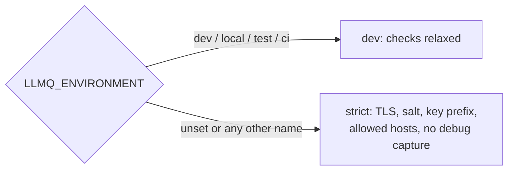

# Environment variables

Every process setting (`LLMQ_*`) that `LLMQueue.from_env()` reads, with its default, its range
and what it does. Model settings live in the registry document, and timeouts and pool sizes in
`Tuning` (see [Configuration](configuration.md)). The job limits (`LLMQ_JOB_*`) are listed in
[Configuration](configuration.md#job-settings-llmq_job_).

## Where values come from

```python
llmq = LLMQueue.from_env()                                    # os.environ
llmq = LLMQueue.from_env(secrets=lookup)                      # lookup(name) first, then os.environ
llmq = LLMQueue.from_env(environ={"LLMQ_STORE_URL": "..."},   # no environment variables at all
                         secrets=lookup)
```

- `environ=` replaces `os.environ` with a mapping you build (from a config file, Secrets
  Manager, a test fixture). Nothing is read from the process environment then.
- `secrets=` is a function from a name to a value or `None`; each `LLMQ_*` name is looked up
  there first, then in `environ`. `LLMQ_STORE_PASSWORD` and `LLMQ_QUEUE_STORE_PASSWORD` are read
  through it on every new store connection, so a rotated password needs no restart. Account
  secrets (`api_key_ref`, `external_id_ref`) are looked up the same way.

Every value is checked at `from_env`; all problems are raised together as one `ConfigError`.
An empty value (`LLMQ_LEASE_SECS=`, as compose's `${VAR:-}` writes) counts as unset.

How to read the **Range** column: `1 to 100` includes both ends; `above 0` excludes 0;
`(whole)` means a whole number (`200.0` and `1e3` are refused). TTLs stay within 2147483647
seconds, the longest `EXPIRE` takes.

## `LLMQ_ENVIRONMENT`: strict or dev

| Value | Mode | What it means |
|---|---|---|
| `dev`, `local`, `test`, `ci` | dev | Plain `redis://` stores allowed, no id salt needed, the default key prefix `llmq`, any `base_url` host, `http` endpoint overrides, `LLMQ_DEBUG_CAPTURE_FROM_CONFIG` allowed |
| anything else (`prod`, `staging`, ...) | strict | The checks below |
| **unset** | **strict** | Same as any other name (since 0.1.0b2; before, unset meant dev) |

`production` is read as `prod`. Strict mode requires:

- store URLs with `rediss://` (or `valkeys://`) and the certificate and host name checked; a
  localhost URL may stay plain. `ssl_cert_reqs=required` and `ssl_check_hostname=true` are
  written into the URL so every client built from it verifies explicitly; a repeated query
  parameter is refused;
- `LLMQ_ID_HASH_SALT`, at least 16 characters (it keys the hash of ids such as phone numbers;
  a short key does not stop brute force);
- an explicit `LLMQ_KEY_PREFIX` (two environments that both kept the default `llmq` on one
  store shared their queues);
- `LLMQ_BASE_URL_ALLOWED_HOSTS` when the registry has an `openai` account;
- `https://` in `LLMQ_BEDROCK_ENDPOINT_URL` and `LLMQ_STS_ENDPOINT_URL` (any host);
- `LLMQ_DEBUG_CAPTURE_FROM_CONFIG` off (it stores prompt text).

A store whose eviction policy can drop keys (anything but `noeviction`) fails readiness in strict
mode, with the reason (the process still starts).



## Stores

| Variable | Default | Range | Meaning |
|---|---|---|---|
| `LLMQ_STORE_URL` | required | a store URL | The state store: `redis://`, `rediss://`, `valkey://` or `valkeys://` |
| `LLMQ_STORE_PASSWORD` | none | text | Optional; read through `secrets=` on every new connection (rotation); wins over a password in the URL |
| `LLMQ_QUEUE_STORE_URL` | the state store | a store URL | Optional separate store for queues and doorbells (same TLS rule) |
| `LLMQ_QUEUE_STORE_PASSWORD` | none | text | As `LLMQ_STORE_PASSWORD`, for the queue store |
| `LLMQ_STORE_MAX_CONNECTIONS` | 200 | 4 to 100000 (whole) | Store connection pool per engine (worker slots + callers + 3). Sync calls without a started queue use at most 20 |
| `LLMQ_QUEUE_FAILOVER_SECS` | 5 | 0 to 3600 | With a separate queue store: send errors this long before calls run direct |
| `LLMQ_QUEUE_WAIT_REPLICAS` | 0 | 0 to 16 (whole) | A write waits for this many replicas to acknowledge it (0: off). With fewer replicas a write is sent anyway, warned about at most once a minute and counted (`llmq_send_not_replicated_total`); a store with no replica connected skips the wait ... |
| `LLMQ_QUEUE_WAIT_MS` | 100 | above 0 to 60000 (whole) | ... for at most this long (it must stay below the store read timeout, see [Tune](../how-to/tune.md)) |
| `LLMQ_QUEUE_WAIT_SCOPES` | `all` | `all`, `none` or a comma list of `calls`, `jobs`, `registry` | Which writes wait for replicas: call sends, job sends, registry live edits. Every scope is on by default when `LLMQ_QUEUE_WAIT_REPLICAS` is set |

For a store with replicas, also set `min-replicas-to-write` on the primary: a write it refuses
(`NOREPLICAS`), like `OOM`, `MISCONF` and `BUSY`, is treated as the store being down.

## Environment, names and process

| Variable | Default | Range | Meaning |
|---|---|---|---|
| `LLMQ_ENVIRONMENT` | unset (strict) | any name | See above |
| `LLMQ_ID_HASH_SALT` | none | 16 or more characters when strict | Key of the user / session id hash (HMAC). Use the same value in every service that shares the store |
| `LLMQ_KEY_PREFIX` | `llmq` in dev; **required** when strict | 1-64 letters, digits, `_`, `.`, `:` or `-` | Prefix of this environment's store keys: name it per app and environment (`myapp-prod`, `llmq:prod:v3`). No braces or glob characters: it is part of every key |
| `LLMQ_QUEUE_PREFIX` | empty | 0-64 letters, digits, `_`, `.` or `-` | Prefix of this environment's queue names (no `:`: it goes inside hash tags) |
| `LLMQ_MODE` | `both` | `both`, `caller`, `worker` | `both` (caller and worker), `caller` (sends and waits only) or `worker` (runs calls only) |
| `LLMQ_METRICS_SINK` | `emf` | `emf`, `prometheus`, `none` | `emf` (CloudWatch embedded metrics), `prometheus` (extra `metrics`) or `none`. One sink per process |

## Registry

| Variable | Default | Range | Meaning |
|---|---|---|---|
| `LLMQ_REGISTRY` | none | JSON | The registry document ([shape](registry.md)) |
| `LLMQ_REGISTRY_FILE` | none | a path | A file holding it (set one of the two, not both). A repeated JSON key is refused |
| `LLMQ_REGISTRY_LIVE_EDIT` | `safe` | `safe`, `all`, `off` | The live-edit mode when the document has no `live_edit` field (see [Live edits](../how-to/configure.md#live-edits)) |
| `LLMQ_CFG_RELOAD_SECS` | 30 | 1 to 3600 | How often each process reloads the registry |
| `LLMQ_AUDIT_RETENTION_DAYS` | 90 | above 0 to 3650 (whole) | How long registry audit entries are kept (also capped at about 10,000 entries) |
| `LLMQ_BASE_URL_ALLOWED_HOSTS` | empty | comma list of bare host names | Hosts an `openai` account's `base_url` may name (no scheme, port or path: `api.openai.com`). Empty: any host in dev; required when strict and the registry has an `openai` account |
| `LLMQ_DEBUG_CAPTURE_FROM_CONFIG` | false | true or false | Allows a model's `debug_capture` (prompt text in the store for an hour); refused when strict |

## Calls and lifecycle

| Variable | Default | Range | Meaning |
|---|---|---|---|
| `LLMQ_LEASE_SECS` | 60 | above 0 to 3600 | Lease of a running call's grant; renewed by the heartbeat every third of it |
| `LLMQ_CALLER_TTL_SECS` | 30 | above 0 to 86400 (whole) | How long a caller process counts as alive without a heartbeat. Must be at least `LLMQ_LEASE_SECS / 3 + max(5, LLMQ_LEASE_SECS / 6)` (checked at start); the caller key lives at least two heartbeats (`2 x LLMQ_LEASE_SECS / 3 + 5`) and is refreshed on every send and attach |
| `LLMQ_RESULT_TTL_SECS` | 300 | above 0 to 2147483647 (whole) | How long a stored result lives; at least `Tuning.engine.result_recheck_secs` (60), or start-up fails |
| `LLMQ_RESULT_DEDUPE_SECS` | 0 | 0 to 2147483647 (whole) | Keep a result with a library-made id this long after it was read (0: delete on read) |
| `LLMQ_STATUS_TTL_SECS` | 1800 | 1 to 2147483647 (whole) | How long a call's status record lives; `start()` warns about a model whose timeout is longer |
| `LLMQ_DRAIN_SECS` | 25 | 0 to 3600 | Default `drain_secs` of `stop()` (0 returns held work at once); fits the Kubernetes default grace period of 30 s (see [Operate](../how-to/operate.md#deploys-and-restarts)) |
| `LLMQ_LOCAL_LIMIT_CAP` | 10 | above 0 to 100000 (whole) | Calls per process and model run without the store under `store_down: static_cap` |

## Purge

What a purge does by default; each method argument overrides its setting. See
[Purge store state](../how-to/purge.md).

| Variable | Default | Range | Meaning |
|---|---|---|---|
| `LLMQ_AUTO_PURGE` | true | true or false (`on` / `off`) | When a registry publish drops a model or deployment, purge its store state after `LLMQ_PURGE_GRACE_SECS` (one pod does it; a rollback within the grace keeps the state) |
| `LLMQ_PURGE_GRACE_SECS` | 900 | 0 to 604800 | How long an auto purge waits after the drop; longer than the longest call |
| `LLMQ_PURGE_WAIT` | true | true or false | A deployment purge waits for the deployment's running calls to end first |
| `LLMQ_PURGE_WAIT_SECS` | 300 | 0 to 86400 | ... for at most this long; still running then, nothing is deleted and the report says why |
| `LLMQ_PURGE_BATCH` | 500 | 1 to 10000 (whole) | Keys per pipelined `UNLINK` batch |
| `LLMQ_TENANT_PURGE_DEFAULT` | `keys` | comma list of `keys`, `queued`, `running` | What a tenant purge removes: its fairness keys, its calls still waiting (cancelled), all its calls (cancelled). `queued` / `running` need `LLMQ_TENANT_INDEX` |
| `LLMQ_TENANT_INDEX` | false | true or false | Keep a per-tenant index of calls (`P:tenant:<hash>:reqs`, one extra write per call) so a tenant purge can cancel them; off, asking for `queued` / `running` raises `PurgeRefused` |

## Endpoint overrides

| Variable | Default | Range | Meaning |
|---|---|---|---|
| `LLMQ_BEDROCK_ENDPOINT_URL` | none | a URL; `https://` when strict | Send Bedrock calls to this endpoint (a VPC endpoint, or a fake such as fakellm in tests) |
| `LLMQ_STS_ENDPOINT_URL` | none | a URL; `https://` when strict | Send STS (assume-role) calls to this endpoint |

## Account secrets

| Variable | Meaning |
|---|---|
| `LLMQ_ACCOUNT_*` | Secrets named by a registry account's `api_key_ref` or `external_id_ref`. Only names with this prefix (upper case, digits, `_`) are accepted, so a registry can never name the store password or the pod's AWS keys |
