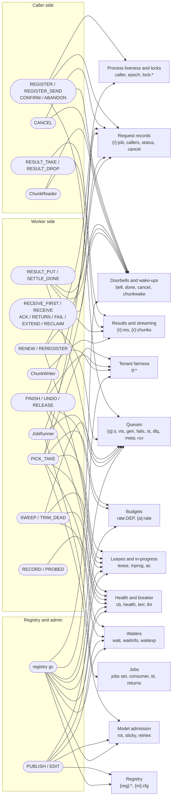

# Store keys

Every key, stream and pub/sub channel llm-queue keeps in Valkey or Redis: what it holds, who
writes and reads it, how long it lives, and what happens if the store drops it. Each claim
points at the code. A machine-readable copy is [`store-keys.json`](store-keys.json) (one object
per key, with the same fields as the tables below).

[Storage](../explanation/storage.md) explains the store rules in prose; this page is the
complete list.

!!! note "Planned for 0.1.0b3: `LLMQ_KEY_EXPIRY=swept`"
    A new mode, `LLMQ_KEY_EXPIRY=swept`, is in progress. It replaces native TTLs with an expiry
    index `P:ttl` (a zset of key -> expire-at ms) that the library sweeps itself. It is
    **planned, not shipped**. Everything on this page describes the native TTLs used today.

## How to read this page

- `P` is `LLMQ_KEY_PREFIX` (default `llmq`, `settings.py:106`). `QP` is `LLMQ_QUEUE_PREFIX`
  (default empty), which starts every queue name.
- Hash tags group keys: `{reg}` the registry, `{m:ALIAS}` one model, `{a:ACCT}` one account,
  `{r:ID}` one request, `{q:NAME}` one queue (`keys.py:20-70`, `registry/store.py:481-502`).
  Scripts cross tags, so only a single primary (with replicas) is supported, not cluster mode.
- `DEP` is a deployment key, `ID` a request id, `WORKER` a process's worker id (the app's id
  plus a random tail, `runtime.py:618-619`), `MINUTE` a Unix minute on the store clock.
- **Store**: `state` is `LLMQ_STORE_URL`. `queue` is `LLMQ_QUEUE_STORE_URL` when set, else the
  same store (`runtime.py:588`).
- **Citations** are `file:line` at commit `0ebac52`. Files are under `src/llm_queue/engine/`
  unless they start with `registry/` (under `src/llm_queue/registry/`) or are `tuning.py`
  (`src/llm_queue/tuning.py`). A bare `:123` repeats the file named last in the same cell.
- Defaults: `budget_key_ms` = 180 s (`tuning.py:104`); lease = `LLMQ_LEASE_SECS` = 60 s;
  "held" lifetime = `max(budget_key_ms, 2 x lease)` = 180 s (`_admission_lua.py:41`);
  `DAY_MS` = 1 day, a constant (`_admission_lua.py:39`).
- "Sliding" means the TTL is set again on each write, so the key lives that long after its
  last use. "Fixed" means set once (or set again only by the writes named).

## Overview

`PICK_TAKE` reads the registry group (`cfg`) and the request records (`res`, `cancel`,
`callers`, `caller`, `epoch`) on every ask (`_admission_lua.py:360-389`). `PUBLISH` deletes a
removed model's `cfg`, `health`, `rot`, `inprog` and waiter keys (`registry/_lua.py:73-79`);
`registry gc` deletes every `{m:ALIAS}` key and queue of a model no longer in the registry
(`cli.py:264-311`). Alerts (`P:alert:*`) and debug captures are written by the runtime only.

## Keys at a glance

59 rows: 57 keys and 2 pub/sub channels. Details per key are in the [catalogue](#key-catalogue).

| Group | Key | Type | Store | Lifetime today |
|---|---|---|---|---|
| Registry | `P:{reg}:doc` | string | state | No TTL. Overwritten by each publish or live edit. |
| Registry | `P:{reg}:meta` | hash | state | No TTL. |
| Registry | `P:{reg}:audit` | stream | state | No TTL. Trimmed on each Lua audit write: `MAXLEN ~ 10000` (`AUDIT_MAX_ENTRIES`, `registry/_lua.py:11`) and `MINID` now minus `LLMQ_AUDIT_RETENTION_DAYS` (90 d, `registry/store.py:462`). The CLI cancel entry trims by `MAXLEN` only. |
| Registry | `P:{reg}:history` | hash | state | No TTL. Oldest versions are `HDEL`ed past `history_size` (`tuning.py:120`). |
| Registry | `P:{m:ALIAS}:cfg` | hash | state | No TTL. Rewritten by every publish and live edit. |
| Model admission | `P:{m:ALIAS}:rot` | hash | state | Sliding 1 day (`DAY_MS`, `_admission_lua.py:39`), reset on each write (`:817`). |
| Model admission | `P:{m:ALIAS}:sticky:HASH` | string | state | Model setting `sticky.idle_ttl_secs` (default 1800 s, `registry/resolve.py:213`), set again on every grant: it lapses after that long idle. |
| Model admission | `P:{m:ALIAS}:retries:MINUTE` | hash | state | Fixed 180 s from the last write (literal 180). |
| Budgets | `P:{m:ALIAS}:rate:DEP` | hash | state | `Tuning.engine.budget_key_ms` (180 s, `tuning.py:104`), set again on every write (`_admission_lua.py:101,113,118,126,766`). |
| Budgets | `P:{a:ACCT}:rate` | hash | state | `budget_key_ms` (180 s), set again on every write. |
| Budgets | `P:reset_minute` | string | state | Fixed 120 s. |
| Waiters | `P:{m:ALIAS}:wait:{p\|n}` | zset | state | Key: sliding `max(budget_key_ms, 2 x lease)` = 180 s by default (`_admission_lua.py:41`). A member counts only while its `waitinfo.exp` is ahead (`EngineSettings.waiter_secs`, 2 s, `runtime.py:220`). |
| Waiters | `P:{m:ALIAS}:waitinfo` | hash | state | Sliding `max(budget_key_ms, 2 x lease)` = 180 s by default (`_admission_lua.py:41`). |
| Waiters | `P:{m:ALIAS}:waitexp` | zset | state | `budget_key_ms` (180 s) from the last refusal. |
| Leases & in-progress | `P:{m:ALIAS}:lease:DEP:{p\|n}` | zset | state | Key: sliding `max(budget_key_ms, 2 x lease)` = 180 s by default (`_admission_lua.py:41`). Members end at their score (`LLMQ_LEASE_SECS`, 60 s, renewed every lease / 3). |
| Leases & in-progress | `P:{m:ALIAS}:inprog` | zset | state | Sliding `max(budget_key_ms, 2 x lease)` = 180 s by default (`_admission_lua.py:41`). |
| Leases & in-progress | `P:{m:ALIAS}:inprog:REQUEST` | hash | state | Fixed `PEXPIRE 2 x lease` (120 s) at grant (`_admission_lua.py:781`), set again by every heartbeat (`:1033`). |
| Leases & in-progress | `P:{m:ALIAS}:ac:DEP` | hash | state | Sliding 1 day: on create (`_admission_lua.py:179`) and after each learned outcome (`:932`). |
| Health & breaker | `P:{m:ALIAS}:cb:DEP` | hash | state | Sliding 1 day after each learned outcome (`_admission_lua.py:933`) and probe grant (`:785`). |
| Health & breaker | `P:{m:ALIAS}:health` | hash | state | Sliding 1 day, but only when `settle` writes a latency sample (`_admission_lua.py:930`). `health.py` sets no TTL, so a hash written only by `RECORD`, `PROBED` or `disable` has none. |
| Health & breaker | `P:{m:ALIAS}:terr:DEP` | zset | state | Fixed: model setting `health.disable_window_secs` (300 s, `registry/settings.py:298`) from the last error. |
| Health & breaker | `P:{m:ALIAS}:thr:DEP:MINUTE` | string | state | Fixed `budget_key_ms` (180 s) from the last throttle. |
| Tenant fairness | `P:{m:ALIAS}:tf:t:H` | hash | state | `budget_key_ms` (180 s) per budget write; `fq` writes slide `max(180 s, 2 x fairness.active_secs)` (`_admission_lua.py:101,287`). |
| Tenant fairness | `P:{m:ALIAS}:tf:s:H` | zset | state | Sliding `max(budget_key_ms, 2 x lease)` = 180 s by default (`_admission_lua.py:41`). |
| Tenant fairness | `P:{m:ALIAS}:tf:act` | zset | state | Sliding `max(budget_key_ms, 2 x fairness.active_secs)` = 180 s by default (`_admission_lua.py:225-227`). |
| Tenant fairness | `P:{m:ALIAS}:tf:w` | hash | state | Sliding `max(budget_key_ms, 2 x fairness.active_secs)` = 180 s by default. |
| Tenant fairness | `P:{m:ALIAS}:tf:need` | zset | state | Sliding `max(budget_key_ms, 2 x lease)` = 180 s by default (`_admission_lua.py:41`). |
| Tenant fairness | `P:{m:ALIAS}:tf:fq` | hash | state | Sliding 1 day (`_admission_lua.py:350`). |
| Request records | `P:{r:ID}:job` | hash | state | Created with 30 s (`unconfirmed_secs`, `requests.py:379`). After the send: the call's deadline + `LLMQ_STATUS_TTL_SECS` (1800 s) (`requests.py:506,524`). After the result: `LLMQ_STATUS_TTL_SECS` (`requests.py:246`). A record a worker's claim made: `Tuning.engine.job_ttl_ms` (3600 s, `_admission_lua.py:792,1100`); `RENEW` pushes it back to `job_ttl_ms` when under 2 leases are left (`:1018`). |
| Request records | `P:{r:ID}:callers` | set | state | Same as `job` (set with it on every write). |
| Request records | `P:{r:ID}:status` | hash | state | `LLMQ_STATUS_TTL_SECS` (1800 s); a write never shortens it (`requests.py:230`). A final state is never replaced (`:217-221`). |
| Request records | `P:{r:ID}:cancel` | string | state | `LLMQ_STATUS_TTL_SECS` (1800 s). |
| Results & streaming | `P:{r:ID}:res` | string | state | `LLMQ_RESULT_TTL_SECS` (300 s), fixed from the write. After the first read of a library-made id: `LLMQ_RESULT_DEDUPE_SECS` when above 0, else 2 s (`TAKE_GRACE_MS`, `requests.py:323,328-333`). An app-supplied id keeps 300 s. An offloaded marker is dropped after the offload read (`RESULT_DROP`, `requests.py:300-311,336`). |
| Results & streaming | `P:{r:ID}:chunks` | stream | state | `LLMQ_RESULT_TTL_SECS` + the call's timeout (`runtime.py:3562`), set again on each write. After `end`: `END_TTL_SECS` (30 s, `streaming.py:28,192`). |
| Results & streaming | `P:offload` | string | state | Fixed 7 days (`OFFLOAD_FLAG_SECS`, `requests.py:52`), set again on each start and offloaded write. |
| Queues (streams) | `P:{q:NAME}:s` | stream | queue | No TTL. `MINID ~` now minus `queue.retention_secs` (86400 s; at most 14 days, `registry/settings.py:313-319`), applied only when a message is added (`queue.py:51`). A message leaves on ack (`XDEL`). |
| Queues (streams) | `P:{q:NAME}:vis` | zset | queue | No TTL. Members leave on ack, dead letter, or when their message is gone (`queue.py:141`). |
| Queues (streams) | `P:{q:NAME}:gen` | hash | queue | No TTL. |
| Queues (streams) | `P:{q:NAME}:fails` | hash | queue | No TTL. |
| Queues (streams) | `P:{q:NAME}:st` | hash | queue | No TTL. |
| Queues (streams) | `P:{q:NAME}:dlq` | stream | queue | No TTL. `MINID ~` now minus `queue.dlq_retention_secs` (86400 s for models; jobs `LLMQ_JOB_DEAD_RETENTION_SECS` 7 days, `jobs.py:68`) on each new dead letter, and on a timer: the sweeper every `sweep_secs` (10 s, `runtime.py:4901-4903`) and each job loop's upkeep (`jobs.py:399`). |
| Queues (streams) | `P:{q:NAME}:meta` | hash | queue | No TTL. |
| Queues (streams) | `P:rcv:WORKER:ALIAS` | string | queue | Fixed: the queue's `visibility_secs` (60 s). |
| Doorbells & wakeups | `P:bell:NAME` | list | queue | Fixed 60 s from the last push. |
| Doorbells & wakeups | `P:done:CALLER` | pub/sub channel | state | Not stored. |
| Doorbells & wakeups | `P:cancel` | pub/sub channel | state | Not stored. |
| Doorbells & wakeups | `P:chunkwake:WORKER` | stream | state | Fixed 60 s from the last wake-up. |
| Jobs | `P:jobs:QP` | set | queue | Fixed `LLMQ_JOB_DEAD_RETENTION_SECS` (7 days), set again every upkeep (10 s). |
| Jobs | `P:{q:QP jobs-NAME}:consumer` | string | queue | Fixed `CONSUMER_TTL_SECS` (30 s, `jobs.py:43`), set every 10 s. |
| Jobs | `P:{q:QP jobs-NAME}:id:JOBID` | string | queue | 60 s until the send is confirmed, then `LLMQ_JOB_DEDUPE_SECS` (86400 s, `jobs.py:64`). |
| Jobs | `P:{q:QP jobs-NAME}:returns` | hash | queue | Fixed: the jobs queue's `retention_secs` (86400 s), set on each return. Fields are not removed on ack. |
| Process liveness & locks | `P:caller:WORKER` | string | state | Fixed: `max(LLMQ_CALLER_TTL_SECS (30), ceil(2 x LLMQ_LEASE_SECS / 3) + 5)` = 45 s by default (`runtime.py:578-580`), set again on every beat and send. |
| Process liveness & locks | `P:epoch` | string | state | No TTL. |
| Process liveness & locks | `P:lock:sweep` | string | state | Fixed `sweep_secs` (10 s, `runtime.py:226`). |
| Process liveness & locks | `P:lock:probe` | string | state | Fixed `PROBE_EVERY_SECS` (5 s); 35 s (`PROBE_TIMEOUT_SECS` 30 + 5) while a probe runs (`runtime.py:113-114`). |
| Process liveness & locks | `P:lock:alerts` | string | state | Fixed `ALERT_LOCK_SECS` (45 s, `runtime.py:116`), renewed every 30 s tick. |
| Process liveness & locks | `P:health:WORKER` | string | state and queue | Fixed 5 s. |
| Alerts & misc | `P:alert:NAME:LABELS` | string | state | Fixed 1 day, set again every evaluation (30 s). |
| Alerts & misc | `P:{r:ID}:debug` | string | state | Fixed 1 hour. |

## Store policy matrix

What each `maxmemory-policy` does to each group when the store is full.

| Group | `noeviction` | `volatile-lru` / `-lfu` / `-random` / `-ttl` | `allkeys-*` |
|---|---|---|---|
| Registry | Kept | Kept (no TTL) | `cfg` lost: admission answers `no_config` until the next publish or edit. `doc` / `meta` lost: republished from config, live edits lost |
| Model admission | Kept | Rotation, sticky sessions and the retry budget start again. Minor | As volatile |
| Budgets | Kept | Clocks reset: one burst or a fixed minute overspent, then throttles | As volatile |
| Waiters | Kept | Newer calls may pass older ones for up to 2 s. Order only | As volatile |
| Leases & in-progress | Kept | Concurrency above the limit until the next heartbeat (20 s); a grant lost after its call ended is not refunded; the learned limit resets | As volatile |
| Health & breaker | Kept | Open breakers close, backoffs end, disabled deployments come back: calls hit failing deployments | As volatile, `health` too when it has no TTL |
| Tenant fairness | Kept | A tenant can pass its share or quota for up to a minute | As volatile |
| Request records | Kept | `job` lost: duplicate provider runs. `cancel` lost: a cancelled call runs | As volatile |
| Results & streaming | Kept | `res` lost: the caller fails `deadline_exceeded`. `P:offload` lost: a pod without offload can start | As volatile |
| Queues (streams) | Kept | Kept, except `P:rcv:*` (minor) | Waiting calls lost, held calls stuck, duplicate deliveries, failure counts reset |
| Doorbells & wakeups | Kept | Workers wake at their poll pause (1 s). Harmless | As volatile |
| Jobs | Kept | `id:JOBID` lost: a job sent twice runs twice | As volatile |
| Process liveness & locks | Kept | `caller` lost: a live caller's calls are dropped as `caller_gone`. Locks: duplicate work only | `epoch` lost too: every pod runs its store-reset path |
| Alerts & misc | Kept | Harmless | Harmless |

- **`noeviction`** keeps every key. A full store refuses writes (`OOM`); the library treats a
  write refusal (`OOM`, `MISCONF`, `NOREPLICAS`, `READONLY`) as the store being down
  (`requests.py:813-818`), so calls fail `queue_unavailable` and nothing is lost silently.
- **`volatile-*`** evicts only keys with a TTL: every group above except the queue streams and
  hashes, `cfg`, the registry keys and `P:epoch`. `volatile-ttl` takes the keys closest to
  expiry first, so the short-lived ones go first: doorbells (60 s), `inprog:ID` (120 s),
  `caller` keys (45 s), a result already read (2 s). The `caller` keys and `inprog:ID` entries
  are the costly ones to lose.
- **`allkeys-*`** can evict anything, including the keys with no TTL: the registry, `cfg`, the
  queues and `P:epoch`.

What the library checks today:

| Check | When | What happens |
|---|---|---|
| Cluster mode (`INFO cluster`) | `start()` | `ConfigError`: refused (`store_checks.py:59-84`, `runtime.py:710-712`) |
| `maxmemory-policy` (`CONFIG GET`, else `INFO memory`; `unknown` if neither works) | `start()`, then every 12 store probes (about 1 minute) | Any policy other than `noeviction` or `unknown` logs `store_eviction_policy` (`store_checks.py:49-56,80-84`). `volatile-*` counts as unsafe too. Re-read by `_read_policies` (`runtime.py:4262-4282`, `POLICY_EVERY_ROUNDS` = 12, `HEALTH_PROBE_EVERY_SECS` = 5 s, `runtime.py:108,117`) |
| Readiness, strict (`LLMQ_ENVIRONMENT` not `dev`/`local`/`test`/`ci`; unset is strict) | each `health_check()` | `_evicting()` returns a reason: `ready: false` with `not_ready_reason` (`runtime.py:4196-4201,4244-4252`); gauge `llmq_ready` 0 (`runtime.py:4384-4390`) |
| Readiness, dev | each `health_check()` | Ready; warning at start only, `eviction_policy` in `health()` (`runtime.py:4211-4213`) |
| Gauge | each metrics tick | `llmq_store_eviction_unsafe{store}` 1 when unsafe (`runtime.py:4385-4387`) |

An unreadable policy (`unknown`) never fails readiness (`store_checks.py:51`).

## Settings that change key lifetimes

| Setting | Default | Keys it changes |
|---|---|---|
| `LLMQ_RESULT_TTL_SECS` | 300 s (`settings.py:315`) | `res` (from the write); `chunks` (this + the call's timeout) |
| `LLMQ_RESULT_DEDUPE_SECS` | 0 (`settings.py:316`) | `res` after its first read for a library id (0: 2 s, `TAKE_GRACE_MS`, `requests.py:323`) |
| `LLMQ_STATUS_TTL_SECS` | 1800 s (`settings.py:318`) | `status`; `cancel`; `job` and `callers` (deadline + this while running, this after the result) |
| `LLMQ_CALLER_TTL_SECS` | 30 s (`settings.py:294`) | `caller` keys, raised to `ceil(2 x lease / 3) + 5` = 45 s when lower (`runtime.py:578-580`) |
| `LLMQ_LEASE_SECS` | 60 s (`settings.py:293`) | lease scores; `inprog:ID` (2 x lease); "held" keys (`max(budget_key_ms, 2 x lease)`); heartbeat every lease / 3; the `caller` TTL floor |
| `LLMQ_AUDIT_RETENTION_DAYS` | 90 (`settings.py:319`) | `{reg}:audit` (`MINID` trim) |
| `Tuning.engine.budget_key_ms` | 180000 ms, at least 130000 (`tuning.py:104,192-194`) | `rate:DEP`, `{a}:rate`, `waitexp`, `thr:*`, `tf:t:*`, and the "held" keys |
| `Tuning.engine.job_ttl_ms` | 3600000 ms (`tuning.py:110`) | a `job` record a worker's claim created |
| `Tuning.registry.history_size` | 20 (`tuning.py:120`) | `{reg}:history` versions kept |
| `EngineSettings.waiter_secs` (no env var) | 2 s (`runtime.py:220`) | a waiter's `exp` in `waitinfo` / `waitexp` |
| `EngineSettings.sweep_secs` (no env var) | 10 s (`runtime.py:226`) | `lock:sweep`; how often dead letters are trimmed |
| Model `queue.retention_secs` | 86400 s, max 14 days (`registry/settings.py:313-319`) | `{q}:s` `MINID` trim; jobs `returns` TTL |
| Model `queue.dlq_retention_secs` | 86400 s (`registry/settings.py:319`) | `{q}:dlq` `MINID` trim |
| Model `queue.visibility_secs` | 60 s (`registry/settings.py:315`) | `vis` scores; `P:rcv:*` TTL |
| Model `sticky.idle_ttl_secs` | 1800 s (`registry/resolve.py:213`) | `sticky:HASH` |
| Model `fairness.active_secs` | 60 s (`registry/settings.py:343`) | `tf:act`, `tf:w`, `tf:t:*` round (`max(180 s, 2 x active)`) |
| Model `health.disable_window_secs` | 300 s (`registry/settings.py:298`) | `terr:DEP` |
| `LLMQ_JOB_DEDUPE_SECS` | 86400 s (`jobs.py:64`) | jobs `id:JOBID` |
| `LLMQ_JOB_DEAD_RETENTION_SECS` | 604800 s (`jobs.py:68`) | jobs `dlq` trim; `P:jobs:QP` TTL |

Fixed in code (no setting): `DAY_MS` 1 day (`rot`, `ac`, `cb`, `health`, `tf:fq`); 180 s
(`retries:MINUTE`); 120 s (`reset_minute`); 60 s (doorbells, `chunkwake`, the jobs dedupe claim
before confirmation); 30 s (`END_TTL_SECS` after a stream's end, the jobs `consumer` mark);
7 days (`P:offload`); 1 day (alert markers); 1 hour (`debug`); 5 s (`P:health:WORKER`,
`lock:probe`); 45 s (`lock:alerts`).

## Pub/sub channels and blocking reads

| Channel or key | Kind | Who writes | Who waits | Safety net |
|---|---|---|---|---|
| `P:done:CALLER` | pub/sub | `RESULT_PUT` / `SETTLE_DONE` publish the request id to each member of `{r:ID}:callers` (`requests.py:248-250,277-279`) | `_result_reader` of that process (`runtime.py:2332-2339`) | `_result_sweep`: one script per process every `poll_secs` (5 s) checks every waiting id (`runtime.py:2295-2330`); 3 sweeps in a row finding unannounced results reset the subscriber (`runtime.py:122`) |
| `P:cancel` | pub/sub | `CANCEL` (`requests.py:350`), from `cancel()` and the CLI | `_cancel_reader` of every worker (`runtime.py:1710-1720`) | `MGET` of the `cancel` keys of running calls on resubscribe and every heartbeat (`runtime.py:1721,1750-1773,4716`) |
| `P:bell:NAME` | list, `BLPOP` | one token per send, return without delay, reclaim, redrive (`queue.py:47-58,192-198,489-505`) | idle model loops (`runtime.py:2426`) and job loops (`jobs.py:435`) | the `BLPOP` timeout: `idle_slow_secs` (1 s), jobs 0.5 s; a worker that cannot serve a token puts it back (`runtime.py:2411`) |
| `P:chunkwake:WORKER` | stream, `XREAD BLOCK` | `ChunkReader._ring` when a stream opens during a blocked read (`streaming.py:372-379`) | the process's shared `XREAD` (`streaming.py:444-458`) | the block ends every `stream_read_block_ms` (100 ms) |
| `P:{r:ID}:chunks` | stream, `XREAD BLOCK` | the worker's `ChunkWriter` (`streaming.py:147-158`) | the caller's `ChunkReader` | idle timeout of the stream call |

Subscribers ping every 5 s and are reset when silent for two pings (`runtime.py:121,2213-2229`).

## Life of one call

A normal call, queue in the state store (so the combined scripts run), no fairness, success on
the first attempt.

| Step | Script | Keys created or updated | Keys deleted |
|---|---|---|---|
| 1. Send | `REGISTER_SEND` (`requests.py:168-190`) | `{r}:job` (`state=queued`, 30 s, then deadline + 1800 s), `{r}:callers`, `{r}:status` (`waiting`, 1800 s), `P:caller:WORKER` (45 s), `{q}:s` (`XADD`), `P:bell:NAME` (`RPUSH`, 60 s) | a stale `{r}:cancel` (`requests.py:101`) |
| 2. Wake | `BLPOP` (`queue.py:603-607`) | - | one `bell` token |
| 3. Receive | `RECEIVE_FIRST` (`queue.py:229-317`) | `{q}:vis` (hold end), `{q}:gen` (+1), `{q}:st` (`h`), `{q}:meta` (`cursor`), `P:rcv:WORKER:ALIAS` (60 s) | - |
| 4a. Ask, refused | `PICK_TAKE` (`_admission_lua.py:741-757`) | `wait:{p\|n}`, `waitinfo`, `waitexp` | expired waiters |
| 4b. Ask, granted | `PICK_TAKE` (`_admission_lua.py:759-824`) | `rate:DEP` (+ `seen_*`), `{a}:rate`, `lease:DEP:{p\|n}`, `inprog`, `inprog:ID` (120 s), `{r}:job` (`running`, `owner`, `hb`), `retries:MINUTE` (`first`), `sticky:HASH`, `rot`; `ac:DEP` on first use | its waiter entries |
| 5. Run | heartbeat `RENEW` every 20 s (`_admission_lua.py:1004-1052`); `EXTEND_MANY` (`queue.py:388-403`) | lease and `inprog` scores, `inprog:ID` TTL, `{r}:job` `hb`, `P:caller:WORKER`, `{q}:vis`; a stream adds `{r}:chunks` | - |
| 6. Finish | `SETTLE_DONE` (`requests.py:267-296`) | `{r}:res` (300 s), `{r}:job` (`done`, 1800 s), `{r}:callers` (1800 s), `{r}:status` (`done`, fields), `PUBLISH P:done:CALLER`; FINISH: refunds on `rate:DEP` / `{a}:rate`, `ac:DEP`, `cb:DEP`, `health` (latency) | `{q}:s` entry, its `vis` / `gen` / `fails` / `st` fields, `inprog:ID`, `inprog` and lease members, `terr:DEP` |
| 7. Read | `RESULT_TAKE` (`requests.py:324-335`) | `{r}:res` TTL cut to 2 s (library id) | - |
| Later | TTLs | - | `res` (2 s), `status` / `job` / `callers` (1800 s), `inprog`-related keys, budgets (180 s) |

Other paths: a handler failure runs `FAIL` (`queue.py:410-427`: `fails` +1, `st=r`, `vis`
delayed; `dlq` at `max_receives`); a give-back runs `UNDO` (refund, release the claim to
`queued`) and `RETURN` (`queue.py:363-374`); a cancel writes `{r}:cancel` and publishes on
`P:cancel`. With a separate queue store, step 1 is `REGISTER`, `SEND` and `CONFIRM`, and step 6
is `RESULT_PUT`, `ACK` and `FINISH` (`runtime.py:3808-3830`).

## The registry document

`P:{reg}:doc` holds the registry document as JSON. Its top level is `registry_version`,
`min_lib_version`, `live_edit`, `defaults`, `routing` (live switches: kill switch, blocked
regions and accounts), `residency`, `accounts` and `models` (each with its `deployments` and
settings). The full shape is in [Registry document](registry.md) and its JSON Schema,
[`registry-schema.json`](registry-schema.json). Two derived copies sit next to it:

- `P:{reg}:history` keeps the last 20 published documents for `registry rollback`.
- `P:{m:ALIAS}:cfg` keeps, per model, only the resolved numbers the admission scripts need
  (`admission_numbers`, `registry/store.py:401-426`), so a script never parses the whole
  document.

## Key catalogue

### Registry

#### `P:{reg}:doc`

| | |
|---|---|
| Type | string |
| Store | state |
| Schema | The whole registry document as JSON (the published config, with live edits and the routing switches carried over). |
| Written by | `PUBLISH` `registry/_lua.py:61`; `EDIT` `registry/_lua.py:95`. |
| Read by | `RegistryStore._read` `registry/store.py:524-527`; `PUBLISH` checks it exists `registry/_lua.py:46`; `EDIT` `registry/_lua.py:91`. |
| Lifetime today | No TTL. Overwritten by each publish or live edit. |
| Count | 1 per prefix. Size of the document (KBs to a few 100 KB). |
| If evicted (`volatile-*`) | Not evictable: the key has no TTL. |
| If evicted (`allkeys-*`) | The reload loop finds no document and republishes the process's own config (`registry/store.py:971-973`). Live edits and routing blocks are lost (logged `registry_reset_live_edits_lost`). |
| Deleted by | Never (overwritten). |

#### `P:{reg}:meta`

| | |
|---|---|
| Type | hash |
| Store | state |
| Schema | `version` (registry_version of the stored doc), `config_hash` (hash of the config as given), `published` (store time, secs), `changes` (counter, +1 per publish or live edit). |
| Written by | `PUBLISH` `registry/_lua.py:60-62`; `EDIT` `registry/_lua.py:94`. |
| Read by | `RegistryStore._read` `registry/store.py:526`; `PUBLISH` `registry/_lua.py:44,52,57`; `EDIT` `registry/_lua.py:90`. |
| Lifetime today | No TTL. |
| Count | 1 per prefix. 4 fields. |
| If evicted (`volatile-*`) | Not evictable: the key has no TTL. |
| If evicted (`allkeys-*`) | Stored version reads 0, so the next reload republishes the own config (`registry/store.py:968-973`); live edits lost. From code reading, not tested. |
| Deleted by | Never. |

#### `P:{reg}:audit`

| | |
|---|---|
| Type | stream |
| Store | state |
| Schema | One entry per publish, live edit or CLI cancel: `actor`, `op` (`publish`, `edit`, `cancel`), `version`, `diff` (JSON list of `{path, before, after}`, secrets redacted), `ts` (secs, float). |
| Written by | `audit()` in `PUBLISH` / `EDIT` `registry/_lua.py:17-21`; CLI `cancel` `cli.py:365-376`. |
| Read by | `RegistryStore.history` `registry/store.py:873`. |
| Lifetime today | No TTL. Trimmed on each Lua audit write: `MAXLEN ~ 10000` (`AUDIT_MAX_ENTRIES`, `registry/_lua.py:11`) and `MINID` now minus `LLMQ_AUDIT_RETENTION_DAYS` (90 d, `registry/store.py:462`). The CLI cancel entry trims by `MAXLEN` only. |
| Count | Bounded: at most about 10,000 entries. A diff is a few 100 B to KBs. |
| If evicted (`volatile-*`) | Not evictable: the key has no TTL. |
| If evicted (`allkeys-*`) | Audit history lost. Harmless for calls. |
| Deleted by | Trim only. |

#### `P:{reg}:history`

| | |
|---|---|
| Type | hash |
| Store | state |
| Schema | Field = registry version, value = that version's whole document JSON. |
| Written by | `PUBLISH` `registry/_lua.py:63-69` (keeps the newest `Tuning.registry.history_size`, 20). |
| Read by | `RegistryStore.versions` `registry/store.py:895`; rollback `registry/store.py:912`; `registry gc` `cli.py:283`. |
| Lifetime today | No TTL. Oldest versions are `HDEL`ed past `history_size` (`tuning.py:120`). |
| Count | Bounded: 20 documents by default. |
| If evicted (`volatile-*`) | Not evictable: the key has no TTL. |
| If evicted (`allkeys-*`) | Rollback has nothing to go back to; `registry gc` cannot find old queue names. Harmless for calls. |
| Deleted by | `HDEL` of old versions in `PUBLISH`. |

#### `P:{m:ALIAS}:cfg`

| | |
|---|---|
| Type | hash |
| Store | state |
| Schema | `numbers`: JSON `{model: {balance, balance_priority, balance_opts, priority_reserve, normal_min_share, require_headroom_pct, max_waiting, health}, deployments: [{enabled, rpm, tpm, rate_limits, rate_window, rate_burst, tpm_output_weight, max_concurrency, weight, attempt_timeout_secs, breaker_*, key, account, group, region, outside_residency, account_enabled, blocked, shared_rpm, shared_tpm, account_priority_reserve}]}` (`admission_numbers`, `registry/store.py:401-426`, setting lists `registry/store.py:64-89`). `changes`: the meta `changes` it was written at. |
| Written by | `write_models` `registry/_lua.py:22-26`, from `PUBLISH` `registry/_lua.py:72` and `EDIT` `registry/_lua.py:98`. |
| Read by | `cfg_of` `_admission_lua.py:184-191` (in `PICK_TAKE` `:360`, `settle` `:840`, `REREGISTER` `:1081`). |
| Lifetime today | No TTL. Rewritten by every publish and live edit. |
| Count | 1 per model. Grows with deployments (roughly 0.5-1 KB each, unverified). |
| If evicted (`volatile-*`) | Not evictable: the key has no TTL. |
| If evicted (`allkeys-*`) | `PICK_TAKE` answers `no_config` (`_admission_lua.py:361`). The worker calls `registry.refresh()` (`runtime.py:3015-3018`), which republishes only when the document is missing or older (`registry/store.py:971`), so with the document intact the numbers stay missing: calls are released with a 5 s delay or fail `queue_unavailable` (`runtime.py:3028-3037`) until the next publish or live edit. From code reading, not tested. |
| Deleted by | `PUBLISH` for models removed from the registry, with `health`, `rot`, `inprog`, `wait:p`, `wait:n`, `waitinfo`, `waitexp` (`registry/_lua.py:73-79`); `registry gc` (`cli.py:277-281`). |

### Model admission

#### `P:{m:ALIAS}:rot`

| | |
|---|---|
| Type | hash |
| Store | state |
| Schema | `rr\|DEP` (round-robin sequence of the deployment's last pick), `rr_seq` (counter), `cw\|DEP` (current weight of the smooth weighted pick). |
| Written by | `PICK_TAKE` at grant `_admission_lua.py:812-817` (FL-17: only with a grant). |
| Read by | `pick()` `_admission_lua.py:692-710`. |
| Lifetime today | Sliding 1 day (`DAY_MS`, `_admission_lua.py:39`), reset on each write (`:817`). |
| Count | 1 per model using `round_robin` or `weighted`. 1-2 fields per deployment. |
| If evicted (`volatile-*`) | The rotation starts again. Harmless. |
| If evicted (`allkeys-*`) | Same as volatile. |
| Deleted by | TTL; `PUBLISH` for a removed model (`registry/_lua.py:77`); `registry gc`. |

#### `P:{m:ALIAS}:sticky:HASH`

| | |
|---|---|
| Type | string |
| Store | state |
| Schema | The deployment key the session last ran on. `HASH` is the keyed hash (`LLMQ_ID_HASH_SALT`, HMAC-SHA256, 16 hex) of the session id or the custom sticky key (`runtime.py:1384-1392`, `runtime.py:2719-2728`). |
| Written by | `PICK_TAKE` at grant `_admission_lua.py:809-811` (`SET ... PX`). |
| Read by | `PICK_TAKE` `_admission_lua.py:616-621`. |
| Lifetime today | Model setting `sticky.idle_ttl_secs` (default 1800 s, `registry/resolve.py:213`), set again on every grant: it lapses after that long idle. |
| Count | Unbounded: one per active session per model. About 100 B. |
| If evicted (`volatile-*`) | The session may move to another deployment (a prompt-cache miss). Harmless. |
| If evicted (`allkeys-*`) | Same as volatile. |
| Deleted by | TTL; `registry gc`. |

#### `P:{m:ALIAS}:retries:MINUTE`

| | |
|---|---|
| Type | hash |
| Store | state |
| Schema | `retries` (retry attempts this minute), `first` (first attempts granted this minute). `MINUTE` = Unix minute on the store clock. |
| Written by | `_retry_allowed` `runtime.py:3470-3476` (`HINCRBY retries`, `EXPIRE 180`); `PICK_TAKE` `_admission_lua.py:804-808` (`HINCRBY first`, `EXPIRE 180`). |
| Read by | `_retry_allowed` `runtime.py:3471-3476` (this and the previous minute). |
| Lifetime today | Fixed 180 s from the last write (literal 180). |
| Count | Bounded: about 3 per model at a time. 2 fields. |
| If evicted (`volatile-*`) | The retry budget of that minute starts again: more retries pass for up to a minute. Minor. |
| If evicted (`allkeys-*`) | Same as volatile. |
| Deleted by | TTL; `registry gc`. |

### Budgets

#### `P:{m:ALIAS}:rate:DEP`

| | |
|---|---|
| Type | hash |
| Store | state |
| Schema | Smooth window: `rpm_tat`, `tpm_tat` (GCRA theoretical arrival time, store ms). Fixed window: `rpm_win` / `rpm_n`, `tpm_win` / `tpm_n` (Unix minute, units used). Class shares when `priority_reserve` or `normal_min_share` is set: `p_rpm_*`, `n_rpm_*`, `p_tpm_*`, `n_tpm_*`. This minute's use: `seen_win` (minute), `seen_calls`, `seen_tokens`, `seen_n` (normal-class calls). |
| Written by | `write` `_admission_lua.py:94-102` (grant `:762`); `seen_*` at grant `:763-770`; `give` `:105-127` (refunds in `settle` `:843-855`); `seen_*` refund `:856-863`. |
| Read by | `avail` / `room` via `rnum` `_admission_lua.py:46-92`; normal floor `:559-560`; `_MODEL_STATUS` `status.py:43`. |
| Lifetime today | `Tuning.engine.budget_key_ms` (180 s, `tuning.py:104`), set again on every write (`_admission_lua.py:101,113,118,126,766`). |
| Count | 1 per deployment. 4-16 fields. |
| If evicted (`volatile-*`) | The deployment's RPM / TPM clocks start empty: one more burst (`rate_burst` x limit) or, with a fixed window, a whole minute's budget can be granted again. Overspend, then provider throttles (FINISH backs the deployment off). Status shows 0 used. |
| If evicted (`allkeys-*`) | Same as volatile. |
| Deleted by | TTL; `registry gc`. Not deleted by `PUBLISH` (its TTL ends it). |

#### `P:{a:ACCT}:rate`

| | |
|---|---|
| Type | hash |
| Store | state |
| Schema | The account's shared budgets (`shared_rpm`, `shared_tpm`): `rpm_tat`, `tpm_tat` or `rpm_win`/`rpm_n`, `tpm_win`/`tpm_n`; normal-class share `n_rpm_*`, `n_tpm_*` when the account has a `priority_reserve`. |
| Written by | `write` / `give` as above; key built in `budgets` `_admission_lua.py:153-163`. |
| Read by | `room` / `avail` `_admission_lua.py:58-92`. |
| Lifetime today | `budget_key_ms` (180 s), set again on every write. |
| Count | 1 per account with shared budgets. |
| If evicted (`volatile-*`) | The account-wide budget starts empty: overspend across every model on that account, then throttles. |
| If evicted (`allkeys-*`) | Same as volatile. |
| Deleted by | TTL only (`registry gc` matches only `{m:*` and `{q:*` keys). |

#### `P:reset_minute`

| | |
|---|---|
| Type | string |
| Store | state |
| Schema | The Unix minute in which a store reset was detected. |
| Written by | `_check_epoch` `runtime.py:4812-4814` (`SET ... EX 120`). |
| Read by | Every admission script `_admission_lua.py:71`; fixed-window hold `:76-78`. |
| Lifetime today | Fixed 120 s. |
| Count | 1 per prefix. |
| If evicted (`volatile-*`) | Fixed windows are not held to the next minute after a reset: possible overspend in that minute. Matters only right after a reset. |
| If evicted (`allkeys-*`) | Same as volatile. |
| Deleted by | TTL. |

### Waiters

#### `P:{m:ALIAS}:wait:{p|n}`

| | |
|---|---|
| Type | zset |
| Store | state |
| Schema | Member = request id. Score = queue position (stream id as `ms * 1000 + seq`, `admission.py:43-47`), or the `fair_queue` round (`_admission_lua.py:502`). `p` = priority class, `n` = normal. |
| Written by | `PICK_TAKE` on a refusal `_admission_lua.py:747,749`. Removed at grant `:794`, from the original model on a fallback grant `:798`, when expired `:450`, by `SWEEP` `:1158`. |
| Read by | `reserve_from` `_admission_lua.py:507,514`; fallback check `:457-464`; `SWEEP` `:1155`. |
| Lifetime today | Key: sliding `max(budget_key_ms, 2 x lease)` = 180 s by default (`_admission_lua.py:41`). A member counts only while its `waitinfo.exp` is ahead (`EngineSettings.waiter_secs`, 2 s, `runtime.py:220`). |
| Count | 1 per model and class. One member per call a worker holds that waits for a grant (about 50 B each). |
| If evicted (`volatile-*`) | Older waiters' reservations are forgotten, so a newer call can take budget ahead of them for up to 2 s, until they ask again. Order only. Harmless for correctness. |
| If evicted (`allkeys-*`) | Same as volatile. |
| Deleted by | TTL; `PUBLISH` for a removed model; `registry gc`. |

#### `P:{m:ALIAS}:waitinfo`

| | |
|---|---|
| Type | hash |
| Store | state |
| Schema | Field = request id. Value = JSON `{r: request cost, t: token cost, deps: [deployment keys it may use], exp: expiry ms}`. |
| Written by | `PICK_TAKE` on a refusal `_admission_lua.py:748,750`. `HDEL` at grant `:795`, fallback `:799`, expiry `:451`, `SWEEP` `:1159`. |
| Read by | `reserve_from` (one `HMGET`) `_admission_lua.py:475`; `:449,459`; `SWEEP` `:1156`. |
| Lifetime today | Sliding `max(budget_key_ms, 2 x lease)` = 180 s by default (`_admission_lua.py:41`). |
| Count | 1 per model. One field per waiting call (about 100-300 B). |
| If evicted (`volatile-*`) | As `wait:{p\|n}`: reservations ignored for up to 2 s. Harmless. |
| If evicted (`allkeys-*`) | Same as volatile. |
| Deleted by | TTL; `PUBLISH` for a removed model; `registry gc`. |

#### `P:{m:ALIAS}:waitexp`

| | |
|---|---|
| Type | zset |
| Store | state |
| Schema | Member = `CLS\|ID` (class and request id). Score = the waiter's expiry ms. |
| Written by | `PICK_TAKE` on a refusal `_admission_lua.py:751-752` (`PEXPIRE budget_key_ms`). `ZREM` at grant `:796`, fallback `:800`, cleanup `:453`. |
| Read by | `PICK_TAKE` `_admission_lua.py:445` (up to 100 expired per call). |
| Lifetime today | `budget_key_ms` (180 s) from the last refusal. |
| Count | 1 per model. One member per waiting call. |
| If evicted (`volatile-*`) | Expired waiters are not found here; `SWEEP` removes them in batches instead (`_admission_lua.py:1150-1162`). Harmless. |
| If evicted (`allkeys-*`) | Same as volatile. |
| Deleted by | TTL; `PUBLISH` for a removed model; `registry gc`. |

### Leases & in-progress

#### `P:{m:ALIAS}:lease:DEP:{p|n}`

| | |
|---|---|
| Type | zset |
| Store | state |
| Schema | Member = owner token `REQUEST\|WORKER@TAG\|ATTEMPT` (`admission.py:38-40`, `Ask.owner`). Score = lease end (store ms). One zset per deployment and class. |
| Written by | `PICK_TAKE` `_admission_lua.py:773,775`; `RENEW` `:1029,1031`; `REREGISTER` `:1072,1074`. Removed by `settle` `:872`, a dead holder `:429`, `SWEEP` `:1131,1144-1149`, expired members on each evaluation `:597-598`. |
| Read by | `evaluate` (`ZCARD`) `_admission_lua.py:596-599`; `_MODEL_STATUS` `status.py:45-46`. |
| Lifetime today | Key: sliding `max(budget_key_ms, 2 x lease)` = 180 s by default (`_admission_lua.py:41`). Members end at their score (`LLMQ_LEASE_SECS`, 60 s, renewed every lease / 3). |
| Count | 2 per deployment. One member per running call. |
| If evicted (`volatile-*`) | Slots in use are forgotten: the deployment can get more concurrent calls than its limit until each running call's next heartbeat puts its lease back (`RENEW`, every lease / 3 = 20 s, `runtime.py:4652`). More throttles possible. |
| If evicted (`allkeys-*`) | Same as volatile. |
| Deleted by | TTL; `SWEEP` prunes lapsed members; `registry gc`. Not deleted by `PUBLISH`. |

#### `P:{m:ALIAS}:inprog`

| | |
|---|---|
| Type | zset |
| Store | state |
| Schema | Member = owner token. Score = lease end (store ms). Every running grant of the model. |
| Written by | `PICK_TAKE` `_admission_lua.py:774,776`; `RENEW` (`ZADD XX`) `:1030,1032`; `REREGISTER` `:1073,1075`. Removed by `settle` `:873`, dead holder `:434`, `SWEEP` `:1123`. |
| Read by | `PICK_TAKE` holder's lease `_admission_lua.py:416`; `SWEEP` `:1122`; `_MODEL_STATUS` `status.py:38`. |
| Lifetime today | Sliding `max(budget_key_ms, 2 x lease)` = 180 s by default (`_admission_lua.py:41`). |
| Count | 1 per model. One member per running call. |
| If evicted (`volatile-*`) | Running calls drop out and `RENEW` does not add them back (`ZADD XX`, `_admission_lua.py:1030`). `SWEEP` then finds dead owners only through their leases' scores; status `in_progress` reads low; the duplicate check falls back to the job heartbeat (`:416-419`). Minor. |
| If evicted (`allkeys-*`) | Same as volatile. |
| Deleted by | TTL; `PUBLISH` for a removed model; `registry gc`. |

#### `P:{m:ALIAS}:inprog:REQUEST`

| | |
|---|---|
| Type | hash |
| Store | state |
| Schema | The grant: `owner`, `worker`, `dep`, `cls` (`p`/`n`), `minute` (grant minute), `cost_r`, `cost_t`, `account`, `started` (ms), `request`, `served` (alias), `mode` (`smooth`/`fixed`), `bud` (JSON list of `[key, field, limit, kind]` it took), `job_owner`; with fairness `tf_slot`, `tf_bud`, `tf_mode`. |
| Written by | `PICK_TAKE` `_admission_lua.py:777-781`; `tf_grant` `:342-345`; `REREGISTER` `:1078-1095`. |
| Read by | `PICK_TAKE` `_admission_lua.py:404-436`; `settle` `:831-879`; `UNDO` `:977-979`; `RENEW` `:1022-1041`; `SWEEP` `:1127-1136`; `StatusReader.request` `status.py:250`. |
| Lifetime today | Fixed `PEXPIRE 2 x lease` (120 s) at grant (`_admission_lua.py:781`), set again by every heartbeat (`:1033`). |
| Count | One per running call. About 0.5 KB. |
| If evicted (`volatile-*`) | The next `RENEW` reports the grant lost and the worker registers it again (`runtime.py:4703-4706`). If it goes after the provider answered, `FINISH` finds no owner: no refund (the estimate stays charged) and the slot stays held until its lease ends. A redelivered copy is still refused while the job heartbeat is fresh (`_admission_lua.py:394-403`). |
| If evicted (`allkeys-*`) | Same as volatile. |
| Deleted by | `settle` (`DEL`, `_admission_lua.py:879`); a dead holder `:435`; `SWEEP` `:1136`; TTL. |

#### `P:{m:ALIAS}:ac:DEP`

| | |
|---|---|
| Type | hash |
| Store | state |
| Schema | Adaptive concurrency limit: `limit` (float, starts at `max_concurrency`), `cut_at` (ms of the last throttle cut). |
| Written by | `limit_of` creates it `_admission_lua.py:171-182`; `settle` learns `:887-892` (cut x 0.7 on a throttle, +1/limit on success). |
| Read by | `limit_of` `_admission_lua.py:174`; `settle` `:887`; `_MODEL_STATUS` `status.py:44`. |
| Lifetime today | Sliding 1 day: on create (`_admission_lua.py:179`) and after each learned outcome (`:932`). |
| Count | 1 per deployment. 2 fields. |
| If evicted (`volatile-*`) | The learned limit goes back to `max_concurrency` (default 200): a deployment cut down by throttles gets full concurrency again, so more throttles until it relearns. |
| If evicted (`allkeys-*`) | Same as volatile. |
| Deleted by | TTL; `registry gc`. |

### Health & breaker

#### `P:{m:ALIAS}:cb:DEP`

| | |
|---|---|
| Type | hash |
| Store | state |
| Schema | Breaker: `state` (`closed`/`open`), `failures`, `fail_at` (ms), `until` (ms, open until), `probe` (owner token of the probe call, or empty), `probe_at` (ms). Throttle backoff: `thr_n` (throttles in a row), `thr_until` (ms, skipped until). |
| Written by | `settle` `_admission_lua.py:893-922`; probe grant `:782-786`; probe freed by a dead holder `:432`, `settle` `:876-877`, `SWEEP` `:1134`. |
| Read by | `evaluate` `_admission_lua.py:537-551`; `_MODEL_STATUS` `status.py:47`; `runtime.py:3118-3121`. |
| Lifetime today | Sliding 1 day after each learned outcome (`_admission_lua.py:933`) and probe grant (`:785`). |
| Count | 1 per deployment. Up to 8 fields. |
| If evicted (`volatile-*`) | An open breaker closes and the throttle backoff ends: calls go back to a failing or throttled deployment until `breaker_threshold` (5) failures open it again. |
| If evicted (`allkeys-*`) | Same as volatile. |
| Deleted by | TTL; `registry gc`. |

#### `P:{m:ALIAS}:health`

| | |
|---|---|
| Type | hash |
| Store | state |
| Schema | Per deployment: `DEP\|until` (ms, disabled until the next probe), `DEP\|wait` (current probe wait, ms), `DEP\|since` (ms disabled at), `DEP\|lat` (latency EWMA, ms), `DEP\|lat_at` (ms of the last sample), `DEP\|n` (samples). |
| Written by | `RECORD` `health.py:46-47`; `PROBED` `health.py:61,69`; `Health.disable` `health.py:142-150`; `settle` latency `_admission_lua.py:923-931`. |
| Read by | `evaluate` `_admission_lua.py:533-534`; slow check `:625-647`; `RECORD` `health.py:43`; `PROBED` `health.py:64`; `Health.disabled` `health.py:132-140`; `_MODEL_STATUS` `status.py:39`. |
| Lifetime today | Sliding 1 day, but only when `settle` writes a latency sample (`_admission_lua.py:930`). `health.py` sets no TTL, so a hash written only by `RECORD`, `PROBED` or `disable` has none. |
| Count | 1 per model. Up to 6 fields per deployment. |
| If evicted (`volatile-*`) | (Only once it has a TTL.) Disabled deployments come back at once: calls hit a deployment with target errors until `disable_errors` (3) in `disable_window_secs` (300 s) disable it again. Latency averages restart, so slow-deployment exclusion is off until `slow_min_samples` (20). |
| If evicted (`allkeys-*`) | Same as volatile, also when it has no TTL. |
| Deleted by | TTL; `PUBLISH` for a removed model (`registry/_lua.py:77`); `registry gc`. |

#### `P:{m:ALIAS}:terr:DEP`

| | |
|---|---|
| Type | zset |
| Store | state |
| Schema | Member = request id. Score = ms of its target error (model not in region, access denied). |
| Written by | `RECORD` `health.py:37-39`. |
| Read by | `RECORD` (`ZCARD`) `health.py:40`. |
| Lifetime today | Fixed: model setting `health.disable_window_secs` (300 s, `registry/settings.py:298`) from the last error. |
| Count | 1 per deployment with recent target errors. Few members. |
| If evicted (`volatile-*`) | The error count starts again: disabling is delayed. Harmless. |
| If evicted (`allkeys-*`) | Same as volatile. |
| Deleted by | `RECORD` on disable `health.py:48`; `settle` on success `_admission_lua.py:902`; TTL. |

#### `P:{m:ALIAS}:thr:DEP:MINUTE`

| | |
|---|---|
| Type | string |
| Store | state |
| Schema | Counter: throttles of the deployment in that Unix minute. |
| Written by | `settle` `_admission_lua.py:884-886` (`INCR`, `PEXPIRE budget_key_ms`). |
| Read by | `_MODEL_STATUS` `status.py:48-49` (this and the previous minute). |
| Lifetime today | Fixed `budget_key_ms` (180 s) from the last throttle. |
| Count | Bounded: about 3 per deployment. |
| If evicted (`volatile-*`) | Status `throttles_1m` and alert `quota_above_observed` read low. Harmless. |
| If evicted (`allkeys-*`) | Same as volatile. |
| Deleted by | TTL; `registry gc`. |

### Tenant fairness

#### `P:{m:ALIAS}:tf:t:H`

| | |
|---|---|
| Type | hash |
| Store | state |
| Schema | Only when the model's `fairness.mode` is not `off` (`fairness.py:63-101`). `H` = keyed hash of the tenant id, else the user id, else a shared no-tenant id (`fairness.py:18,58-60`). `share`: `r_tat`, `t_tat` (share clocks). `quota`: `r_tat`/`t_tat` or `r_win`/`r_n`, `t_win`/`t_n`. `fair_queue`: `fq` (the tenant's last round). |
| Written by | `tf_grant` -> `write` `_admission_lua.py:337`; round `:286-287`; refunds `settle` `:865-870`. |
| Read by | `tf_check` `_admission_lua.py:269,285,299`. |
| Lifetime today | `budget_key_ms` (180 s) per budget write; `fq` writes slide `max(180 s, 2 x fairness.active_secs)` (`_admission_lua.py:101,287`). |
| Count | Unbounded: one per active tenant per model; lapses 180 s after its last grant. |
| If evicted (`volatile-*`) | The tenant's clocks start empty: it can go past its share or quota for up to a minute. `fair_queue`: its round restarts (order only). |
| If evicted (`allkeys-*`) | Same as volatile. |
| Deleted by | TTL; `registry gc`. |

#### `P:{m:ALIAS}:tf:s:H`

| | |
|---|---|
| Type | zset |
| Store | state |
| Schema | Only when the model's `fairness.mode` is not `off` (`fairness.py:63-101`). `share` mode: member = owner token, score = lease end (ms). The tenant's slots in use. |
| Written by | `tf_grant` `_admission_lua.py:339-340`; `RENEW` `:1037-1038`. Removed by `settle` `:871`, lapsed members `:305`. |
| Read by | `tf_check` (`ZCARD`) `_admission_lua.py:306`. |
| Lifetime today | Sliding `max(budget_key_ms, 2 x lease)` = 180 s by default (`_admission_lua.py:41`). |
| Count | One per active tenant per model. |
| If evicted (`volatile-*`) | The tenant's slots are forgotten: it can hold more than its slot share until the next heartbeat (20 s). |
| If evicted (`allkeys-*`) | Same as volatile. |
| Deleted by | TTL; `registry gc`. |

#### `P:{m:ALIAS}:tf:act`

| | |
|---|---|
| Type | zset |
| Store | state |
| Schema | Only when the model's `fairness.mode` is not `off` (`fairness.py:63-101`). Member = tenant hash `H`. Score = ms of its last ask. |
| Written by | `tf_active` `_admission_lua.py:224-226`; prunes 16 stale members per ask `:215-219`. |
| Read by | `tf_active` `_admission_lua.py:215`; `StatusReader._fairness` `status.py:139`. |
| Lifetime today | Sliding `max(budget_key_ms, 2 x fairness.active_secs)` = 180 s by default (`_admission_lua.py:225-227`). |
| Count | 1 per model. One member per active tenant. |
| If evicted (`volatile-*`) | Stale tenants are not pruned from `tf:w`, so `~sum` stays too high and shares too small until `tf:w` lapses. Fairness only. |
| If evicted (`allkeys-*`) | Same as volatile. |
| Deleted by | TTL; `registry gc`. |

#### `P:{m:ALIAS}:tf:w`

| | |
|---|---|
| Type | hash |
| Store | state |
| Schema | Only when the model's `fairness.mode` is not `off` (`fairness.py:63-101`). Field `H` = the tenant's weight; field `~sum` = sum of the active tenants' weights. |
| Written by | `tf_active` `_admission_lua.py:217,223,227`. |
| Read by | `tf_active` `_admission_lua.py:214-216,221`. |
| Lifetime today | Sliding `max(budget_key_ms, 2 x fairness.active_secs)` = 180 s by default. |
| Count | 1 per model. One field per active tenant. |
| If evicted (`volatile-*`) | `~sum` restarts from the asking tenant: shares are too large for a while. Fairness only. |
| If evicted (`allkeys-*`) | Same as volatile. |
| Deleted by | TTL; `registry gc`. |

#### `P:{m:ALIAS}:tf:need`

| | |
|---|---|
| Type | zset |
| Store | state |
| Schema | Only when the model's `fairness.mode` is not `off` (`fairness.py:63-101`). `share` mode: member = request id refused while within its share, score = its waiter expiry (ms). |
| Written by | `tf_refused` `_admission_lua.py:329-330`; removed at grant `:341`; lapsed members `:315`. |
| Read by | `tf_check` `_admission_lua.py:316-317`; `StatusReader._fairness` `status.py:140`. |
| Lifetime today | Sliding `max(budget_key_ms, 2 x lease)` = 180 s by default (`_admission_lua.py:41`). |
| Count | 1 per model. One member per waiting within-share call. |
| If evicted (`volatile-*`) | An over-share tenant may borrow ahead of a within-share waiter for up to 2 s. Fairness only. |
| If evicted (`allkeys-*`) | Same as volatile. |
| Deleted by | TTL; `registry gc`. |

#### `P:{m:ALIAS}:tf:fq`

| | |
|---|---|
| Type | hash |
| Store | state |
| Schema | Only when the model's `fairness.mode` is not `off` (`fairness.py:63-101`). `fair_queue` mode: `v` = the round of the last grant. |
| Written by | `tf_grant` `_admission_lua.py:348-350`. |
| Read by | `tf_check` `_admission_lua.py:284`; `tf_grant` `:349`. |
| Lifetime today | Sliding 1 day (`_admission_lua.py:350`). |
| Count | 1 per model. |
| If evicted (`volatile-*`) | The served round restarts at 0. A tenant's stored lead is capped at `v + 1000` (`:285`), so order recovers. Order only. |
| If evicted (`allkeys-*`) | Same as volatile. |
| Deleted by | TTL; `registry gc`. |

### Request records

#### `P:{r:ID}:job`

| | |
|---|---|
| Type | hash |
| Store | state |
| Schema | The claim record: `state` (`queued`, `running`, `done`, `failed`, `expired`, `cancelled`), `user` (keyed hash of the user or session id, `runtime.py:1452`), `params` (params hash, `envelope.py:161`), `caller` (worker id of the sender), `confirmed` (`0`/`1`), `created` (store secs), `app` (`1`: app-supplied id), `direct` (`1`: run in the caller's process), `owner` (`WORKER@TAG` running it), `hb` (ms of its last heartbeat). |
| Written by | `register` `requests.py:68-159`; `REGISTER_SEND` `requests.py:179-187`; `CONFIRM` `requests.py:195-201`; `RESULT_PUT` `requests.py:244-247`; `SETTLE_DONE` `requests.py:273-276`; `PICK_TAKE` `_admission_lua.py:789-793`; `release_claim` `:955-964`; `RENEW` `:1013-1019`; `REREGISTER` `:1096-1101`. |
| Read by | `register` `requests.py:70`; `PICK_TAKE` `_admission_lua.py:372,396-397,413`; `RESULT_TAKE` / `_DROP_READ` `requests.py:301,328`; `CANCEL` `requests.py:347`; `_RESULTS_EXIST` `runtime.py:257`; `_lost` `runtime.py:2182-2193`. |
| Lifetime today | Created with 30 s (`unconfirmed_secs`, `requests.py:379`). After the send: the call's deadline + `LLMQ_STATUS_TTL_SECS` (1800 s) (`requests.py:506,524`). After the result: `LLMQ_STATUS_TTL_SECS` (`requests.py:246`). A record a worker's claim made: `Tuning.engine.job_ttl_ms` (3600 s, `_admission_lua.py:792,1100`); `RENEW` pushes it back to `job_ttl_ms` when under 2 leases are left (`:1018`). |
| Count | One per request. About 200-400 B. |
| If evicted (`volatile-*`) | Duplicate protection is lost. A waiting caller's result sweep finds the record gone and sends the call again (`runtime.py:2324-2328`, `_lost` `runtime.py:2189-2190`), so the provider can run it twice. A redelivered message is no longer refused as a duplicate. |
| If evicted (`allkeys-*`) | Same as volatile. |
| Deleted by | TTL; `ABANDON` `requests.py:207`; a full queue in `REGISTER_SEND` `requests.py:181`; a re-run of a failed id `requests.py:125`. |

#### `P:{r:ID}:callers`

| | |
|---|---|
| Type | set |
| Store | state |
| Schema | Worker ids of the processes waiting on this request id (one per attached caller process). |
| Written by | `register` (`SADD`) `requests.py:90,111,133,149,155`; TTL kept with the job `requests.py:81-84,91,187,199`; `RESULT_PUT` / `SETTLE_DONE` `requests.py:251,280`. |
| Read by | `RESULT_PUT` / `SETTLE_DONE` publish loop `requests.py:248,277`; `PICK_TAKE` caller check `_admission_lua.py:382`; `RequestStore.callers` `requests.py:805`. |
| Lifetime today | Same as `job` (set with it on every write). |
| Count | One per request. A few members. |
| If evicted (`volatile-*`) | The result's wake-up is published to nobody; callers find it by their result sweep within `poll_secs` (5 s, `runtime.py:225`). `PICK_TAKE` treats an empty set as alive (`_admission_lua.py:383`). Harmless (latency). |
| If evicted (`allkeys-*`) | Same as volatile. |
| Deleted by | TTL; with `job` in `ABANDON`, `REGISTER_SEND` full, re-run. |

#### `P:{r:ID}:status`

| | |
|---|---|
| Type | hash |
| Store | state |
| Schema | `state` (`waiting`, `in_progress`, `done`, `failed`, `expired`, `cancelled`), `model`, `priority` (`1`/`0`), `enqueued_at` (store secs.micros), `<state>_at`, then on the end `served_model`, `deployment`, `attempts`, `tokens_in`, `tokens_out`, or `error` (the failure kind) (`runtime.py:3801-3807,4041`). |
| Written by | `register` create `requests.py:92-97`; `set_status` `requests.py:215-233` from `RESULT_PUT` `:252`, `SETTLE_DONE` `:281`, `STATUS_SET` `:358` (fallback `in_progress`, `runtime.py:3248`). |
| Read by | `RequestStore.status` `requests.py:800`; `StatusReader.request` `status.py:244`; `register` `requests.py:92`. |
| Lifetime today | `LLMQ_STATUS_TTL_SECS` (1800 s); a write never shortens it (`requests.py:230`). A final state is never replaced (`:217-221`). |
| Count | One per request. About 200-400 B. |
| If evicted (`volatile-*`) | `status(request_id)` answers unknown. Harmless for calls. |
| If evicted (`allkeys-*`) | Same as volatile. |
| Deleted by | TTL; `ABANDON`; `REGISTER_SEND` full; re-run of a failed id. |

#### `P:{r:ID}:cancel`

| | |
|---|---|
| Type | string |
| Store | state |
| Schema | `1`: a cancel is pending for this id (any caller's cancel wins for all). |
| Written by | `CANCEL` `requests.py:344-355` (`SET ... EX`), from `cancel()` `runtime.py:1704-1708` and CLI `cli.py:359-361`. |
| Read by | `PICK_TAKE` `_admission_lua.py:371`; `register` `requests.py:129`; `REREGISTER` `_admission_lua.py:1069`; `_check_cancels` (`MGET`) `runtime.py:1759-1760`. |
| Lifetime today | `LLMQ_STATUS_TTL_SECS` (1800 s). |
| Count | One per cancelled request. |
| If evicted (`volatile-*`) | The cancel is lost: a queued call can still be granted and run; a running attempt that missed the pub/sub message is not stopped by the key check. |
| If evicted (`allkeys-*`) | Same as volatile. |
| Deleted by | TTL; a new run of the id `requests.py:101,125`. |

### Results & streaming

#### `P:{r:ID}:res`

| | |
|---|---|
| Type | string |
| Store | state |
| Schema | The `Reply` JSON: `request_id`, `ok`, `response`, `error`, `message`, `retry_after_secs`, `partial_text`, `meta` {`served_model`, `deployment`, `fallback`, `attempts`, `queue_wait_ms`, `provider_ms`, `tokens_in`, `tokens_out`, `worker`}, and `b64: true` when bytes are inside (`envelope.py:167-210`). Or the marker `llmq-offload:<ref>` when the result went to the offload (`offload.py:24`). |
| Written by | `RESULT_PUT` `requests.py:243`; `SETTLE_DONE` `requests.py:272` (both `SET NX EX`). |
| Read by | `RESULT_TAKE` `requests.py:324-335`; `PICK_TAKE` `_admission_lua.py:370`; `register` `requests.py:118`; `REREGISTER` `_admission_lua.py:1069`; `_RESULTS_EXIST` `runtime.py:255`. |
| Lifetime today | `LLMQ_RESULT_TTL_SECS` (300 s), fixed from the write. After the first read of a library-made id: `LLMQ_RESULT_DEDUPE_SECS` when above 0, else 2 s (`TAKE_GRACE_MS`, `requests.py:323,328-333`). An app-supplied id keeps 300 s. An offloaded marker is dropped after the offload read (`RESULT_DROP`, `requests.py:300-311,336`). |
| Count | One per request. The reply's size (up to MBs; inline at most 64 MB, `requests.py:43`). |
| If evicted (`volatile-*`) | A caller still waiting gets nothing: the job says `done`, so it waits to its deadline and fails `deadline_exceeded` (`runtime.py:2166-2168`). A later call with the same app id gets `result_expired` (`requests.py:117-119`, `runtime.py:1475`). |
| If evicted (`allkeys-*`) | Same as volatile. |
| Deleted by | TTL; `RESULT_DROP` `requests.py:305`; re-run of a failed id `requests.py:125`. |

#### `P:{r:ID}:chunks`

| | |
|---|---|
| Type | stream |
| Store | state |
| Schema | Entries `seq` (int), `att` (owner token of the attempt), `t` (`chunk`, `end`, `error`), `d` (JSON: a list of provider events; `{usage, meta}` for `end`; `{kind, message, partial}` for `error`). |
| Written by | `ChunkWriter._send` `streaming.py:147-158` (`XADD` + `EXPIRE` on every write); created in `runtime.py:3556-3562`. |
| Read by | `ChunkReader._xread` `streaming.py:444-458`; `PICK_TAKE` (`XLEN`) `_admission_lua.py:409,823`; `runtime.py:1301,3565`. |
| Lifetime today | `LLMQ_RESULT_TTL_SECS` + the call's timeout (`runtime.py:3562`), set again on each write. After `end`: `END_TTL_SECS` (30 s, `streaming.py:28,192`). |
| Count | One per streaming request. At most `stream_max_bytes`. |
| If evicted (`volatile-*`) | The reader misses entries and waits for its idle timeout; a resumed attempt reads `XLEN` 0 and streams from the start. Exact caller-side outcome unverified. |
| If evicted (`allkeys-*`) | Same as volatile. |
| Deleted by | TTL; re-run of a failed id `requests.py:125`. |

#### `P:offload`

| | |
|---|---|
| Type | string |
| Store | state |
| Schema | `1`: this fleet stores large results in a result offload. |
| Written by | `check_offload` `requests.py:641-642`; each offloaded write `requests.py:689-690` (`EX OFFLOAD_FLAG_SECS`). |
| Read by | `check_offload` `requests.py:644`. |
| Lifetime today | Fixed 7 days (`OFFLOAD_FLAG_SECS`, `requests.py:52`), set again on each start and offloaded write. |
| Count | 1 per prefix. |
| If evicted (`volatile-*`) | A process without the offload can start, then fails reading offloaded results with `result_expired` (`requests.py:727-732`). |
| If evicted (`allkeys-*`) | Same as volatile. |
| Deleted by | TTL. |

### Queues (streams)

#### `P:{q:NAME}:s`

| | |
|---|---|
| Type | stream |
| Store | queue |
| Schema | `NAME` = `QP` + `llm-<alias>` (or the model's `queue.name`) and the same with `-priority` (`runtime.py:953-955`, `registry/resolve.py:179-183`); job queues `QP` + `jobs-<name>` (`jobs.py:206-208`). One field per entry: `body`. Model queue: the message JSON (envelope v2: `v`, `request_id`, `op`, `model`, `params`, `priority`, `caller`, `timeout_secs`, `max_wait_secs`, `allow_fallback`, `allowed_regions`, `allowed_accounts`, `session_id`, `user_id`, `tenant_id`, `app_request_id`, `stream`, `vectors`, `b64`; `envelope.py:97-139`). Job queue: `{id, name, payload, ctx}` (`jobs.py:256`). The entry id (`ms-seq`, store clock) is the call's place in line. |
| Written by | `send` `queue.py:47-58` (from `SEND` `queue.py:61-67` and `REGISTER_SEND` `requests.py:175`); `REDRIVE` `queue.py:480`. |
| Read by | `receive` `queue.py:125,139`; replay `queue.py:267`; `FAIL` `queue.py:419`; `DEPTH` `queue.py:436`; `_first_id` `status.py:148-151`. |
| Lifetime today | No TTL. `MINID ~` now minus `queue.retention_secs` (86400 s; at most 14 days, `registry/settings.py:313-319`), applied only when a message is added (`queue.py:51`). A message leaves on ack (`XDEL`). |
| Count | Bounded per queue by `max_waiting` (50,000; jobs 10,000, `jobs.py:42`). Up to 4 MB a message (`envelope.py:33`). |
| If evicted (`volatile-*`) | Not evictable: the key has no TTL. |
| If evicted (`allkeys-*`) | Every waiting call of the queue is lost. Callers wait to their deadline. |
| Deleted by | `ACK` `queue.py:350`; `SETTLE_DONE` `requests.py:284`; to dead letters `queue.py:74`; `MINID` trim; `registry gc`; `StreamQueues.delete` `queue.py:855-857`. |

#### `P:{q:NAME}:vis`

| | |
|---|---|
| Type | zset |
| Store | queue |
| Schema | Member = message id. Score = ms the message is visible again (hold end, or a delayed retry or return). |
| Written by | `receive` `queue.py:166`; replay `:269`; `RECLAIM` `:336`; `RETURN` `:370`; `EXTEND` `:381`; `EXTEND_MANY` `:395`; `FAIL` `:424`. |
| Read by | `receive` `queue.py:101`; `DEPTH` `queue.py:435`. |
| Lifetime today | No TTL. Members leave on ack, dead letter, or when their message is gone (`queue.py:141`). |
| Count | One member per held or delayed message. |
| If evicted (`volatile-*`) | Not evictable: the key has no TTL. |
| If evicted (`allkeys-*`) | Held and delayed messages never come back (the cursor is past them): those calls are stuck until their callers time out. |
| Deleted by | Members by `ACK`, `SETTLE_DONE`, dead letter; key by `registry gc` / `StreamQueues.delete`. |

#### `P:{q:NAME}:gen`

| | |
|---|---|
| Type | hash |
| Store | queue |
| Schema | Field = message id. Value = generation (the receipt), +1 on every receive, return, failure and reclaim. |
| Written by | `receive` `queue.py:164`; `RECLAIM` `:334`; `RETURN` `:368`; `FAIL` `:415`. |
| Read by | `ACK` `queue.py:349`; `RETURN` `:367`; `EXTEND` `:380`; `EXTEND_MANY` `:394`; `FAIL` `:414`; replay `:266`; `RECLAIM` `:333`; `SETTLE_DONE` `requests.py:283`. |
| Lifetime today | No TTL. |
| Count | One field per message received at least once and not yet acked. |
| If evicted (`volatile-*`) | Not evictable: the key has no TTL. |
| If evicted (`allkeys-*`) | Every live receipt reads stale: ack and fail do nothing, so finished messages stay and are delivered again when their hold lapses. Admission's claim check stops most second runs. |
| Deleted by | Fields by `ACK`, `SETTLE_DONE`, dead letter; key by `registry gc` / `StreamQueues.delete`. |

#### `P:{q:NAME}:fails`

| | |
|---|---|
| Type | hash |
| Store | queue |
| Schema | Field = message id. Value = failures counted (a failed handler, or a hold that lapsed). |
| Written by | `receive` (lapsed hold) `queue.py:148`; `FAIL` `queue.py:416`. |
| Read by | `StreamQueues.failures` `queue.py:838-841`. |
| Lifetime today | No TTL. |
| Count | One field per message that failed at least once. |
| If evicted (`volatile-*`) | Not evictable: the key has no TTL. |
| If evicted (`allkeys-*`) | Failure counts restart: a message that keeps failing gets more tries before the dead letters. |
| Deleted by | Fields by `ACK`, `SETTLE_DONE`, dead letter; key by `registry gc` / `StreamQueues.delete`. |

#### `P:{q:NAME}:st`

| | |
|---|---|
| Type | hash |
| Store | queue |
| Schema | Field = message id. Value = `h` (held by a receive) or `r` (returned or failed, waiting to show again). |
| Written by | `receive` `queue.py:165`; `RECLAIM` `:335`; `RETURN` `:369`; `FAIL` `:423`. |
| Read by | `receive` `queue.py:147` (a due `h` counts one failure); replay `:266`. |
| Lifetime today | No TTL. |
| Count | One field per received message not yet acked. |
| If evicted (`volatile-*`) | Not evictable: the key has no TTL. |
| If evicted (`allkeys-*`) | Lapsed holds stop counting failures (a crash loop never dead-letters); a receive replay returns nothing. |
| Deleted by | Fields by `ACK`, `SETTLE_DONE`, dead letter; key by `registry gc` / `StreamQueues.delete`. |

#### `P:{q:NAME}:dlq`

| | |
|---|---|
| Type | stream |
| Store | queue |
| Schema | Dead letters: `body` (the message), `src` (its original id), `fails`. |
| Written by | `to_dlq` `queue.py:70-80` (from `receive` and `FAIL`). |
| Read by | `dead_letters` `queue.py:783-797`; `REDRIVE` `queue.py:474`; `DEPTH` `queue.py:436`; replay `queue.py:250`. |
| Lifetime today | No TTL. `MINID ~` now minus `queue.dlq_retention_secs` (86400 s for models; jobs `LLMQ_JOB_DEAD_RETENTION_SECS` 7 days, `jobs.py:68`) on each new dead letter, and on a timer: the sweeper every `sweep_secs` (10 s, `runtime.py:4901-4903`) and each job loop's upkeep (`jobs.py:399`). |
| Count | Bounded by retention. Up to 4 MB an entry. |
| If evicted (`volatile-*`) | Not evictable: the key has no TTL. |
| If evicted (`allkeys-*`) | Dead letters lost (their callers were already told). |
| Deleted by | `MINID` trim; `REDRIVE` `queue.py:487`; `purge_dead` `queue.py:851-853`; `registry gc`. |

#### `P:{q:NAME}:meta`

| | |
|---|---|
| Type | hash |
| Store | queue |
| Schema | `cursor` = the last new stream id a receive handed out. |
| Written by | `receive` `queue.py:173`. |
| Read by | `receive` `queue.py:123`. |
| Lifetime today | No TTL. |
| Count | 1 per queue. |
| If evicted (`volatile-*`) | Not evictable: the key has no TTL. |
| If evicted (`allkeys-*`) | The next receive reads the stream from the start and hands out messages other workers hold: duplicate deliveries (admission's claim check refuses most). |
| Deleted by | `registry gc` / `StreamQueues.delete`. |

#### `P:rcv:WORKER:ALIAS`

| | |
|---|---|
| Type | string |
| Store | queue |
| Schema | The last receive of one worker loop: JSON `{n: nonce, b: queue key base, bell: doorbell key, t: [id, generation, ...] taken, d: [queue index, id, dead-letter id, ...]}`. |
| Written by | `RECEIVE_FIRST` `queue.py:283-296` (`SET ... PX`); key `queue.py:699-701`, `runtime.py:2470`. |
| Read by | `RECEIVE_FIRST` replay `queue.py:242-243`; `RECLAIM` `queue.py:327`. |
| Lifetime today | Fixed: the queue's `visibility_secs` (60 s). |
| Count | 1 per worker process per model. |
| If evicted (`volatile-*`) | A receive whose reply was lost cannot be reclaimed: its messages stay hidden for the visibility time, then count one failure. Minor. |
| If evicted (`allkeys-*`) | Same as volatile. |
| Deleted by | `RECLAIM` `queue.py:341`; TTL. |

### Doorbells & wakeups

#### `P:bell:NAME`

| | |
|---|---|
| Type | list |
| Store | queue |
| Schema | Tokens `1`, at most 64 (`LTRIM`). One token per send wakes one idle worker. |
| Written by | `send` `queue.py:53-55`; `RING` `queue.py:500-505` (`ring_again`, `runtime.py:2411`); `RETURN` / `RECLAIM` `ring` `queue.py:192-198`; `REDRIVE` `queue.py:489-493`. |
| Read by | `BLPOP` in `wait_bell` `queue.py:603-607` (model loops `runtime.py:2426`, job loops `jobs.py:435`). |
| Lifetime today | Fixed 60 s from the last push. |
| Count | 1 per queue. |
| If evicted (`volatile-*`) | Idle workers wake at their poll pause (`idle_slow_secs` 1 s, `tuning.py:90`; jobs 0.5 s, `jobs.py:47`) instead of at once. Harmless. |
| If evicted (`allkeys-*`) | Same as volatile. |
| Deleted by | `BLPOP` takes tokens; TTL; `registry gc` (`cli.py:299-302`). |

#### `P:done:CALLER`

| | |
|---|---|
| Type | pub/sub channel |
| Store | state |
| Schema | Message = request id whose result is stored. `CALLER` = the waiting process's worker id. |
| Written by | `PUBLISH` in `RESULT_PUT` `requests.py:248-250` and `SETTLE_DONE` `requests.py:277-279`, to each member of `callers`. |
| Read by | `_result_reader` subscribes `runtime.py:2332-2339`. Safety net: `_result_sweep` every `poll_secs` (5 s) `runtime.py:2295-2330`. |
| Lifetime today | Not stored. |
| Count | 1 channel per caller process. |
| If evicted (`volatile-*`) | Not a key: never evicted. |
| If evicted (`allkeys-*`) | Not a key. |
| Deleted by | n/a. |

#### `P:cancel`

| | |
|---|---|
| Type | pub/sub channel |
| Store | state |
| Schema | Message = a request id just cancelled. |
| Written by | `PUBLISH` in `CANCEL` `requests.py:350`. |
| Read by | `_cancel_reader` subscribes `runtime.py:1710-1720`. Safety net: `_check_cancels` (an `MGET` of the cancel keys) on resubscribe and every heartbeat (`runtime.py:1721,4716`). |
| Lifetime today | Not stored. |
| Count | 1 channel per prefix. |
| If evicted (`volatile-*`) | Not a key: never evicted. |
| If evicted (`allkeys-*`) | Not a key. |
| Deleted by | n/a. |

#### `P:chunkwake:WORKER`

| | |
|---|---|
| Type | stream |
| Store | state |
| Schema | One entry `{w: 1}` (`MAXLEN 1`): wakes the process's shared chunk reader when a new stream opens. |
| Written by | `ChunkReader._ring` `streaming.py:372-379` (`XADD MAXLEN 1`, `PEXPIRE 60000`); key `runtime.py:676`. |
| Read by | `ChunkReader._xread` (`$`) `streaming.py:456-457`. |
| Lifetime today | Fixed 60 s from the last wake-up. |
| Count | 1 per caller process that streams. |
| If evicted (`volatile-*`) | The new stream joins the shared read at its next block end (`stream_read_block_ms` 100 ms). Harmless. |
| If evicted (`allkeys-*`) | Same as volatile. |
| Deleted by | TTL. |

### Jobs

#### `P:jobs:QP`

| | |
|---|---|
| Type | set |
| Store | queue |
| Schema | Job names some worker consumed lately (for `status()` and the CLI). Job messages themselves use the queue keys above with `NAME` = `QP` + `jobs-<name>`. |
| Written by | `JobRunner._upkeep` `jobs.py:397-398` (`SADD`, `EXPIRE` dead-letter retention). |
| Read by | `StatusReader.jobs` `status.py:215-216`; CLI `queues` `cli.py:441-442`. |
| Lifetime today | Fixed `LLMQ_JOB_DEAD_RETENTION_SECS` (7 days), set again every upkeep (10 s). |
| Count | 1 per prefix and queue prefix. |
| If evicted (`volatile-*`) | Job queues vanish from `status()` and the CLI until the next upkeep (10 s). Harmless. |
| If evicted (`allkeys-*`) | Same as volatile. |
| Deleted by | TTL. |

#### `P:{q:QP jobs-NAME}:consumer`

| | |
|---|---|
| Type | string |
| Store | queue |
| Schema | `1`: some process consumes this job queue. |
| Written by | `mark_consumer` `queue.py:843-845` from `_upkeep` `jobs.py:395`. |
| Read by | `has_consumer` `queue.py:847-849` from `send_job` `jobs.py:316-320`. |
| Lifetime today | Fixed `CONSUMER_TTL_SECS` (30 s, `jobs.py:43`), set every 10 s. |
| Count | 1 per job name. |
| If evicted (`volatile-*`) | A false `job_no_consumer` warning. Harmless. |
| If evicted (`allkeys-*`) | Same as volatile. |
| Deleted by | TTL; `registry gc` only for model queues (never `jobs-*`). |

#### `P:{q:QP jobs-NAME}:id:JOBID`

| | |
|---|---|
| Type | string |
| Store | queue |
| Schema | `1`: a job with this app `job_id` was sent (dedupe claim). |
| Written by | `send` `jobs.py:290` (`SET NX EX 60`, `_CLAIM_SECS` `jobs.py:52`), then `jobs.py:310` (`EX LLMQ_JOB_DEDUPE_SECS`); `DEL` on a failed send `jobs.py:306`. |
| Read by | `send` (`SET NX`) `jobs.py:290`. |
| Lifetime today | 60 s until the send is confirmed, then `LLMQ_JOB_DEDUPE_SECS` (86400 s, `jobs.py:64`). |
| Count | Unbounded: one per job sent with a `job_id` in the last day. |
| If evicted (`volatile-*`) | A second send with the same `job_id` queues the job again: it runs twice. |
| If evicted (`allkeys-*`) | Same as volatile. |
| Deleted by | TTL; failed send. |

#### `P:{q:QP jobs-NAME}:returns`

| | |
|---|---|
| Type | hash |
| Store | queue |
| Schema | Field = message id. Value = times the job was handed back at shutdown. |
| Written by | `_give_back` `jobs.py:555-558` (`HINCRBY`, `EXPIRE retention_secs`). |
| Read by | `_give_back` `jobs.py:557`. |
| Lifetime today | Fixed: the jobs queue's `retention_secs` (86400 s), set on each return. Fields are not removed on ack. |
| Count | 1 per job name. One field per job returned in the last day. |
| If evicted (`volatile-*`) | Return counts restart: a job longer than the drain can be returned more than `max_returns` (5) times. |
| If evicted (`allkeys-*`) | Same as volatile. |
| Deleted by | TTL. |

### Process liveness & locks

#### `P:caller:WORKER`

| | |
|---|---|
| Type | string |
| Store | state |
| Schema | `1`: this calling process is alive. `WORKER` = the process's worker id (`runtime.py:618-619`). |
| Written by | `RENEW` `_admission_lua.py:1049` (every heartbeat, lease / 3 = 20 s); `register` `requests.py:76-79` (every send and attach). |
| Read by | `PICK_TAKE` caller check `_admission_lua.py:385`; `register` direct-run takeover `requests.py:143`; `_direct_runner_dead` `runtime.py:2207`. |
| Lifetime today | Fixed: `max(LLMQ_CALLER_TTL_SECS (30), ceil(2 x LLMQ_LEASE_SECS / 3) + 5)` = 45 s by default (`runtime.py:578-580`), set again on every beat and send. |
| Count | 1 per running process. |
| If evicted (`volatile-*`) | A live caller looks gone: at a call's first admission `PICK_TAKE` answers `gone` (`_admission_lua.py:379-388`) and the worker ends the call as `caller_gone` (`runtime.py:3022-3027`). Another caller of a direct run takes it over and runs it again (`requests.py:141-154`). |
| If evicted (`allkeys-*`) | Same as volatile. |
| Deleted by | TTL. |

#### `P:epoch`

| | |
|---|---|
| Type | string |
| Store | state |
| Schema | The store time (secs) when a process first found it missing. Missing or changed means the store lost its data. |
| Written by | `SET NX` at start `runtime.py:713` and in `_check_epoch` `runtime.py:4811`. |
| Read by | `runtime.py:714,4806`; `RENEW` `_admission_lua.py:1050`; `PICK_TAKE` `_admission_lua.py:380`. |
| Lifetime today | No TTL. |
| Count | 1 per prefix. |
| If evicted (`volatile-*`) | Not evictable: the key has no TTL. |
| If evicted (`allkeys-*`) | Every pod treats it as a store reset: logs `state_store_reset_detected`, re-registers its running grants and holds fixed windows to the next minute (`runtime.py:4806-4823`). Self-healing, but a burst of work. |
| Deleted by | Never. |

#### `P:lock:sweep`

| | |
|---|---|
| Type | string |
| Store | state |
| Schema | Worker id of the process running the sweep. |
| Written by | `_sweeper` `runtime.py:4878-4882` (`SET NX PX sweep_secs`). |
| Read by | Same (`SET NX`). |
| Lifetime today | Fixed `sweep_secs` (10 s, `runtime.py:226`). |
| Count | 1 per prefix. |
| If evicted (`volatile-*`) | Two processes may sweep at once. Harmless. |
| If evicted (`allkeys-*`) | Same as volatile. |
| Deleted by | TTL. |

#### `P:lock:probe`

| | |
|---|---|
| Type | string |
| Store | state |
| Schema | Worker id of the process probing disabled deployments. |
| Written by | `_prober` `runtime.py:3949` (`SET NX EX 5`), stretched per probe `runtime.py:3981`, back to 5 s `runtime.py:3963`. |
| Read by | Same (`SET NX`). |
| Lifetime today | Fixed `PROBE_EVERY_SECS` (5 s); 35 s (`PROBE_TIMEOUT_SECS` 30 + 5) while a probe runs (`runtime.py:113-114`). |
| Count | 1 per prefix. |
| If evicted (`volatile-*`) | Two processes may probe one deployment at once. Harmless. |
| If evicted (`allkeys-*`) | Same as volatile. |
| Deleted by | TTL. |

#### `P:lock:alerts`

| | |
|---|---|
| Type | string |
| Store | state |
| Schema | Worker id of the process evaluating alerts. |
| Written by | `_alert_lock` `runtime.py:4392-4404` (`SET NX EX 45`, renewed by the holder). |
| Read by | `_alert_lock` `runtime.py:4402`. |
| Lifetime today | Fixed `ALERT_LOCK_SECS` (45 s, `runtime.py:116`), renewed every 30 s tick. |
| Count | 1 per prefix. |
| If evicted (`volatile-*`) | Another process may take over alert evaluation. Harmless. |
| If evicted (`allkeys-*`) | Same as volatile. |
| Deleted by | TTL. |

#### `P:health:WORKER`

| | |
|---|---|
| Type | string |
| Store | state and queue |
| Schema | `1`: a write probe (each store's readiness check). |
| Written by | `_probe_stores` `runtime.py:4216-4224` (`SET ... PX 5000`, every 5 s on each store). |
| Read by | Nobody (the write itself is the probe). |
| Lifetime today | Fixed 5 s. |
| Count | 1 per process per store. |
| If evicted (`volatile-*`) | Harmless. |
| If evicted (`allkeys-*`) | Harmless. |
| Deleted by | TTL. |

### Alerts & misc

#### `P:alert:NAME:LABELS`

| | |
|---|---|
| Type | string |
| Store | state |
| Schema | `1` (on) or `0` (off): the alert's last state. `LABELS` = sorted `k=v` pairs joined by `,` (`status.py:271-274`). |
| Written by | `AlertEvaluator.changed` `status.py:422-427` (`SET ... EX 86400 GET`). |
| Read by | Same (the `GET` part). |
| Lifetime today | Fixed 1 day, set again every evaluation (30 s). |
| Count | Bounded: alert names x models x deployments (plus job names). |
| If evicted (`volatile-*`) | The last state is forgotten: one extra `llmq_alert` log line. Harmless. |
| If evicted (`allkeys-*`) | Same as volatile. |
| Deleted by | TTL. |

#### `P:{r:ID}:debug`

| | |
|---|---|
| Type | string |
| Store | state |
| Schema | JSON `{request, response}`, each cut to 2000 characters. Only with debug capture, which is refused outside dev (`settings.py:215-219`). |
| Written by | `_debug` `runtime.py:4155-4167` (`SET ... EX 3600`). |
| Read by | Nobody in the library (for operators). |
| Lifetime today | Fixed 1 hour. |
| Count | One per captured request. |
| If evicted (`volatile-*`) | Harmless. |
| If evicted (`allkeys-*`) | Harmless. |
| Deleted by | TTL. |

## Not verified

- Sizes marked "rough" or "unverified" are estimates from the field lists, not measurements.
- The `allkeys-*` outcomes for `cfg` and `meta`, and the caller-side outcome of a lost
  `{r}:chunks` stream, come from reading the code, not from a test.
- Whether a managed service exposes `min-replicas-to-write` is out of scope here (see
  [Storage](../explanation/storage.md#store-requirements)).
