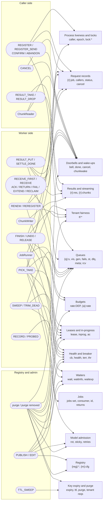

# Store keys

Every key, stream and pub/sub channel llm-queue keeps in Valkey or Redis: what it holds, who
writes and reads it, how long it lives, and what happens if the store drops it. Each claim
points at the code. A machine-readable copy is [`store-keys.json`](store-keys.json) (one object
per key, with the same fields as the tables below).

[Storage](../explanation/storage.md) explains the store rules in prose; this page is the
complete list.

Keys expire in one of two modes, set by `LLMQ_KEY_EXPIRY` (`auto` by default) and stored per
store in `P:expiry` (see [Key expiry modes](../explanation/storage.md#key-expiry-modes)):

- **native**: Valkey TTLs, as the "Lifetime (native)" column says. Needs `noeviction`.
- **swept**: no key the library needs has a TTL. Each expiry is a member of the zset `P:ttl`
  (key -> expire-at, store ms) and the sweeper deletes due keys, up to one sweep (10 s) late. A
  `volatile-*` store cannot evict them. The "Swept mode" column says what each key does then:
  "indexed in `P:ttl`", "native (on purpose)" (a few keys keep their TTL: losing them is
  harmless) or "no expiry".

Switching modes loses nothing. In `swept` mode, setting an expiry also clears the key's native
TTL (`PERSIST`); in `native` mode it also removes the key's `P:ttl` member; reading the time
left counts either. So after a switch (a 0.1.0b2 store upgraded on a `volatile-lru` node, or a
policy change under `auto`) each key moves to the new mode on its next write, and a key never
written again keeps its old expiry (native TTL or index member) and still goes then: the index
sweep runs in both modes.

Example: `P:{r:ID}:status` lives 1800 s in both modes. In `native` it has a TTL of 1800 s; in
`swept` it has no TTL, `P:ttl` holds `llmq:{r:ID}:status -> now + 1800000`, and the sweep that
runs after that time deletes it.

## How to read this page

- `P` is `LLMQ_KEY_PREFIX` (default `llmq`, `settings.py:143`). `QP` is `LLMQ_QUEUE_PREFIX`
  (default empty), which starts every queue name.
- Hash tags group keys: `{reg}` the registry, `{m:ALIAS}` one model, `{a:ACCT}` one account,
  `{r:ID}` one request, `{q:NAME}` one queue (`keys.py:20-70`, `registry/store.py:481-502`).
  Scripts cross tags, so only a single primary (with replicas) is supported, not cluster mode.
- `DEP` is a deployment key, `ID` a request id, `WORKER` a process's worker id (the app's id
  plus a random tail, `runtime.py:624-625`), `MINUTE` a Unix minute on the store clock.
- **Store**: `state` is `LLMQ_STORE_URL`. `queue` is `LLMQ_QUEUE_STORE_URL` when set, else the
  same store (`runtime.py:594`).
- **Citations** are `file:line` in the source this page ships with (`dev/0.1.0b3` at
  `0fa93c4`); most name the function too, so a cite stays findable when lines move. Files are under `src/llm_queue/engine/` unless they start with `registry/` (under
  `src/llm_queue/registry/`) or are `tuning.py` (`src/llm_queue/tuning.py`). A bare `:123` repeats the file named last in the same cell.
- Defaults: `budget_key_ms` = 180 s (`tuning.py:104`); lease = `LLMQ_LEASE_SECS` = 60 s;
  "held" lifetime = `max(budget_key_ms, 2 x lease)` = 180 s (`_admission_lua.py:41`);
  `DAY_MS` = 1 day, a constant (`_admission_lua.py:39`).
- `EXPIRE`, `EX` and `PX` in the "Written by" cells name the native form. The code writes every
  expiry through `X.expire` / `X.set` (Lua) or `Expiry.expire` / `Expiry.set` (Python,
  `expiry.py:29-70,138-159`), so in `swept` mode the same write goes to `P:ttl` instead. The keys
  marked "native (on purpose)" call the store directly and keep their TTL in both modes.
- "Sliding" means the TTL is set again on each write, so the key lives that long after its
  last use. "Fixed" means set once (or set again only by the writes named).

## Overview

`PICK_TAKE` reads the registry group (`cfg`) and the request records (`res`, `cancel`,
`callers`, `caller`, `epoch`) on every ask (`_admission_lua.py:360-389`). `PUBLISH` deletes a
removed model's `cfg`, `health`, `rot`, `inprog` and waiter keys (`registry/_lua.py:73-79`);
a model purge (auto after `LLMQ_PURGE_GRACE_SECS`, `purge removed`, or `llmq.admin.purge`) deletes
every `{m:ALIAS}` key and the empty queues of a model no longer in the registry
(`purge.py:515-557`; `purge removed` runs `PurgeService.removed`). A
deployment purge and a tenant purge delete less; see [Purge](../how-to/purge.md). In `swept`
mode `TTL_SWEEP` deletes every due key in `P:ttl`. Alerts (`P:alert:*`) and debug captures are written by the runtime only.

## Keys at a glance

64 rows: 62 keys and 2 pub/sub channels. Details per key are in the [catalogue](#key-catalogue).

| Group | Key | Type | Store | Lifetime (native) | Swept mode |
|---|---|---|---|---|---|
| Registry | `P:{reg}:doc` | string | state | No TTL. Overwritten by each publish or live edit. | no expiry |
| Registry | `P:{reg}:meta` | hash | state | No TTL. | no expiry |
| Registry | `P:{reg}:audit` | stream | state | No TTL. Trimmed on each Lua audit write: `MAXLEN ~ 10000` (`AUDIT_MAX_ENTRIES`, `registry/_lua.py:11`) and `MINID` now minus `LLMQ_AUDIT_RETENTION_DAYS` (90 d, `registry/store.py:462`). The CLI cancel entry trims by `MAXLEN` only. | no expiry |
| Registry | `P:{reg}:history` | hash | state | No TTL. Oldest versions are `HDEL`ed past `history_size` (`tuning.py:120`). | no expiry |
| Registry | `P:{m:ALIAS}:cfg` | hash | state | No TTL. Rewritten by every publish and live edit. | no expiry |
| Model admission | `P:{m:ALIAS}:rot` | hash | state | Sliding 1 day (`DAY_MS`, `_admission_lua.py:39`), reset on each write (`:817`). | indexed in `P:ttl` |
| Model admission | `P:{m:ALIAS}:sticky:HASH` | string | state | Model setting `sticky.idle_ttl_secs` (default 1800 s, `registry/resolve.py:213`), set again on every grant: it lapses after that long idle. | indexed in `P:ttl` |
| Model admission | `P:{m:ALIAS}:retries:MINUTE` | hash | state | Fixed 180 s from the last write (literal 180). | indexed in `P:ttl` |
| Budgets | `P:{m:ALIAS}:rate:DEP` | hash | state | `Tuning.engine.budget_key_ms` (180 s, `tuning.py:104`), set again on every write (`_admission_lua.py:101,113,118,126,766`). | indexed in `P:ttl` |
| Budgets | `P:{a:ACCT}:rate` | hash | state | `budget_key_ms` (180 s), set again on every write. | indexed in `P:ttl` |
| Budgets | `P:reset_minute` | string | state | Fixed 120 s. | indexed in `P:ttl` |
| Waiters | `P:{m:ALIAS}:wait:{p\|n}` | zset | state | Key: sliding `max(budget_key_ms, 2 x lease)` = 180 s by default (`_admission_lua.py:41`). A member counts only while its `waitinfo.exp` is ahead (`EngineSettings.waiter_secs`, 2 s, `runtime.py:222`). | indexed in `P:ttl` |
| Waiters | `P:{m:ALIAS}:waitinfo` | hash | state | Sliding `max(budget_key_ms, 2 x lease)` = 180 s by default (`_admission_lua.py:41`). | indexed in `P:ttl` |
| Waiters | `P:{m:ALIAS}:waitexp` | zset | state | `budget_key_ms` (180 s) from the last refusal. | indexed in `P:ttl` |
| Leases & in-progress | `P:{m:ALIAS}:lease:DEP:{p\|n}` | zset | state | Key: sliding `max(budget_key_ms, 2 x lease)` = 180 s by default (`_admission_lua.py:41`). Members end at their score (`LLMQ_LEASE_SECS`, 60 s, renewed every lease / 3). | indexed in `P:ttl` |
| Leases & in-progress | `P:{m:ALIAS}:inprog` | zset | state | Sliding `max(budget_key_ms, 2 x lease)` = 180 s by default (`_admission_lua.py:41`). | indexed in `P:ttl` |
| Leases & in-progress | `P:{m:ALIAS}:inprog:REQUEST` | hash | state | Fixed `PEXPIRE 2 x lease` (120 s) at grant (`_admission_lua.py:781`), set again by every heartbeat (`:1033`). | indexed in `P:ttl` |
| Leases & in-progress | `P:{m:ALIAS}:ac:DEP` | hash | state | Sliding 1 day: on create (`_admission_lua.py:179`) and after each learned outcome (`:932`). | indexed in `P:ttl` |
| Health & breaker | `P:{m:ALIAS}:cb:DEP` | hash | state | Sliding 1 day after each learned outcome (`_admission_lua.py:933`) and probe grant (`:785`). | indexed in `P:ttl` |
| Health & breaker | `P:{m:ALIAS}:health` | hash | state | Sliding 1 day, but only when `settle` writes a latency sample (`_admission_lua.py:930`). `health.py` sets no TTL, so a hash written only by `RECORD`, `PROBED` or `disable` has none. | indexed in `P:ttl` (once it has an expiry) |
| Health & breaker | `P:{m:ALIAS}:terr:DEP` | zset | state | Fixed: model setting `health.disable_window_secs` (300 s, `registry/settings.py:298`) from the last error. | indexed in `P:ttl` |
| Health & breaker | `P:{m:ALIAS}:thr:DEP:MINUTE` | string | state | Fixed `budget_key_ms` (180 s) from the last throttle. | indexed in `P:ttl` |
| Tenant fairness | `P:{m:ALIAS}:tf:t:H` | hash | state | `budget_key_ms` (180 s) per budget write; `fq` writes slide `max(180 s, 2 x fairness.active_secs)` (`_admission_lua.py:101,287`). | indexed in `P:ttl` |
| Tenant fairness | `P:{m:ALIAS}:tf:s:H` | zset | state | Sliding `max(budget_key_ms, 2 x lease)` = 180 s by default (`_admission_lua.py:41`). | indexed in `P:ttl` |
| Tenant fairness | `P:{m:ALIAS}:tf:act` | zset | state | Sliding `max(budget_key_ms, 2 x fairness.active_secs)` = 180 s by default (`_admission_lua.py:225-227`). | indexed in `P:ttl` |
| Tenant fairness | `P:{m:ALIAS}:tf:w` | hash | state | Sliding `max(budget_key_ms, 2 x fairness.active_secs)` = 180 s by default. | indexed in `P:ttl` |
| Tenant fairness | `P:{m:ALIAS}:tf:need` | zset | state | Sliding `max(budget_key_ms, 2 x lease)` = 180 s by default (`_admission_lua.py:41`). | indexed in `P:ttl` |
| Tenant fairness | `P:{m:ALIAS}:tf:fq` | hash | state | Sliding 1 day (`_admission_lua.py:350`). | indexed in `P:ttl` |
| Request records | `P:{r:ID}:job` | hash | state | Created with 30 s (`unconfirmed_secs`, `requests.py:380`). After the send: the call's deadline + `LLMQ_STATUS_TTL_SECS` (1800 s) (`requests.py:509,527`). After the result: `LLMQ_STATUS_TTL_SECS` (`requests.py:247`). A record a worker's claim made: `Tuning.engine.job_ttl_ms` (3600 s, `_admission_lua.py:792,1100`); `RENEW` pushes it back to `job_ttl_ms` when under 2 leases are left (`:1018`). | indexed in `P:ttl` |
| Request records | `P:{r:ID}:callers` | set | state | Same as `job` (set with it on every write). | indexed in `P:ttl` |
| Request records | `P:{r:ID}:status` | hash | state | `LLMQ_STATUS_TTL_SECS` (1800 s); a write never shortens it (`requests.py:231`). A final state is never replaced (`:218-222`). | indexed in `P:ttl` |
| Request records | `P:{r:ID}:cancel` | string | state | `LLMQ_STATUS_TTL_SECS` (1800 s). | indexed in `P:ttl` |
| Results & streaming | `P:{r:ID}:res` | string | state | `LLMQ_RESULT_TTL_SECS` (300 s), fixed from the write. After the first read of a library-made id: `LLMQ_RESULT_DEDUPE_SECS` when above 0, else 2 s (`TAKE_GRACE_MS`, `requests.py:324,329-334`). An app-supplied id keeps 300 s. An offloaded marker is dropped after the offload read (`RESULT_DROP`, `requests.py:301-312,337`). | indexed in `P:ttl` |
| Results & streaming | `P:{r:ID}:chunks` | stream | state | `LLMQ_RESULT_TTL_SECS` + the call's timeout (`runtime.py:3617`), set again on each write. After `end`: `END_TTL_SECS` (30 s, `streaming.py:29,194`). | indexed in `P:ttl` |
| Results & streaming | `P:offload` | string | state | Fixed 7 days (`OFFLOAD_FLAG_SECS`, `requests.py:53`), set again on each start and offloaded write. | indexed in `P:ttl` |
| Queues (streams) | `P:{q:NAME}:s` | stream | queue | No TTL. `MINID ~` now minus `queue.retention_secs` (86400 s; at most 14 days, `registry/settings.py:313-319`), applied only when a message is added (`queue.py:52`). A message leaves on ack (`XDEL`). | no expiry |
| Queues (streams) | `P:{q:NAME}:vis` | zset | queue | No TTL. Members leave on ack, dead letter, or when their message is gone (`queue.py:142`). | no expiry |
| Queues (streams) | `P:{q:NAME}:gen` | hash | queue | No TTL. | no expiry |
| Queues (streams) | `P:{q:NAME}:fails` | hash | queue | No TTL. | no expiry |
| Queues (streams) | `P:{q:NAME}:st` | hash | queue | No TTL. | no expiry |
| Queues (streams) | `P:{q:NAME}:dlq` | stream | queue | No TTL. `MINID ~` now minus `queue.dlq_retention_secs` (86400 s for models; jobs `LLMQ_JOB_DEAD_RETENTION_SECS` 7 days, `jobs.py:68`) on each new dead letter, and on a timer: the sweeper every `sweep_secs` (10 s, `runtime.py:5035-5037`) and each job loop's upkeep (`jobs.py:402`). | no expiry |
| Queues (streams) | `P:{q:NAME}:meta` | hash | queue | No TTL. | no expiry |
| Queues (streams) | `P:rcv:WORKER:ALIAS` | string | queue | Fixed: the queue's `visibility_secs` (60 s). | indexed in `P:ttl` |
| Doorbells & wakeups | `P:bell:NAME` | list | queue | Fixed 60 s from the last push. | indexed in `P:ttl` |
| Doorbells & wakeups | `P:done:CALLER` | pub/sub channel | state | Not stored. | - |
| Doorbells & wakeups | `P:cancel` | pub/sub channel | state | Not stored. | - |
| Doorbells & wakeups | `P:chunkwake:WORKER` | stream | state | Fixed 60 s from the last wake-up. | indexed in `P:ttl` |
| Jobs | `P:jobs:QP` | set | queue | Fixed `LLMQ_JOB_DEAD_RETENTION_SECS` (7 days), set again every upkeep (10 s). | indexed in `P:ttl` |
| Jobs | `P:{q:QP jobs-NAME}:consumer` | string | queue | Fixed `CONSUMER_TTL_SECS` (30 s, `jobs.py:43`), set every 10 s. | indexed in `P:ttl` |
| Jobs | `P:{q:QP jobs-NAME}:id:JOBID` | string | queue | 60 s until the send is confirmed, then `LLMQ_JOB_DEDUPE_SECS` (86400 s, `jobs.py:64`). | indexed in `P:ttl` |
| Jobs | `P:{q:QP jobs-NAME}:returns` | hash | queue | Fixed: the jobs queue's `retention_secs` (86400 s), set on each return. Fields are not removed on ack. | indexed in `P:ttl` |
| Process liveness & locks | `P:caller:WORKER` | string | state | Fixed: `max(LLMQ_CALLER_TTL_SECS (30), ceil(2 x LLMQ_LEASE_SECS / 3) + 5)` = 45 s by default (`runtime.py:584-586`), set again on every beat and send. | indexed in `P:ttl` |
| Process liveness & locks | `P:epoch` | string | state | No TTL. | no expiry |
| Process liveness & locks | `P:lock:sweep` | string | state | Fixed `sweep_secs` (10 s, `runtime.py:228`). | native (on purpose) |
| Process liveness & locks | `P:lock:ttlsweep` | string | state | Fixed `sweep_secs` (10 s, `runtime.py:228`). | native (on purpose) |
| Process liveness & locks | `P:lock:probe` | string | state | Fixed `PROBE_EVERY_SECS` (5 s); 35 s (`PROBE_TIMEOUT_SECS` 30 + 5) while a probe runs (`runtime.py:115-116`). | native (on purpose) |
| Process liveness & locks | `P:lock:alerts` | string | state | Fixed `ALERT_LOCK_SECS` (45 s, `runtime.py:118`), renewed every 30 s tick. | native (on purpose) |
| Process liveness & locks | `P:health:WORKER` | string | state and queue | Fixed 5 s. | native (on purpose) |
| Alerts & misc | `P:alert:NAME:LABELS` | string | state | Fixed 1 day, set again every evaluation (30 s). | indexed in `P:ttl` |
| Alerts & misc | `P:{r:ID}:debug` | string | state | Fixed 1 hour. | native (on purpose) |
| Key expiry & purge | `P:expiry` | string | state and queue | No TTL. | no expiry |
| Key expiry & purge | `P:ttl` | zset | state and queue | No TTL. Members leave when swept or purged. | no expiry |
| Key expiry & purge | `P:purge` | zset | state | No TTL. A member leaves when its purge ran or its target came back (`purge.py:483`), or by `cancel_scheduled()` `purge.py:438-443`. | no expiry |
| Key expiry & purge | `P:lock:purge` | string | state | Fixed 120 s, or until the holder releases it at the end of its tick (`purge.py:485`). | native (on purpose) |
| Key expiry & purge | `P:tenant:H:reqs` | zset | state | The longest call in it + 60 s; a write only lengthens it (`grow=True`, `purge.py:510`). | indexed in `P:ttl` |

## Store policy matrix

What each `maxmemory-policy` does to each group when the store is full, in each key expiry
mode. `noeviction` is the same in both modes. `allkeys-*` evicts any key in either mode.

| Group | `noeviction` | `volatile-*`, native | `volatile-*`, swept | `allkeys-*` |
|---|---|---|---|---|
| Registry | Kept | Kept (no TTL) | Kept | `cfg` lost: admission answers `no_config` until the next publish or edit. `doc` / `meta` lost: republished from config, live edits lost |
| Model admission | Kept | Rotation, sticky sessions and the retry budget start again. Minor | Kept | As volatile native |
| Budgets | Kept | Clocks reset: one burst or a fixed minute overspent, then throttles | Kept | As volatile native |
| Waiters | Kept | Newer calls may pass older ones for up to 2 s. Order only | Kept | As volatile native |
| Leases & in-progress | Kept | Concurrency above the limit until the next heartbeat (20 s); a grant lost after its call ended is not refunded; the learned limit resets | Kept | As volatile native |
| Health & breaker | Kept | Open breakers close, backoffs end, disabled deployments come back: calls hit failing deployments | Kept | As volatile native, `health` too when it has no TTL |
| Tenant fairness | Kept | A tenant can pass its share or quota for up to a minute | Kept | As volatile native |
| Request records | Kept | `job` lost: duplicate provider runs. `cancel` lost: a cancelled call runs | Kept | As volatile native |
| Results & streaming | Kept | `res` lost: the caller fails `deadline_exceeded`. `P:offload` lost: a pod without offload can start | Kept | As volatile native |
| Queues (streams) | Kept | Kept, except `P:rcv:*` (minor) | Kept | Waiting calls lost, held calls stuck, duplicate deliveries, failure counts reset |
| Doorbells & wakeups | Kept | Workers wake at their poll pause (1 s). Harmless | Kept | As volatile native |
| Jobs | Kept | `id:JOBID` lost: a job sent twice runs twice | Kept | As volatile native |
| Process liveness & locks | Kept | `caller` lost: a live caller's calls are dropped as `caller_gone`. Locks: duplicate work only | `caller` kept. Locks and `P:health:WORKER` keep native TTLs and may go: duplicate work only | `epoch` lost too: every pod runs its store-reset path |
| Alerts & misc | Kept | Harmless | Alert markers kept; `debug` may go. Harmless | Harmless |
| Key expiry & purge | Kept | `P:tenant:H:reqs` lost: a tenant purge cannot cancel older calls. `P:lock:purge`: duplicate work only | `P:lock:purge` may go: duplicate work only | `P:ttl` lost: indexed keys never expire (memory grows). `P:purge` lost: scheduled auto purges forgotten |

- **`noeviction`** keeps every key. A full store refuses writes (`OOM`); the library treats a
  write refusal (`OOM`, `MISCONF`, `NOREPLICAS`, `READONLY`) as the store being down
  (`_refuses_writes`, `requests.py:816-821`), so calls fail `queue_unavailable` and nothing is
  lost silently.
- **`volatile-*` with native TTLs** evicts only keys with a TTL: every group above except the
  queue streams and hashes, `cfg`, the registry keys and `P:epoch`. `volatile-ttl` takes the
  keys closest to expiry first, so the short-lived ones go first: doorbells (60 s),
  `inprog:ID` (120 s), `caller` keys (45 s), a result already read (2 s). The `caller` keys and
  `inprog:ID` entries are the costly ones to lose.
- **`volatile-*` with swept expiry** can evict only the seven keys kept on native TTLs on
  purpose (`P:lock:sweep`, `P:lock:ttlsweep`, `P:lock:probe`, `P:lock:alerts`, `P:lock:purge`,
  `P:health:WORKER`, `P:{r:ID}:debug`): losing any of them is harmless. Every other key has no TTL, so it is never
  a candidate. When the store is full and only keys without a TTL are left, it refuses writes
  (`OOM`) exactly as under `noeviction`. The app's own keys with TTLs are evicted first.
- **`allkeys-*`** can evict anything, including the keys with no TTL: the registry, `cfg`, the
  queues, `P:epoch`, `P:expiry` and `P:ttl`. No mode makes it safe.

What the library checks:

| Check | When | What happens |
|---|---|---|
| Cluster mode (`INFO cluster`) | `start()` | `ConfigError`: refused (`store_checks.py:67-94`, `runtime.py:740-742`) |
| `maxmemory-policy` (`CONFIG GET`, else `INFO memory`; `unknown` if neither works) | `start()`, then every 12 store probes (about 1 minute) | Logs `store_eviction_policy` when `eviction_warning(policy, mode)` warns (`store_checks.py:51-64,90-94`): `allkeys-*` always; `volatile-*` only with native TTLs. Re-read by `_read_policies` (`runtime.py:4326-4339`, `POLICY_EVERY_ROUNDS` = 12, `HEALTH_PROBE_EVERY_SECS` = 5 s, `runtime.py:110,119`) |
| Key expiry mode | `start()`, every minute, after a store reset | `_apply_expiry` (`runtime.py:4349-4361`) writes `decide(LLMQ_KEY_EXPIRY, policy)` (`expiry.py:97-105`) to each store's `P:expiry`; a change logs `key_expiry_changed` (warning), a failed write `key_expiry_publish_failed` (warning, `_publish_expiry_safely` `runtime.py:4342-4347`). Until a process has published its mode it reports the mode its setting asks for (`native` for `auto`) |
| Readiness, strict (`LLMQ_ENVIRONMENT` not `dev`/`local`/`test`/`ci`; unset is strict) | each `health_check()` | `_evicting()` returns a reason: `ready: false` with `not_ready_reason` (`runtime.py:4252-4257,4301-4309`); gauge `llmq_ready` 0 (`runtime.py:4502-4510`) |
| Readiness, dev | each `health_check()` | Ready; warning at start only; `eviction_policy` and `key_expiry` in `health()` (`runtime.py:4267-4270`) |
| Gauges | each metrics tick | `llmq_store_eviction_unsafe{store}` 1 when unsafe in the store's mode; `llmq_key_expiry_swept{store}` 1 in `swept` (`runtime.py:4503-4507`) |
| Expiry sweep | every `sweep_secs` (10 s), in every process (workers and callers), one at a time under its own lock `P:lock:ttlsweep` (the worker sweep keeps `P:lock:sweep`) | `TTL_SWEEP` deletes due keys, `LLMQ_TTL_SWEEP_BATCH` (500) per run, at most `LLMQ_TTL_SWEEP_ROUNDS` (100) runs per sweep (`runtime.py:4384-4400`); counted in `llmq_ttl_swept_total`. It runs in both modes |

An unreadable policy (`unknown`) never fails readiness (`store_checks.py:57`); with `auto` it
gets `swept`.

## Settings that change key lifetimes

| Setting | Default | Keys it changes |
|---|---|---|
| `LLMQ_RESULT_TTL_SECS` | 300 s (`settings.py:369`) | `res` (from the write); `chunks` (this + the call's timeout) |
| `LLMQ_RESULT_DEDUPE_SECS` | 0 (`settings.py:370`) | `res` after its first read for a library id (0: 2 s, `TAKE_GRACE_MS`, `requests.py:324`) |
| `LLMQ_STATUS_TTL_SECS` | 1800 s (`settings.py:372`) | `status`; `cancel`; `job` and `callers` (deadline + this while running, this after the result) |
| `LLMQ_CALLER_TTL_SECS` | 30 s (`settings.py:347`) | `caller` keys, raised to `ceil(2 x lease / 3) + 5` = 45 s when lower (`runtime.py:584-586`) |
| `LLMQ_LEASE_SECS` | 60 s (`settings.py:346`) | lease scores; `inprog:ID` (2 x lease); "held" keys (`max(budget_key_ms, 2 x lease)`); heartbeat every lease / 3; the `caller` TTL floor |
| `LLMQ_AUDIT_RETENTION_DAYS` | 90 (`settings.py:373`) | `{reg}:audit` (`MINID` trim) |
| `Tuning.engine.budget_key_ms` | 180000 ms, at least 130000 (`tuning.py:104,192-194`) | `rate:DEP`, `{a}:rate`, `waitexp`, `thr:*`, `tf:t:*`, and the "held" keys |
| `Tuning.engine.job_ttl_ms` | 3600000 ms (`tuning.py:110`) | a `job` record a worker's claim created |
| `Tuning.registry.history_size` | 20 (`tuning.py:120`) | `{reg}:history` versions kept |
| `EngineSettings.waiter_secs` (no env var) | 2 s (`runtime.py:222`) | a waiter's `exp` in `waitinfo` / `waitexp` |
| `EngineSettings.sweep_secs` (no env var) | 10 s (`runtime.py:228`) | `lock:sweep`, `lock:ttlsweep`; how often dead letters are trimmed and the expiry index is swept |
| Model `queue.retention_secs` | 86400 s, max 14 days (`registry/settings.py:313-319`) | `{q}:s` `MINID` trim; jobs `returns` TTL |
| Model `queue.dlq_retention_secs` | 86400 s (`registry/settings.py:319`) | `{q}:dlq` `MINID` trim |
| Model `queue.visibility_secs` | 60 s (`registry/settings.py:315`) | `vis` scores; `P:rcv:*` TTL |
| Model `sticky.idle_ttl_secs` | 1800 s (`registry/resolve.py:213`) | `sticky:HASH` |
| Model `fairness.active_secs` | 60 s (`registry/settings.py:343`) | `tf:act`, `tf:w`, `tf:t:*` round (`max(180 s, 2 x active)`) |
| Model `health.disable_window_secs` | 300 s (`registry/settings.py:298`) | `terr:DEP` |
| `LLMQ_JOB_DEDUPE_SECS` | 86400 s (`jobs.py:64`) | jobs `id:JOBID` |
| `LLMQ_JOB_DEAD_RETENTION_SECS` | 604800 s (`jobs.py:68`) | jobs `dlq` trim; `P:jobs:QP` TTL |
| `LLMQ_KEY_EXPIRY` | `auto` (`settings.py:281`) | how every expiry is kept: native TTLs or the index `P:ttl` (`auto`: native on `noeviction`, else swept). Lifetimes stay the same |
| `LLMQ_TTL_SWEEP_BATCH` / `LLMQ_TTL_SWEEP_ROUNDS` | 500 / 100 (`settings.py:392-393`; 1-5000 / 1-10000) | how many due keys one sweep deletes (at most 500 x 100 = 50000 per 10 s by default); a bigger backlog waits for the next sweep |
| `LLMQ_PURGE_GRACE_SECS` | 900 s | `P:purge` due times |
| `LLMQ_TENANT_INDEX` | false | writes `P:tenant:H:reqs` at all |

Fixed in code (no setting): `DAY_MS` 1 day (`rot`, `ac`, `cb`, `health`, `tf:fq`); 180 s
(`retries:MINUTE`); 120 s (`reset_minute`); 60 s (doorbells, `chunkwake`, the jobs dedupe claim
before confirmation); 30 s (`END_TTL_SECS` after a stream's end, the jobs `consumer` mark);
7 days (`P:offload`); 1 day (alert markers); 1 hour (`debug`); 5 s (`P:health:WORKER`,
`lock:probe`); 45 s (`lock:alerts`); 120 s (`lock:purge`); the longest call + 60 s
(`P:tenant:H:reqs`).

## Pub/sub channels and blocking reads

| Channel or key | Kind | Who writes | Who waits | Safety net |
|---|---|---|---|---|
| `P:done:CALLER` | pub/sub | `RESULT_PUT` / `SETTLE_DONE` publish the request id to each member of `{r:ID}:callers` (`requests.py:249-251,278-280`) | `_result_reader` of that process (`runtime.py:2387-2394`) | `_result_sweep`: one script per process every `poll_secs` (5 s) checks every waiting id (`runtime.py:2350-2385`); 3 sweeps in a row finding unannounced results reset the subscriber (`runtime.py:124`) |
| `P:cancel` | pub/sub | `CANCEL` (`requests.py:351`), from `cancel()` and the CLI | `_cancel_reader` of every worker (`runtime.py:1765-1775`) | `MGET` of the `cancel` keys of running calls on resubscribe and every heartbeat (`runtime.py:1776,1805-1828,4836`) |
| `P:bell:NAME` | list, `BLPOP` | one token per send, return without delay, reclaim, redrive (`queue.py:48-59,193-199,489-505`) | idle model loops (`runtime.py:2481`) and job loops (`jobs.py:438`) | the `BLPOP` timeout: `idle_slow_secs` (1 s), jobs 0.5 s; a worker that cannot serve a token puts it back (`runtime.py:2466`) |
| `P:chunkwake:WORKER` | stream, `XREAD BLOCK` | `ChunkReader._ring` when a stream opens during a blocked read (`streaming.py:380-387`) | the process's shared `XREAD` (`streaming.py:452-466`) | the block ends every `stream_read_block_ms` (100 ms) |
| `P:{r:ID}:chunks` | stream, `XREAD BLOCK` | the worker's `ChunkWriter` (`streaming.py:150-160`) | the caller's `ChunkReader` | idle timeout of the stream call |

Subscribers ping every 5 s and are reset when silent for two pings (`runtime.py:123,2268-2284`).

## Life of one call

A normal call, queue in the state store (so the combined scripts run), no fairness, success on
the first attempt.

| Step | Script | Keys created or updated | Keys deleted |
|---|---|---|---|
| 1. Send | `REGISTER_SEND` (`requests.py:169-191`) | `{r}:job` (`state=queued`, 30 s, then deadline + 1800 s), `{r}:callers`, `{r}:status` (`waiting`, 1800 s), `P:caller:WORKER` (45 s), `{q}:s` (`XADD`), `P:bell:NAME` (`RPUSH`, 60 s) | a stale `{r}:cancel` (`requests.py:102`) |
| 2. Wake | `BLPOP` (`queue.py:605-609`) | - | one `bell` token |
| 3. Receive | `RECEIVE_FIRST` (`queue.py:230-317`) | `{q}:vis` (hold end), `{q}:gen` (+1), `{q}:st` (`h`), `{q}:meta` (`cursor`), `P:rcv:WORKER:ALIAS` (60 s) | - |
| 4a. Ask, refused | `PICK_TAKE` (`_admission_lua.py:741-757`) | `wait:{p\|n}`, `waitinfo`, `waitexp` | expired waiters |
| 4b. Ask, granted | `PICK_TAKE` (`_admission_lua.py:759-824`) | `rate:DEP` (+ `seen_*`), `{a}:rate`, `lease:DEP:{p\|n}`, `inprog`, `inprog:ID` (120 s), `{r}:job` (`running`, `owner`, `hb`), `retries:MINUTE` (`first`), `sticky:HASH`, `rot`; `ac:DEP` on first use | its waiter entries |
| 5. Run | heartbeat `RENEW` every 20 s (`_admission_lua.py:1004-1052`); `EXTEND_MANY` (`queue.py:388-403`) | lease and `inprog` scores, `inprog:ID` TTL, `{r}:job` `hb`, `P:caller:WORKER`, `{q}:vis`; a stream adds `{r}:chunks` | - |
| 6. Finish | `SETTLE_DONE` (`requests.py:268-297`) | `{r}:res` (300 s), `{r}:job` (`done`, 1800 s), `{r}:callers` (1800 s), `{r}:status` (`done`, fields), `PUBLISH P:done:CALLER`; FINISH: refunds on `rate:DEP` / `{a}:rate`, `ac:DEP`, `cb:DEP`, `health` (latency) | `{q}:s` entry, its `vis` / `gen` / `fails` / `st` fields, `inprog:ID`, `inprog` and lease members, `terr:DEP` |
| 7. Read | `RESULT_TAKE` (`requests.py:325-336`) | `{r}:res` TTL cut to 2 s (library id) | - |
| Later | TTLs (native) or `TTL_SWEEP` (swept, up to 10 s late) | - | `res` (2 s), `status` / `job` / `callers` (1800 s), `inprog`-related keys, budgets (180 s) |

Other paths: a handler failure runs `FAIL` (`queue.py:410-427`: `fails` +1, `st=r`, `vis`
delayed; `dlq` at `max_receives`); a give-back runs `UNDO` (refund, release the claim to
`queued`) and `RETURN` (`queue.py:363-374`); a cancel writes `{r}:cancel` and publishes on
`P:cancel`. With a separate queue store, step 1 is `REGISTER`, `SEND` and `CONFIRM`, and step 6
is `RESULT_PUT`, `ACK` and `FINISH` (`runtime.py:3864-3886`).

## The registry document

`P:{reg}:doc` holds the registry document as JSON. Its top level is `registry_version`,
`min_lib_version`, `live_edit`, `defaults`, `routing` (live switches: kill switch, blocked
regions and accounts), `residency`, `accounts` and `models` (each with its `deployments` and
settings). The full shape is in [Registry document](registry.md) and its JSON Schema,
[`registry-schema.json`](registry-schema.json). Two derived copies sit next to it:

- `P:{reg}:history` keeps the last 20 published documents for `registry rollback`.
- `P:{m:ALIAS}:cfg` keeps, per model, only the resolved numbers the admission scripts need
  (`admission_numbers`, `registry/store.py:401-426`), so a script never parses the whole
  document.

## Key catalogue

### Registry

#### `P:{reg}:doc`

| | |
|---|---|
| Type | string |
| Store | state |
| Schema | The whole registry document as JSON (the published config, with live edits and the routing switches carried over). |
| Written by | `PUBLISH` `registry/_lua.py:61`; `EDIT` `registry/_lua.py:95`. |
| Read by | `RegistryStore._read` `registry/store.py:524-527`; `PUBLISH` checks it exists `registry/_lua.py:46`; `EDIT` `registry/_lua.py:91`. |
| Lifetime (native) | No TTL. Overwritten by each publish or live edit. |
| Swept mode | No expiry, in both modes. |
| Count | 1 per prefix. Size of the document (KBs to a few 100 KB). |
| If evicted (`volatile-*`, native mode) | Not evictable: the key has no TTL. |
| If evicted (`allkeys-*`) | The reload loop finds no document and republishes the process's own config (`registry/store.py:971-973`). Live edits and routing blocks are lost (logged `registry_reset_live_edits_lost`). |
| Deleted by | Never (overwritten). |

#### `P:{reg}:meta`

| | |
|---|---|
| Type | hash |
| Store | state |
| Schema | `version` (registry_version of the stored doc), `config_hash` (hash of the config as given), `published` (store time, secs), `changes` (counter, +1 per publish or live edit). |
| Written by | `PUBLISH` `registry/_lua.py:60-62`; `EDIT` `registry/_lua.py:94`. |
| Read by | `RegistryStore._read` `registry/store.py:526`; `PUBLISH` `registry/_lua.py:44,52,57`; `EDIT` `registry/_lua.py:90`. |
| Lifetime (native) | No TTL. |
| Swept mode | No expiry, in both modes. |
| Count | 1 per prefix. 4 fields. |
| If evicted (`volatile-*`, native mode) | Not evictable: the key has no TTL. |
| If evicted (`allkeys-*`) | Stored version reads 0, so the next reload republishes the own config (`registry/store.py:968-973`); live edits lost. From code reading, not tested. |
| Deleted by | Never. |

#### `P:{reg}:audit`

| | |
|---|---|
| Type | stream |
| Store | state |
| Schema | One entry per publish, live edit or CLI cancel: `actor`, `op` (`publish`, `edit`, `cancel`), `version`, `diff` (JSON list of `{path, before, after}`, secrets redacted), `ts` (secs, float). |
| Written by | `audit()` in `PUBLISH` / `EDIT` `registry/_lua.py:17-21`; every admin write `Audit.write` `engine/audit.py`. |
| Read by | `RegistryStore.history` `registry/store.py:873`. |
| Lifetime (native) | No TTL. Trimmed on each Lua audit write: `MAXLEN ~ 10000` (`AUDIT_MAX_ENTRIES`, `registry/_lua.py:11`) and `MINID` now minus `LLMQ_AUDIT_RETENTION_DAYS` (90 d, `registry/store.py:462`). The CLI cancel entry trims by `MAXLEN` only. |
| Swept mode | No expiry, in both modes. |
| Count | Bounded: at most about 10,000 entries. A diff is a few 100 B to KBs. |
| If evicted (`volatile-*`, native mode) | Not evictable: the key has no TTL. |
| If evicted (`allkeys-*`) | Audit history lost. Harmless for calls. |
| Deleted by | Trim only. |

#### `P:{reg}:history`

| | |
|---|---|
| Type | hash |
| Store | state |
| Schema | Field = registry version, value = that version's whole document JSON. |
| Written by | `PUBLISH` `registry/_lua.py:63-69` (keeps the newest `Tuning.registry.history_size`, 20). |
| Read by | `RegistryStore.versions` `registry/store.py:895`; rollback `registry/store.py:912`; `purge removed` / auto purge (`_aliases_in_history` `purge.py:781-789`). |
| Lifetime (native) | No TTL. Oldest versions are `HDEL`ed past `history_size` (`tuning.py:120`). |
| Swept mode | No expiry, in both modes. |
| Count | Bounded: 20 documents by default. |
| If evicted (`volatile-*`, native mode) | Not evictable: the key has no TTL. |
| If evicted (`allkeys-*`) | Rollback has nothing to go back to; a model purge cannot find old queue names. Harmless for calls. |
| Deleted by | `HDEL` of old versions in `PUBLISH`. |

#### `P:{m:ALIAS}:cfg`

| | |
|---|---|
| Type | hash |
| Store | state |
| Schema | `numbers`: JSON `{model: {balance, balance_priority, balance_opts, priority_reserve, normal_min_share, require_headroom_pct, max_waiting, health}, deployments: [{enabled, rpm, tpm, rate_limits, rate_window, rate_burst, tpm_output_weight, max_concurrency, weight, attempt_timeout_secs, breaker_*, key, account, group, region, outside_residency, account_enabled, blocked, shared_rpm, shared_tpm, account_priority_reserve}]}` (`admission_numbers`, `registry/store.py:401-426`, setting lists `registry/store.py:64-89`). `changes`: the meta `changes` it was written at. |
| Written by | `write_models` `registry/_lua.py:22-26`, from `PUBLISH` `registry/_lua.py:72` and `EDIT` `registry/_lua.py:98`. |
| Read by | `cfg_of` `_admission_lua.py:184-191` (in `PICK_TAKE` `:360`, `settle` `:840`, `REREGISTER` `:1081`). |
| Lifetime (native) | No TTL. Rewritten by every publish and live edit. |
| Swept mode | No expiry, in both modes. |
| Count | 1 per model. Grows with deployments (roughly 0.5-1 KB each, unverified). |
| If evicted (`volatile-*`, native mode) | Not evictable: the key has no TTL. |
| If evicted (`allkeys-*`) | `PICK_TAKE` answers `no_config` (`_admission_lua.py:361`). The worker calls `registry.refresh()` (`runtime.py:3070-3073`), which republishes only when the document is missing or older (`registry/store.py:971`), so with the document intact the numbers stay missing: calls are released with a 5 s delay or fail `queue_unavailable` (`runtime.py:3083-3092`) until the next publish or live edit. From code reading, not tested. |
| Deleted by | `PUBLISH` for models removed from the registry, with `health`, `rot`, `inprog`, `wait:p`, `wait:n`, `waitinfo`, `waitexp` (`registry/_lua.py:73-79`); a model purge (`purge.py:515-557`). |

### Model admission

#### `P:{m:ALIAS}:rot`

| | |
|---|---|
| Type | hash |
| Store | state |
| Schema | `rr\|DEP` (round-robin sequence of the deployment's last pick), `rr_seq` (counter), `cw\|DEP` (current weight of the smooth weighted pick). |
| Written by | `PICK_TAKE` at grant `_admission_lua.py:812-817` (FL-17: only with a grant). |
| Read by | `pick()` `_admission_lua.py:692-710`. |
| Lifetime (native) | Sliding 1 day (`DAY_MS`, `_admission_lua.py:39`), reset on each write (`:817`). |
| Swept mode | Indexed in `P:ttl`: no TTL, the same lifetime; the sweeper deletes it up to `sweep_secs` (10 s) late. Never evictable. |
| Count | 1 per model using `round_robin` or `weighted`. 1-2 fields per deployment. |
| If evicted (`volatile-*`, native mode) | The rotation starts again. Harmless. |
| If evicted (`allkeys-*`) | Same as volatile. |
| Deleted by | TTL; `PUBLISH` for a removed model (`registry/_lua.py:77`); a model purge (`purge.py:515-557`); a deployment purge drops that deployment's fields (`purge.py:598-615`). |

#### `P:{m:ALIAS}:sticky:HASH`

| | |
|---|---|
| Type | string |
| Store | state |
| Schema | The deployment key the session last ran on. `HASH` is the keyed hash (`LLMQ_ID_HASH_SALT`, HMAC-SHA256, 16 hex) of the session id or the custom sticky key (`runtime.py:1419-1427`, `runtime.py:2774-2783`). |
| Written by | `PICK_TAKE` at grant `_admission_lua.py:809-811` (`SET ... PX`). |
| Read by | `PICK_TAKE` `_admission_lua.py:616-621`. |
| Lifetime (native) | Model setting `sticky.idle_ttl_secs` (default 1800 s, `registry/resolve.py:213`), set again on every grant: it lapses after that long idle. |
| Swept mode | Indexed in `P:ttl`: no TTL, the same lifetime; the sweeper deletes it up to `sweep_secs` (10 s) late. Never evictable. |
| Count | Unbounded: one per active session per model. About 100 B. |
| If evicted (`volatile-*`, native mode) | The session may move to another deployment (a prompt-cache miss). Harmless. |
| If evicted (`allkeys-*`) | Same as volatile. |
| Deleted by | TTL; a model purge (`purge.py:515-557`); a deployment purge (`purge.py:582-609`). |

#### `P:{m:ALIAS}:retries:MINUTE`

| | |
|---|---|
| Type | hash |
| Store | state |
| Schema | `retries` (retry attempts this minute), `first` (first attempts granted this minute). `MINUTE` = Unix minute on the store clock. |
| Written by | `_retry_allowed` `runtime.py:3525-3531` (`HINCRBY retries`, `EXPIRE 180`); `PICK_TAKE` `_admission_lua.py:804-808` (`HINCRBY first`, `EXPIRE 180`). |
| Read by | `_retry_allowed` `runtime.py:3526-3531` (this and the previous minute). |
| Lifetime (native) | Fixed 180 s from the last write (literal 180). |
| Swept mode | Indexed in `P:ttl`: no TTL, the same lifetime; the sweeper deletes it up to `sweep_secs` (10 s) late. Never evictable. |
| Count | Bounded: about 3 per model at a time. 2 fields. |
| If evicted (`volatile-*`, native mode) | The retry budget of that minute starts again: more retries pass for up to a minute. Minor. |
| If evicted (`allkeys-*`) | Same as volatile. |
| Deleted by | TTL; a model purge (`purge.py:515-557`). |

### Budgets

#### `P:{m:ALIAS}:rate:DEP`

| | |
|---|---|
| Type | hash |
| Store | state |
| Schema | Smooth window: `rpm_tat`, `tpm_tat` (GCRA theoretical arrival time, store ms). Fixed window: `rpm_win` / `rpm_n`, `tpm_win` / `tpm_n` (Unix minute, units used). Class shares when `priority_reserve` or `normal_min_share` is set: `p_rpm_*`, `n_rpm_*`, `p_tpm_*`, `n_tpm_*`. This minute's use: `seen_win` (minute), `seen_calls`, `seen_tokens`, `seen_n` (normal-class calls). |
| Written by | `write` `_admission_lua.py:94-102` (grant `:762`); `seen_*` at grant `:763-770`; `give` `:105-127` (refunds in `settle` `:843-855`); `seen_*` refund `:856-863`. |
| Read by | `avail` / `room` via `rnum` `_admission_lua.py:46-92`; normal floor `:559-560`; `_MODEL_STATUS` `status.py:44`. |
| Lifetime (native) | `Tuning.engine.budget_key_ms` (180 s, `tuning.py:104`), set again on every write (`_admission_lua.py:101,113,118,126,766`). |
| Swept mode | Indexed in `P:ttl`: no TTL, the same lifetime; the sweeper deletes it up to `sweep_secs` (10 s) late. Never evictable. |
| Count | 1 per deployment. 4-16 fields. |
| If evicted (`volatile-*`, native mode) | The deployment's RPM / TPM clocks start empty: one more burst (`rate_burst` x limit) or, with a fixed window, a whole minute's budget can be granted again. Overspend, then provider throttles (FINISH backs the deployment off). Status shows 0 used. |
| If evicted (`allkeys-*`) | Same as volatile. |
| Deleted by | TTL; a model purge (`purge.py:515-557`); a deployment purge (`purge.py:582-609`). Not deleted by `PUBLISH` (its TTL ends it). |

#### `P:{a:ACCT}:rate`

| | |
|---|---|
| Type | hash |
| Store | state |
| Schema | The account's shared budgets (`shared_rpm`, `shared_tpm`): `rpm_tat`, `tpm_tat` or `rpm_win`/`rpm_n`, `tpm_win`/`tpm_n`; normal-class share `n_rpm_*`, `n_tpm_*` when the account has a `priority_reserve`. |
| Written by | `write` / `give` as above; key built in `budgets` `_admission_lua.py:153-163`. |
| Read by | `room` / `avail` `_admission_lua.py:58-92`. |
| Lifetime (native) | `budget_key_ms` (180 s), set again on every write. |
| Swept mode | Indexed in `P:ttl`: no TTL, the same lifetime; the sweeper deletes it up to `sweep_secs` (10 s) late. Never evictable. |
| Count | 1 per account with shared budgets. |
| If evicted (`volatile-*`, native mode) | The account-wide budget starts empty: overspend across every model on that account, then throttles. |
| If evicted (`allkeys-*`) | Same as volatile. |
| Deleted by | TTL only (a purge matches only `{m:ALIAS}` and `{q:NAME}` keys). |

#### `P:reset_minute`

| | |
|---|---|
| Type | string |
| Store | state |
| Schema | The Unix minute in which a store reset was detected. |
| Written by | `_check_epoch` `runtime.py:4933-4935` (`SET ... EX 120`). |
| Read by | Every admission script `_admission_lua.py:71`; fixed-window hold `:76-78`. |
| Lifetime (native) | Fixed 120 s. |
| Swept mode | Indexed in `P:ttl`: no TTL, the same lifetime; the sweeper deletes it up to `sweep_secs` (10 s) late. Never evictable. |
| Count | 1 per prefix. |
| If evicted (`volatile-*`, native mode) | Fixed windows are not held to the next minute after a reset: possible overspend in that minute. Matters only right after a reset. |
| If evicted (`allkeys-*`) | Same as volatile. |
| Deleted by | TTL. |

### Waiters

#### `P:{m:ALIAS}:wait:{p|n}`

| | |
|---|---|
| Type | zset |
| Store | state |
| Schema | Member = request id. Score = queue position (stream id as `ms * 1000 + seq`, `admission.py:44-48`), or the `fair_queue` round (`_admission_lua.py:502`). `p` = priority class, `n` = normal. |
| Written by | `PICK_TAKE` on a refusal `_admission_lua.py:747,749`. Removed at grant `:794`, from the original model on a fallback grant `:798`, when expired `:450`, by `SWEEP` `:1158`. |
| Read by | `reserve_from` `_admission_lua.py:507,514`; fallback check `:457-464`; `SWEEP` `:1155`. |
| Lifetime (native) | Key: sliding `max(budget_key_ms, 2 x lease)` = 180 s by default (`_admission_lua.py:41`). A member counts only while its `waitinfo.exp` is ahead (`EngineSettings.waiter_secs`, 2 s, `runtime.py:222`). |
| Swept mode | Indexed in `P:ttl`: no TTL, the same lifetime; the sweeper deletes it up to `sweep_secs` (10 s) late. Never evictable. |
| Count | 1 per model and class. One member per call a worker holds that waits for a grant (about 50 B each). |
| If evicted (`volatile-*`, native mode) | Older waiters' reservations are forgotten, so a newer call can take budget ahead of them for up to 2 s, until they ask again. Order only. Harmless for correctness. |
| If evicted (`allkeys-*`) | Same as volatile. |
| Deleted by | TTL; `PUBLISH` for a removed model; a model purge (`purge.py:515-557`). |

#### `P:{m:ALIAS}:waitinfo`

| | |
|---|---|
| Type | hash |
| Store | state |
| Schema | Field = request id. Value = JSON `{r: request cost, t: token cost, deps: [deployment keys it may use], exp: expiry ms}`. |
| Written by | `PICK_TAKE` on a refusal `_admission_lua.py:748,750`. `HDEL` at grant `:795`, fallback `:799`, expiry `:451`, `SWEEP` `:1159`. |
| Read by | `reserve_from` (one `HMGET`) `_admission_lua.py:475`; `:449,459`; `SWEEP` `:1156`. |
| Lifetime (native) | Sliding `max(budget_key_ms, 2 x lease)` = 180 s by default (`_admission_lua.py:41`). |
| Swept mode | Indexed in `P:ttl`: no TTL, the same lifetime; the sweeper deletes it up to `sweep_secs` (10 s) late. Never evictable. |
| Count | 1 per model. One field per waiting call (about 100-300 B). |
| If evicted (`volatile-*`, native mode) | As `wait:{p\|n}`: reservations ignored for up to 2 s. Harmless. |
| If evicted (`allkeys-*`) | Same as volatile. |
| Deleted by | TTL; `PUBLISH` for a removed model; a model purge (`purge.py:515-557`). |

#### `P:{m:ALIAS}:waitexp`

| | |
|---|---|
| Type | zset |
| Store | state |
| Schema | Member = `CLS\|ID` (class and request id). Score = the waiter's expiry ms. |
| Written by | `PICK_TAKE` on a refusal `_admission_lua.py:751-752` (`PEXPIRE budget_key_ms`). `ZREM` at grant `:796`, fallback `:800`, cleanup `:453`. |
| Read by | `PICK_TAKE` `_admission_lua.py:445` (up to 100 expired per call). |
| Lifetime (native) | `budget_key_ms` (180 s) from the last refusal. |
| Swept mode | Indexed in `P:ttl`: no TTL, the same lifetime; the sweeper deletes it up to `sweep_secs` (10 s) late. Never evictable. |
| Count | 1 per model. One member per waiting call. |
| If evicted (`volatile-*`, native mode) | Expired waiters are not found here; `SWEEP` removes them in batches instead (`_admission_lua.py:1150-1162`). Harmless. |
| If evicted (`allkeys-*`) | Same as volatile. |
| Deleted by | TTL; `PUBLISH` for a removed model; a model purge (`purge.py:515-557`). |

### Leases & in-progress

#### `P:{m:ALIAS}:lease:DEP:{p|n}`

| | |
|---|---|
| Type | zset |
| Store | state |
| Schema | Member = owner token `REQUEST\|WORKER@TAG\|ATTEMPT` (`admission.py:39-41`, `Ask.owner`). Score = lease end (store ms). One zset per deployment and class. |
| Written by | `PICK_TAKE` `_admission_lua.py:773,775`; `RENEW` `:1029,1031`; `REREGISTER` `:1072,1074`. Removed by `settle` `:872`, a dead holder `:429`, `SWEEP` `:1131,1144-1149`, expired members on each evaluation `:597-598`. |
| Read by | `evaluate` (`ZCARD`) `_admission_lua.py:596-599`; `_MODEL_STATUS` `status.py:46-47`. |
| Lifetime (native) | Key: sliding `max(budget_key_ms, 2 x lease)` = 180 s by default (`_admission_lua.py:41`). Members end at their score (`LLMQ_LEASE_SECS`, 60 s, renewed every lease / 3). |
| Swept mode | Indexed in `P:ttl`: no TTL, the same lifetime; the sweeper deletes it up to `sweep_secs` (10 s) late. Never evictable. |
| Count | 2 per deployment. One member per running call. |
| If evicted (`volatile-*`, native mode) | Slots in use are forgotten: the deployment can get more concurrent calls than its limit until each running call's next heartbeat puts its lease back (`RENEW`, every lease / 3 = 20 s, `runtime.py:4772`). More throttles possible. |
| If evicted (`allkeys-*`) | Same as volatile. |
| Deleted by | TTL; `SWEEP` prunes lapsed members; a model purge (`purge.py:515-557`); a deployment purge (`purge.py:582-609`). Not deleted by `PUBLISH`. |

#### `P:{m:ALIAS}:inprog`

| | |
|---|---|
| Type | zset |
| Store | state |
| Schema | Member = owner token. Score = lease end (store ms). Every running grant of the model. |
| Written by | `PICK_TAKE` `_admission_lua.py:774,776`; `RENEW` (`ZADD XX`) `:1030,1032`; `REREGISTER` `:1073,1075`. Removed by `settle` `:873`, dead holder `:434`, `SWEEP` `:1123`. |
| Read by | `PICK_TAKE` holder's lease `_admission_lua.py:416`; `SWEEP` `:1122`; `_MODEL_STATUS` `status.py:39`. |
| Lifetime (native) | Sliding `max(budget_key_ms, 2 x lease)` = 180 s by default (`_admission_lua.py:41`). |
| Swept mode | Indexed in `P:ttl`: no TTL, the same lifetime; the sweeper deletes it up to `sweep_secs` (10 s) late. Never evictable. |
| Count | 1 per model. One member per running call. |
| If evicted (`volatile-*`, native mode) | Running calls drop out and `RENEW` does not add them back (`ZADD XX`, `_admission_lua.py:1030`). `SWEEP` then finds dead owners only through their leases' scores; status `in_progress` reads low; the duplicate check falls back to the job heartbeat (`:416-419`). Minor. |
| If evicted (`allkeys-*`) | Same as volatile. |
| Deleted by | TTL; `PUBLISH` for a removed model; a model purge (`purge.py:515-557`). |

#### `P:{m:ALIAS}:inprog:REQUEST`

| | |
|---|---|
| Type | hash |
| Store | state |
| Schema | The grant: `owner`, `worker`, `dep`, `cls` (`p`/`n`), `minute` (grant minute), `cost_r`, `cost_t`, `account`, `started` (ms), `request`, `served` (alias), `mode` (`smooth`/`fixed`), `bud` (JSON list of `[key, field, limit, kind]` it took), `job_owner`; with fairness `tf_slot`, `tf_bud`, `tf_mode`. |
| Written by | `PICK_TAKE` `_admission_lua.py:777-781`; `tf_grant` `:342-345`; `REREGISTER` `:1078-1095`. |
| Read by | `PICK_TAKE` `_admission_lua.py:404-436`; `settle` `:831-879`; `UNDO` `:977-979`; `RENEW` `:1022-1041`; `SWEEP` `:1127-1136`; `StatusReader.request` `status.py:251`. |
| Lifetime (native) | Fixed `PEXPIRE 2 x lease` (120 s) at grant (`_admission_lua.py:781`), set again by every heartbeat (`:1033`). |
| Swept mode | Indexed in `P:ttl`: no TTL, the same lifetime; the sweeper deletes it up to `sweep_secs` (10 s) late. Never evictable. |
| Count | One per running call. About 0.5 KB. |
| If evicted (`volatile-*`, native mode) | The next `RENEW` reports the grant lost and the worker registers it again (`runtime.py:4823-4826`). If it goes after the provider answered, `FINISH` finds no owner: no refund (the estimate stays charged) and the slot stays held until its lease ends. A redelivered copy is still refused while the job heartbeat is fresh (`_admission_lua.py:394-403`). |
| If evicted (`allkeys-*`) | Same as volatile. |
| Deleted by | `settle` (`DEL`, `_admission_lua.py:879`); a dead holder `:435`; `SWEEP` `:1136`; TTL. |

#### `P:{m:ALIAS}:ac:DEP`

| | |
|---|---|
| Type | hash |
| Store | state |
| Schema | Adaptive concurrency limit: `limit` (float, starts at `max_concurrency`), `cut_at` (ms of the last throttle cut). |
| Written by | `limit_of` creates it `_admission_lua.py:171-182`; `settle` learns `:887-892` (cut x 0.7 on a throttle, +1/limit on success). |
| Read by | `limit_of` `_admission_lua.py:174`; `settle` `:887`; `_MODEL_STATUS` `status.py:45`. |
| Lifetime (native) | Sliding 1 day: on create (`_admission_lua.py:179`) and after each learned outcome (`:932`). |
| Swept mode | Indexed in `P:ttl`: no TTL, the same lifetime; the sweeper deletes it up to `sweep_secs` (10 s) late. Never evictable. |
| Count | 1 per deployment. 2 fields. |
| If evicted (`volatile-*`, native mode) | The learned limit goes back to `max_concurrency` (default 200): a deployment cut down by throttles gets full concurrency again, so more throttles until it relearns. |
| If evicted (`allkeys-*`) | Same as volatile. |
| Deleted by | TTL; a model purge (`purge.py:515-557`); a deployment purge (`purge.py:582-609`). |

### Health & breaker

#### `P:{m:ALIAS}:cb:DEP`

| | |
|---|---|
| Type | hash |
| Store | state |
| Schema | Breaker: `state` (`closed`/`open`), `failures`, `fail_at` (ms), `until` (ms, open until), `probe` (owner token of the probe call, or empty), `probe_at` (ms). Throttle backoff: `thr_n` (throttles in a row), `thr_until` (ms, skipped until). |
| Written by | `settle` `_admission_lua.py:893-922`; probe grant `:782-786`; probe freed by a dead holder `:432`, `settle` `:876-877`, `SWEEP` `:1134`. |
| Read by | `evaluate` `_admission_lua.py:537-551`; `_MODEL_STATUS` `status.py:48`; `runtime.py:3173-3176`. |
| Lifetime (native) | Sliding 1 day after each learned outcome (`_admission_lua.py:933`) and probe grant (`:785`). |
| Swept mode | Indexed in `P:ttl`: no TTL, the same lifetime; the sweeper deletes it up to `sweep_secs` (10 s) late. Never evictable. |
| Count | 1 per deployment. Up to 8 fields. |
| If evicted (`volatile-*`, native mode) | An open breaker closes and the throttle backoff ends: calls go back to a failing or throttled deployment until `breaker_threshold` (5) failures open it again. |
| If evicted (`allkeys-*`) | Same as volatile. |
| Deleted by | TTL; a model purge (`purge.py:515-557`); a deployment purge (`purge.py:582-609`). |

#### `P:{m:ALIAS}:health`

| | |
|---|---|
| Type | hash |
| Store | state |
| Schema | Per deployment: `DEP\|until` (ms, disabled until the next probe), `DEP\|wait` (current probe wait, ms), `DEP\|since` (ms disabled at), `DEP\|lat` (latency EWMA, ms), `DEP\|lat_at` (ms of the last sample), `DEP\|n` (samples). |
| Written by | `RECORD` `health.py:47-48`; `PROBED` `health.py:62,70`; `Health.disable` `health.py:144-152`; `settle` latency `_admission_lua.py:923-931`. |
| Read by | `evaluate` `_admission_lua.py:533-534`; slow check `:625-647`; `RECORD` `health.py:44`; `PROBED` `health.py:65`; `Health.disabled` `health.py:134-142`; `_MODEL_STATUS` `status.py:40`. |
| Lifetime (native) | Sliding 1 day, but only when `settle` writes a latency sample (`_admission_lua.py:930`). `health.py` sets no TTL, so a hash written only by `RECORD`, `PROBED` or `disable` has none. |
| Swept mode | Indexed in `P:ttl` when `settle` writes a latency sample (the same 1 day); a hash written only by `RECORD`, `PROBED` or `disable` has no expiry in either mode. Never evictable. |
| Count | 1 per model. Up to 6 fields per deployment. |
| If evicted (`volatile-*`, native mode) | (Only once it has a TTL.) Disabled deployments come back at once: calls hit a deployment with target errors until `disable_errors` (3) in `disable_window_secs` (300 s) disable it again. Latency averages restart, so slow-deployment exclusion is off until `slow_min_samples` (20). |
| If evicted (`allkeys-*`) | Same as volatile, also when it has no TTL. |
| Deleted by | TTL; `PUBLISH` for a removed model (`registry/_lua.py:77`); a model purge (`purge.py:515-557`); a deployment purge drops that deployment's fields (`purge.py:598-615`). |

#### `P:{m:ALIAS}:terr:DEP`

| | |
|---|---|
| Type | zset |
| Store | state |
| Schema | Member = request id. Score = ms of its target error (model not in region, access denied). |
| Written by | `RECORD` `health.py:38-40`. |
| Read by | `RECORD` (`ZCARD`) `health.py:41`. |
| Lifetime (native) | Fixed: model setting `health.disable_window_secs` (300 s, `registry/settings.py:298`) from the last error. |
| Swept mode | Indexed in `P:ttl`: no TTL, the same lifetime; the sweeper deletes it up to `sweep_secs` (10 s) late. Never evictable. |
| Count | 1 per deployment with recent target errors. Few members. |
| If evicted (`volatile-*`, native mode) | The error count starts again: disabling is delayed. Harmless. |
| If evicted (`allkeys-*`) | Same as volatile. |
| Deleted by | `RECORD` on disable `health.py:49`; `settle` on success `_admission_lua.py:902`; TTL. |

#### `P:{m:ALIAS}:thr:DEP:MINUTE`

| | |
|---|---|
| Type | string |
| Store | state |
| Schema | Counter: throttles of the deployment in that Unix minute. |
| Written by | `settle` `_admission_lua.py:884-886` (`INCR`, `PEXPIRE budget_key_ms`). |
| Read by | `_MODEL_STATUS` `status.py:49-50` (this and the previous minute). |
| Lifetime (native) | Fixed `budget_key_ms` (180 s) from the last throttle. |
| Swept mode | Indexed in `P:ttl`: no TTL, the same lifetime; the sweeper deletes it up to `sweep_secs` (10 s) late. Never evictable. |
| Count | Bounded: about 3 per deployment. |
| If evicted (`volatile-*`, native mode) | Status `throttles_1m` and alert `quota_above_observed` read low. Harmless. |
| If evicted (`allkeys-*`) | Same as volatile. |
| Deleted by | TTL; a model purge (`purge.py:515-557`); a deployment purge (`purge.py:582-609`). |

### Tenant fairness

#### `P:{m:ALIAS}:tf:t:H`

| | |
|---|---|
| Type | hash |
| Store | state |
| Schema | Only when the model's `fairness.mode` is not `off` (`fairness.py:63-101`). `H` = keyed hash of the tenant id, else the user id, else a shared no-tenant id (`fairness.py:18,58-60`). `share`: `r_tat`, `t_tat` (share clocks). `quota`: `r_tat`/`t_tat` or `r_win`/`r_n`, `t_win`/`t_n`. `fair_queue`: `fq` (the tenant's last round). |
| Written by | `tf_grant` -> `write` `_admission_lua.py:337`; round `:286-287`; refunds `settle` `:865-870`. |
| Read by | `tf_check` `_admission_lua.py:269,285,299`. |
| Lifetime (native) | `budget_key_ms` (180 s) per budget write; `fq` writes slide `max(180 s, 2 x fairness.active_secs)` (`_admission_lua.py:101,287`). |
| Swept mode | Indexed in `P:ttl`: no TTL, the same lifetime; the sweeper deletes it up to `sweep_secs` (10 s) late. Never evictable. |
| Count | Unbounded: one per active tenant per model; lapses 180 s after its last grant. |
| If evicted (`volatile-*`, native mode) | The tenant's clocks start empty: it can go past its share or quota for up to a minute. `fair_queue`: its round restarts (order only). |
| If evicted (`allkeys-*`) | Same as volatile. |
| Deleted by | TTL; a model purge (`purge.py:515-557`); a tenant purge (`_TENANT_PURGE` `purge.py:51-81`). |

#### `P:{m:ALIAS}:tf:s:H`

| | |
|---|---|
| Type | zset |
| Store | state |
| Schema | Only when the model's `fairness.mode` is not `off` (`fairness.py:63-101`). `share` mode: member = owner token, score = lease end (ms). The tenant's slots in use. |
| Written by | `tf_grant` `_admission_lua.py:339-340`; `RENEW` `:1037-1038`. Removed by `settle` `:871`, lapsed members `:305`. |
| Read by | `tf_check` (`ZCARD`) `_admission_lua.py:306`. |
| Lifetime (native) | Sliding `max(budget_key_ms, 2 x lease)` = 180 s by default (`_admission_lua.py:41`). |
| Swept mode | Indexed in `P:ttl`: no TTL, the same lifetime; the sweeper deletes it up to `sweep_secs` (10 s) late. Never evictable. |
| Count | One per active tenant per model. |
| If evicted (`volatile-*`, native mode) | The tenant's slots are forgotten: it can hold more than its slot share until the next heartbeat (20 s). |
| If evicted (`allkeys-*`) | Same as volatile. |
| Deleted by | TTL; a model purge (`purge.py:515-557`); a tenant purge (`_TENANT_PURGE` `purge.py:51-81`). |

#### `P:{m:ALIAS}:tf:act`

| | |
|---|---|
| Type | zset |
| Store | state |
| Schema | Only when the model's `fairness.mode` is not `off` (`fairness.py:63-101`). Member = tenant hash `H`. Score = ms of its last ask. |
| Written by | `tf_active` `_admission_lua.py:224-226`; prunes 16 stale members per ask `:215-219`. |
| Read by | `tf_active` `_admission_lua.py:215`; `StatusReader._fairness` `status.py:140`. |
| Lifetime (native) | Sliding `max(budget_key_ms, 2 x fairness.active_secs)` = 180 s by default (`_admission_lua.py:225-227`). |
| Swept mode | Indexed in `P:ttl`: no TTL, the same lifetime; the sweeper deletes it up to `sweep_secs` (10 s) late. Never evictable. |
| Count | 1 per model. One member per active tenant. |
| If evicted (`volatile-*`, native mode) | Stale tenants are not pruned from `tf:w`, so `~sum` stays too high and shares too small until `tf:w` lapses. Fairness only. |
| If evicted (`allkeys-*`) | Same as volatile. |
| Deleted by | TTL; a model purge (`purge.py:515-557`); a tenant purge drops that tenant's member or field (`_TENANT_PURGE` `purge.py:51-81`). |

#### `P:{m:ALIAS}:tf:w`

| | |
|---|---|
| Type | hash |
| Store | state |
| Schema | Only when the model's `fairness.mode` is not `off` (`fairness.py:63-101`). Field `H` = the tenant's weight; field `~sum` = sum of the active tenants' weights. |
| Written by | `tf_active` `_admission_lua.py:217,223,227`. |
| Read by | `tf_active` `_admission_lua.py:214-216,221`. |
| Lifetime (native) | Sliding `max(budget_key_ms, 2 x fairness.active_secs)` = 180 s by default. |
| Swept mode | Indexed in `P:ttl`: no TTL, the same lifetime; the sweeper deletes it up to `sweep_secs` (10 s) late. Never evictable. |
| Count | 1 per model. One field per active tenant. |
| If evicted (`volatile-*`, native mode) | `~sum` restarts from the asking tenant: shares are too large for a while. Fairness only. |
| If evicted (`allkeys-*`) | Same as volatile. |
| Deleted by | TTL; a model purge (`purge.py:515-557`); a tenant purge drops that tenant's member or field (`_TENANT_PURGE` `purge.py:51-81`). |

#### `P:{m:ALIAS}:tf:need`

| | |
|---|---|
| Type | zset |
| Store | state |
| Schema | Only when the model's `fairness.mode` is not `off` (`fairness.py:63-101`). `share` mode: member = request id refused while within its share, score = its waiter expiry (ms). |
| Written by | `tf_refused` `_admission_lua.py:329-330`; removed at grant `:341`; lapsed members `:315`. |
| Read by | `tf_check` `_admission_lua.py:316-317`; `StatusReader._fairness` `status.py:141`. |
| Lifetime (native) | Sliding `max(budget_key_ms, 2 x lease)` = 180 s by default (`_admission_lua.py:41`). |
| Swept mode | Indexed in `P:ttl`: no TTL, the same lifetime; the sweeper deletes it up to `sweep_secs` (10 s) late. Never evictable. |
| Count | 1 per model. One member per waiting within-share call. |
| If evicted (`volatile-*`, native mode) | An over-share tenant may borrow ahead of a within-share waiter for up to 2 s. Fairness only. |
| If evicted (`allkeys-*`) | Same as volatile. |
| Deleted by | TTL; a model purge (`purge.py:515-557`); a tenant purge drops that tenant's member or field (`_TENANT_PURGE` `purge.py:51-81`). |

#### `P:{m:ALIAS}:tf:fq`

| | |
|---|---|
| Type | hash |
| Store | state |
| Schema | Only when the model's `fairness.mode` is not `off` (`fairness.py:63-101`). `fair_queue` mode: `v` = the round of the last grant. |
| Written by | `tf_grant` `_admission_lua.py:348-350`. |
| Read by | `tf_check` `_admission_lua.py:284`; `tf_grant` `:349`. |
| Lifetime (native) | Sliding 1 day (`_admission_lua.py:350`). |
| Swept mode | Indexed in `P:ttl`: no TTL, the same lifetime; the sweeper deletes it up to `sweep_secs` (10 s) late. Never evictable. |
| Count | 1 per model. |
| If evicted (`volatile-*`, native mode) | The served round restarts at 0. A tenant's stored lead is capped at `v + 1000` (`:285`), so order recovers. Order only. |
| If evicted (`allkeys-*`) | Same as volatile. |
| Deleted by | TTL; a model purge (`purge.py:515-557`). |

### Request records

#### `P:{r:ID}:job`

| | |
|---|---|
| Type | hash |
| Store | state |
| Schema | The claim record: `state` (`queued`, `running`, `done`, `failed`, `expired`, `cancelled`), `user` (keyed hash of the user or session id, `runtime.py:1487`), `params` (params hash, `envelope.py:161`), `caller` (worker id of the sender), `confirmed` (`0`/`1`), `created` (store secs), `app` (`1`: app-supplied id), `direct` (`1`: run in the caller's process), `owner` (`WORKER@TAG` running it), `hb` (ms of its last heartbeat). |
| Written by | `register` `requests.py:69-160`; `REGISTER_SEND` `requests.py:180-188`; `CONFIRM` `requests.py:196-202`; `RESULT_PUT` `requests.py:245-248`; `SETTLE_DONE` `requests.py:274-277`; `PICK_TAKE` `_admission_lua.py:789-793`; `release_claim` `:955-964`; `RENEW` `:1013-1019`; `REREGISTER` `:1096-1101`. |
| Read by | `register` `requests.py:71`; `PICK_TAKE` `_admission_lua.py:372,396-397,413`; `RESULT_TAKE` / `_DROP_READ` `requests.py:302,329`; `CANCEL` `requests.py:348`; `_RESULTS_EXIST` `runtime.py:263`; `_lost` `runtime.py:2237-2248`. |
| Lifetime (native) | Created with 30 s (`unconfirmed_secs`, `requests.py:380`). After the send: the call's deadline + `LLMQ_STATUS_TTL_SECS` (1800 s) (`requests.py:509,527`). After the result: `LLMQ_STATUS_TTL_SECS` (`requests.py:247`). A record a worker's claim made: `Tuning.engine.job_ttl_ms` (3600 s, `_admission_lua.py:792,1100`); `RENEW` pushes it back to `job_ttl_ms` when under 2 leases are left (`:1018`). |
| Swept mode | Indexed in `P:ttl`: no TTL, the same lifetime; the sweeper deletes it up to `sweep_secs` (10 s) late. Never evictable. |
| Count | One per request. About 200-400 B. |
| If evicted (`volatile-*`, native mode) | Duplicate protection is lost. A waiting caller's result sweep finds the record gone and sends the call again (`runtime.py:2379-2383`, `_lost` `runtime.py:2244-2245`), so the provider can run it twice. A redelivered message is no longer refused as a duplicate. |
| If evicted (`allkeys-*`) | Same as volatile. |
| Deleted by | TTL; `ABANDON` `requests.py:208`; a full queue in `REGISTER_SEND` `requests.py:182`; a re-run of a failed id `requests.py:126`. |

#### `P:{r:ID}:callers`

| | |
|---|---|
| Type | set |
| Store | state |
| Schema | Worker ids of the processes waiting on this request id (one per attached caller process). |
| Written by | `register` (`SADD`) `requests.py:91,112,134,150,156`; TTL kept with the job `requests.py:82-85,92,188,200`; `RESULT_PUT` / `SETTLE_DONE` `requests.py:252,281`. |
| Read by | `RESULT_PUT` / `SETTLE_DONE` publish loop `requests.py:249,278`; `PICK_TAKE` caller check `_admission_lua.py:382`; `RequestStore.callers` `requests.py:808`. |
| Lifetime (native) | Same as `job` (set with it on every write). |
| Swept mode | Indexed in `P:ttl`: no TTL, the same lifetime; the sweeper deletes it up to `sweep_secs` (10 s) late. Never evictable. |
| Count | One per request. A few members. |
| If evicted (`volatile-*`, native mode) | The result's wake-up is published to nobody; callers find it by their result sweep within `poll_secs` (5 s, `runtime.py:227`). `PICK_TAKE` treats an empty set as alive (`_admission_lua.py:383`). Harmless (latency). |
| If evicted (`allkeys-*`) | Same as volatile. |
| Deleted by | TTL; with `job` in `ABANDON`, `REGISTER_SEND` full, re-run. |

#### `P:{r:ID}:status`

| | |
|---|---|
| Type | hash |
| Store | state |
| Schema | `state` (`waiting`, `in_progress`, `done`, `failed`, `expired`, `cancelled`), `model`, `priority` (`1`/`0`), `enqueued_at` (store secs.micros), `<state>_at`, then on the end `served_model`, `deployment`, `attempts`, `tokens_in`, `tokens_out`, or `error` (the failure kind) (`runtime.py:3857-3863,4097`). |
| Written by | `register` create `requests.py:93-98`; `set_status` `requests.py:216-234` from `RESULT_PUT` `:253`, `SETTLE_DONE` `:282`, `STATUS_SET` `:359` (fallback `in_progress`, `runtime.py:3303`). |
| Read by | `RequestStore.status` `requests.py:803`; `StatusReader.request` `status.py:245`; `register` `requests.py:93`. |
| Lifetime (native) | `LLMQ_STATUS_TTL_SECS` (1800 s); a write never shortens it (`requests.py:231`). A final state is never replaced (`:218-222`). |
| Swept mode | Indexed in `P:ttl`: no TTL, the same lifetime; the sweeper deletes it up to `sweep_secs` (10 s) late. Never evictable. |
| Count | One per request. About 200-400 B. |
| If evicted (`volatile-*`, native mode) | `status(request_id)` answers unknown. Harmless for calls. |
| If evicted (`allkeys-*`) | Same as volatile. |
| Deleted by | TTL; `ABANDON`; `REGISTER_SEND` full; re-run of a failed id. |

#### `P:{r:ID}:cancel`

| | |
|---|---|
| Type | string |
| Store | state |
| Schema | `1`: a cancel is pending for this id (any caller's cancel wins for all). |
| Written by | `CANCEL` `requests.py:345-356` (`SET ... EX`), from `cancel()` `runtime.py:1759-1763` and the admin cancel `engine/admin/requests.py`. |
| Read by | `PICK_TAKE` `_admission_lua.py:371`; `register` `requests.py:130`; `REREGISTER` `_admission_lua.py:1069`; `_check_cancels` (`MGET`) `runtime.py:1814-1815`. |
| Lifetime (native) | `LLMQ_STATUS_TTL_SECS` (1800 s). |
| Swept mode | Indexed in `P:ttl`: no TTL, the same lifetime; the sweeper deletes it up to `sweep_secs` (10 s) late. Never evictable. |
| Count | One per cancelled request. |
| If evicted (`volatile-*`, native mode) | The cancel is lost: a queued call can still be granted and run; a running attempt that missed the pub/sub message is not stopped by the key check. |
| If evicted (`allkeys-*`) | Same as volatile. |
| Deleted by | TTL; a new run of the id `requests.py:102,126`. |

### Results & streaming

#### `P:{r:ID}:res`

| | |
|---|---|
| Type | string |
| Store | state |
| Schema | The `Reply` JSON: `request_id`, `ok`, `response`, `error`, `message`, `retry_after_secs`, `partial_text`, `meta` {`served_model`, `deployment`, `fallback`, `attempts`, `queue_wait_ms`, `provider_ms`, `tokens_in`, `tokens_out`, `worker`}, and `b64: true` when bytes are inside (`envelope.py:167-210`). Or the marker `llmq-offload:<ref>` when the result went to the offload (`offload.py:24`). |
| Written by | `RESULT_PUT` `requests.py:244`; `SETTLE_DONE` `requests.py:273` (both `SET NX EX`). |
| Read by | `RESULT_TAKE` `requests.py:325-336`; `PICK_TAKE` `_admission_lua.py:370`; `register` `requests.py:119`; `REREGISTER` `_admission_lua.py:1069`; `_RESULTS_EXIST` `runtime.py:261`. |
| Lifetime (native) | `LLMQ_RESULT_TTL_SECS` (300 s), fixed from the write. After the first read of a library-made id: `LLMQ_RESULT_DEDUPE_SECS` when above 0, else 2 s (`TAKE_GRACE_MS`, `requests.py:324,329-334`). An app-supplied id keeps 300 s. An offloaded marker is dropped after the offload read (`RESULT_DROP`, `requests.py:301-312,337`). |
| Swept mode | Indexed in `P:ttl`: no TTL, the same lifetime; the sweeper deletes it up to `sweep_secs` (10 s) late. Never evictable. |
| Count | One per request. The reply's size (up to MBs; inline at most 64 MB, `requests.py:44`). |
| If evicted (`volatile-*`, native mode) | A caller still waiting gets nothing: the job says `done`, so it waits to its deadline and fails `deadline_exceeded` (`runtime.py:2221-2223`). A later call with the same app id gets `result_expired` (`requests.py:118-120`, `runtime.py:1510`). |
| If evicted (`allkeys-*`) | Same as volatile. |
| Deleted by | TTL; `RESULT_DROP` `requests.py:306`; re-run of a failed id `requests.py:126`. |

#### `P:{r:ID}:chunks`

| | |
|---|---|
| Type | stream |
| Store | state |
| Schema | Entries `seq` (int), `att` (owner token of the attempt), `t` (`chunk`, `end`, `error`), `d` (JSON: a list of provider events; `{usage, meta}` for `end`; `{kind, message, partial}` for `error`). |
| Written by | `ChunkWriter._send` `streaming.py:150-160` (`XADD` + `EXPIRE` on every write); created in `runtime.py:3611-3617`. |
| Read by | `ChunkReader._xread` `streaming.py:452-466`; `PICK_TAKE` (`XLEN`) `_admission_lua.py:409,823`; `runtime.py:1336,3621`. |
| Lifetime (native) | `LLMQ_RESULT_TTL_SECS` + the call's timeout (`runtime.py:3617`), set again on each write. After `end`: `END_TTL_SECS` (30 s, `streaming.py:29,194`). |
| Swept mode | Indexed in `P:ttl`: no TTL, the same lifetime; the sweeper deletes it up to `sweep_secs` (10 s) late. Never evictable. |
| Count | One per streaming request. At most `stream_max_bytes`. |
| If evicted (`volatile-*`, native mode) | The reader misses entries and waits for its idle timeout; a resumed attempt reads `XLEN` 0 and streams from the start. Exact caller-side outcome unverified. |
| If evicted (`allkeys-*`) | Same as volatile. |
| Deleted by | TTL; re-run of a failed id `requests.py:126`. |

#### `P:offload`

| | |
|---|---|
| Type | string |
| Store | state |
| Schema | `1`: this fleet stores large results in a result offload. |
| Written by | `check_offload` `requests.py:644-645`; each offloaded write `requests.py:692-693` (`EX OFFLOAD_FLAG_SECS`). |
| Read by | `check_offload` `requests.py:647`. |
| Lifetime (native) | Fixed 7 days (`OFFLOAD_FLAG_SECS`, `requests.py:53`), set again on each start and offloaded write. |
| Swept mode | Indexed in `P:ttl`: no TTL, the same lifetime; the sweeper deletes it up to `sweep_secs` (10 s) late. Never evictable. |
| Count | 1 per prefix. |
| If evicted (`volatile-*`, native mode) | A process without the offload can start, then fails reading offloaded results with `result_expired` (`requests.py:730-735`). |
| If evicted (`allkeys-*`) | Same as volatile. |
| Deleted by | TTL. |

### Queues (streams)

#### `P:{q:NAME}:s`

| | |
|---|---|
| Type | stream |
| Store | queue |
| Schema | `NAME` = `QP` + `llm-<alias>` (or the model's `queue.name`) and the same with `-priority` (`runtime.py:988-990`, `registry/resolve.py:179-183`); job queues `QP` + `jobs-<name>` (`jobs.py:206-208`). One field per entry: `body`. Model queue: the message JSON (envelope v2: `v`, `request_id`, `op`, `model`, `params`, `priority`, `caller`, `timeout_secs`, `max_wait_secs`, `allow_fallback`, `allowed_regions`, `allowed_accounts`, `session_id`, `user_id`, `tenant_id`, `app_request_id`, `stream`, `vectors`, `b64`; `envelope.py:97-139`). Job queue: `{id, name, payload, ctx}` (`jobs.py:256`). The entry id (`ms-seq`, store clock) is the call's place in line. |
| Written by | `send` `queue.py:48-59` (from `SEND` `queue.py:62-68` and `REGISTER_SEND` `requests.py:176`); `REDRIVE` `queue.py:480`. |
| Read by | `receive` `queue.py:126,140`; replay `queue.py:268`; `FAIL` `queue.py:419`; `DEPTH` `queue.py:436`; `_first_id` `status.py:149-152`. |
| Lifetime (native) | No TTL. `MINID ~` now minus `queue.retention_secs` (86400 s; at most 14 days, `registry/settings.py:313-319`), applied only when a message is added (`queue.py:52`). A message leaves on ack (`XDEL`). |
| Swept mode | No expiry, in both modes. |
| Count | Bounded per queue by `max_waiting` (50,000; jobs 10,000, `jobs.py:42`). Up to 4 MB a message (`envelope.py:33`). |
| If evicted (`volatile-*`, native mode) | Not evictable: the key has no TTL. |
| If evicted (`allkeys-*`) | Every waiting call of the queue is lost. Callers wait to their deadline. |
| Deleted by | `ACK` `queue.py:350`; `SETTLE_DONE` `requests.py:285`; to dead letters `queue.py:75`; `MINID` trim; a model purge (`purge.py:515-557`); `StreamQueues.delete` `queue.py:857-859`. |

#### `P:{q:NAME}:vis`

| | |
|---|---|
| Type | zset |
| Store | queue |
| Schema | Member = message id. Score = ms the message is visible again (hold end, or a delayed retry or return). |
| Written by | `receive` `queue.py:167`; replay `:270`; `RECLAIM` `:336`; `RETURN` `:370`; `EXTEND` `:381`; `EXTEND_MANY` `:395`; `FAIL` `:424`. |
| Read by | `receive` `queue.py:102`; `DEPTH` `queue.py:435`. |
| Lifetime (native) | No TTL. Members leave on ack, dead letter, or when their message is gone (`queue.py:142`). |
| Swept mode | No expiry, in both modes. |
| Count | One member per held or delayed message. |
| If evicted (`volatile-*`, native mode) | Not evictable: the key has no TTL. |
| If evicted (`allkeys-*`) | Held and delayed messages never come back (the cursor is past them): those calls are stuck until their callers time out. |
| Deleted by | Members by `ACK`, `SETTLE_DONE`, dead letter; key by a model purge (`purge.py:528-548`) / `StreamQueues.delete`. |

#### `P:{q:NAME}:gen`

| | |
|---|---|
| Type | hash |
| Store | queue |
| Schema | Field = message id. Value = generation (the receipt), +1 on every receive, return, failure and reclaim. |
| Written by | `receive` `queue.py:165`; `RECLAIM` `:334`; `RETURN` `:368`; `FAIL` `:415`. |
| Read by | `ACK` `queue.py:349`; `RETURN` `:367`; `EXTEND` `:380`; `EXTEND_MANY` `:394`; `FAIL` `:414`; replay `:267`; `RECLAIM` `:333`; `SETTLE_DONE` `requests.py:284`. |
| Lifetime (native) | No TTL. |
| Swept mode | No expiry, in both modes. |
| Count | One field per message received at least once and not yet acked. |
| If evicted (`volatile-*`, native mode) | Not evictable: the key has no TTL. |
| If evicted (`allkeys-*`) | Every live receipt reads stale: ack and fail do nothing, so finished messages stay and are delivered again when their hold lapses. Admission's claim check stops most second runs. |
| Deleted by | Fields by `ACK`, `SETTLE_DONE`, dead letter; key by a model purge (`purge.py:528-548`) / `StreamQueues.delete`. |

#### `P:{q:NAME}:fails`

| | |
|---|---|
| Type | hash |
| Store | queue |
| Schema | Field = message id. Value = failures counted (a failed handler, or a hold that lapsed). |
| Written by | `receive` (lapsed hold) `queue.py:149`; `FAIL` `queue.py:416`. |
| Read by | `StreamQueues.failures` `queue.py:840-843`. |
| Lifetime (native) | No TTL. |
| Swept mode | No expiry, in both modes. |
| Count | One field per message that failed at least once. |
| If evicted (`volatile-*`, native mode) | Not evictable: the key has no TTL. |
| If evicted (`allkeys-*`) | Failure counts restart: a message that keeps failing gets more tries before the dead letters. |
| Deleted by | Fields by `ACK`, `SETTLE_DONE`, dead letter; key by a model purge (`purge.py:528-548`) / `StreamQueues.delete`. |

#### `P:{q:NAME}:st`

| | |
|---|---|
| Type | hash |
| Store | queue |
| Schema | Field = message id. Value = `h` (held by a receive) or `r` (returned or failed, waiting to show again). |
| Written by | `receive` `queue.py:166`; `RECLAIM` `:335`; `RETURN` `:369`; `FAIL` `:423`. |
| Read by | `receive` `queue.py:148` (a due `h` counts one failure); replay `:267`. |
| Lifetime (native) | No TTL. |
| Swept mode | No expiry, in both modes. |
| Count | One field per received message not yet acked. |
| If evicted (`volatile-*`, native mode) | Not evictable: the key has no TTL. |
| If evicted (`allkeys-*`) | Lapsed holds stop counting failures (a crash loop never dead-letters); a receive replay returns nothing. |
| Deleted by | Fields by `ACK`, `SETTLE_DONE`, dead letter; key by a model purge (`purge.py:528-548`) / `StreamQueues.delete`. |

#### `P:{q:NAME}:dlq`

| | |
|---|---|
| Type | stream |
| Store | queue |
| Schema | Dead letters: `body` (the message), `src` (its original id), `fails`. |
| Written by | `to_dlq` `queue.py:71-81` (from `receive` and `FAIL`). |
| Read by | `dead_letters` `queue.py:785-799`; `REDRIVE` `queue.py:474`; `DEPTH` `queue.py:436`; replay `queue.py:251`. |
| Lifetime (native) | No TTL. `MINID ~` now minus `queue.dlq_retention_secs` (86400 s for models; jobs `LLMQ_JOB_DEAD_RETENTION_SECS` 7 days, `jobs.py:68`) on each new dead letter, and on a timer: the sweeper every `sweep_secs` (10 s, `runtime.py:5035-5037`) and each job loop's upkeep (`jobs.py:402`). |
| Swept mode | No expiry, in both modes. |
| Count | Bounded by retention. Up to 4 MB an entry. |
| If evicted (`volatile-*`, native mode) | Not evictable: the key has no TTL. |
| If evicted (`allkeys-*`) | Dead letters lost (their callers were already told). |
| Deleted by | `MINID` trim; `REDRIVE` `queue.py:487`; `purge_dead` `queue.py:853-855`; a model purge (`purge.py:515-557`). |

#### `P:{q:NAME}:meta`

| | |
|---|---|
| Type | hash |
| Store | queue |
| Schema | `cursor` = the last new stream id a receive handed out. |
| Written by | `receive` `queue.py:174`. |
| Read by | `receive` `queue.py:124`. |
| Lifetime (native) | No TTL. |
| Swept mode | No expiry, in both modes. |
| Count | 1 per queue. |
| If evicted (`volatile-*`, native mode) | Not evictable: the key has no TTL. |
| If evicted (`allkeys-*`) | The next receive reads the stream from the start and hands out messages other workers hold: duplicate deliveries (admission's claim check refuses most). |
| Deleted by | a model purge (`purge.py:528-548`) / `StreamQueues.delete`. |

#### `P:rcv:WORKER:ALIAS`

| | |
|---|---|
| Type | string |
| Store | queue |
| Schema | The last receive of one worker loop: JSON `{n: nonce, b: queue key base, bell: doorbell key, t: [id, generation, ...] taken, d: [queue index, id, dead-letter id, ...]}`. |
| Written by | `RECEIVE_FIRST` `queue.py:284-296` (`SET ... PX`); key `queue.py:701-703`, `runtime.py:2525`. |
| Read by | `RECEIVE_FIRST` replay `queue.py:243-244`; `RECLAIM` `queue.py:327`. |
| Lifetime (native) | Fixed: the queue's `visibility_secs` (60 s). |
| Swept mode | Indexed in `P:ttl`: no TTL, the same lifetime; the sweeper deletes it up to `sweep_secs` (10 s) late. Never evictable. |
| Count | 1 per worker process per model. |
| If evicted (`volatile-*`, native mode) | A receive whose reply was lost cannot be reclaimed: its messages stay hidden for the visibility time, then count one failure. Minor. |
| If evicted (`allkeys-*`) | Same as volatile. |
| Deleted by | `RECLAIM` `queue.py:341`; TTL. |

### Doorbells & wakeups

#### `P:bell:NAME`

| | |
|---|---|
| Type | list |
| Store | queue |
| Schema | Tokens `1`, at most 64 (`LTRIM`). One token per send wakes one idle worker. |
| Written by | `send` `queue.py:54-56`; `RING` `queue.py:500-505` (`ring_again`, `runtime.py:2466`); `RETURN` / `RECLAIM` `ring` `queue.py:193-199`; `REDRIVE` `queue.py:489-493`. |
| Read by | `BLPOP` in `wait_bell` `queue.py:605-609` (model loops `runtime.py:2481`, job loops `jobs.py:438`). |
| Lifetime (native) | Fixed 60 s from the last push. |
| Swept mode | Indexed in `P:ttl`: no TTL, the same lifetime; the sweeper deletes it up to `sweep_secs` (10 s) late. Never evictable. |
| Count | 1 per queue. |
| If evicted (`volatile-*`, native mode) | Idle workers wake at their poll pause (`idle_slow_secs` 1 s, `tuning.py:90`; jobs 0.5 s, `jobs.py:47`) instead of at once. Harmless. |
| If evicted (`allkeys-*`) | Same as volatile. |
| Deleted by | `BLPOP` takes tokens; TTL; a model purge (`purge.py:515-557`). |

#### `P:done:CALLER`

| | |
|---|---|
| Type | pub/sub channel |
| Store | state |
| Schema | Message = request id whose result is stored. `CALLER` = the waiting process's worker id. |
| Written by | `PUBLISH` in `RESULT_PUT` `requests.py:249-251` and `SETTLE_DONE` `requests.py:278-280`, to each member of `callers`. |
| Read by | `_result_reader` subscribes `runtime.py:2387-2394`. Safety net: `_result_sweep` every `poll_secs` (5 s) `runtime.py:2350-2385`. |
| Lifetime (native) | Not stored. |
| Swept mode | Not stored. |
| Count | 1 channel per caller process. |
| If evicted (`volatile-*`, native mode) | Not a key: never evicted. |
| If evicted (`allkeys-*`) | Not a key. |
| Deleted by | n/a. |

#### `P:cancel`

| | |
|---|---|
| Type | pub/sub channel |
| Store | state |
| Schema | Message = a request id just cancelled. |
| Written by | `PUBLISH` in `CANCEL` `requests.py:351`. |
| Read by | `_cancel_reader` subscribes `runtime.py:1765-1775`. Safety net: `_check_cancels` (an `MGET` of the cancel keys) on resubscribe and every heartbeat (`runtime.py:1776,4836`). |
| Lifetime (native) | Not stored. |
| Swept mode | Not stored. |
| Count | 1 channel per prefix. |
| If evicted (`volatile-*`, native mode) | Not a key: never evicted. |
| If evicted (`allkeys-*`) | Not a key. |
| Deleted by | n/a. |

#### `P:chunkwake:WORKER`

| | |
|---|---|
| Type | stream |
| Store | state |
| Schema | One entry `{w: 1}` (`MAXLEN 1`): wakes the process's shared chunk reader when a new stream opens. |
| Written by | `ChunkReader._ring` `streaming.py:380-387` (`XADD MAXLEN 1`, `PEXPIRE 60000`); key `runtime.py:704`. |
| Read by | `ChunkReader._xread` (`$`) `streaming.py:464-465`. |
| Lifetime (native) | Fixed 60 s from the last wake-up. |
| Swept mode | Indexed in `P:ttl`: no TTL, the same lifetime; the sweeper deletes it up to `sweep_secs` (10 s) late. Never evictable. |
| Count | 1 per caller process that streams. |
| If evicted (`volatile-*`, native mode) | The new stream joins the shared read at its next block end (`stream_read_block_ms` 100 ms). Harmless. |
| If evicted (`allkeys-*`) | Same as volatile. |
| Deleted by | TTL. |

### Jobs

#### `P:jobs:QP`

| | |
|---|---|
| Type | set |
| Store | queue |
| Schema | Job names some worker consumed lately (for `status()` and the CLI). Job messages themselves use the queue keys above with `NAME` = `QP` + `jobs-<name>`. |
| Written by | `JobRunner._upkeep` `jobs.py:399-400` (`SADD`, `EXPIRE` dead-letter retention). |
| Read by | `StatusReader.jobs` `status.py:216-217`; `queues.list` / `jobs.list` `engine/admin/queues.py`. |
| Lifetime (native) | Fixed `LLMQ_JOB_DEAD_RETENTION_SECS` (7 days), set again every upkeep (10 s). |
| Swept mode | Indexed in `P:ttl`: no TTL, the same lifetime; the sweeper deletes it up to `sweep_secs` (10 s) late. Never evictable. |
| Count | 1 per prefix and queue prefix. |
| If evicted (`volatile-*`, native mode) | Job queues vanish from `status()` and the CLI until the next upkeep (10 s). Harmless. |
| If evicted (`allkeys-*`) | Same as volatile. |
| Deleted by | TTL. |

#### `P:{q:QP jobs-NAME}:consumer`

| | |
|---|---|
| Type | string |
| Store | queue |
| Schema | `1`: some process consumes this job queue. |
| Written by | `mark_consumer` `queue.py:845-847` from `_upkeep` `jobs.py:396`. |
| Read by | `has_consumer` `queue.py:849-851` from `send_job` `jobs.py:317-321`. |
| Lifetime (native) | Fixed `CONSUMER_TTL_SECS` (30 s, `jobs.py:43`), set every 10 s. |
| Swept mode | Indexed in `P:ttl`: no TTL, the same lifetime; the sweeper deletes it up to `sweep_secs` (10 s) late. Never evictable. |
| Count | 1 per job name. |
| If evicted (`volatile-*`, native mode) | A false `job_no_consumer` warning. Harmless. |
| If evicted (`allkeys-*`) | Same as volatile. |
| Deleted by | TTL; a model purge only for model queues (never `jobs-*`). |

#### `P:{q:QP jobs-NAME}:id:JOBID`

| | |
|---|---|
| Type | string |
| Store | queue |
| Schema | `1`: a job with this app `job_id` was sent (dedupe claim). |
| Written by | `send` `jobs.py:291` (`SET NX EX 60`, `_CLAIM_SECS` `jobs.py:52`), then `jobs.py:311` (`EX LLMQ_JOB_DEDUPE_SECS`); `DEL` on a failed send `jobs.py:307`. |
| Read by | `send` (`SET NX`) `jobs.py:291`. |
| Lifetime (native) | 60 s until the send is confirmed, then `LLMQ_JOB_DEDUPE_SECS` (86400 s, `jobs.py:64`). |
| Swept mode | Indexed in `P:ttl`: no TTL, the same lifetime; the sweeper deletes it up to `sweep_secs` (10 s) late. Never evictable. |
| Count | Unbounded: one per job sent with a `job_id` in the last day. |
| If evicted (`volatile-*`, native mode) | A second send with the same `job_id` queues the job again: it runs twice. |
| If evicted (`allkeys-*`) | Same as volatile. |
| Deleted by | TTL; failed send. |

#### `P:{q:QP jobs-NAME}:returns`

| | |
|---|---|
| Type | hash |
| Store | queue |
| Schema | Field = message id. Value = times the job was handed back at shutdown. |
| Written by | `_give_back` `jobs.py:558-562` (`HINCRBY`, `EXPIRE retention_secs`). |
| Read by | `_give_back` `jobs.py:560`. |
| Lifetime (native) | Fixed: the jobs queue's `retention_secs` (86400 s), set on each return. Fields are not removed on ack. |
| Swept mode | Indexed in `P:ttl`: no TTL, the same lifetime; the sweeper deletes it up to `sweep_secs` (10 s) late. Never evictable. |
| Count | 1 per job name. One field per job returned in the last day. |
| If evicted (`volatile-*`, native mode) | Return counts restart: a job longer than the drain can be returned more than `max_returns` (5) times. |
| If evicted (`allkeys-*`) | Same as volatile. |
| Deleted by | TTL. |

### Process liveness & locks

#### `P:caller:WORKER`

| | |
|---|---|
| Type | string |
| Store | state |
| Schema | `1`: this calling process is alive. `WORKER` = the process's worker id (`runtime.py:624-625`). |
| Written by | `RENEW` `_admission_lua.py:1049` (every heartbeat, lease / 3 = 20 s); `register` `requests.py:77-80` (every send and attach). |
| Read by | `PICK_TAKE` caller check `_admission_lua.py:385`; `register` direct-run takeover `requests.py:144`; `_direct_runner_dead` `runtime.py:2262`. |
| Lifetime (native) | Fixed: `max(LLMQ_CALLER_TTL_SECS (30), ceil(2 x LLMQ_LEASE_SECS / 3) + 5)` = 45 s by default (`runtime.py:584-586`), set again on every beat and send. |
| Swept mode | Indexed in `P:ttl`: no TTL, the same lifetime; the sweeper deletes it up to `sweep_secs` (10 s) late. Never evictable. |
| Count | 1 per running process. |
| If evicted (`volatile-*`, native mode) | A live caller looks gone: at a call's first admission `PICK_TAKE` answers `gone` (`_admission_lua.py:379-388`) and the worker ends the call as `caller_gone` (`runtime.py:3077-3082`). Another caller of a direct run takes it over and runs it again (`requests.py:142-155`). |
| If evicted (`allkeys-*`) | Same as volatile. |
| Deleted by | TTL. |

#### `P:epoch`

| | |
|---|---|
| Type | string |
| Store | state |
| Schema | The store time (secs) when a process first found it missing. Missing or changed means the store lost its data. |
| Written by | `SET NX` at start `runtime.py:743` and in `_check_epoch` `runtime.py:4931`. |
| Read by | `runtime.py:744,4926`; `RENEW` `_admission_lua.py:1050`; `PICK_TAKE` `_admission_lua.py:380`. |
| Lifetime (native) | No TTL. |
| Swept mode | No expiry, in both modes. |
| Count | 1 per prefix. |
| If evicted (`volatile-*`, native mode) | Not evictable: the key has no TTL. |
| If evicted (`allkeys-*`) | Every pod treats it as a store reset: logs `state_store_reset_detected`, re-registers its running grants and holds fixed windows to the next minute (`runtime.py:4926-4948`). Self-healing, but a burst of work. |
| Deleted by | Never. |

#### `P:lock:sweep`

| | |
|---|---|
| Type | string |
| Store | state |
| Schema | Worker id of the worker running the worker sweep (lapsed leases, dead letters); the expiry index sweep has its own lock, `P:lock:ttlsweep`. |
| Written by | `_sweeper` `runtime.py:5011-5015` (`SET NX PX sweep_secs`). |
| Read by | Same (`SET NX`). |
| Lifetime (native) | Fixed `sweep_secs` (10 s, `runtime.py:228`). |
| Swept mode | Native (on purpose): keeps its TTL, so a `volatile-*` store may evict it; losing it lets two processes sweep at once (the sweep is idempotent), and the sweep that deletes due keys must not depend on itself. |
| Count | 1 per prefix. |
| If evicted (`volatile-*`, native mode) | Two processes may sweep at once. Harmless. |
| If evicted (`allkeys-*`) | Same as volatile. |
| Deleted by | TTL. |

#### `P:lock:ttlsweep`

| | |
|---|---|
| Type | string |
| Store | state |
| Schema | Worker id of the process running the expiry index sweep (`TTL_SWEEP` on each store's `P:ttl`). |
| Written by | `_ttl_sweeper` `runtime.py:4363-4378` (`SET NX PX sweep_secs`), in every process: workers and callers. |
| Read by | Same (`SET NX`). |
| Lifetime (native) | Fixed `sweep_secs` (10 s, `runtime.py:228`). |
| Swept mode | Native (on purpose): keeps its TTL, so a `volatile-*` store may evict it; losing it lets two processes sweep at once (the sweep is idempotent), and the sweep that deletes due keys must not depend on itself. |
| Count | 1 per prefix. |
| If evicted (`volatile-*`, native mode) | Two processes may sweep the index at once. Harmless. |
| If evicted (`allkeys-*`) | Same as volatile. |
| Deleted by | TTL. |

#### `P:lock:probe`

| | |
|---|---|
| Type | string |
| Store | state |
| Schema | Worker id of the process probing disabled deployments. |
| Written by | `_prober` `runtime.py:4005` (`SET NX EX 5`), stretched per probe `runtime.py:4037`, back to 5 s `runtime.py:4019`. |
| Read by | Same (`SET NX`). |
| Lifetime (native) | Fixed `PROBE_EVERY_SECS` (5 s); 35 s (`PROBE_TIMEOUT_SECS` 30 + 5) while a probe runs (`runtime.py:115-116`). |
| Swept mode | Native (on purpose): keeps its TTL, so a `volatile-*` store may evict it; losing it lets two processes probe one deployment at once: harmless. |
| Count | 1 per prefix. |
| If evicted (`volatile-*`, native mode) | Two processes may probe one deployment at once. Harmless. |
| If evicted (`allkeys-*`) | Same as volatile. |
| Deleted by | TTL. |

#### `P:lock:alerts`

| | |
|---|---|
| Type | string |
| Store | state |
| Schema | Worker id of the process evaluating alerts. |
| Written by | `_alert_lock` `runtime.py:4512-4524` (`SET NX EX 45`, renewed by the holder). |
| Read by | `_alert_lock` `runtime.py:4522`. |
| Lifetime (native) | Fixed `ALERT_LOCK_SECS` (45 s, `runtime.py:118`), renewed every 30 s tick. |
| Swept mode | Native (on purpose): keeps its TTL, so a `volatile-*` store may evict it; losing it hands alert evaluation to another process: harmless. |
| Count | 1 per prefix. |
| If evicted (`volatile-*`, native mode) | Another process may take over alert evaluation. Harmless. |
| If evicted (`allkeys-*`) | Same as volatile. |
| Deleted by | TTL. |

#### `P:health:WORKER`

| | |
|---|---|
| Type | string |
| Store | state and queue |
| Schema | `1`: a write probe (each store's readiness check). |
| Written by | `_probe_stores` `runtime.py:4273-4281` (`SET ... PX 5000`, every 5 s on each store). |
| Read by | Nobody (the write itself is the probe). |
| Lifetime (native) | Fixed 5 s. |
| Swept mode | Native (on purpose): keeps its TTL, so a `volatile-*` store may evict it; a 5 s write probe; losing it is harmless. |
| Count | 1 per process per store. |
| If evicted (`volatile-*`, native mode) | Harmless. |
| If evicted (`allkeys-*`) | Harmless. |
| Deleted by | TTL. |

### Alerts & misc

#### `P:alert:NAME:LABELS`

| | |
|---|---|
| Type | string |
| Store | state |
| Schema | `1` (on) or `0` (off): the alert's last state. `LABELS` = sorted `k=v` pairs joined by `,` (`status.py:272-275`). |
| Written by | `AlertEvaluator.changed` `status.py:424-429` (`SET ... EX 86400 GET`). |
| Read by | Same (the `GET` part). |
| Lifetime (native) | Fixed 1 day, set again every evaluation (30 s). |
| Swept mode | Indexed in `P:ttl`: no TTL, the same lifetime; the sweeper deletes it up to `sweep_secs` (10 s) late. Never evictable. |
| Count | Bounded: alert names x models x deployments (plus job names). |
| If evicted (`volatile-*`, native mode) | The last state is forgotten: one extra `llmq_alert` log line. Harmless. |
| If evicted (`allkeys-*`) | Same as volatile. |
| Deleted by | TTL. |

#### `P:{r:ID}:debug`

| | |
|---|---|
| Type | string |
| Store | state |
| Schema | JSON `{request, response}`, each cut to 2000 characters. Only with debug capture, which is refused outside dev (`settings.py:265-269`). |
| Written by | `_debug` `runtime.py:4211-4223` (`SET ... EX 3600`). |
| Read by | Nobody in the library (for operators). |
| Lifetime (native) | Fixed 1 hour. |
| Swept mode | Native (on purpose): keeps its TTL, so a `volatile-*` store may evict it; debug capture (dev only); losing it is harmless. |
| Count | One per captured request. |
| If evicted (`volatile-*`, native mode) | Harmless. |
| If evicted (`allkeys-*`) | Harmless. |
| Deleted by | TTL. |

### Key expiry & purge

#### `P:expiry`

| | |
|---|---|
| Type | string |
| Store | state and queue |
| Schema | `native` or `swept`: the store's key expiry mode. Each store has its own (a separate queue store too). |
| Written by | `_apply_expiry` `runtime.py:4349-4361` through `Expiry.publish_mode` `expiry.py:161-166` (`SET ... GET`): at `start()` (`_publish_expiry_safely`, `runtime.py:748`), every minute (`_read_policies` `runtime.py:4340`) and after a store reset (`_check_epoch` `runtime.py:4946`). Until then a process reports the mode its setting asks for (`native` for `auto`). |
| Read by | Every script that sets an expiry: `X.swept()` `expiry.py:31-34` (one `GET` per script run). |
| Lifetime (native) | No TTL. |
| Swept mode | No expiry, in both modes. |
| Count | 1 per store. |
| If evicted (`volatile-*`, native mode) | Not evictable: the key has no TTL. |
| If evicted (`allkeys-*`) | Missing means `native`: scripts set native TTLs until a process writes the mode again (within a minute). `allkeys-*` is never safe anyway. |
| Deleted by | Never (a store reset loses it; the engine writes it again). |

#### `P:ttl`

| | |
|---|---|
| Type | zset |
| Store | state and queue |
| Schema | The expiry index: member = a full key name, score = when it expires (store ms). Used only in `swept` mode. |
| Written by | `X.expire` / `X.set` in every script (`expiry.py:43-70`); `Expiry.expire` / `Expiry.set` from Python (`expiry.py:138-159`). In `native` mode the same helpers also remove the key's member (and in `swept` mode clear the key's native TTL with `PERSIST`), so a key moves to the current mode on its next write. A purge drops the members of the keys it deletes from each store's own index (`_unlink` `purge.py:761-772`, `_TENANT_PURGE` `purge.py:60`). |
| Read by | `X.pttl` `expiry.py:51-57`; `TTL_SWEEP` `expiry.py:78-89`, run by `_sweep_ttl_index` `runtime.py:4384-4400` under `P:lock:ttlsweep`, in every process (`_ttl_sweeper` `runtime.py:4363`). |
| Lifetime (native) | No TTL. Members leave when swept or purged. |
| Swept mode | No expiry, in both modes. |
| Count | One member per indexed key: about every live key with an expiry (request records, budgets, leases, ...). Rough: key name + about 20 bytes per member (unverified). |
| If evicted (`volatile-*`, native mode) | Not evictable: the key has no TTL. |
| If evicted (`allkeys-*`) | Every indexed key loses its expiry and stays until purged or deleted by its own code path: memory grows, nothing is lost. |
| Deleted by | Never. The sweep runs in both modes, so keys indexed while `swept` and not written since still go at their due time after a switch to `native` (`_sweep_ttl_index` `runtime.py:4384-4388`). |

#### `P:purge`

| | |
|---|---|
| Type | zset |
| Store | state |
| Schema | Auto purges waiting for their grace: member = target (`alias` or `alias/account/name`), score = due time (store ms) = when the registry dropped it + `LLMQ_PURGE_GRACE_SECS` (900 s). |
| Written by | `PurgeService.tick` `purge.py:466-475` (`ZADD NX`), by the process holding `P:lock:purge`. |
| Read by | `tick` `purge.py:476`; `scheduled()` `purge.py:422-435`. |
| Lifetime (native) | No TTL. A member leaves when its purge ran or its target came back (`purge.py:483`), or by `cancel_scheduled()` `purge.py:438-443`. |
| Swept mode | No expiry, in both modes. |
| Count | 1 per prefix. Usually empty; one member per dropped model or deployment within its grace. |
| If evicted (`volatile-*`, native mode) | Not evictable: the key has no TTL. |
| If evicted (`allkeys-*`) | Scheduled auto purges are forgotten: the dropped model's or deployment's state stays until a manual purge or `purge removed`. |
| Deleted by | Never (members only). |

#### `P:lock:purge`

| | |
|---|---|
| Type | string |
| Store | state |
| Schema | Worker id of the process scheduling and running auto purges this tick. |
| Written by | `tick` `purge.py:462` (`SET NX PX 120000`, `_LOCK_MS` `purge.py:45`). |
| Read by | Same (`SET NX`); `_UNLOCK` `purge.py:84-88`. |
| Lifetime (native) | Fixed 120 s, or until the holder releases it at the end of its tick (`purge.py:485`). |
| Swept mode | Native (on purpose): keeps its TTL, so a `volatile-*` store may evict it; losing it lets two processes run one auto purge tick: the purges are idempotent. |
| Count | 1 per prefix. |
| If evicted (`volatile-*`, native mode) | Two processes may run one tick at once. The purges are idempotent and `ZADD NX` keeps the first due time. Harmless. |
| If evicted (`allkeys-*`) | Same as volatile. |
| Deleted by | `_UNLOCK` (only by its holder); TTL. |

#### `P:tenant:H:reqs`

| | |
|---|---|
| Type | zset |
| Store | state |
| Schema | Only with `LLMQ_TENANT_INDEX=true`. A tenant's calls: member = request id, score = the call's deadline (store ms: now + call time + `caller_margin_secs`). `H` = the tenant hash admission uses (`tf:t:H`). |
| Written by | `index_call` `purge.py:489-511` from `_index_tenant` `runtime.py:1567-1583` on each new call: `ZADD`, then entries past their deadline are pruned (`ZREMRANGEBYSCORE`). |
| Read by | Tenant purge `purge.py:636-641` (to cancel `queued` / `running` calls). |
| Lifetime (native) | The longest call in it + 60 s; a write only lengthens it (`grow=True`, `purge.py:510`). |
| Swept mode | Indexed in `P:ttl`: no TTL, the same lifetime; the sweeper deletes it up to `sweep_secs` (10 s) late. Never evictable. |
| Count | 1 per tenant with calls in flight; one member per call until its deadline. |
| If evicted (`volatile-*`, native mode) | A tenant purge cannot cancel the calls made before: they run to the end. |
| If evicted (`allkeys-*`) | Same as volatile. |
| Deleted by | Tenant purge (`purge.py:659-660`); TTL. |

## Not verified

- Sizes marked "rough" or "unverified" are estimates from the field lists, not measurements.
- The `allkeys-*` outcomes for `cfg` and `meta`, and the caller-side outcome of a lost
  `{r}:chunks` stream, come from reading the code, not from a test.
- In `swept` mode a key deleted by its own code path keeps its member in `P:ttl` until the due
  time (the sweep then `UNLINK`s a missing key: harmless). A key deleted and written again
  without an expiry (for example a removed model's `health` hash, written again by `RECORD`)
  is still deleted at the old due time; native TTLs would keep it. From code reading.
- `P:ttl` member size is an estimate, not a measurement.
- Whether a managed service exposes `min-replicas-to-write` is out of scope here (see
  [Storage](../explanation/storage.md#store-requirements)).
