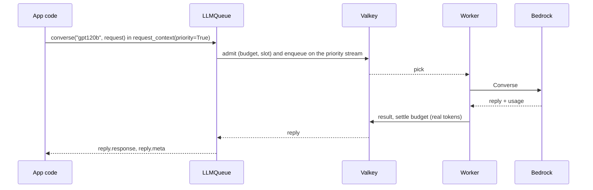

# 01 Converse

Chat with a Bedrock model through the queue: the call most apps make most often. Use it in async
request handlers (FastAPI routes), agent steps, and anything a user waits for.



## Key points

- `LLMQueue.from_env()` reads `LLMQ_*`; `start()` loads the registry and runs the workers in
  this process.
- `request_context(priority=True, session_id=..., user_id=...)` applies to every call inside it.
  Priority calls are read before batch ones.
- `reply.response` is the Bedrock Converse body, unchanged. `reply.meta` says where and how the
  call was served: model, deployment, tokens and time spent waiting.
- `gpt-oss` models also return reasoning blocks; `answer_text` keeps only the text blocks.

## Code

```python title="samples/01_converse.py"
--8<-- "samples/01_converse.py"
```

## Output (live, 2026-11-14)

```text
gpt120b: 'One well-known Indian stock index is the **NIFTY 50** (the benchmark index of the National Stock Exchange of India).'
  served by gpt120b on aws-main/us-east-1, tokens 73/89, queue wait 213 ms
gpt20b: 'Nifty 50.'
  served by gpt20b on aws-main/us-east-1, tokens 73/87, queue wait 48 ms
```

See also: [Make calls](../how-to/call.md), [The life of a call](../explanation/call-lifecycle.md).
