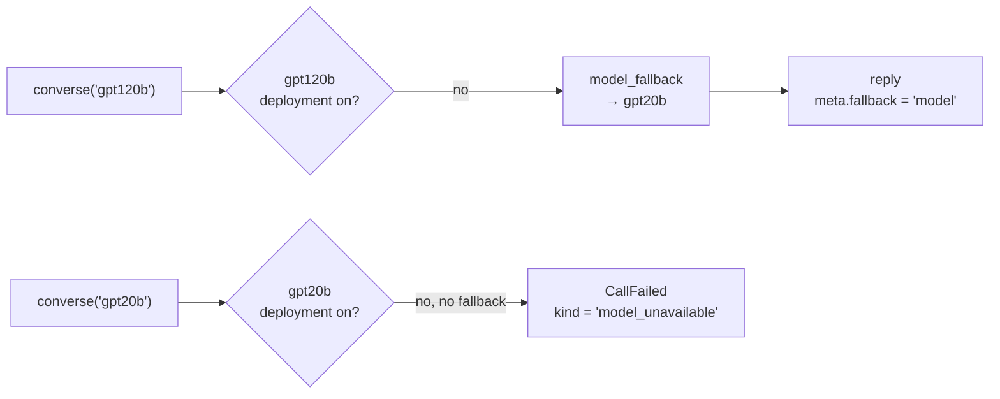

# 05 Errors and fallback

Handle failures with one exception type, `CallFailed`, and a `kind` to branch on. Every caller
needs this: map `kind` to a user message or a retry.



## Key points

- The sample turns deployments off with a live registry edit (what `llm-queue registry disable`
  does), and turns them back on at the end.
- A model with a `model_fallback` rule is served by its fallback model, and `meta.fallback`
  says so.
- A model with nowhere to go fails fast with `CallFailed`. `retry_after_secs` tells you when to
  try again.
- Branch on `kind`:
    - `rate_limited` and `queue_full` mean busy: retry later.
    - `model_unavailable`, `model_disabled` and `no_deployment` mean nothing can serve the
      model now.

## Code

```python title="samples/05_errors_and_fallback.py"
--8<-- "samples/05_errors_and_fallback.py"
```

## Output (live, 2026-11-14)

```text
gpt120b off -> served by gpt20b (fallback=model)
gpt20b off -> CallFailed kind='model_unavailable' retry_after=60.0
```

See also: [Errors](../reference/errors.md), [Failures and recovery](../explanation/resilience.md).
