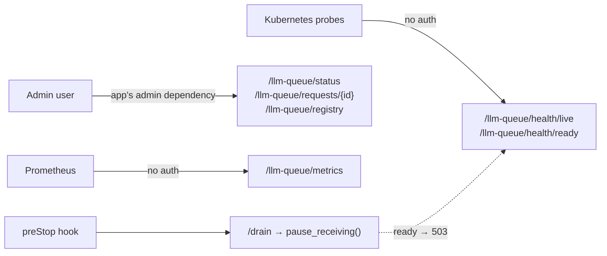

# 09 HTTP router

Mount the queue's health, status and registry routes on a FastAPI app. Use it for the admin
API, Kubernetes probes and the preStop hook.



## Key points

- `llmq.http_router()` returns an `APIRouter` (install the `http` extra).
- `/health/live` and `/health/ready` take no auth, so the Kubernetes probes can reach them.
  Every other route runs the app's admin dependencies (or needs `LLMQ_ADMIN_READ_TOKEN` /
  `LLMQ_ADMIN_TOKEN`); `GET /` lists every mounted route with a live summary.
- Writes (live registry edits, region and account blocks, purges) stay off unless
  `allow_writes=True`. Each write is a dry run unless its body says `"dry_run": false`, and is
  audited under the `actor` you return. Every route is listed in
  [Admin API](../reference/admin-api.md).
- `metrics_route=True` adds `GET /metrics`: the Prometheus exposition of a Prometheus sink
  (`LLMQ_METRICS_SINK=prometheus`, or `metrics=PrometheusSink()` as in the sample; install the
  `metrics` extra). It is open like the probes, so a scraper needs no admin credentials.
- A preStop hook calls `pause_receiving()`. Readiness then fails and no new queued work starts,
  while running calls finish. The sample's `/drain` is the app's own GET route; since 0.2.0 the
  router can serve it (`drain_routes=True`: guarded `POST /drain` and `POST /resume`), and a pod
  with several processes touches `LLMQ_DRAIN_FILE` instead (see
  [Drain a pod](../how-to/operate.md#drain-a-pod)).
- The sample calls the app in process with httpx's ASGI transport, so no port is opened. In an
  app, uvicorn serves the same router.

## Code

```python title="samples/09_http_router.py"
--8<-- "samples/09_http_router.py"
```

## Output (fakellm, 2026-11-16)

```text
GET /health/ready -> 200 {'live': True, 'ready': True, 'worker': '4beb9df1d0551a', 'version': '0.1.0b2', 'registry_version': 1, 'held': 0, 'heartbeat_age_secs': 0.0, 'stores': {'state': 'ok', 'queue': 'ok'}, 'eviction_policy': 'noeviction'}
GET /status without the admin header -> 401
GET /requests/{id} -> done
GET /metrics -> 200, 76 llmq_ series
  aws-main/us-east-1: rpm 5/60
POST /registry without X-LLMQ-Admin -> 403
POST /registry rpm=50 -> [{'path': 'models.gpt20b.rpm', 'before': 60, 'after': 50}]
POST /registry/block us-east-1 on=True -> 200
POST /registry/block us-east-1 on=False -> 200
after /drain: GET /health/ready -> 503
```

The live output will be refreshed on the next live run (`python scripts/samples.py --live`); the
last one, on 2026-11-14, ran this sample before its current code.

See also: [Admin API](../reference/admin-api.md), [CLI and HTTP](../reference/cli-http.md),
[Operate](../how-to/operate.md).
