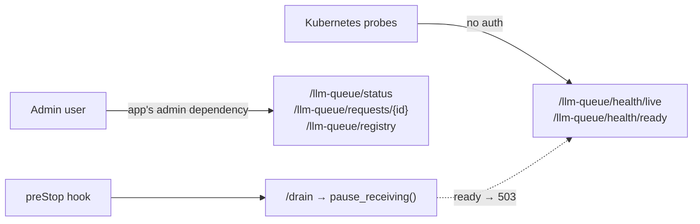

# 09 HTTP router

Mount the queue's health, status and registry routes on a FastAPI app. Use it for the admin
API, Kubernetes probes and the preStop hook.



## Key points

- `llmq.http_router()` returns an `APIRouter` (install the `http` extra).
- `/health/live` and `/health/ready` take no auth, so the Kubernetes probes can reach them.
  Every other route runs the app's admin dependencies.
- Writes (live registry edits, region and account blocks) stay off unless `allow_writes=True`.
  Each write is audited under the `actor` you return.
- A preStop hook calls `pause_receiving()`. Readiness then fails and no new queued work starts,
  while running calls finish.
- The sample calls the app in process with httpx's ASGI transport, so no port is opened. In an
  app, uvicorn serves the same router.

## Code

```python title="samples/09_http_router.py"
--8<-- "samples/09_http_router.py"
```

## Output (live, 2026-11-14)

```text
GET /health/ready -> 200 {'live': True, 'ready': True, 'stores': {'state': 'ok', 'queue': 'ok'}}
GET /status without the admin header -> 401
GET /requests/{id} -> done
  aws-main/us-east-1: rpm 2/60
POST /registry rpm=50 -> [{'path': 'models.gpt20b.rpm', 'before': 60, 'after': 50}]
after /drain: GET /health/ready -> 503
```

See also: [CLI and HTTP](../reference/cli-http.md), [Operate](../how-to/operate.md).
