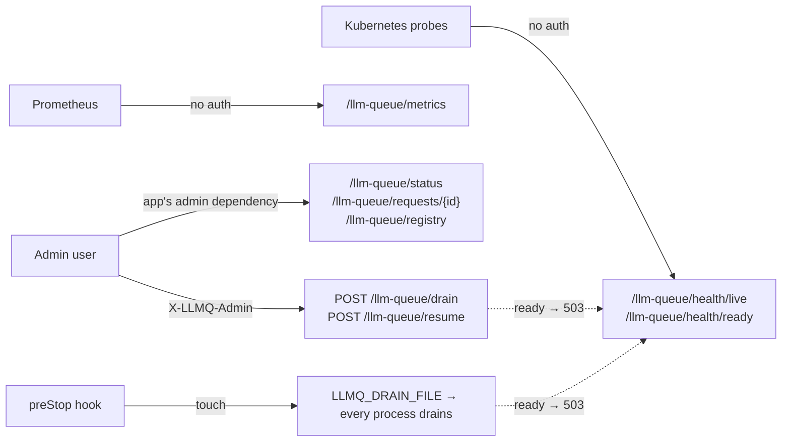

# 09 HTTP router

Wire the queue into a FastAPI app with `llm_queue.fastapi.install()`: health, status, registry
and drain routes. Use it for the admin API, Kubernetes probes and the preStop hook.



## Key points

- `install(app, llmq, ...)` starts and stops the queue with the app and mounts
  `llmq.http_router()` under `/llm-queue` (install the `http` extra).
- The app's admin check compares its secret with `hmac.compare_digest` (constant time), never
  with `!=`.
- `/health/live` and `/health/ready` take no auth, so the Kubernetes probes can reach them.
  Every other route runs the app's admin dependencies (or needs `LLMQ_ADMIN_READ_TOKEN` /
  `LLMQ_ADMIN_TOKEN`); `GET /` lists every mounted route with a live summary.
- Writes (live registry edits, region and account blocks, purges) stay off unless
  `allow_writes=True`. Each write is a dry run unless its body says `"dry_run": false`, and is
  audited under the `actor` you return. Every route is listed in
  [Admin API](../reference/admin-api.md).
- `metrics_route=True` adds `GET /metrics`: the Prometheus exposition of a Prometheus sink
  (`LLMQ_METRICS_SINK=prometheus`, or `metrics=PrometheusSink()` as in the sample; install the
  `metrics` extra). It is open like the probes, so a scraper needs no admin credentials.
- Draining: with `dependencies` and `actor`, `install()` mounts the guarded drain routes.
  `POST /drain` fails readiness and hands held calls back while running calls finish;
  `POST /resume` undoes it; `GET /drain` shows the state. A route reaches one process, so a pod
  with several processes drains through `LLMQ_DRAIN_FILE`: the preStop hook runs
  `touch $LLMQ_DRAIN_FILE` and every process sees it (see
  [Drain a pod](../how-to/operate.md#drain-a-pod)). Never add an open GET that drains: anyone
  could take a pod out of service.
- The sample calls the app in process with httpx's ASGI transport, so no port is opened. In an
  app, uvicorn serves the same router.

## Code

```python title="samples/09_http_router.py"
--8<-- "samples/09_http_router.py"
```

## Output (fakellm, 2026-11-17)

```text
GET /health/ready -> 200 {'live': True, 'ready': True, 'draining': False, 'draining_since': None, 'worker': 'api-7f9c:12-9bb228', 'version': '0.1.1', 'registry_version': 1, 'held': 0, 'heartbeat_age_secs': 0.0, 'stores': {'state': 'ok', 'queue': 'ok'}, 'eviction_policy': 'noeviction', 'key_expiry': 'native'}
GET /status without the admin header -> 401
GET /requests/{id} -> done
GET / -> 51 routes, registry v1
GET /metrics -> 200, 76 llmq_ series
  aws-main/us-east-1: rpm 4/60
POST /registry without X-LLMQ-Admin -> 403
POST /registry rpm=50 (dry run) -> [{'path': 'models.gpt20b.rpm', 'before': 60, 'after': 50}]
POST /registry rpm=50 -> [{'path': 'models.gpt20b.rpm', 'before': 60, 'after': 50}]
POST /blocks us-east-1 -> ['us-east-1']
POST /blocks/remove us-east-1 -> []
POST /drain -> 200
after POST /drain: GET /health/ready -> 503
GET /drain -> 200
POST /resume -> 200
```

The drain lines and the route count (48 plus the three drain routes) follow the 0.2.0 sample,
which mounts the drain routes; the rest is the 2026-11-17 fakellm run. The output will be
refreshed on the next run (`python scripts/samples.py 09_http_router`).

See also: [Admin API](../reference/admin-api.md), [CLI and HTTP](../reference/cli-http.md),
[Operate](../how-to/operate.md).
