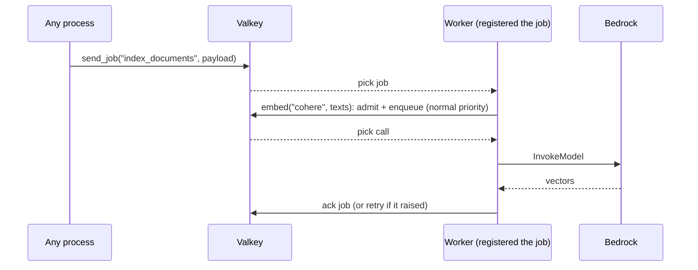

# 06 Jobs

Queued background work that runs at least once, with LLM calls inside it. Use it for
ingestion, nightly re-embedding, and any batch work that should not block a request.



## Key points

- Register the job function in **every worker process** before `start()`. Any process can send
  a job.
- A job that raises is retried, so make it safe to run twice (for example, upsert by id).
- LLM calls inside a job go through the same queue and budgets as user calls, at normal priority.

## Code

```python title="samples/06_jobs.py"
--8<-- "samples/06_jobs.py"
```

## Output (live, 2026-11-14)

```text
sent job 01a1d83e8f6f70ad9f39f456071a3ecd
job finished: {'ids': ['d1', 'd2'], 'vectors': 2}
```

See also: [Background tasks](../explanation/background.md).
