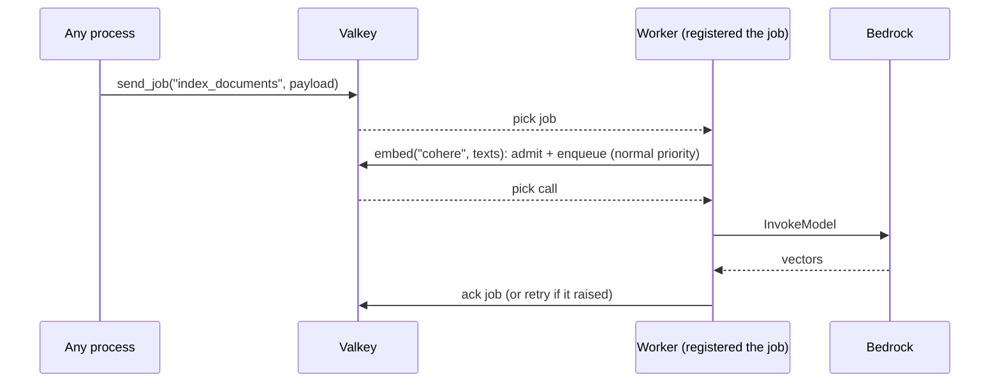

# 06 Jobs

Queued background work that runs at least once, with LLM calls inside it. Use it for
ingestion, nightly re-embedding, and any batch work that should not block a request.



## Key points

- Register the job function in **every worker process** before `start()`. Any process can send
  a job.
- `register_job(..., concurrency=N)` caps the job's runs per process (default 4,
  `LLMQ_JOB_CONCURRENCY`).
- A job that raises is retried, so make it safe to run twice (for example, upsert by id).
- When the retries run out (5 s doubling to 5 minutes, for about an hour) the job is
  **dead-lettered**. `job_dead_letters(name)` lists the dead jobs (id, job id, fails, payload);
  once the cause is fixed, `redrive_jobs(name)` sends them back to run again. The sample cuts the
  retry settings (`LLMQ_JOB_RETRY_*`) to under a second so this shows within the run; an app
  keeps the defaults.
- LLM calls inside a job go through the same queue and budgets as user calls, at normal priority.

## Code

```python title="samples/06_jobs.py"
--8<-- "samples/06_jobs.py"
```

## Output (fakellm, 2026-11-16)

```text
sent job 01a1e2cf3060779aa143b3ba890b7cf6
job finished: {'ids': ['d1', 'd2'], 'vectors': 2}
dead letter: job feed-nse, fails 4
redriven: 1
after redrive: {'feed': 'nse', 'attempt': 1}
```

The live output will be refreshed on the next live run (`python scripts/samples.py --live`); the
last one, on 2026-11-14, ran this sample before its current code.

See also: [Background tasks](../explanation/background.md).
