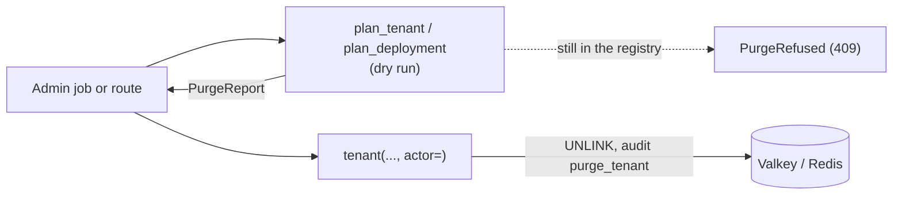

# 10 Purge

Delete the store state of a tenant that left, and plan the purge of a deployment. Use it for
admin jobs, offboarding and runbooks.



## Key points

- `llmq.purge` is the `PurgeService` of a started queue; `PurgeService.from_env()` builds one
  for an admin worker without a queue.
- Every purge has a dry run (`plan_tenant`, `plan_deployment`, `plan_model`, or
  `dry_run=True`) that reports what it would delete and changes nothing.
- Each returns a `PurgeReport`; `report.as_dict()` is JSON-ready for an admin API: keys and
  hash fields deleted, queues, what was skipped and why.
- A real purge is audited (`purge_tenant` in `registry.log`), logged `llmq_purge` and counted
  in `llmq_purged_keys_total{kind}`. The tenant id is hashed as admission hashes it; the report
  names only the hash.
- A purge of state still in use raises `PurgeRefused` (HTTP 409 on the built-in routes): here, a
  deployment the registry still has. `force=True` overrides it.
- The same purges run from the CLI (`llm-queue purge ...`) and the
  [HTTP router](http-router.md) with `allow_writes=True`.

## Code

```python title="samples/10_purge.py"
--8<-- "samples/10_purge.py"
```

## Output (fakellm, 2026-11-16)

```text
plan tenant: {"target": "tenant:c9a7e476bacbbf87", "kind": "tenant", "deleted_keys": 1, "queues": [], "skipped": [], "dry_run": true, "actor": "plan", "deleted_fields": 2, "cancelled": 0}
purge tenant: {"target": "tenant:c9a7e476bacbbf87", "kind": "tenant", "deleted_keys": 1, "queues": [], "skipped": [], "dry_run": false, "actor": "sample", "deleted_fields": 2, "cancelled": 0}
audit: op=purge_tenant actor=sample
plan tenant again: deleted_keys=0
plan deployment aws-main/us-east-1: refused (deployment gpt20b/aws-main/us-east-1 is still in the registry: remove it first, or pass force=True)
plan deployment (force): {"target": "gpt20b/aws-main/us-east-1", "kind": "deployment", "deleted_keys": 3, "queues": [], "skipped": [], "dry_run": true, "actor": "plan", "deleted_fields": 3, "cancelled": 0}
```

This sample has not run on real Bedrock yet; its live output will be added on the next live run
(`python scripts/samples.py --live`).

See also: [Purge store state](../how-to/purge.md), [Errors](../reference/errors.md#purgerefused).
