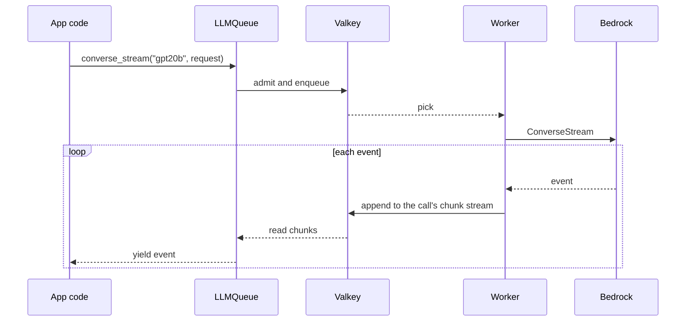

# 02 Stream

Stream an answer as the model writes it. Use it in chat UIs and server-sent events, where the
first words should show at once.



## Key points

- `converse_stream` yields Bedrock ConverseStream events in order: `contentBlockDelta` carries
  the text, and `metadata` carries usage at the end.
- If the stream breaks after some text was sent, `CallFailed` carries `partial_text`, and the
  call is **not** retried, so the user never sees the answer start over.
- Waits are capped by the call's deadline, so a stream never runs past its timeout.

## Code

```python title="samples/02_stream.py"
--8<-- "samples/02_stream.py"
```

## Output (live, 2026-11-14)

```text
A P/E ratio is the price of a stock divided by its earnings per share, showing how much investors are willing to pay for each dollar of earnings. It's used to gauge valuation: a low P/E may suggest a stock is cheap or undervalued, while a high P/E can signal overvaluation or high growth expectations.
  [10 events, tokens 76/142]
```

See also: [Streaming](../explanation/streaming.md).
