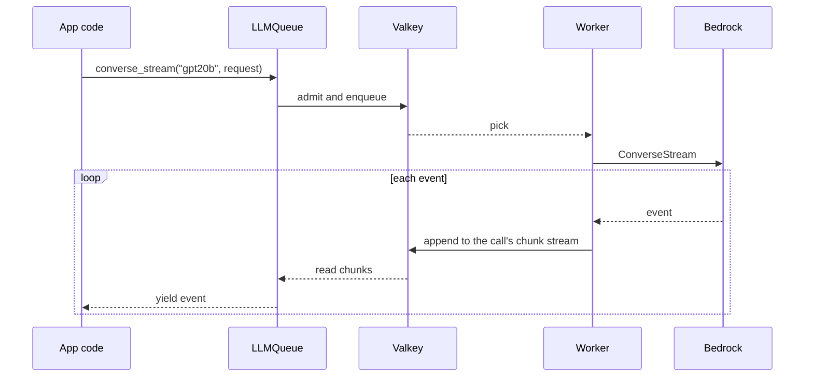

# 02 Stream

Stream an answer as the model writes it. Use it in chat UIs and server-sent events, where the
first words should show at once.



## Key points

- `converse_stream` yields Bedrock ConverseStream events in order: `contentBlockDelta` carries
  the text, and `metadata` carries usage at the end.
- `meta_event=True` ends a complete stream with one event of the library's own,
  `{"llmq": {"usage": ..., "meta": ...}}`: tokens, and the model, deployment, fallback and
  attempts that served it. A streaming caller never gets a `Reply`, so this is where it learns
  them. Do not forward that event to the client.
- `chat_stream` is the same call under the OpenAI name: an OpenAI-compatible model (provider
  `openai`, such as vLLM) yields chat completion chunks, text in
  `chunk["choices"][0]["delta"]["content"]`. The sample registry has only Bedrock models, so
  that part runs only when the registry names one.
- If the stream breaks after some text was sent, `CallFailed` carries `partial_text`, and the
  call is **not** retried, so the user never sees the answer start over.
- Waits are capped by the call's deadline, so a stream never runs past its timeout.

## Code

```python title="samples/02_stream.py"
--8<-- "samples/02_stream.py"
```

## Output (fakellm, 2026-11-16)

```text
fakellm reply 56ea7996fa5ea4c8
  [5 events, tokens 9/8]
  served by gpt20b on aws-main/us-east-1, attempts 1, fallback=None
```

The live output will be refreshed on the next live run (`python scripts/samples.py --live`); the
last one, on 2026-11-14, ran this sample before its current code.

See also: [Streaming](../explanation/streaming.md).
